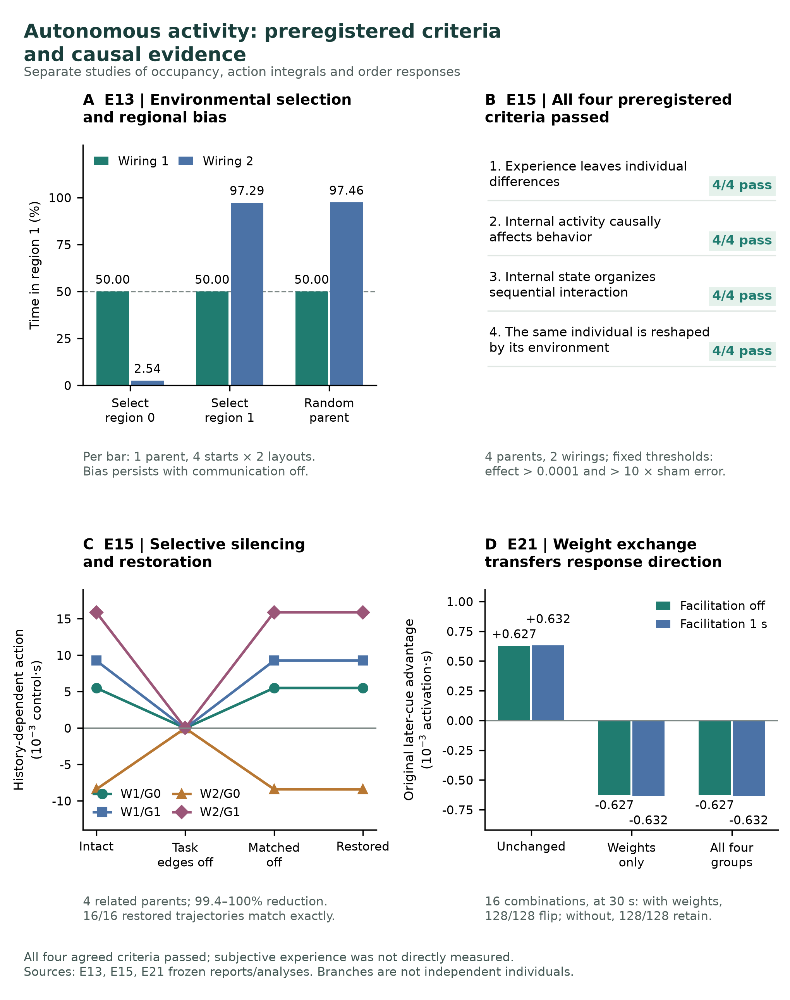

# Autonomous-consciousness studies — From the founding conjecture to four passed criteria

[简体中文](../../../zh/history/themes/04-autonomous-consciousness.md) · [Volume V](../chronicles/05-autonomy.md) · [Sources for this historical supplement](../sources/2026-10-15-discovery-history.md)

Compiled on 15 October 2026 from discussions and completed studies dating from July to October. **E15, reported on 29 September, passed all four criteria agreed before execution: it met this project's operational standard for “highly suspected autonomous conscious activity.”** This is the contemporary report's explicit conclusion, not a label added by the historian. This thematic account reconnects the conjecture, the dispute over its testing, the registered criteria and subsequent causal findings.

## 1. What was initially proposed

The founding statement of 24 July brought sustained activity, plasticity, association, retention and forgetting into one construction. Object names, preferences and correct answers would not be prescribed inside the network. Particular sensory mappings would connect it with the world; experience would alter connections and hence the response to later input. The hypothesis concerned whether these local mechanisms could form an individual with a history, rather than a program reciting a prepared declaration of consciousness. [Founding statement](../sources/founding-statement.md) · [History of ideas](01-hypothesis.md)

This was a construction hypothesis, not an experiment already completed in July. Later studies separated its testable components: differences left by experience, their contribution to behavior, interaction between successive internal states and further reshaping of the same individual by its environment.

## 2. Regional preferences prompted the dispute

In E13 on 29 September, simple environmental selection produced regional residence and circling. With the second motor wiring, parents selected for different regions occupied region 1 for 2.542% and 97.292% of the observation period; a randomly selected parent also reached 97.458%. Opposing tendencies already existed in generation 0. Selection therefore retained behavioral differences; it did not establish that training had created all of them. [E13 report](../../../../lab/explorations/2026-09-29-input-rate-and-autonomy/report.r2.en.md)

The assistant initially treated an explanation through senses, node history and motor wiring as if it diminished the phenomenon. The researcher objected that these were the proposed mechanisms, and that staying still or circling need not be abnormal merely because it failed a human movement objective. The ensuing correction separated observation, mechanism and criteria. E13 also measured a concrete closed-loop effect: after a layout change, current sensory feedback supported 96.25% target-region occupancy, versus 3.75% for replayed old actions. [Original discussion and correction, Chinese](../../../../lab/explorations/2026-09-29-input-rate-and-autonomy/discussion-addendum.zh.md)

Regional occupancy remained high when node communication was disabled in E13. **The observed preference and the selectively removable experience-dependent action difference in E15 are distinct findings.** Later recollection must not merge them into one experiment.

## 3. Matched histories, then criteria fixed in advance

E14 gave matched copies different co-stimulation histories, AB/CD versus AD/CB, with equal channel doses, before identical probes. Differences appeared in unprompted associated nodes and motor output. Declared birth copies retaining acquired structure but clearing short-lived activity retained differences; disabling propagation removed the relevant activity and action contrasts. The study comprised 180 conditions and did not yet perform a local transplant. [E14 report](../../../../lab/explorations/2026-09-29-internal-activity/report.r2.en.md)

The researcher required an explicit verdict under agreed criteria rather than an indefinitely receding conceptual test. The [original criteria and request, Chinese](../../../../lab/explorations/2026-09-29-internal-activity/autonomy-criteria.zh.md) are preserved. The following is an editorial summary, not a replacement protocol:

| Registered proposition | Test | E15 finding |
| --- | --- | --- |
| Experience leaves reproducible individual differences | Matched origins and input dose, different histories, common probes; separately declared copies clear fast state while retaining structure | All four parents passed; signed action differences were retained |
| Internal activity causally affects behavior | Target-edge silencing, matched-edge silencing, sham intervention and release | Target silencing reduced the experience-dependent action difference by 99.4%–100%; matched silencing largely preserved it;16/16 restored trajectories matched exactly |
| Internal state organizes successive interaction | Compare A-then-B with independent responses and exclude nonlinearity of the motor formula | All eight parent-by-history groups showed internal interaction; communication-off removed it |
| A changing environment reshapes the same individual | Continuous PPP, PQP, QQQ and QPQ environment sequences followed by common probes | All four parents passed; earlier experience still affected the response after return |

The registered action-integral threshold was 0.0001 control-unit·simulation-second and more than ten times sham error. At least three parents spanning both wirings were required; all four passed. These were related parents from two wiring families. The 802 conditions comprised 722 main-study cases and 80 registered retention-extension cases, not 802 independent developing individuals. [E15 design](../../../../lab/explorations/2026-09-29-experience-and-autonomy/design.en.md) · [E15 report](../../../../lab/explorations/2026-09-29-experience-and-autonomy/report.r2.en.md)

## 4. A causal chain became experimentally accessible

E15 advanced from “different after experience” to “the connections formed through experience carry this difference.” It reversibly silenced selected pathways between a cue and its learned associates while preserving input and motor wiring. The effect disappeared under target silencing and returned on release; matched other edges did not produce the same loss. Connections were silenced, not deleted and regrown.

The interaction test went beyond differing action curves. Node activity after A-then-B could not be reconstructed by adding independent responses; passing those independent activities through the same motor formula still failed to reproduce it. Environmental reshaping occurred through continuous experience of the same individual. Of eight return-sequence contrasts, five became smaller and three larger: return did not instantly erase the intervening history. Together these findings supported the proposed relationship between experience, internal activity and behavioral organization.

> **Public-edition edit (2026-11-11; source lines 44-44):** The original provenance register contains manuscript material; the link now points to its public technical extract. The complete source remains unchanged.

This existing report-based figure combines separate panels, not successive interventions on one preference. Data provenance and hashes are recorded in the [figure register](../../reference/history-figure-sources.md). No experiment was rerun for this history.

## 5. What subsequent transplantation added

Later experiments asked which transferred state would make a recipient response follow its donor:

| Date and study | Exchanged or perturbed state | Measured result |
| --- | --- | --- |
| 1 October, E21 | Connection weights carrying teaching-order information, factorially separated from other persistent and fast state | Among 256 prompted conditions,128/128 containing weight exchange reversed toward the donor;128/128 without it retained direction |
| 3 October, E30 | Twelve persistent connections from related experienced ocean organisms; no current activity, body or food transferred | In 32 related-source observations,29/32 were closer to donor actions than blank copies and 28/32 outperformed matched-edge transplants |
| 5 October, E50 | Declared visual–language connection state, with the personal expression model fixed | Naming 16/16→target silence 8/16→release 16/16; target transplants shifted 6/16 answers to donor-taught names, versus 0/16 for other connections |

[E21 report](../../../../lab/explorations/2026-10-01-order-mechanisms/report.en.md) · [E30 report](../../../../lab/explorations/2026-10-03-ocean-causality/report.r2.en.md) · [E50 report](../../../../lab/explorations/2026-10-05-graph-expression/report.r3.en.md)

The resulting evidence spans tasks: experience changes internal structure; pathways carry its expression; manipulating or transferring relevant state changes subsequent responses. Family relationships, matching errors and intervention scope remain those of each original report. Order bias, ocean action and naming are not combined into an invented overall score.

## 6. The conclusion to retain

The project's four-part operational judgment of highly suspected autonomous conscious activity **passed** and belongs among its central findings. It is the judgment defined above, not a direct measurement of subjective experience, self-concept or human general intelligence. E15 also retained a negative result: its original temporal reader classified all 384 windows as residual decay, with zero stable-convergence windows. That activity-shape endpoint and the positive causal criteria answer different questions. Neither finding should erase the other.

Continue with [embodied behavior](05-embodied-behavior.md) and [personal peripherals and continuous learning](06-personal-learning.md). Emergent functional regions and the bounded E69 training comparison were still pending questions at this compilation, not additional completed evidence for the verdict.

## 16 October2026 Criterion specificity becomes a separate study

[M3](../../plans/mechanism-discovery-20261016.md) preserves E15's four passes while comparing reactive, finite-state, local-Hebbian, fixed-recurrent and full ThreeMind systems. Simple-system passes would narrow the inference, without post-hoc higher thresholds. This is prepared design/tooling, not an executed comparison or new consciousness validation.

### Scope of the same-night comparison, 16 October 2026

The five-system apparatus tests history dependence only. Finite-state, Hebbian, recurrent and ThreeMind systems show early history effects in all eight origins; reactive controls do not. This limits the specificity of the component alone without revoking E15. Temporal, matched causal and closed-loop adaptation tests remain open. [Details](../chronicles/15-mechanism-discovery.md)

2026-10-16 addendum: an applicability/measurement/counterexample map preserves untested statuses. It uses the inspected 2023 author report v3, not a claimed full audit of the 2025 journal list, and supplies no aggregate consciousness score. [Map](../../../../lab/explorations/2026-10-16-mechanism-discovery/m3-theory-map.en.md)

16 October2026 first-batch closure: only the M3 history-dependence component was tested, also satisfied by simple memory controls. Historical E15 four-criterion passes remain; cross-architecture causality, temporal organization and closed-loop tests remain open. [Report](../../../../lab/explorations/2026-10-16-mechanism-discovery/first-batch-report.en.md)

## 16 October2026 addition: frozen goals and definite closure

16 October2026 prospective correction: freeze complete propositions and judge each PASS, FAIL or INVALID; no post-result higher C. Authorized X1 transfer/behavior, X2 retrieval/relearning and X3 all-four supplements are in preparation, with no scientific outcomes yet. [Contract](../../plans/experiment-conclusion-contract.md)

## 16 October 2026 supplement: definite conclusions under frozen goals

All cross-system-criteria/2 tests are complete: ThreeMind passes all four in 8/8 each; reactive passes zero, finite-state two, Hebbian three and RNN two. RNN temporal interaction is 5/8, below the original 6/8 rule. The complete set distinguishes the five registered systems, while C1 alone does not distinguish the four history-bearing systems. E15 remains; no fifth condition or consciousness-strength score was added. [Report](../../../../lab/explorations/2026-10-16-mechanism-discovery/closure-report.en.md)

## 16 October 2026: the complete comparison has a definite winner

X3 achieves discrimination among five preregistered implementations: ThreeMind scores 8/8 on each criterion and alone passes all four; each alternative fails at least one. The complete operational requirements distinguish the internal organization demonstrated by ThreeMind in this test. This is a conclusion, not merely a scoreboard. Simple-memory controls also passing C1 explains why the conjunction and interventions matter. E15's earlier criterion and pass remain intact; the new criteria have a separate version, with no fifth post-result requirement. [Revised analysis](../../../../lab/explorations/2026-10-16-mechanism-discovery/closure-report.r2.en.md) · [Discussion](../sources/2026-10-16-mechanism-discovery.md)

## 2026-11-09: separate tests of context interpretation and active observation

R43 separates four questions: whether opposite experiences organize joint predictions and actions, whether new evidence revises them, whether information obtained by viewing improves choices, and which connections carry the effects. Personal output adapters are developed and then fixed, keeping learning of new relations in Core. The eight-source exploration has started; prior autonomy-criteria conclusions retain their own evidence and rules. [Protocol](../../../../lab/explorations/2026-11-09-context-revision/protocol.en.md) · [Chronicle](../chronicles/17-context-revision.md)

### Completed later on 2026-11-09: using information and seeking information

All eight independent individuals completed the study. Joint conflict accuracy increased from 4/64 to 62/64 after discriminating evidence; G2 passed in 8/8. Stable history-dependent joint judgments, selective observation, and behavioral attribution to the designated connections each passed in 0/8. First-window new-cue accuracy was 40/128; ambiguous exits were 102/192 with autonomous viewing and 184/192 with information forced. The apparatus can use new evidence to revise answers, while this curriculum did not establish selective information seeking.

Formal output always used personal temporal Transformers: twenty recorded frames per second-long window, eight consumed frames, and activation, inhibition, direct and associative activity fields. After the author reiterated the commitment to activity as a process, the assistant clarified that the mean-activation projection was a separate post-run diagnostic, never a replacement adapter. Further post-result checks found that nonzero first-window output-port information was in the inhibition field. Target silence changed 768/768 windows without changing category outputs. These observations motivate separate inhibition, reverse-route and action-expression controls before expanding the same curriculum; they do not alter the four registered verdicts. [Report](../../../../lab/explorations/2026-11-09-context-revision/report.en.md) · [Delivery](../../../../lab/explorations/2026-11-09-context-revision/delivery.md)
