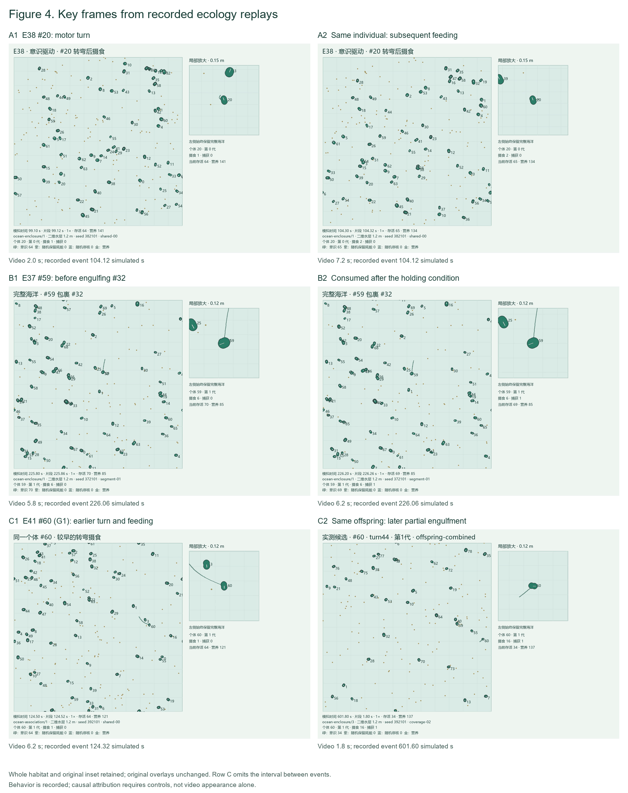

# Embodied behavior — Preferences, turning, predation and inheritance

> Public edition, 2026-11-11: private conversation locators and manuscript/submission discussions are omitted where present. Scientific records retain their original dates; the complete source remains unchanged.

[简体中文](../../../zh/history/themes/05-embodied-behavior.md) · [Volume VII](../chronicles/07-priority-experiments.md) · [Autonomous-consciousness studies](04-autonomous-consciousness.md)

Compiled on 15 October 2026 from reports dated 29 September–6 October. Embodied research followed two connected lines: making internal activity causally participate in action, and giving action consequences through feeding, death, reproduction and communication. This account follows the discoveries from regional preference to the complete ocean, rather than recording only apparatus changes and execution logs.

## From selecting a region to selecting survivors

E13 showed regional preferences and the contribution of current feedback; E14 and E15 then established effects of experience and internal pathways on action. The next question was whether these networks could act through costly bodies and encounter environmental selection through actual survival. [Early causal chain](04-autonomous-consciousness.md)

The initial cup task, E27, produced no successful parent to inherit from: all 24 individuals ultimately died. The researchers retained that failure and moved to a nutrient ocean with more immediate action consequences. E28 recorded 18 worlds and 199 bodies. Survival was 48/48 under Core control,47/48 under random control and 0/24 without movement. Nutrient contact, energy intake, movement and reproduction formed a functioning closed loop; strong random performance showed that the first achievement was the loop itself. [E27 report](../../../../lab/explorations/2026-10-02-survival-transfer/report.r2.en.md) · [E28 report](../../../../lab/explorations/2026-10-03-primitive-ocean/report.r2.en.md)

E29 compared populations and experience sources. Total intake, accumulated living time and intake per living-body-second could move in different directions. The fourth paired confirmation world yielded 952 nutrient intakes for Core control versus 783 for random control; inherited experience did not reliably outperform blank origins in a new sea. These findings motivated closer causal investigation rather than a single label of intelligence or failure. [E29 report](../../../../lab/explorations/2026-10-03-ocean-evolution/report.en.md)

## Acquired connections can transfer part of an action pattern

E30 traced behavior to connections. In 31/32 related-source observations, silencing relevant pathways reduced unprompted activity and changed action. Immediate release restored identical action in 32/32. Transferring 12 persistent connections into channel-aligned blank birth copies made 29/32 closer to the experienced donor than blank copies, and 28/32 closer than matched-edge transplants. Current activity, bodies and food were not transferred. **A part of the behavioral response could therefore travel with acquired local connectivity.** [E30 revised report](../../../../lab/explorations/2026-10-03-ocean-causality/report.r2.en.md)

In-world interventions also changed individual fates, but their scope matters. The old E30 example involving organism 37 intervened on eligible members of the population, not on 37 alone. E31 separately checked single-organism interventions and exposed the consequences of extracting a body into a simplified scene. E32 subsequently retained the complete ocean and its state. These corrections placed later action videos in their actual shared environment. [E31 scope correction](../../../../lab/explorations/2026-10-03-ocean-behavior/report.en.md) · [E32 full-ocean report](../../../../lab/explorations/2026-10-03-ocean-community/report.r2.en.md)

## Turning and predation were recorded actions

On 4 October, the ocean studies yielded concrete events that can be inspected frame by frame. E37 organism 59 completely enclosed and consumed 32 at 226.06 simulation seconds. Across E37 and E38, ten source identities produced turning-then-feeding episodes, with fourteen subsequent living snapshots archived. E38 organism 20 changed heading 50.7 degrees in the five seconds preceding ingestion at 104.12 seconds; organisms 44 and 59 repeated such episodes hundreds of seconds apart. [E37 report](../../../../lab/explorations/2026-10-04-ocean-enclosure/report.r2.en.md) · [E38 bilingual turning record](../../../../lab/explorations/2026-10-04-ocean-species/turning-and-closeout.md)

The screen considered motor commands, water-relative heading, angular velocity, nutrient gradients and actual ingestion, excluding collisions within the observation window. It did not add a “turn toward food” policy. Here autonomous turning means actual turning produced through the organism's control chain without step-by-step teacher direction. Whether this constitutes a learned, generalizable pursuit strategy is a further causal question; it does not erase the recorded turn and ingestion.

> **Public-edition edit (2026-11-11; source lines 29-29):** The original provenance register contains manuscript material; the link now points to its public technical extract. The complete source remains unchanged.

These existing E38, E37 and E41 screenshots come from recorded experiments, not reconstructed demonstrations. Simulation times, video positions and hashes are separately recorded in the [figure provenance register](../../reference/history-figure-sources.md). Complete and partial enclosure used different environmental rules.

## From parental candidates to natural descendants

Turning and engulfment candidates initially appeared separately. E38's cross-check of all successful engulfment events found no identity with evidence of both. E39 and E40 reached 900 simulation seconds without a new complete-enclosure success. E41 therefore branched one complete 300-second ocean into two declared environments: one prohibited inter-organism consumption; the other permitted partial enclosure subject to at least 50% coverage and holding conditions.

E41 recorded 18 partial-enclosure consumptions,56 new turning-then-feeding episodes and 53 candidate snapshots. **Six identities exhibited both behaviors, including two naturally born descendants; four individuals consumed others more than once.** Natural G1 descendant 60, for example, had a turning-feeding event at 124.32 seconds and partial engulfment at 601.60 seconds. Body and network ancestry could now be linked to observed events. [E41 revised report](../../../../lab/explorations/2026-10-04-ocean-split/report.r3.en.md)

The established findings are inheritance of body/connection state and the recurrence of these behaviors in natural descendants. E41's parental-improvement screen triggered zero cases; related branches are not independent generational replications. Stable skill advantage improving through inheritance and selection remains a separate test. Nor does success under partial enclosure rewrite earlier complete-enclosure failures.

## Actions reached other organisms

E53 connected mouths to other bodies' ears through a medium with attenuation and delay. Blocking peers' sound changed first-second actions in 39/42 and 38/40 organisms in the two environments. Auditory-edge interventions and release further implicated internal pathways. Inspection also found that the original apparatus submitted simultaneous auditory and bodily measurements separately, preventing their joint experience from forming cross-sensory edges. Under a separately declared environment protocol/2,34/34 and 36/36 living organisms formed those connections. This was an important apparatus discovery for learnable communication; coordinated hunting, linguistic reference and reliable cooperative benefit remained distinct questions. [E53 report](../../../../lab/explorations/2026-10-06-ocean-communication/report.en.md) · [Volume VIII](../chronicles/08-embodied-communication.md)

The achievements of this line are concrete: sustained networks operated bodies that consumed energy, fed and reproduced; acquired local pathways altered and partially transferred actions; turning, predation and descendant behavior occurred in complete environments. These discoveries, together with the negative results, are the substance of the embodied research history.

> **Public-edition edit (2026-11-11; source lines 45-49):** Manuscript text, writing/submission discussion or links to non-public manuscript documents are omitted. Where a paragraph mixed these with research information, the research information is retained in this public extract. The complete source remains unchanged.

> **Public-edition edit (2026-11-11; source lines 52-52):** Manuscript text, writing/submission discussion or links to non-public manuscript documents are omitted. Where a paragraph mixed these with research information, the research information is retained in this public extract. The complete source remains unchanged.

> **Public-edition edit (2026-11-11; source lines 54-54):** Manuscript text, writing/submission discussion or links to non-public manuscript documents are omitted. Where a paragraph mixed these with research information, the research information is retained in this public extract. The complete source remains unchanged.

> **Public-edition edit (2026-11-11; source lines 56-56):** Manuscript text, writing/submission discussion or links to non-public manuscript documents are omitted. Where a paragraph mixed these with research information, the research information is retained in this public extract. The complete source remains unchanged.

> **Public-edition edit (2026-11-11; source lines 58-58):** Manuscript text, writing/submission discussion or links to non-public manuscript documents are omitted. Where a paragraph mixed these with research information, the research information is retained in this public extract. The complete source remains unchanged.

## 19 October 2026: Review of event counts and behavioral attribution

This public extract retains the technical correction from the same-day record: 44 and 59 in the E38 register are individual IDs, not event counts; ten source individuals contribute 14 diagnostic candidate states. The original worlds, trajectories and reports are unchanged.

The E39/E41 recordings document natural G1 individual 60 feeding at simulated 124.32 s and partially engulfing prey at 601.60 s; the clips are not consecutive. E56 actual pointing scores were 24/24 intact, 19/24 with designated connections silenced, and 24/24 after restoration. E57 peripheral-recognition and short-term-state attribution, and E58 connection effects in the first source with nonreplication in the second, remain separate results. Motor intention in those experiments denotes the selected target location, with movement executed by a servo controller.

[Turning register](../../../../lab/explorations/2026-10-04-ocean-species/turning-and-closeout.md) · [Offspring report](../../../../lab/explorations/2026-10-04-ocean-split/report.r3.en.md) · [Attribution report](../../../../lab/explorations/2026-10-06-choice-attribution/report.r2.en.md)

## 13 November 2026: birth conditions for 6.0 aquatic revalidation

Version 6.0 now inherits persistent connections and decay age, with an optional reset-age control; fast state and the internal clock are initialized anew. Multigeneration ecological engineering verified inheritance, energy accounting and exact recovery. Feeding, selection and capture revalidation has not begun because advancement cost crossed the registered stop. Reproduction capability and adaptive benefit remain separately tested questions. [Chapter 19](../chronicles/19-kernel60.md)

On 21 November 2026 the 6.3 water-world reruns opened with the feeding comparison. Separate registrations cover the earlier food-supply comparison and the new scavenging hypothesis. The latter retains negative-return meals and traces individual income, movement and shell costs, births and descendants. [Chapter 20](../chronicles/20-artificial-selection.md)

Later that day the author requested measurements of turns before feeding. Study P1 varies grain replenishment between worlds with the same starting state. It distinguishes live kills, scavenging and predation among close relatives, and follows the survival of actual offspring. This permits a comparison of who hunts when food is scarce and who leaves more descendants. [P1 protocol](../../../../lab/explorations/2026-11-21-ocean63-p1/protocol.en.md)

On 22 November, a P1 individual less than five seconds old had eaten its own parent. P2 separates the size at birth from the inherited adult target and charges the body for growth. It records individual births, parental feeding, evasive turns and the number of surviving children per parent. [P2 protocol](../../../../lab/explorations/2026-11-22-ocean63-p2/protocol.en.md)
