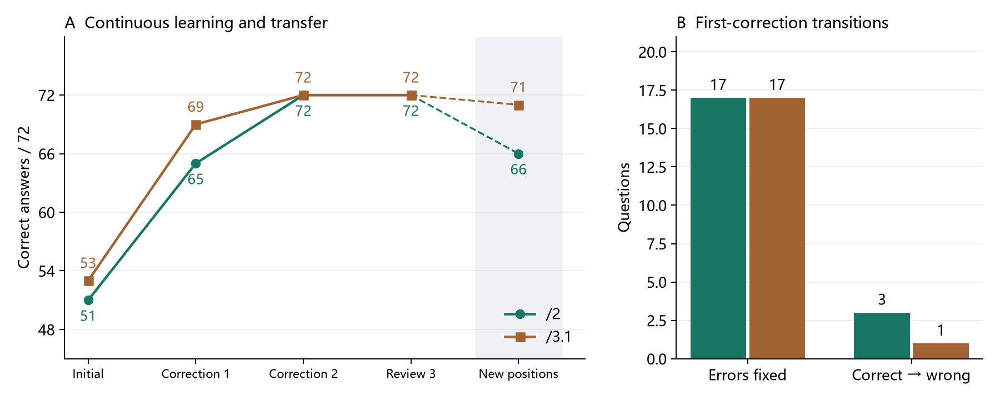

# Co-learning — Personal expression models, four-field pointing and continuous shape–color learning

[简体中文](../../../zh/history/themes/06-personal-learning.md) · [Volume VIII](../chronicles/08-embodied-communication.md) · [Volume XIII](../chronicles/13-shape-color-causality.md)

Compiled on 15 October 2026 from completed work dated 5–13 October, with later unfinished questions marked separately. This research asks whether a network without prescribed word meanings can acquire readable information through experience, express and act through a peripheral trained on its activity, and continue developing. It has produced concrete achievements in limited naming, physical pointing and continuous shape–color learning, while separating failures to read from failures to learn.

## 1. Learning the individual's internal patterns

E46 compared shared, personal, developmentally updated and equal-data cold-trained Transformer expression models. Visual naming was 7/12 with a model calibrated to the individual's associative activity, versus 2/12 with one calibrated to other individuals. Direct-sensory-only calibration scored 0/36 on cross-sensory tasks. **Learning the particular individual's internal activity improved expression under these conditions**, giving empirical support to a personal-peripheral research direction. [E46 report](../../../../lab/explorations/2026-10-05-native-language/report.en.md)

Training in stages at 24,72 and 266 seconds did not beat cold training on the same combined data. A frozen expression model also failed to follow new correspondences taught only to Core. Personal calibration, universal necessity of one-to-one pairing and an advantage of co-development are therefore distinct propositions. In this study the output peripheral learned Core activity in stages; the input encoder remained fixed and Core received no backpropagated gradient.

## 2. Different histories can make the same object receive different names

E47 jointly calibrated original and reversed mappings, then tested held-out stimulus strengths and views. Across three new sources, two teachings and two observation times, visual naming reached 48/48. The expression model did not receive question text, object identifiers or a current answer table. In a readout excluding direct visual channels, all 24 correct names at 592 seconds disappeared under visual–language edge silencing, while equal-count other-edge silencing retained 24. **Learned cross-sensory correspondences inside the network could be expressed as names through a small Transformer.** This study included a research readout based on prompted minus same-state unprompted activity, distinct from later raw local-process reading. [E47 report](../../../../lab/explorations/2026-10-05-expression-alignment/report.r3.en.md)

E50 used the local process actually reached by activity, with a personal model for each source. Early original/reversed teaching answers totaled 74/80 across two sources; a same-architecture current-sensory-only control reached 50%, the limit imposed by assigning different names to identical objects across histories. With the expression model fixed, target-edge silence changed 16/16 to 8/16, matched other-edge silence retained 16/16 and release restored 16/16. Target connection-state transplantation shifted 6/16 answers to donor-taught names, compared with 0/16 for other-edge transfer. The achievement advanced from fitting output to demonstrating that some answers use internally acquired experience. [E50 report](../../../../lab/explorations/2026-10-05-graph-expression/report.r3.en.md)

A substantial bottleneck remained: after Core learned correspondences unseen by the frozen expression model, the relevant E50 tests scored 0/20. E52 explored personal peripherals co-learning with Core without obtaining reliable expression of new experience. Subsequent work thus addressed both content formation and keeping the reader aligned, rather than merely adding harder language tasks. [E52 report](../../../../lab/explorations/2026-10-05-coadaptive-language/report.en.md)

## 3. A misaligned reader is not the disappearance of memory

The same raw state could become readable under a different calibration. For E49 source 223, same-time calibration changed late-state performance from 1/8 to 8/8; cross-state calibration reached 24/24. This directly demonstrated a change in readout coverage without reteaching that recorded Core state. [E49 report](../../../../lab/explorations/2026-10-05-bus-expression/report.r2.en.md)

This connects with the earlier order studies: structure may retain history without strongly expressing it in a chosen window; the peripheral must still learn to use the available process. Later continuous-learning work therefore preserved personal weights, Adam, random state and recent windows alongside Core, because together they determine the complete individual's next answer. [Memory mechanisms](03-memory.md) · [Whole-system continuity](../../plans/system-continuity-audit.md)

## 4. Four-field selection became physical arrival

E54 and E55 had working motor chains but unreliable instructed pointing. E56's decisive change was a shared reading rule across four visual fields, retaining 4×4 sensing, bodily background and Core dynamics. A reader was selected using development material, then confirmed on reserved layouts. Color, shape and conjunction questions each contributed eight trials: **24/24 correct selections and 24/24 physical arrivals**. The actuator moved to the reader's selected position; scoring truth did not command the hand. [E56 report](../../../../lab/explorations/2026-10-06-vision-correction/report.r2.en.md)

| E56 condition | Selection and arrival | Interpretation |
| --- | ---: | --- |
| Normal Core with fixed shared reader | 24/24 | Reserved-layout confirmation |
| Existing edges silenced in matched copies, reader unchanged | 19/24 | Five answers affected |
| Silencing released | 24/24 | Normal selections restored |
| Structural learning disabled from birth, separately fitted equal-budget reader | 24/24 | Peripheral recognition can also solve this architecture's task |

Sharing here means across fields, not requiring all individuals to use one expression model. The working chain read activity, selected a point and used a physical servo. It allowed the peripheral to perform part of recognition, unlike E69's later stepwise eye/hand MOVE/WAIT learning. Existing-edge effects and peripheral recognition coexist; the complete system's24/24 remains an actual functional achievement.

## 5. A complete individual carries correction into the next question

The researcher subsequently made developmental continuity explicit for ordinary lessons and tests: preserving Core alone while replacing its peripheral is insufficient, as is returning to the pre-exam state before each question. The differing E61 and E67 procedures and corrections remain recorded. E68 began separately with two new complete blank individuals using `continuous-memory/2` and`/3.1`, each retaining its own expression model, optimizer, random state, body and recent activity.

Each experienced 1555 simulation seconds,514 teaching statements and three correction/review rounds. Ordinary test experiences carried into the next question; peripheral calibration retained its final update state. During inference the eight-word temporal Transformer received only four Core activity channels, without a raw-image or scene-answer bypass. The apparatus held eye and hand fixed for a clear centered view and had no action head. [E68 report](../../../../lab/explorations/2026-10-13-continuous-shape-color/report.en.md)

| Continuous stage | `/2` | `/3.1` |
| --- | ---: | ---: |
| Initial development test | 51/72 | 53/72 |
| After first correction | 65/72 | 69/72 |
| Second and third development retests | Both 72/72 | Both 72/72 |
| Final new-position test | **66/72 (91.67%)** | **71/72 (98.61%)** |
| Final paired shape and color answers both correct | 26/32 pairs | 31/32 pairs |

The first correction repaired 17 previous errors in each group while introducing three and one errors on formerly correct questions. The second removed the remaining errors. **The complete teaching, personal-peripheral updating and correction procedure worked, with high final accuracy at untaught positions.** Development and final transfer results remain separate; paired answers do not mean uttering both attributes in one sentence. One individual per version and one seed support this batch's finding, with general version rankings left to independent repetition.

> **Public-edition edit (2026-11-11; source lines 58-58):** The original provenance register contains manuscript material; the link now points to its public technical extract. The complete source remains unchanged.

This is an existing measured-results figure, not a rerun for the history. See its [provenance](../../reference/history-figure-sources.md). Version `/3.1` scored higher in this batch but required 1.896 times the native advancement time of `/2`; accuracy, speed and size remain separate findings.

## 6. Achievements and bottlenecks shaped the next questions

At compilation, E69 had improved development gaze scores but persistent WAIT outputs during eye–hand work; its complete final test was not an already completed report. Repeated early hand-wait examples were a documented training-history basis for a consolidation explanation, still awaiting causal comparison. Read-only functional-region analysis and bounded combined training improvements were registered, pending or conditional work. [Stage records and user statements](../sources/2026-10-13-eye-hand-shape-color.md)

These questions neither erase limited naming in E47/E50, physical pointing in E56 and continuous shape–color learning in E68, nor turn those achievements into an E69 success. The research progressively gave “internally acquired information,” “a peripheral able to read it” and “a whole individual learning continuously and transferring performance” concrete tasks, measurements and intervention witnesses.

## 16 October 2026: fixed personal expression and causal readout comparison

E50/E52 had exposed failure to express new associations through fixed personal readers. M5 does not retrain those historical individuals. New origins separate Core learning from reader relearning: after old-course calibration both readout scopes answer old cues, but teaching Core alone yields new 64/64 through ports and 0/64 through all activity. Target, matched and restored connections separate local roles for new and old associations. Fixed expression and selective attribution meet their complete registered goals.

Offline crossing further shows that continued all-activity calibration can assign new labels to activity saved before new Core teaching. Port expression requires post-teaching activity. This separates expression of Core-learned associations from added cue-label mappings in the peripheral. Port joint cues remain 16/32; singleton success does not hide their distinct denominator. E69 WAIT causes are not retroactively assigned, and its pause remains.

All seven prospective decisions are complete: four PASS and three FAIL. The archive is 825,858,105 bytes with 2,080 manifest files (2,081 ZIP entries including the manifest), SHA256 `b05aa9c8e1667765af101ef17c43ec351da3e8c1182f4a7a5261c2c5c00dfe99`; full API download matches member by member. Recalculation is by the executing assistant, not external-researcher replication.

[Report](../../../../lab/explorations/2026-10-16-mechanism-discovery/m5-report.en.md) · [Delivery](../../../../lab/explorations/2026-10-16-mechanism-discovery/m5-delivery.en.md)

## 16 October 2026: new learning and expression have been separated

M5 positively supports Core history learning: reader weights are fixed first, later Core teaching forms new associations, and the port reader expresses 64/64. Selective intervention, matching and rescue establish causal contribution. The full-activity reader on the same Core remains in WAIT, showing that old calibration does not guarantee new-history expression. Its recalibration succeeds even on pre-teaching activity, demonstrating peripheral cue–label learning as another route. Core learning through a fixed interface is the favorable result; failed transfer by the old full-activity reader is the unfavorable result. They are compatible conclusions. This is a passive-expression terminal; E69 eye/hand WAIT causes retain their own evidential requirements. [Revised report](../../../../lab/explorations/2026-10-16-mechanism-discovery/m5-report.r2.en.md)

## 1 November 2026: brief expression versus sustained use

R42 places a taught zero-break preference in continuous 3-SAT search. Normal and shuffled teaching both solve 98/192; WalkSAT solves 172/192. Target connections have a 0.829-point local choice effect, below the registered 20 points, and actual solving benefit also fails. Nonzero preference scores cease 21.11–26.91 internal seconds after teaching; connections subsequently fail to persist. This rejects the current apparatus's sustained-use expectation and identifies continuous expression as a concrete next question. It does not rewrite M5's positive short-course fixed-reader result. [Chronicle and evidence](../chronicles/16-sat-pilot.md)

## 1 November 2026: mandatory teaching and the SAT rerun

The first SAT apparatus omitted spaced review, correction and personal temporal readout, so it did not represent the prescribed complete-student procedure. The author requested a compliant rerun without half-life changes. v2 registers new materials and students, calibrates personal Transformers and preserves whole-state continuity. System benefit, additional Core-teaching benefit and the rule reference receive separate conclusions. Peripheral scores do not become Core learning claims, and measured system ability remains explicit. [Chronicle and conclusions](../chronicles/16-sat-pilot.md)

## 1 November 2026, further: direct exclusions of Core necessity in the SAT apparatus

The author requested clearer exclusions. Prospective inspection found zero edges at the final teaching and final-test boundaries in all eight normal v2 parents. Silencing those edges would be a no-op, so whole-Core replacements, bypasses and information-negative controls were separately registered while preserving the complete parents.

On new formulas, intact, exactly restored, untrained-Core, no-Core relay, untrained static-template and freshly trained no-Core-reader arms, plus the direct zero-break rule, all solve 161/192. Each replacement reproduces all 208 intact action trajectories step by step. Old readers remain frozen; fresh peripherals begin at zero updates and receive no old Core activity. Old/new constant-input readers solve only 103/192 and 103/192; local and solving losses meet the prospective thresholds. Q1, Q2a, Q2b, Q3 and both Q4 targets close explicitly.

The scientific conclusion is that this solver does not require previous Core experience or online Core processing. External code computes break counts and searches; the reader learns the local zero-break preference. Current category information helps, while a memoryless relay can replace Core's transformation. v2's whole-system benefit remains recorded, with its sufficient components now identified. This result is unfavorable to attributing the present SAT scores to Core learning; further repetition of the same curriculum is not pursued as evidence of Core reasoning. This research judgment follows the new exclusions and starts no new task.

Separate arithmetic code verifies 2288 trajectories, 1728 complete-state transitions and all final reader predictions. Restoration is exact; parent files and both old archive hashes remain unchanged. Bilingual protocols/reports and the complete archive are read back through the local unified research API: completed/verified/pending=0. Assistant verification is distinguished from external replication. Core, half-life, old studies, automations and manuscripts are unchanged.

[Exclusion report](../../../../lab/explorations/2026-11-01-sat-core-exclusion/report.en.md) · [Delivery](../../../../lab/explorations/2026-11-01-sat-core-exclusion/delivery.md)
