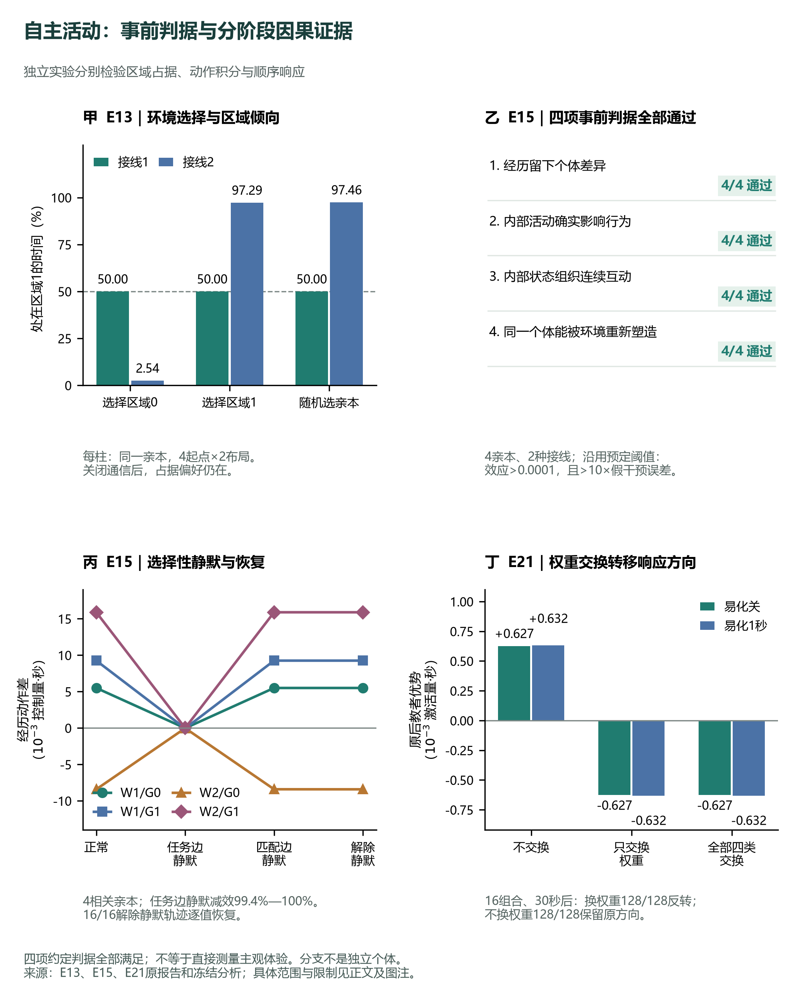

# 自主意识列传　从创始猜想到四项判据通过

[English](../../../en/history/themes/04-autonomous-consciousness.md) · [通史卷五](../chronicles/05-autonomy.md) · [本次补史的原话与证据表](../sources/2026-10-15-discovery-history.md)

2026-10-15补编，追述2026-07至10月的原始讨论与已完成实验。**2026-09-29的E15明确通过了事前约定的四项判据，结论为“符合本项目高度疑似自主意识活动的操作标准”。** 这一结论不是后来编史时加上的评价，而是当时报告的明确验收结果。本传把提出问题、固定标准、实验检验和后续因果证据集中叙述，避免读者只能在工具与运行记录中寻找它。

## 一、最初要构造的是什么

7月24日的创始陈述把持续活动、可塑、联想、保持和遗忘放在同一个设想中：网络没有研究者预先写好的物体名称、偏好或正确答案，输入与世界之间由具体感官映射联系；经历改变连接，后来到来的刺激因而可能唤起不同的内部活动和响应。意识假设的研究重心，是这些局部机制能否共同形成有历史的个体，而不是让一个固定程序输出预写的意识宣言。[创始原文](../sources/founding-statement.md) · [思想演变](01-hypothesis.md)

这仍是当时提出的构造假设，不能倒写为7月已经完成自主意识验证。后来的工作逐步把它拆成可检验的问题：不同经历是否留下差异；这些差异是否真的参与行为；前后活动是否相互作用；同一个体是否继续受环境塑造。

## 二、区域偏好引出了对“自主”的争论

9月29日，E13的简单环境选择出现区域停留与绕圈。第二套运动接线中，选择不同区域后得到的亲本，对区域1的占据分别为2.542%与97.292%；随机选择亲本也达到97.458%。这是偏好差异与选择保留的实际现象。第0代已有相反倾向，说明不能把全部差异都归为后来学习创造。[E13修订报告](../../../../lab/explorations/2026-09-29-input-rate-and-autonomy/report.r2.zh.md)

助手一度把“感官、节点经历和固定运动接线能够解释它”写成对现象价值的否定。研究者反驳：这正是所设想的实现机制；停留与绕圈也可能是偏好，不能因不合人的移动目标便视为异常。讨论因此分清现象、机制和判定标准。E13还有一个具体发现：改变布局后，依赖当前反馈的目标占据为96.25%，旧动作回放仅3.75%，显示行为与当下环境构成闭环。[原始争论及更正](../../../../lab/explorations/2026-09-29-input-rate-and-autonomy/discussion-addendum.zh.md)

E13关闭节点通信后，区域占据仍然较高。**因此，“区域偏好存在”与后来“经历动作差被选择性消除”必须分别记载。** 后者来自E15，不应借回忆中的概括替换前者的原始结果。

## 三、先用同源个体分离经历，再约定验收标准

E14把先天条件和当前输入尽量配平：同源副本分别经历AB/CD或AD/CB的共同刺激，各通道剂量相同，再接受相同提示。差异不仅出现在直接受刺激的节点，也出现在未直接提示的关联节点和运动输出。清除短时活动、保留经历结构的公开出生副本仍有差异；关闭传播后，相关活动差和动作差归零。这把研究从观察偏好推进到检验经历留下的内部因果作用。E14共180项条件，尚未做局部移植。[E14报告](../../../../lab/explorations/2026-09-29-internal-activity/report.r2.zh.md)

研究者同时要求：既然双方约定了可检验的判据，结果出来后就必须明确回答通过与否，不能不断退回没有终点的概念争论。原话是：

> 本轮实验结束后，按照我们商定的标准，对于ThreeMind有无高度怀疑的自主意识活动，应有明确的命题结论，不能再不知可否、闪烁其词。

原文与四项标准见[事前判据](../../../../lab/explorations/2026-09-29-internal-activity/autonomy-criteria.zh.md)。以下为编者概括，非改写原判据：

| 事前命题 | 怎样检验 | E15实际验收 |
| --- | --- | --- |
| 经历留下可再现的个体差异 | 同源、等剂量、不同经历，随后给相同输入；另用保留结构而清除快态的研究副本 | 四个父本均通过，经历动作差的方向与大小保留 |
| 内部活动因果性地影响行为 | 目标连接静默、匹配连接静默、假干预和解除静默 | 目标静默削弱99.4%—100%的经历动作差；匹配干预基本保留；16/16恢复轨迹逐值一致 |
| 内部状态组织连续互动 | 比较先A后B与独立响应之和，并排除运动公式自身的非线性 | 八个父本×历史组合均出现内部相互作用；关闭通信后该作用归零 |
| 同一个体能被变化的环境重新塑造 | 连续经历PPP、PQP、QQQ、QPQ三段环境，再统一测试 | 四个父本均通过；返回旧环境后仍带有此前经历的影响 |

动作积分的预设门槛为0.0001控制量·模拟秒，并须超过假干预误差十倍；要求至少三个父本且覆盖两套接线，实际四个父本全部达到。四个父本来自两套接线家系；802项为722项主实验加80项登记追加条件，不是802个独立成长个体。[E15设计](../../../../lab/explorations/2026-09-29-experience-and-autonomy/design.zh.md) · [E15验收报告](../../../../lab/explorations/2026-09-29-experience-and-autonomy/report.r2.zh.md)

## 四、通过意味着一条实际的因果链成立

E15最重要的推进，是把“经历以后不同”进一步定位为“经历形成的连接通路承担了这种差异”。它可逆地阻断提示与已学关联节点之间的目标连接，保留输入与运动接线；影响随目标阻断消失，随解除阻断回来，匹配的其他连接则没有造成同样损失。这里是静默，不是删除连接以后重新生成一个替代网络。

连续互动检验也没有止于动作曲线看起来不同。先A后B产生的节点活动，不能由两次独立响应相加来重建；把独立活动再送进相同运动公式，仍无法复现。环境塑形则在同一个体的连续经历中发生：返回原环境的八个顺序对照，五个差异缩小、三个增大，显示历史影响而非一换环境便回到原状。这些结果共同支持原先关于经历、内部活动与行为组织的猜想。

> **公开版删节／调整（2026-11-11，原文件第48-48行）：**原来源总表含稿件内容，现改链到仅含科研信息的公开来源说明。完整原件未改。

此图沿用已生成的报告汇总图；各面板来自不同实验，不能连读为同一项偏好的一次消融移植。数值、来源和哈希见[图表依据](../../reference/history-figure-sources.md)。本次补史未重新运行实验。

## 五、移植证据随后补上了什么

E15之后的研究把“改变内部状态会改变行为”进一步推进到“转移哪一部分状态，响应就跟随哪一部分”。三组结果各有自己的对象：

| 日期与实验 | 转移或干预的对象 | 实测发现 |
| --- | --- | --- |
| 10月1日，E21 | 教学先后形成的连接权重，与其他持久／快速状态作因子交换 | 256个有提示条件中，含权重交换的128/128随供体方向反转，不换权重的128/128保留；定位的是顺序响应的载体 |
| 10月3日，E30 | 同源海洋个体的12条持久连接；不移入当前活动、身体或食物 | 32次相关来源观察中，29/32比空白更接近经历供体的动作，28/32优于匹配连接移植；显示部分动作模式可随连接转移 |
| 10月5日，E50 | 固定个人表达器时，视觉—语言相关连接及所声明的连接状态 | 正确命名16/16→目标静默8/16→恢复16/16；相关连接移植使6/16回答转向供体所教名字，其他连接移植为0/16 |

[E21报告](../../../../lab/explorations/2026-10-01-order-mechanisms/report.zh.md) · [E30报告](../../../../lab/explorations/2026-10-03-ocean-causality/report.r2.zh.md) · [E50报告](../../../../lab/explorations/2026-10-05-graph-expression/report.r3.zh.md)

由此形成的是跨任务的证据链：经历塑形，通路承担表达，相关状态的改变或转移能够改变后来响应。每项的家系、匹配误差和干预范围仍按原报告保留，不把顺序偏向、海洋动作和物体命名合成一个未经测量的总分。

## 六、怎样准确记住这项发现

本项目所约定的“高度疑似自主意识活动”判定已经通过，应该作为重要研究结论明确写进通史。其定义是上述四项操作命题，不等同于直接测量主观体验、自我概念或人类通用智能。E15原时序读取器的384个窗口仍全部归类为残余衰减、稳定收敛为零；这是另一种活动形态的阴性结果，与四项因果判据的阳性结果一并保存。既不把未测问题添进通过范围，也不以未测问题撤销已经通过的命题。

后续具身行为见[具身行为列传](05-embodied-behavior.md)，个人外设和持续学习见[共同学习列传](06-personal-learning.md)。自然功能区域、E69有界改训等在本次整理时仍属于待检验事项，不能作为这段已完成验证的新证据。

## 2026-10-16 判据区分力成为独立研究

[M3](../../plans/mechanism-discovery-20261016.md)保留E15四项通过原结论，让反应式、有限状态、局部Hebbian、固定循环及完整ThreeMind分别接受明示比较。若简单系统也过，收窄判据支持的解释，不事后抬门槛。当前是已编制的方案和工具，未实际比较，不补写新的意识验证。

### 2026-10-16同夜比较的边界

五系统装置仅完成经历依赖组件。有限状态、Hebbian、循环及ThreeMind早窗八源均有经历差，反应式无。由此收窄该组件单独的区分力，不撤销E15四项通过；时序、匹配因果和闭环适应仍须另测。 [Details](../chronicles/15-mechanism-discovery.md)

2026-10-16追加：另完成理论指标的适用性、测量与反例表，逐项保留未测状态；基于已读2023作者报告v3，不冒称完整复验2025期刊清单，不加总意识分数。 [Map](../../../../lab/explorations/2026-10-16-mechanism-discovery/m3-theory-map.zh.md)

2026-10-16首批收束：M3只完成经历依赖组件，简单记忆对照亦可满足；原E15四项通过保留，内部因果、时序组织与闭环三项跨架构对照仍待。 [Report](../../../../lab/explorations/2026-10-16-mechanism-discovery/first-batch-report.zh.md)

## 2026-10-16追加：事前目标与明确结项

2026-10-16用户纠正后的执行覆盖：实验按完整命题事前冻结，逐项目标明确达标、未达标或测量无效，禁止事后增加更高的C。已授权X1移植/行为、X2提取/重学、X3四项完整判据追加验证；目前为准备，尚无科学成绩。 [Contract](../../plans/experiment-conclusion-contract.md)

## 2026-10-16追加验证：按冻结目标给出确定结论

cross-system-criteria/2已全测，ThreeMind四项均8/8，达标；反应式0项、有限状态2项、Hebbian3项、循环网络2项通过。循环时序5/8低于6/8门槛，按原准判未达。完整标准在登记五系统中区分成功；第一项单独不能区分四种有记忆系统。保留E15原四准，未追加第五条件或把测验分数改叫意识强度。 [Report](../../../../lab/explorations/2026-10-16-mechanism-discovery/closure-report.zh.md)

## 2026-10-16补述：完整四项比较有明确胜出者

X3在五种预先登记的具体系统中实现了区分目标：ThreeMind四项各8/8，唯一全部通过；其余四种各有未过项。结论是本次完整操作要求识别出了ThreeMind所具备的内部组织，不能被淡化为只有一张成绩表。C1被简单记忆系统共同通过，反而说明完整合取及干预为何必要。原E15判据与通过结论不变，本轮新判据另有版本；既定目标外不追加第五条件。[修订分析](../../../../lab/explorations/2026-10-16-mechanism-discovery/closure-report.r2.zh.md) · [用户讨论](../sources/2026-10-16-mechanism-discovery.md)

## 2026-11-09：把情境解释与主动观察分别检验

R43将经历组织活动的问题分成四项：相反经历能否形成一致的预测和动作，新证据能否修正它们，查看所得信息能否提高选择成绩，哪些连接承担这些作用。个人输出适配器先培养后固定，避免把新关系的学习全部放到外设中。首批8来源已经启动，旧四项自主活动结论保留；新目标按新协议独立判定。[协议](../../../../lab/explorations/2026-11-09-context-revision/protocol.zh.md) · [经过](../chronicles/17-context-revision.md)

### 2026-11-09同日完成：利用新信息与主动取得信息分开结论

8个独立个体全部完成。新辨别线索到来后，冲突题联合正确从4/64提高到62/64，G2为8/8达标；稳定依赖相反历史的联合判断、选择性主动观察及指定连接的行为归因均为0/8。新题首窗联合正确40/128；混合线索下自主出口正确102/192，强制提供辨别信息后184/192。这批证实了装置利用新信息改答的能力，同时明确指出本课程没有教成按需取得信息的策略。

正式输出一直由个人时序Transformer读取一秒内的活动，20帧原件、8帧输入、激活／抑制／直接／联想四字段。作者提醒既有约定重视活动过程，执行者据此澄清：平均激活投影只是结束后的只读诊断，没有替代正式适配器。事后核查发现首窗记录中的非零输出端口信息来自抑制字段；目标阻断改变768/768个窗口，却未改变其输出类别。这提出了信号与行为之间的新定位问题，不改变本批四目标的判定。后续先评估抑制、反向通路与动作表达的专门对照，不直接扩大同课规模。[报告](../../../../lab/explorations/2026-11-09-context-revision/report.zh.md) · [完整交付](../../../../lab/explorations/2026-11-09-context-revision/delivery.md)
