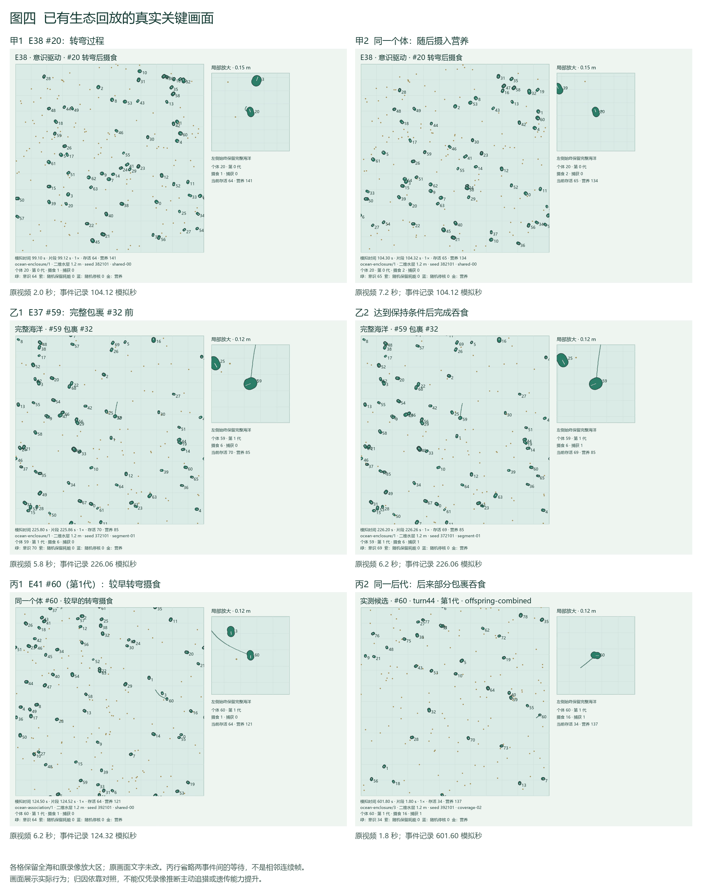

# 具身行为列传　偏好、转弯、捕食与传承

> 2026-11-11 公开节选：涉及私有会话定位、论文整理和投稿讨论的部分已省略。科研记录保留原日期，完整原件未改。

[English](../../../en/history/themes/05-embodied-behavior.md) · [通史卷七](../chronicles/07-priority-experiments.md) · [自主意识列传](04-autonomous-consciousness.md)

2026-10-15补编，追述9月29日至10月6日的已存报告。ThreeMind的具身研究有两条互相支撑的线：一条让内部活动真实地参与行动，另一条让行动在环境里产生摄食、死亡、繁殖和交流等后果。本传集中记录从区域偏好到完整海洋的过程，避免只留下装置更换与运行日志。

## 从选择区域到选择能够活下来的个体

E13在简单环境中显示区域偏好与当前感知反馈的作用，随后E14、E15验证经历和内部通路对动作的贡献。下一步问题变为：这样的网络能否在有身体、有代价的世界中行动，并通过实际生存后果接受环境选择？这使评价从预定动作分数扩展到摄食与存活。[早期因果链](04-autonomous-consciousness.md)

最初的抓杯任务E27没有培养出可供传承的成功亲本：24个个体最终全部死亡。研究者没有把死者换成虚构的成功者，而是转向动作后果更直接的营养海洋。E28记录18个世界、199个躯体，Core控制组48/48存活、随机控制47/48、静止组0/24。接触营养、获取能量、身体活动和繁殖由此连成实际闭环；随机控制也很强，说明这时的成功首先是闭环成立。[E27报告](../../../../lab/explorations/2026-10-02-survival-transfer/report.r2.zh.md) · [E28报告](../../../../lab/explorations/2026-10-03-primitive-ocean/report.r2.zh.md)

E29再比较完整种群与经历来源。总摄食、累计存活时间、单位活体时间摄食效率可能朝不同方向变化，故后来没有用“活得多”替代所有能力指标。第四对确认环境中Core组摄食952、随机组783；继承经历进入新海域并未稳定胜过空白来源。正是这些结果促使研究者要求进一步查内部活动的具体作用，而不是只给种群贴上聪明或不聪明的标签。[E29报告](../../../../lab/explorations/2026-10-03-ocean-evolution/report.zh.md)

## 经历形成的连接可以把部分动作带给另一个个体

E30把动作的来源追到连接。在32次相关来源观察中，31次未直接提示的活动因相应通路静默而减弱，动作也随之改变；立即解除静默，32次动作全部精确恢复。把有经历者的12条持久连接移到通道对齐的空白出生副本，29/32比空白更接近供体动作，28/32优于匹配连接移植。当前激活、身体和食物没有一起搬过去。因此，**已经形成的局部连接能够传递一部分行为响应模式**，这是从“行为有所不同”走到“差异有可转移载体”的重要发现。[E30修订报告](../../../../lab/explorations/2026-10-03-ocean-causality/report.r2.zh.md)

原位闭环干预也改变了个体命运，但干预范围必须按当时实录理解。旧E30第37号的命运差异来自对群体中合格对象的干预，不是仅改变37号。E31另做单体范围检验，并发现把个体从完整世界抽成单体小场景会改变问题本身；随后E32保留全海及其状态。这一纠正使后来的转弯和捕食录像能够放回真实共同环境中解释。[E31范围核查](../../../../lab/explorations/2026-10-03-ocean-behavior/report.zh.md) · [E32全海报告](../../../../lab/explorations/2026-10-03-ocean-community/report.r2.zh.md)

## 转弯和捕食不是预写的演示动作

10月4日，海洋研究留下了可逐帧检查的具体行动。E37第59号在226.06模拟秒完整包裹并吞食32号。E37和E38共筛出10个源身份的转向后摄食过程，保存14份后续活体快照；E38第20号在摄食前5秒改变方向50.7度，104.12秒实际摄入营养，44号与59号还在相隔数百秒后重复出现这种过程。[E37报告](../../../../lab/explorations/2026-10-04-ocean-enclosure/report.r2.zh.md) · [E38转弯记录](../../../../lab/explorations/2026-10-04-ocean-species/turning-and-closeout.md)

筛查同时看运动命令、相对水流的方向、角速度、营养梯度和摄入事件，并排除观察窗内碰撞。它没有向网络追加“朝食物转弯”的控制策略。此处的“自主转弯”指由个体控制链产生、没有教师逐步指定的实际转向；它与“已经学会可泛化追食策略”是下一层归因问题。已经发生的转弯和摄食应明确记录，筛查本身也不充当训练来源。

> **公开版删节／调整（2026-11-11，原文件第29-29行）：**原来源总表含稿件内容，现改链到仅含科研信息的公开来源说明。完整原件未改。

画面沿用E38、E37、E41原视频截图，模拟时刻与视频位置分别登记；没有重造成功演示。逐帧来源、事件和哈希见[既有图表清单](../../reference/history-figure-sources.md)。图中的完整包裹与部分包裹属于不同环境规则。

## 从亲本候选到自然后代

转弯候选和吞食候选起初分开出现。E38对全部成功吞食事件交叉检查后，仍未找到同一身份兼具两类行为的证据。E39、E40观察到900模拟秒也没有新的完整包裹成功，因此E41从同一个300秒完整海洋分成两种公开的培养环境：一支禁止个体间吞食，一支允许满足至少50%面积及保持条件的部分包裹吞食。

E41实际记录18次部分包裹吞食、56次新的转弯后摄食，并保存53份候选状态。**6个同一身份兼有两类行为，其中2个是自然出生的后代；4个个体重复成功吞食。** 例如自然G1后代60号有124.32秒转弯摄食和601.60秒部分包裹吞食记录。网络与身体的谱系、出生和事件证据由此接到同一条历史上。[E41修订报告](../../../../lab/explorations/2026-10-04-ocean-split/report.r3.zh.md)

这里已经确认的是身体／连接状态的继承，以及自然后代中再次出现这些行为。E41亲代改善筛查触发0条；同源分支也不是独立世代复现。因此，稳定的技能优势是否经遗传、选择而提高仍待相应对照。这一问题不取消已经观察到的后代行动，也不把旧完整包裹的失败改写成成功。

## 行动进一步连到同伴身上

E53使嘴巴经物理介质、衰减和延迟影响其他个体的耳朵。屏蔽同伴声音后，两环境首秒分别有39/42、38/40个体改变动作，听觉相关边的干预与恢复进一步显示内部通路参与。复查又发现，原装置把同身同刻的听觉与身体感觉分批提交，阻断了共同经历形成跨感官边的机会。另立环境协议/2后，两境34/34、36/36存活个体形成跨感官连接。这是从自主行动走向可学习交流的重要装置发现；共同狩猎、语言所指和稳定合作收益仍是分别登记的后续问题。[E53报告](../../../../lab/explorations/2026-10-06-ocean-communication/report.zh.md) · [通史卷八](../chronicles/08-embodied-communication.md)

这条研究线的实绩是：持续网络进入了会消耗、会摄食、会繁殖的身体，局部经历通路能够改变和部分传递动作，完整环境中出现了真实转弯、捕食及后代行为。上述发现与各批阴性结果共同构成具身研究的历史，不能只剩“后来换了一个环境”的工程叙述。

> **公开版删节／调整（2026-11-11，原文件第45-49行）：**省略论文正文、写作／投稿讨论或相应非公开文档链接；同段涉及的实验事实、技术说明与运行决定在公开节选中保留。完整原件未改。

> **公开版删节／调整（2026-11-11，原文件第52-52行）：**省略论文正文、写作／投稿讨论或相应非公开文档链接；同段涉及的实验事实、技术说明与运行决定在公开节选中保留。完整原件未改。

> **公开版删节／调整（2026-11-11，原文件第54-54行）：**省略论文正文、写作／投稿讨论或相应非公开文档链接；同段涉及的实验事实、技术说明与运行决定在公开节选中保留。完整原件未改。

> **公开版删节／调整（2026-11-11，原文件第56-56行）：**省略论文正文、写作／投稿讨论或相应非公开文档链接；同段涉及的实验事实、技术说明与运行决定在公开节选中保留。完整原件未改。

> **公开版删节／调整（2026-11-11，原文件第58-58行）：**省略论文正文、写作／投稿讨论或相应非公开文档链接；同段涉及的实验事实、技术说明与运行决定在公开节选中保留。完整原件未改。

## 2026-10-19：实验记录计数与行为归因的复核

公开版从同日记录保留以下技术更正：E38原表的44、59为个体编号，非事件数；10个来源个体共有14个待诊断状态。原世界、轨迹和报告未改。

E39/E41原片记载，自然后代G1个体60在124.32模拟秒摄食，并在601.60模拟秒发生部分包裹捕获，两段不是连续镜头。E56实际指认正常24/24、指定连接静默19/24、恢复24/24；E57外围识别与短时状态归因、E58第一来源的连接作用及第二来源未复现分别保留。动作意图在相应实验中按选定目标位置定义，由伺服控制器执行移动。

[转弯登记](../../../../lab/explorations/2026-10-04-ocean-species/turning-and-closeout.md) · [后代报告](../../../../lab/explorations/2026-10-04-ocean-split/report.r3.zh.md) · [归因报告](../../../../lab/explorations/2026-10-06-choice-attribution/report.r2.zh.md)
