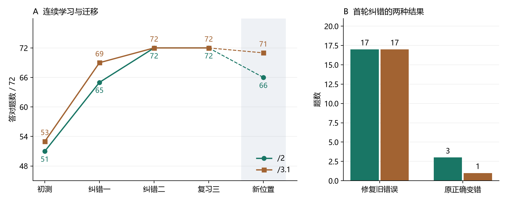

# 共同学习列传　个人表达器、四视场与连续形色

[English](../../../en/history/themes/06-personal-learning.md) · [通史卷八](../chronicles/08-embodied-communication.md) · [通史卷十三](../chronicles/13-shape-color-causality.md)

2026-10-15补编，追述10月5日至13日已完成的研究，并标明15日尚未完成的后续问题。这条路线问的是：一个没有预写词义的网络，能否通过自己的经历形成可读的信息，再由学习过其活动的外设表达、行动，并继续成长？它已经取得有限命名、实际指认和连续形色学习的明确成果，也逐步找出了“读不到”与“没学到”之间的区别。

## 一、从翻译公共标签转向学习个体的内部模式

E46比较共享、个人专用、随发育继续校准和同资料冷训练的Transformer表达器。看物体说出所教名字，学习本个体联想活动的表达器为7/12，学习其他个体活动的共享表达器为2/12；只校准直接感官反应的表达器在跨感官任务为0/36。**学习具体个体的内部活动，确实提高了该条件下的表达效果。** 这一发现使“一意识配自己的表达器”成为有依据的研究方向。[E46报告](../../../../lab/explorations/2026-10-05-native-language/report.zh.md)

同一研究也比较了随24、72、266秒发育分阶段训练与合并相同资料后冷训练，前者未胜出；冻结表达器后，只给Core新经历也未可靠地表达新对应。因此，个人校准的有效性、必须永久一对一的普遍主张、共同发育是否优于等资料训练，是三个不同问题。当时完成的是输出器分阶段学习Core活动，输入编码固定，Core没有接收反向传播梯度。

## 二、同一物体能因经历不同而被叫出不同名字

E47把原对应与反对应共同校准，并用未参与拟合的刺激强度和视角检验。三个新来源、两种教学、两个观察时间的视觉命名合计48/48正确；表达器不读取问题文本、物体编号或当前答案表。在排除直接视觉通道的读法中，592秒的24个正确命名，静默视觉—语言相关连接后降为0，等数量其他连接静默仍24。**内部学得的跨感官对应已经能够通过小Transformer表达为名字。** 此批使用有提示与同状态无提示过程之差作为一种研究读法，须与后来的原始局部过程读法分开。[E47报告](../../../../lab/explorations/2026-10-05-expression-alignment/report.r3.zh.md)

E50进一步用活动实际触达的局部过程，每个来源配自己的表达器。两来源原／反教学的早期回答合计74/80，而只看当前入射感官的同架构对照为50%：相同物体在两种经历中有不同名字，眼前感官本身不足以区分。固定表达器后，目标连接静默使16/16降为8/16，匹配其他连接仍16/16，恢复后回到16/16；目标连接状态移植使6/16回答转向供体名字，其他连接移植0/16。正面结果由此从“能拟合”推进到“部分回答确实使用了内部经历信息”。[E50报告](../../../../lab/explorations/2026-10-05-graph-expression/report.r3.zh.md)

这一成功仍与一个重要瓶颈并存：Core另学表达器未见的新对应、表达器保持冻结时，E50各版本的相关检验为0/20。E52继续探索一对一个人外设与Core共同学习，也没有获得可靠的新经历表达。后续因而同时研究怎样形成内容、怎样让表达器跟上变化，而不是只扩大语言题的复杂度。[E52报告](../../../../lab/explorations/2026-10-05-coadaptive-language/report.zh.md)

## 三、表达失准不等于记忆消失

同一原始状态在不同读法下，可能从答不出变成答得出。E49的223号晚期状态，按相同时间重新校准表达器，8道题从1/8变为8/8，跨状态校准达到24/24。这是读出范围变化的直接证据。它不要求抹去此前失败，也不需要把当时的网络另教一遍。[E49报告](../../../../lab/explorations/2026-10-05-bus-expression/report.r2.zh.md)

这种区分又与更早的顺序实验相接：连接保持着历史，当前活动未必在某一固定窗口内充分表达；表达器能否利用它还取决于读取过程及校准。后来连续学习把个人权重、Adam、随机状态、近期窗口和Core一同保存，正是因为这些共同决定一个完整个体接下来怎样回答。[机制列传](03-memory.md) · [完整个体连续性](../../plans/system-continuity-audit.md)

## 四、四视场把“选中”落实为实际到达

E54、E55已证明运动链能动，却未可靠完成按话指认。E56的关键改进是四个视场共用读取规则，保留4×4视觉、身体背景和Core机制，先在开发材料选择读法，再用预留的新布局确认。颜色、形状、形色组合各8题，**24/24选对，24/24实际到达**。执行器去的是读头选中的位置，评分答案没有直接指挥手臂。[E56报告](../../../../lab/explorations/2026-10-06-vision-correction/report.r2.zh.md)

| E56条件 | 选择并实际到达 | 说明 |
| --- | ---: | --- |
| 正常Core＋固定共享读取器 | 24/24 | 预留新布局确认 |
| 同源副本静默既有连接，读取器不换 | 19/24 | 五道回答受影响 |
| 解除静默 | 24/24 | 正常选择恢复 |
| 从出生关闭结构学习，另训同量读取器 | 24/24 | 该架构中外设也有独立解题能力 |

此处的共享是四个视场共用规则，不等于所有意识必须共用同一个人表达器。E56工作链是活动读取、选点和物理伺服；它允许外设承担部分识别工作，不是后来E69逐刻眼手MOVE/WAIT学习的同一个任务。既有连接的干预作用与外设的识别能力同时存在，完整系统的24/24仍是确实完成的功能成果。

## 五、完整个体把纠错经历带到下一题

之后，研究者把成长连续性明确为普通教学和测试的组成部分：不能只保存Core却换掉个人外设，也不能每问一题便回到考前。E61和E67的不同流程及更正保留原处；E68另从两个新的完整空白个体开始，分别使用`continuous-memory/2`与`/3.1`，每个个体都携带自己的表达器、优化器、随机状态、身体和近期活动走完整个课程。

两组各经历1555模拟秒、514次教学陈述及三轮纠错／复习；普通测验经历传给下一题，外设续校保留末步状态。推理时，八词时间Transformer只读Core四类活动，没有图像原值或场景答案直达预测的旁路。它使用固定眼手的居中清晰装置，没有动作头。[E68正式报告](../../../../lab/explorations/2026-10-13-continuous-shape-color/report.zh.md)

| 连续阶段 | `/2` | `/3.1` |
| --- | ---: | ---: |
| 初教后开发测验 | 51/72 | 53/72 |
| 首轮纠错后 | 65/72 | 69/72 |
| 第二、第三轮开发复测 | 均72/72 | 均72/72 |
| 最终新位置测验 | **66/72（91.67%）** | **71/72（98.61%）** |
| 最终同对象形状、颜色两问均对 | 26/32组 | 31/32组 |

首轮两组各改正17道旧错题，也分别有3道、1道旧正确题变错；第二轮消除剩余错误。**本批持续教学、个人表达器续校与纠错流程有效，最后还能在未教位置取得较高正确率。** 开发全对与最终迁移分数分别报告，两问全对也不冒充一句同时说出两个属性。每版一个个体、同一种子，支持本批结果；版本的普遍优劣另待独立重复。

> **公开版删节／调整（2026-11-11，原文件第58-58行）：**原来源总表含稿件内容，现改链到仅含科研信息的公开来源说明。完整原件未改。

图沿用既有实测汇总，未在本次修史中重跑。来源见[图表清单](../../reference/history-figure-sources.md)。本批成绩由`/3.1`较高，原生推进耗时却为`/2`的1.896倍；准确率、速度和规模是不同发现，不能用一个未经定义的“更先进”替代。

## 六、后续问题由成果和瓶颈共同提出

截至本次补史，E69的注视开发成绩已有提高，手眼阶段仍显示新手决策大量WAIT；完整终试尚未成为已完成报告。前期手等待样本可能造成固化，是有训练史依据、尚待因果对照的解释。自然功能区域的只读分析与有界组合改训也处在已登记、待执行或待触发阶段。[阶段记录与原话](../sources/2026-10-13-eye-hand-shape-color.md)

这些后续问题不能抹去E47／E50有限命名、E56实际指认和E68连续形色学习的成果，也不能反过来把它们当作E69已成功。共同学习路线的推进，是把“内部有可用的经历信息”“外设能把它读出来”“完整个体能持续学会并迁移”逐层变成了有具体任务、数据和干预见证的研究结果。

## 2026-10-16：固定个人表达与读取范围的因果对照

E50/E52 曾经暴露固定个人读头对新对应表达失败的瓶颈。M5 没有重训那些历史个体，而是在新来源上把“Core 学习”与“读头再学习”分开。先用旧课校准，两种读取范围均答对旧题；随后只教 Core，新对应在端口读头 64/64，而全活动读头 0/64。目标、匹配与恢复把新旧对应的局部连接作用分开，所问的固定表达及选择性归因明确达标。

离线交叉还显示，续校准全活动读头能从新教学前的活动答出新标签；端口读头必须用新教学后的活动才能答出。由此分清了 Core 新学关系的表达与外设增加提示—标签关系两条途径。联合提示仍为端口 16/32，新单路满分没有掩去这一独立分母。旧 E69 WAIT 的原因不由本批追认，暂停状态不变。

实验前定义的七项判定完成，四项达标、三项未达标。原件包 825,858,105 字节、2,080 清单文件（ZIP 加清单共 2,081 条目），SHA256 `b05aa9c8e1667765af101ef17c43ec351da3e8c1182f4a7a5261c2c5c00dfe99`，API 全量下载逐成员一致。该复算由执行助手完成，未称外部研究者复现。

[Report](../../../../lab/explorations/2026-10-16-mechanism-discovery/m5-report.zh.md) · [Delivery](../../../../lab/explorations/2026-10-16-mechanism-discovery/m5-delivery.zh.md)

## 2026-10-16补述：新学与表达的归因已经分开

M5是支持Core经历学习的阳性结果：读头权重先固定，新对应由后来的Core教学形成，经端口读头64/64表达；选择性干预、匹配和恢复提供因果依据。同Core全活动读头全WAIT说明旧校准不能保证表达新学；其续校准能在教学前活动上答对，说明外设自身也能增加提示—标签对应。因而有利的是固定接口下Core新学习成立，不利的是全活动旧读头的迁移预期失败；两者不是矛盾结论。此处是明确归因的被动表达终端，E69手眼等待的原因仍按E69自身证据处理。[修订报告](../../../../lab/explorations/2026-10-16-mechanism-discovery/m5-report.r2.zh.md)

## 2026-11-01：能短时读出，不等于能持续调用

R42将已教的零破坏偏好放入连续3-SAT搜索。正常与打乱教学均98/192，传统WalkSAT172/192；目标连接有0.829点局部选择作用，却未达到预登记20点，实际求解增益目标亦失败。原件显示偏好分数在教学结束21.11—26.91内部秒后停止出现，随后连接不再保持。此次明确否定当前装置的持续应用预期，并将持续表达列为具体后续问题；没有改写M5短程固定读出器学习的阳性结论。[通史与证据](../chronicles/16-sat-pilot.md)

## 2026-11-01：强制训练步骤与SAT重验

首次SAT装置遗漏渐疏复习、纠错与个人时序读出，不能代表既定完整学生培养。作者要求按规约重做且不改半衰期；v2以新材料、新学生独立登记，真实校准个人Transformer并保持全状态连续。完整系统收益、正常Core教学史的额外作用及规则基线分别判断，既不以外设成绩冒称Core学习，也不抹去完整系统的实际能力。[通史与明确结论](../chronicles/16-sat-pilot.md)

## 2026-11-01再续：直接排除当前SAT装置对Core的依赖

作者要求更明确的排除实验。事前检查八个v2正常父体，最后教学与终试完整边界的连接数均为零；仅静默这些边将成为空操作，故另外登记整核替换、绕过与输入负对照，完整原父体保留。

八来源的新题上，完整参照、精确恢复、未受训Core、无Core直通、未教学静态模板、从零训练的无Core读出器及直接零破坏规则，均解出161/192；上述替代组各208条完整动作轨迹都与参照逐步一致。原读出器保持冻结，新外设从0更新开始，未读取旧Core活动。恒定输入的旧／新读出器分别仅解出103/192、103/192，局部和解题损伤均达到预设标准。Q1、Q2a、Q2b、Q3及两个Q4目标全部闭合。

科学结论明确：本装置的解题能力不依赖既有Core经历状态或在线Core处理。外部程序计算破坏数并搜索，读出器学会零破坏的局部偏好；当前类别信息有用，Core的转换可由无记忆转接替代。v2的完整系统收益继续保留，本批明确其能力来源。这个结果不支持把当前SAT成绩归给Core的经历学习，故不继续以相同课程追加训练来主张Core推理收益。此为依据新排除结果所作研究判断；没有自动实施下一项任务。

独立算术路径核对2288条轨迹、1728次完整状态承接及全部最终读出；恢复状态精确，原父体及两批旧归档哈希不变。双语协议／报告和原包经本机统一科研API完整读回，completed／verified／pending=0。助手复算与外部研究者复现分开标明。Core、半衰期、旧实验、自动任务和作者论文均未改。

[排除实验报告](../../../../lab/explorations/2026-11-01-sat-core-exclusion/report.zh.md) · [交付](../../../../lab/explorations/2026-11-01-sat-core-exclusion/delivery.md)
