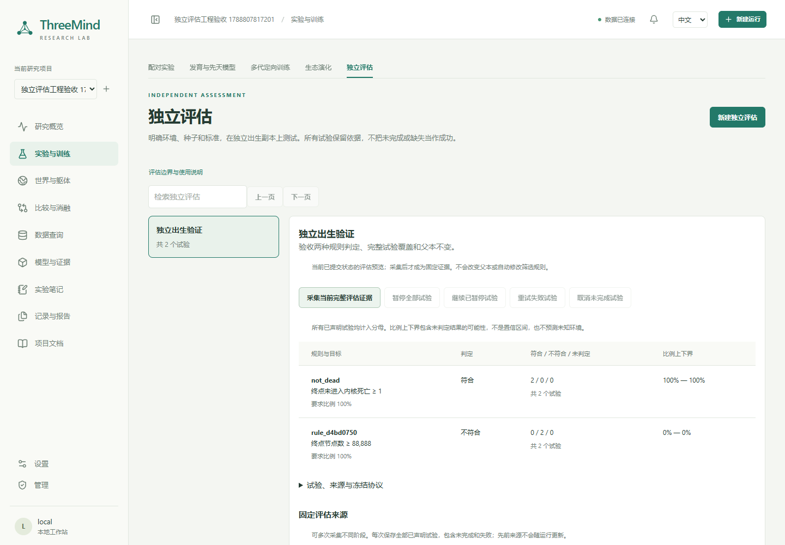

# 独立评估：出生副本、固定标准与完整证据

2026-09-08，F5c。入口为「实验与训练 → 独立评估」。它回答**这个已登记先天版本在这些明确环境与条件下，是否满足研究者声明的可测量标准**，不把网络大小或激活量解释为智能、善恶、危险意图或意识证明。

## 创建与控制

先在「发育与先天模型」登记一个真实恢复点，再选择该先天版本创建评估。生态个体与多代训练候选仍先经过已有登记入口；不猜测研究者想评估哪个个体或恢复点。默认不会自动开展评估。

默认图形配置包含名称、目标、来源、环境种子、判定规则和完整环境／运行参数。额外排除种子与内核运行的高级参数折叠展示；右上方链接切换整个协议的 JSON，支持行号、高亮、格式化、校验和双向同步。创建必须重新通过服务器校验。默认示例是「全部试验终点未进入 Core 死亡」，只是填写示例，不是经过标定的意识质量目标。

每个环境种子创建一个独立出生副本，最多 32 个种子；每批最多 8 条规则。同一批种子不得重复。出生使用既有 `threemind.birth/1`：保留受刺激塑形的结构和感官身份，清空活动、在途事件和环境状态，从零模拟时间开始。评估期间连接仍按模型本来的可塑性配置变化；结果不写回来源，也不自动登记为下一代父本。它不等同于精确复制当前短期活动状态。

来源的 Core 参数和感官编码身份在表单中只读，JSON 修改后也会被拒绝。评估环境可使用模拟躯体、自定义世界或明确标识的合成环境，采用尽速或指定倍率；宿主／进程遥测刺激不混入这个可重放测试入口。虚拟世界和身体仍沿既有协议独立运行，不让 Core 依赖图形显示。

服务器核对来源谱系中已保存的发育种子，以及已记录的多代选择／验证种子；研究者也可声明额外排除列表。没有记录的外部或导入前历史无法自动验证。**不同种子不证明训练与测试的环境分布相互独立**；严格的泛化研究还需要声明不同环境、任务及未见条件。

批次创建后冻结协议、成员和种子表。页面可以暂停全部试验、继续暂停试验、明确重试失败／阻塞试验，或取消未完成试验。控制有操作编号和版本检查，已完成个体不重新执行。试验详情的人工输入、参数修改及独立控制受到冻结保护；额外干预实验需要先分叉。身体状态、任务停止、Core 死亡是不同事实。

## 测量与判定

本版复用已经实现的终点指标：已观测存续时长、终点 Core 是否未死亡、节点／连接数、总／平均激活、活动比例、连接密度、平均权重，以及开启能量模拟时的能量账本。尚未提供任意行为检测脚本或通用危险倾向分数；不能把没有实现的碰撞、任务成功或意图指标写入 JSON 后当作已测量。

网络终点值需要有与固定恢复点同一模拟时间的观测；更早的样本不冒充终点值。清单保存样本时间、恢复点、状态哈希和具体缺失原因。能量取已提交的边界账本；未启用或溢出保持缺失。完成但未死亡的存续时长属于右删失，不是完整寿命。暂停、取消、失败、缺少恢复点或缺失数值都保留，不能填零或当作成功。

规则声明指标、比较关系、阈值和要求符合比例。每条规则针对每个已完成试验作比较，再对**全部已声明试验**汇总。设总数为 $N$，已确认符合数为 $S$，不符合数为 $F$，未判定数为 $U$，要求比例为 $q$：

$$
N=S+F+U,\qquad L=S/N,\qquad H=(S+U)/N.
$$

- 若 $L\ge q$，则已确定符合要求。
- 若 $H<q$，则已确定不符合要求。
- 其他情况保持未判定；没有试验时也保持未判定。

因此有缺失并不必然导致所有规则都未判定：例如已知失败数足以推翻「全部符合」，可以确认这条标准不符合，但仍保留其他试验的未知事实。$[L,H]$ 是这个有限测试集在未知结果下的逻辑范围，**不是置信区间，也不是对未知环境成功概率的估计**。同源结构的多个副本不是不同演化谱系；若需要群体推断，应另行设计模型来源、环境与统计单位。

## 固定证据、记录、报告与 AI

详情首先显示当前已提交状态的只读预览。点击「采集当前完整评估证据」会固定全部成员当时的状态、恢复点引用、来源哈希、协议、缺失和判定；后台复用现有来源采集任务，不重新运行意识。采集时试验还没完成，后来即使完成，**旧来源仍保持当时的不完整状态**。可以多次采集不同阶段；固定来源也能反复用于多篇记录或报告。

「从此证据创建记录」生成包含默认指标图表、全体试验表格与**固定规则判定**的草案。记录／报告里也可通过「选择或采集数据来源 → 独立评估结果」选取批次。指标图表从真实数据行计算；`assessment_summary` 内容块仅包含来源引用，服务器从固定清单读取所有规则结果，文档 JSON 无权填写判定值。

已有记录／报告的 AI 生成可以使用评估来源。发送范围保留全部规则的符合、不符合、未判定、分母、缺失及边界；AI 草案必须引用完整固定规则判定，不能只展示通过项。AI 文字始终属于待复核解释，不能据此自动调整筛选或写回脑模型。生成仍需用户在项目里选择并启用供应商，然后显式发起；开发验证只用本地模拟响应，没有外部请求。

Markdown、HTML、Word、PDF 导出复用现有发布模块，包含固定判定、图表、来源校验和及可选完整数据证据包。复制已保存记录中的判定块进入报告时也保留原修订。既有证据再分析和文档编辑都不创建意识；只有明确点击创建独立评估才启动出生试验。

## 实现与部署

协议为 `threemind.assessment/1`。Lab 用同一 PostgreSQL 的 `assessment_batches`、`assessment_members` 和 `assessment_actions` 保存批次、成员和控制依据；固定证据复用 `report_source_requests`、`report_sources` 与原有文档修订。没有新增数据库、MQ、微服务或另一套脑执行器。最多 32 个普通 Runtime 作业通过原执行额度和能力匹配调度；页面关闭不停止试验。

API 前缀为 `/api/v2/projects/{project}/assessments`，提供 `/catalogue`、`/validate`、创建／检索、`/{id}` 与 `/{id}/controls`。来源采集使用原 `/report-sources`，`kind=assessment` 与 `assessment_id`。配置、成员和控制记录具有项目隔离、复合外键和不可变约束。新能力标识 `worker.assessment_v1` 防止旧执行节点误接新任务。

数据库升级到 **schema 43**，Core `causal/7`、状态 `state/5`、运行 `profile/5` 和出生规则均未改变。部署新版本前先停服务并执行 `python -m threemind_lab.cli migrate`，再启动；API 和命令行 worker／工作站在启动时核对数据库版本，缺失升级会明确拒绝启动，不在用户请求时才报缺表错误。该命令使用本地配置的迁移账号，不需要把密码发到聊天。

验收包括独立出生、父本不变、固定不完整来源、控制、缺失与比例边界、冻结规则、项目隔离、不可变 SQL、所有四种导出和本地模拟 AI。新表格进行了 PDF 渲染检查；默认图形／JSON、来源身份拒绝、种子重叠拒绝、窄屏与记录预览通过浏览器检查。详见[冻结验收记录](../benchmarks/2026-09-08-assessment-validation.json)。本页不是正式意识实验结果。

[演化观察的 AI 解释与调度](v2-ecology-ai.md)已由后续 F5d 补齐。宿主性能和执行故障规则，以及更广泛的适配器契约验收仍须继续交付。
