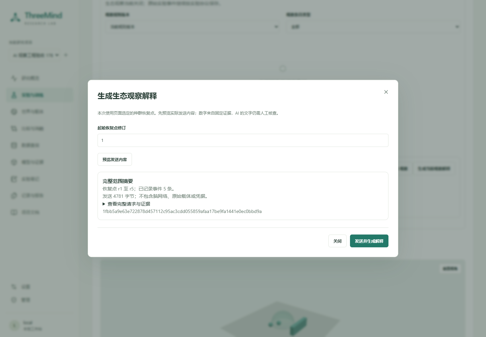

# 可选的 AI 生态观察解释

2026-09-08，F5d。入口在「实验与训练 → 生态演化 → 生态观察与预警 → AI 观察解释」。基础规则观察、AI 解释和浏览器语音各自启停，默认没有 AI 请求。本模块属于 Lab 外部研究工具，Core、Runtime 的独立生态运行与命令行观察不依赖它。

## 配置与手动生成

先在设置中配置可用的 AI 供应商，再打开「配置 AI 观察」。默认使用图形表单；高级项折叠，右上角可切换到有高亮和行号的 JSON 编辑器，提供格式化、校验和双向同步。每次保存生成新版本；旧配置与调用证据保留。

可独立选择供应商、语言、关注点、周期触发、躯体失效、繁殖暂缓、预警命中与结束总结。启用自动解释是明确的外部调用授权；它使用所选供应商的实际地址、模型及额度。开发验收只使用本机模拟服务，没有调用用户的真实供应商。

「生成当前观察解释」固定打开弹窗时所选的种群恢复点，不随页面轮询偷偷变成新恢复点。默认起始修订为 1，可以缩小到明确的恢复点范围。先预览，再发送；预览包含实际请求和证据哈希。配置或证据变更会拒绝旧预览；确认丢失时保留原请求编号重试，不额外发出一次调用。同一恢复点可多次生成不同配置或关注点的解释。

## 哪些数据会被发送

- 所选恢复点的整个人口摘要：累计个体、存活躯体、尚未死亡的内核、后代数、失效躯体、代数及模型／物理时间。缺失项保持缺失。
- 声明范围内**全部已记录生态事件**按类型的计数；不是截取第一页个体或最近几条事件。
- 当前规则版本在该范围内已经生成的全部预警分类计数、完整规则配置及实际处理进度。观察还没处理完或规则关闭，不等同于零预警。
- 起止恢复点身份和校验和、配置版本与校验和，以及共享祖先、共享世界、采样和因果解释等边界。

不发送每个脑的网络、原始感官载体、设备凭据或执行器命令。最多 64 种事件类型、256 个预警分类，完整证据最多 80 KB；超过限制拒绝生成，不能截断后宣称“完整”。这些计数不能重建每一步物理过程或个体轨迹，深入分析仍应使用既有数据查询与完整种群报告来源。

## 自动调度与费用

间隔可以采用宿主 UTC 墙钟或模型模拟时间，默认 60 秒；独立的最小宿主间隔默认 30 秒，防止尽速训练瞬间产生大量外部请求。宿主校时可能改变外部调用的等待时间，不改变 Core 的模拟时钟。积压的周期合并为一次当前范围解释，不补发每个错过的周期。

同一训练最多一个请求处理中。新配置会取消尚未完成的旧请求；已发送请求的远端费用可能仍然发生。请求上限按配置版本统计，默认 20 次，包括手动、失败和取消的请求；另受现有供应商的并发、日次数和金额预算约束。改变配置版本会建立新的工具次数上限，供应商总预算不会重置。

自动开启时从当前最近恢复点附近开始跟进。结束总结覆盖第一个至最终已提交恢复点；不把暂停或阻塞当作自然死亡。晚到的规则预警会扩大本次证据范围以包含其原始恢复点，不引用范围外的预警。失败、拒绝、权限撤销或预算阻塞后暂停自动调度，显示原因；「恢复自动观察」仅恢复后续观察，不自动重发旧的失败请求。最终总结失败时，可手动发起新请求。

调度复用现有 AI worker 与 PostgreSQL 队列。每轮最多发现 10 个到期订阅，同一订阅的空闲检查间隔为 5 秒；没有新增服务、MQ 或空任务执行日志。页面关闭不停止已授权的后台观察。旧 AI worker 不领取新的解释任务。

## 事实与解释的边界

响应协议为 `threemind.ecology-interpretation/1`，分别保存摘要、观察说明、待验证假设、后续研究建议和证据局限。每项陈述必须引用提供过的来源；未知引用、重复 JSON 键、额外事实字段或命令字段会被拒绝。原始响应、请求、模型版本、用量、费用与拒绝原因均可在调用详情查看和导出。

来源校验不能自动证明自然语言中的每个推论正确。AI 文字始终标为未人工复核；图表、原始数值和规则判定仍由本地证据产生。建议没有执行入口，不会自动暂停训练、淘汰个体、改动筛选、施加刺激、修剪激活或修改脑连接。AI 故障不会改变已有基础观察条目。

当前浏览器实时语音沿用基础规则说明与预警，AI 解释通过独立文本详情呈现。独立 CLI 继续提供确定性文字／JSONL；它没有额外依赖在线 AI。

## 数据与验收

schema 44 保存配置修订、订阅状态和调用来源引用；schema 45 强化来源与调用的项目复合外键。脑模型和生态原始证据没有变化。新部署自动依次安装；升级已有 Lab 时停机运行 `python -m threemind_lab.cli migrate` 后启动。

验收覆盖整个种群证据计数、固定哈希、单次发送、配置取消、拒绝伪造来源／事实、模拟时钟与宿主时间区分、晚到预警、额度和项目权限，以及图形／JSON、窄屏、发送预览、调用详情和旧观察／语音回归。详情见[冻结验证记录](../benchmarks/2026-09-08-ecology-ai-validation.json)。这些是工程验收，不是意识研究结果。
