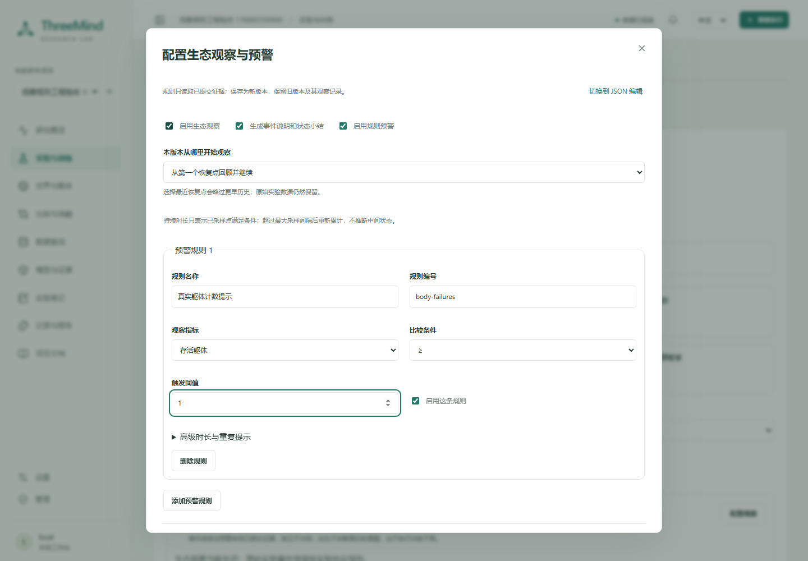
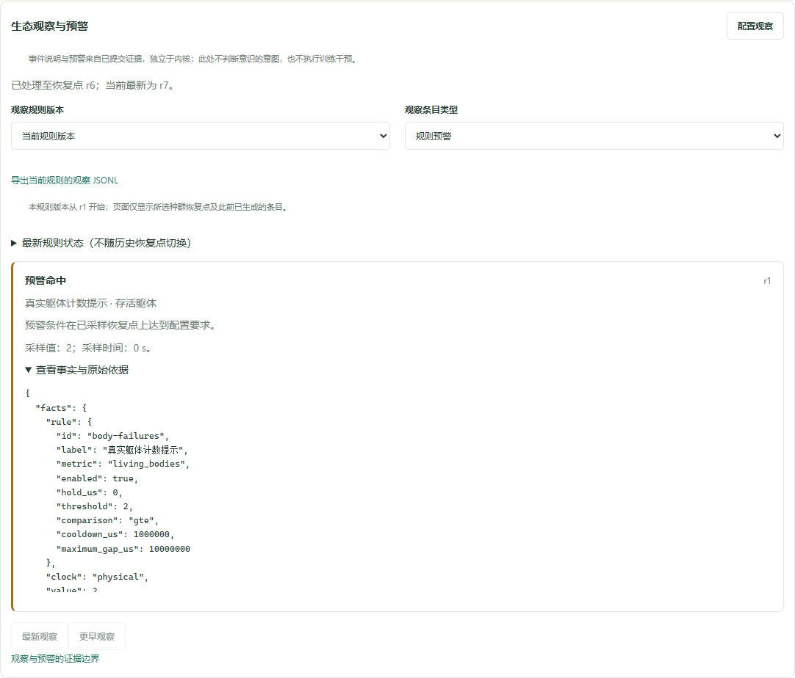

# 生态观察与规则预警

2026-09-08，F5a 与 F5b。该工具把已经提交的生态事件和种群恢复点转为可追溯的文字、状态小结与规则提示。它不拥有意识实例，不向输入总线写入刺激，也不执行暂停、筛选、淘汰或连接修改。Core 的局部抑制、竞争和遗忘仍由各自的动力学决定。

## 操作入口

在「实验与训练 → 生态演化」打开一次训练，使用「生态观察与预警 → 配置观察」。默认关闭整体观察；启用后可分别关闭事件说明或规则预警。可以从最近已提交的恢复点开始，也可以回顾第一次恢复点及后续历史。提前配置尚无恢复点的训练时，后台会等待其第一批证据。



默认使用图形配置；每条规则的持续时长、重复提示间隔及最大采样间隔折叠在高级配置中。右上方链接切换到带行号、高亮的 JSON 编辑，支持格式化、校验和双向同步。切换及保存都经过服务器校验。保存产生新配置版本，使用页面打开时的版本号进行冲突检查，避免覆盖另一位研究者的修改。

新版本重新开始自己的观察游标和规则状态。旧版本及其条目保持不可变，关闭观察也不删除它们。可以按规则版本、条目类型和种群恢复点筛选，翻阅更早条目，展开事实、原始事件编号、恢复点编号及内容哈希。最新规则状态单独标明，不伪装为所选历史恢复点的状态。



## 指标与时钟

| 指标 | 所用时钟 | 含义与限制 |
| --- | --- | --- |
| 存活躯体、失效躯体、失效躯体比例 | 物理世界时间 | 来自全体历史个体的真实躯体账本；失效比例的分母包括历史个体，不是当前列表第一页 |
| 可存续内核 | 意识模拟时间 | 包含等待输入但尚未死亡的内核，不等于此刻正在激活的意识数 |
| 后代出生数、最高代数 | 意识模拟时间 | 已实际出生的模型；不把繁殖意向算作出生 |
| 人口上限推迟次数、出生预算推迟次数 | 意识模拟时间 | 规则产生的累计计数，不是价值判断或遗传质量评分 |

物理时间可能领先于已经递送完成的意识时间，因此不能混用二者。阈值可选择大于、大于等于、小于、小于等于或等于；最多 32 条规则。默认示例规则观察失效躯体比例，不表示这个阈值已经完成生物学标定。

持续时长仅说明所覆盖的采样点满足条件，不能证明两点之间始终满足条件。同一时间戳不会因轮询而增加持续时间。超过最大采样间隔会中断累计；缺少有效指标、分母或时钟时显示「证据不足」，不会填入零。恢复采样与预警解除是不同条目，缺失区间不会被写成好转。重复提示受冷却间隔限制；有效时间倒退会使观察任务报错，保留之前已经提交的事实供排查。

身体失效、任务暂停或任务完成，都不能单独证明意识死亡、痛苦、恶意或任何主观体验。默认预警没有「危险意识分数」。这类研究必须另行给出可测量的行为、条件和误报范围。

## 后台、原子性与成本

规则计算位于独立 Runtime 模块 `threemind_runtime.ecology_observer`，可由无界面上层复用；不依赖网页或 Lab 数据库。Lab 在同一个 PostgreSQL 中保存配置修订、游标和条目，复用已有任务队列，没有新增数据库、MQ 或微服务。

每次领取任务最多处理 100 个事件和一个恢复点。条目、规则状态及游标在同一事务提交，失败可以从上一次已提交游标重试。尚有积压时让出执行名额至少一秒；追上证据后休眠，下一次种群恢复点提交在同一事务唤醒订阅。没有新证据时不会每秒生成空执行回执。旧配置任务在配置变更后退出。

观察任务与其他 Runtime 任务共享现有执行节点和项目额度。若只有一个可用节点，且它正在执行长时间训练，观察会等到有空闲节点；本版不承诺这种配置下实时更新。工作站默认的多个节点可在有余量时并行处理。页面显示已处理与最新恢复点编号；增加有对应能力的 worker 可以降低积压，不会重新计算脑状态。持久化观察条目会增加存储量，原始证据保留策略与观察开关独立。

默认没有语音播放，也没有外部 AI 请求。关闭页面不终止已经启用的后台观察。所有固定输入下的只读保证都以同一输入、协议与 Core 后端为前提；真实相机、麦克风或 CPU 遥测可能受额外宿主负载影响，不能承诺现实采样条件无条件相同。

本轮联调同时修复 Windows 下离屏 RGB 探针继承工作站退出监听管道而超时的问题：探针标准输入显式关闭，仍使用原渲染后端、20 秒超时和独立子进程。未通过的 RGB 能力在 worker 空闲时最多每分钟复查一次；通过后停止重复探测。复查不运行用户意识，也不静默改换 GL 后端。它避免一次启动失败让依赖 RGB 的任务永久排队。

## 导出与复用

「导出当前规则的观察 JSONL」冻结所选配置、恢复点上限和导出开始时已经生成的最大条目编号。首行清单包含配置和哈希、首个与最大恢复点、条目总数；后续为完整观察条目及其引用。后台继续生成新条目不会改变这一次导出的范围。

这是**已经生成的观察条目及来源引用**，不冒充原始实验的完整模型与全部输入。完整种群、个体模型和原始数据仍使用原有证据包与记录／报告来源。未知类型事件保留原始字段并标明未解释，不由叙述器编造缺失意义。

接口前缀为 `/api/v2/projects/{project}/ecologies/{campaign}/observer`：读取详情、`/revisions`、`/entries`、`/export`，以及 `/validate`、`/configuration`、`/retry`。读写均受项目角色限制；数据库对配置历史和条目强制项目隔离及不可变约束。配置契约是 `threemind.ecology-observer-config/1`，条目实现版本是 `threemind.ecology-observer/1`；Lab 数据库为 schema 42，Core、状态格式和运行协议版本不变。

## 无界面观察输出

`python -m threemind_runtime.ecology_observer_cli` 只读打开用户明确指定的独立种群 SQLite 文件；不导入 Lab、不连接 PostgreSQL、不启动意识、不读取模型数据块。安装更新后的 Python 包也可使用 `threemind-observe`。未持久化的 Runtime 可以直接复用 `ecology_observer` 的事件解释和规则函数，无需为了观察引入数据库。

```sh
python -m threemind_runtime.ecology_observer_cli --write-example observer.json
# 在 observer.json 中明确设置 enabled: true，并配置规则。
python -m threemind_runtime.ecology_observer_cli --store population.sqlite --configuration observer.json
python -m threemind_runtime.ecology_observer_cli --store population.sqlite --configuration observer.json --follow
python -m threemind_runtime.ecology_observer_cli --store population.sqlite --configuration observer.json --format jsonl --output observations.jsonl
```

配置示例默认关闭，不会覆盖已有文件。`--instance` 选择种群实例；`--from-revision` 和 `--through-revision` 指定已经存在的恢复点范围。普通调用在开始时冻结上限；`--follow` 等待新提交，不能同时指定固定上限。`--language en` 输出英文说明。默认输出到控制台，仅在显式给出 `--output` 时创建新文件，拒绝覆盖已有文件或输入。

JSONL 包含配置、范围、说明、预警、每个完成恢复点的规则游标，以及正常快照结束标记。中断／出错后缺少结束标记的输出不是完整快照。恢复输出时可从明确恢复点重新观察；此版没有额外建设可写的 CLI 观察数据库，也不会自动续写旧输出文件。重新从较晚恢复点开始会重新累计规则持续窗口，不能沿用未加载的历史状态。

读取前核对恢复点清单哈希和成员引用；事件按 100 条读取，每批关闭读事务后才向慢速控制台输出，避免长期占住 WAL。默认允许的单个清单大小为 128 MiB，超过时明确报错，可通过 `--maximum-manifest-mib` 调整到 1–4096 MiB；这只是观察器内存预算，不裁剪科学证据。该范围不包括模型数据块。

独立种群清单没有瞬时 Core 生命计数，`dead_recorded` 只是通知游标，因此本入口将 `viable_cores` 标为缺失，相关规则显示证据不足；不偷偷加载全部脑模型填数。躯体、出生、代数和推迟计数来自完整账本。清单也不证明另一个进程当前仍在训练或已经结束，读取到最新恢复点不能被解释为训练完成或意识死亡。

## 可选网页语音

启用生态观察后，详情中的「语音播报（默认关闭）」可以选择系统语音和 0.5–2 倍语速。默认优先选择本机语音；没有本机语音时不自动选用网络语音。若用户选择网络语音，页面会说明播报文本可能交给浏览器的语音服务；点击「启用播报」后才开始。

播报仅订阅启用之后、当前规则版本的新小结和预警。第一条订阅请求只建立游标，不追读旧历史；页面切换历史恢复点和筛选条件不会改变播报范围。更改规则、关闭观察、切换语言或离开页面都会停止当前播报。语音服务报错或长时间无完成回调会显示原因并停止，不影响原始记录或训练。

`/observer/live` 是独立的呈现接口：每次取最新至多三条小结／预警，返回被跳过条目的准确数量。浏览器最多保留三条待播内容，后来的新内容替换积压，当前正在播报的一条可以播完；界面显示已播报和跳过数量。这个游标不确认、删除或推进持久化观察游标，完整条目仍可从 `/entries` 和 `/export` 获取。浏览器不支持语音或语音包尚不可用时明确反馈；基础文字、图表和导出不依赖语音。

开发验收使用模拟语音接口，没有实际播放音频或调用外部语音服务。不同系统的音色、语言包、发音质量和浏览器行为需要在实际设备上确认。


## 后续范围

F5a 交付生态计数的规则观察和预警，F5b 补齐独立命令行与可选网页播报，F5c 已另行交付[独立出生评估与固定报告判定](v2-assessments.md)，F5d 已提供[可选 AI 解释与调度](v2-ecology-ai.md)。性能与执行故障预警及通用适配器契约验收仍按[实施方案](v2-observation-and-adapter-plan.md)继续，不以本页宣称全部完成。此处也没有启动[具身分化预测](embodied-functional-differentiation.md)的正式研究实验。

F5a 最终观察／升级专项 35 项通过，最终索引升级与大批游标复验 2 项通过；RGB 故障隔离与工作站生命周期 9 项通过；抑制与相关 Core 回归 63 项通过。最终 Edge 四条流程通过，桌面与手机图片已检查，构建、Ruff、4,282 条翻译及 55 个旧参数审计通过。测试组之间存在重叠，不能相加当作全量回归。详见[F5a 冻结验收记录](../benchmarks/2026-09-08-ecology-observer-validation.json)。

F5b 的独立生态 CLI、观察 CLI 与 API 回归 10 项通过；最终非法配置处理复验 2 项通过，安装后的命令入口通过。原观察页面与模拟语音流程分别通过；语音流程覆盖默认关闭、本机／网络提示、积压替换、错误、配置变更和原始证据不变，桌面／窄屏截图已经检查。构建、Ruff、格式、4,299 条翻译和 diff 检查通过。验收中修复了条目编号转字符串导致排序错误，以及 React 延迟执行状态回调时重复计数的问题；详见[F5b 冻结验收记录](../benchmarks/2026-09-08-observer-output-validation.json)。
