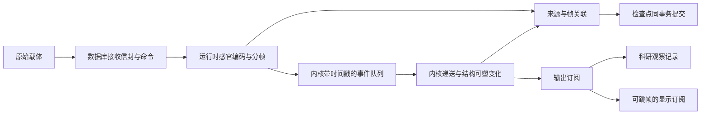

# 感官输入、分帧与递送证据

本轮恢复阶段 B 的第一部分：输入信封与队列审计、文本感官、匿名帧接入、输入 UI，以及独立 Runtime 的输出订阅基础。耳朵、眼睛、嘴巴、激活图像和结构/时序读出尚未恢复，不能把本轮视为阶段 B 全部完成。

## 页面入口

- 意识网络右侧默认提供文本输入，可切换匿名帧序列；后者使用带行号、高亮和格式化的 JSON 编辑器。
- “参数配置 → 高级参数”增加“文本感官”和“输入总线与资源”。新建、暂停编辑和项目默认参数使用同一份目录及图形/JSON 编辑器。
- 意识详情增加“感官与输入”：查看已接通适配器、最近提交队列、输入记录、原始载体、编码配置和每一帧的递送结果。
- 记录按来源、状态筛选并分页。文本是默认筛选来源，环境记录需切换来源；这只是显示筛选，不会停用环境。
- 可导出原始载体/配置或逐帧记录，提供 JSONL、CSV。导出包含所选来源的全部记录，不受页面或状态筛选限制。历史检查点证据使用原有证据包导出。
- Enter 发送是当前设备的交互偏好，默认关闭；开启后 Shift＋Enter 换行，中文输入法组合期间不发送。

## 边界与数据流

Core 接收的仍是 `Stimulus(time_us, channels, intensity)`。文本、标签、来源名称、载体 ID 和用户信息均不进入 Core。感官接线只决定外界信号落到哪个匿名通道；连接仍由核心实际接收的刺激形成。文本手工输入是显式实验来源，默认模拟物理环境未被替换。

文本适配器位于 `threemind_runtime.sensory`，不依赖 Lab 或 PostgreSQL。`InputBus` 包裹 Core 自己的队列，以事件 ID 关联来源；不维护一套决定不同时间顺序的替代队列。同一时刻的两个输入仍是两个独立事件，不合并为一次全局共同刺激。

HTTP 接收成功返回 202，含义是数据库已持久化载体与输入命令。执行结果分为：

| 状态 | 含义 |
| --- | --- |
| accepted | 已接收，运行时尚未处理命令 |
| scheduled | 至少已处理排队，仍有帧等待递送 |
| completed | 全部帧已递送或被声明的实验阶段过滤；须同时查看递送数和过滤数 |
| rejected | 排入前发现过期时间、来源关闭等问题；原因保留，原始载体不改写 |

`delay_us` 从运行时处理输入命令的模拟时刻起算，各帧 `time_us` 是相对该起点的偏移；也可通过 API 指定绝对 `requested_time_us`。绝对时间若在执行时已经过去，整条拒绝，不能倒填时间。暂停时可以接收载体，但不会自动继续运行。已结束的实例需先分叉；冻结的配对实验拒绝人工输入。

相同 `request_id` 与相同载体重复提交，返回第一次接收的结果，不产生第二条命令；相同 ID 携带不同请求则拒绝。载体按接收时的编码配置处理；之后停用感官或修改增益、分帧间隔，均不追溯修改已接收载体。

## 文本感官的三种模式

`text-sensor/2` 保留旧文本适配器的非语义信号思路，转换为当前 u32 通道和模拟微秒时间。编码版本属于实验条件，不能把新旧数值通道 ID 当作相同身份。

1. **匿名分布编码**：可选 NFKC 规范化；按字符分片，对 UTF-8 字节、相邻字节对、字节位置模 11 形成信号，映射到有限感受器。跨帧保留前一字节和全载体位置；总字节长度特征只在最后一帧出现。默认通道数 192、每帧 24 字符、间隔 20,000 μs。权重分别为 0.42、0.32、0.18、0.20。
2. **匿名编码＋观察标签**：与第一种产生完全相同的数值脉冲；字符标签附着在外部帧记录。标签可能有碰撞或一对多关系，不是内核学会的词义。
3. **逐字通道编码**：每个 Unicode 字符对应独立匿名通道，重复字符累加 0.72；用于明确的感官编码对照，不进行分词、语义 embedding 或预造连接。

匿名模式按每帧 UTF-8 字节数平方根归一化，逐字模式按字符数平方根归一化：

\[
a_c=\min\left(1,\frac{g\sum_j w_{c,j}}{\max(1,\sqrt{n})}\right).
\]

`g` 是文本感官增益，`n` 是相应模式的字节数或字符数；提交的 `intensity` 保持为独立刺激强度。原始文本完整保存，规范化后的字符数与 SHA-256 另外记录。空格、换行不删除；非法 Unicode、超限载体不静默替换或裁剪。

接线采用由种子确定的 u32 双射，文本受体域避免与已经发布的平面物理/宿主遥测接线冲突。匿名分布模式内部折叠碰撞属于公开编码机制。编码、规范化规则、感受器数量以及感官种子在实例创建后只读；它们改变会重新解释已学到的通道身份。可变项在暂停后编辑，保存仍会校验。

## 接收预算与记录成本

人工输入有载体大小、单次字符数（音视频另有原件／时长预算）、待递送帧数、待递送通道条目数预算。文本／匿名 JSON 入口默认 4 MiB 单次请求载体、100,000 字符、8,192 帧、524,288 通道条目；图形界面可提高协议中可配置的预算。超过预算时整条拒绝，不截断、抽样或合并科学输入。

接收与配置修改均锁定该运行的数据库行：不能把新预算降到小于已接收的待递送量。已递送但尚未提交的帧仍占数据库接收预算，因此繁忙时会保守地拒绝额外载体。内存队列计数为常数时间更新，不为每帧重扫整个队列。

这些预算约束新增人工载体；自动环境由原有采样周期约束，预声明重放由重放协议约束，导入/分叉的既有队列由模型导入预算约束。它们没有被偷偷截断以满足人工输入预算。预算并不构成公开部署下的完整用户存储配额。

接收信封保存一次原始载体和配置；逐帧记录实际数值输入、计划/递送时间、核心事件/序列、观察标签、过滤理由及提交版本。队列关联、帧结果、核心检查点和状态投影在同一带租约和版本检查的事务中提交。失败事务不会留下“已经递送”但无对应检查点的证据。崩溃后从上次提交边界重新计算，保证已提交证据不重复；这不是物理设备副作用的端到端 exactly-once 承诺。

MuJoCo、现有宿主遥测和重放也接入逐帧审计；共同培养阶段的输入同样记录。当前环境信封保存适配器产生的匿名测量帧，尚未提供完整原始传感器采集序列。旧版本历史没有这些记录，不会伪造补齐。分叉/导入继承在途数值事件时创建新的来源身份，并保留原运行引用；不改写父分支记录，原载体和标签需沿父分支追溯。

输入记录导出使用数据库游标逐批传输，列表不读取大载体字段。详情仅查询选中载体；页面限制文本预览长度和帧数。完整证据 ZIP 仍由现有后台工件任务构建，并非整个证据包都已实现流式低内存打包。长期运行的审计表会增长，后续配额、保留策略和压测仍需完成。

## 模型复用与输出端口

新导出的 `.tmind` 在原四成员容器的清单内携带可选 `threemind.runtime-profile/2`：感官种子、文本／音视频感官与被动器官完整配置（仍可读取 V1 profile），并有独立校验值。JSON 模型携带等价内容；核心状态哈希保持独立。Lab 导入后仍创建暂停实例，再从数据库继续。裸 Core 状态或历史模型缺少该信息时采用默认感官配置，不猜测旧接线。

新版 Python/Rust Runtime 均验证并保留该配置；SQLite 设备恢复将它与状态同事务、同版本保存。模型文件不会在学习时反复覆写。Rust CLI 当前通过匿名帧运行并传递配置，文本转换器的可调用实现位于 Python Runtime SDK；不能据此宣称所有感官已编译进 Rust。复用文本接线应使用本次或更新的 Runtime，旧程序不保证保留新增配置。

`OutputBus.subscribe(name, callback)` 返回退订函数；每个消费者获得独立数值副本。科研消费者的异常会向外传播，不能默默失去证据。`LatestOutput` 提供有界的最新帧及明确跳过数量，供显示消费者选择。Lab 采样观察已经接到输出端口；浏览器三维图仍查询已提交状态，文件听觉／视觉与被动发声器／投影器现已接入，具体见[媒体与器官说明](v2-media.md)；连续设备会话和读出器仍待恢复。

## 验证位置

`tests_v2/test_sensory.py` 覆盖匿名/观察模式数值一致、字符/时间保留、同时输入不合并、暂停恢复、预算与重复提交、跨项目隔离、失败提交回滚、分叉独立记录、历史证据水位，以及模型与设备库的 Python/Rust 往返。原物理阶段与暂停恢复测试继续约束动力学没有因增加审计而改变。
