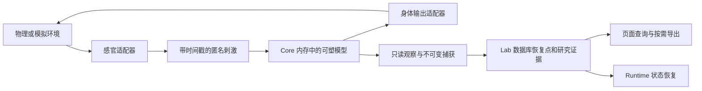

# ThreeMind 内核：架构、时间与局部动力学

[English](../en/v2-kernel.md)

当前新建意识使用 **`threemind.causal/9`、`threemind.state/6`**。旧 V3 的局部机制依据 Git `97d8592` 恢复，保留已批准的时间戳递送和独立传播巩固。[恢复记录](plans/v3-restoration.md)给出逐项决定、全部公式、源码证据和实际验收状态；[历史核查](v2-kernel-behavior-audit.md)记录恢复前的问题。旧 causal/1–7 状态保留原版本供读取、查询和导出，不能套新版本号续跑或继承。

研究解释遵守[意识假设](consciousness-hypothesis.md)。局部规则描述一个可检验的动力系统；工程恢复不等于已经验证 AGI 或主观体验。

## 架构与边界

Core 只处理数值刺激、状态和命令；不依赖数据库、浏览器、AI 或可视化。Python 参考实现位于 `src/threemind_core`，Rust 位于 `crates/threemind-core`，恢复的局部公式各自集中在 `restoration.py` 和 `restoration.rs`。Runtime 负责适配器、时钟、器官和状态交换；Lab 负责研究、权限、证据、数据库与界面。

空模型没有人为指定的概念节点、认知连接或脑区。新通道可形成零激活、零支持的受体；孤立节点和独立小片网络合法存在。默认连接来自同一刺激实际共同触达的节点，同一时刻的独立输入不因此被合并。先天结构来自有谱系的父本。通道映射与分帧属于版本化适配器，不能随意更换。

外部文字标签和信封编号只用于观察与审计，不改变激活路径。被动读出保留原始活动，不按人类对因果或语言意义的判断剪裁。[感官协议](v2-inputs.md)、[媒体器官](v2-media.md)和[读出边界](v2-readouts.md)另有说明。

## 三种时间职责

| 时间量 | 默认 | 职责 |
| --- | --- | --- |
| `step_us` | 10,000 μs | 固定数值格点，包括归零与现有可选空间竞争 |
| `propagation_interval_us` | 100,000 μs | 实际发送、旧抑制非线性相位、连接遗忘与修剪的模型节律 |
| `delay_us` | 10,000 μs | 已发出信号到达的正延迟 |

时间为无符号 128 位整数微秒；JSON 使用十进制字符串。状态保存 `time_us`、`state_time_us`、`next_step_us`、`next_propagation_us`、完整事件队列和死亡等待状态。`advance_to(12345)` 不额外制造传播步，分段观察、暂停恢复和导出恢复须保持同一因果相位。

同刻先按实际经过时间结算损失，再按事件序号递送已有事件、计算实际激活变化；若到数值格点则执行现有可选空间竞争，若到传播格点则执行发送与旧抑制步骤、遗忘和修剪，最后检查死亡期限。截止同刻的到达事件先于判死。在途信号只有确实引起激活才中断无激活计时。

实时模式用宿主单调时钟约束模拟秒与实际秒；加速模式使用明确倍率；无界模式尽快计算。普通意识默认没有时长上限。显示刷新和性能档位不能改动上述模型时间参数。真实硬件遥测要求实时模式；记录重放可按原时间戳加速。

## 从刺激到保持、遗忘

设激活为 $a$，抑制为 $q$，软饱和 $S(q)=c\tanh(q/c)$，响应 $R(q)=1/(1+g_rS(q))$。接收量经过节点自身响应得到触达量，再由上限决定实际激活增量。发送量由源节点、连接和显式空间规则决定，不读取目标状态；已发出的消耗不因目标饱和撤销，也不在接收时重复收费。

每条连接的发送量为 $x_{ij}=a_iR(q_i)w_{ij}g_{prop}\Delta t_{prop}$，默认恢复单次 `.42` 增益。逐边门槛是 `.004`，先排除不合格单路，再汇总。源激活门槛与接收饱和是独立规则。归零阈值也恢复 `.004`，使用内核状态而非图形显示阈值。

出生权重和稳定度同时受共同激活、合并巩固冲量及局部新颖影响。每节点局部可塑性随其稳定度变化；既有强边继续增强更困难，历史触达参与学习。事件学习率默认 `.055`、局部新颖增益默认 `.018`；它们不是数值步长的函数，也没有语义新颖评分。

通过逐边门槛且实际发出的非零传播可独立巩固经过边。旧候选分支不再重复计算同一次联想巩固，直接共同触达仍单独按旧公式学习。

抑制恢复两阶段软饱和、有限势分配、源头扣除和正延迟扩散。激活、节点痕迹与抑制按实际模拟时间衰减；连接资格迹、稳定度、经过历史共同影响遗忘。节点支持度的损失受节点稳定度影响。激活归零不直接删除节点，必须同时满足孤立、支持不足、无激活及足够久未触达，默认支持门槛 `.006`、等待超过 80 模拟秒。各项可关闭的速率、门槛与损失开关均在配置目录中公开。

完整出生、触达、学习、抑制、遗忘及修剪公式见[恢复记录的公式与执行相位](plans/v3-restoration.md#公式与执行相位)。本页不再把 causal/7 的汇合阈值、硬封顶或独立指数遗忘描述为当前规则；这些替代方案留在[后续议题](plans/mechanism-questions.md)。

## 生命与显式损伤

第一次非零激活之前为“待接入”。出生后所有节点连续无激活达到 `quiescence_death_us` 才死亡，默认 1 模拟秒；0 表示同刻到达处理完后立即判断，不是关闭死亡。剩余连接、抑制、开放接口和不能激活节点的外部输入都不是存活证据。暂停或实验时长结束也不等于死亡。

死亡保留结构和证据，不自动复活同一意识。2026-09-09 已按确认决定删除独立饥饿判死，保留可选缺能结构损伤；能量耗尽本身不抹掉激活或重置无激活宽限期。详见[统一活动死亡](plans/energy-lifecycle.md)。

研究损伤接口分为 `disconnect_edges`、`delete_nodes`、`silence`、`unsilence`。断边以后可由真实刺激重新形成；删点清除受体索引和相邻连接，同通道后来出生的节点取得新身份，不继承被删节点的历史，旧在途包不会转投它。断边不撤回已经发出的包。默认不执行人为或随机损伤。

## 配置、保存与恢复

完整参数通过同一目录进入基础配置、高级配置和 JSON，校验及保存共同执行类型、范围、只读与实验冻结约束。节点标记／感官模式在创建第一层公开，和高级文本编码共用 `text_sensor.encoding`。

普通科学参数修改须先暂停并保存；Core 用旧参数结算到生效时刻后安装新值，既有包不被追溯改写。显式更改传播周期会从生效时刻开始新相位、重置传播周期预算用量。数值步长、身份种子及感官编码创建后固定。四个器官快捷开关使用单独受限命令，在运行时提交边界记录实际生效时间，不能借此改动无关内核参数。

运行中的模型在 Core 内存中持续改变；Lab 按记录协议写入数据库。`.tmind` 与 JSON 是按需导出格式，不是每次触达写回的模型文件。状态捕获必须保存局部历史、相位、队列、收发账本及静默/死亡状态，仅保存边权不能精确继续。旧模型只读，不自动迁移为新动力学。

## 可选研究工具与验证边界

[因果空间](v2-spatial.md)、[数量预算](v2-resource-limits.md)、[能量约束](v2-energy.md)、[输入注意](v2-attention.md)和[来源策略](v2-source-policies.md)有独立开关、参数和证据。因果空间、数量竞争、全局钳制默认不启用；空间比较竞争保持原数值相位，与本轮恢复的拓扑抑制不同。前端布局坐标不进入 Core。

同后端检查状态摘要和时间分段一致性；Python/Rust 浮点对照允许明确的数值误差，不承诺任意 CPU 和数学库逐位一致。旧源码小样例验证局部公式，已批准的时间架构等差异单列预期，不声称整条轨迹回到旧帧驱动结果。实际测试、未完成项和限制以[恢复验收记录](plans/v3-restoration.md)为准。
