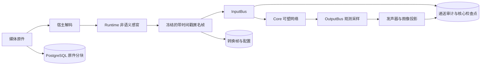

# 物理媒体感官与被动输出器官

本页说明文件输入与被动输出的信号算法、配置、总线及证据。后续已接入[连续采集](v2-live-capture.md)、[网络设备](v2-network-devices.md)、[连续器官输出](v2-continuous-output.md)、[截面与时序读出](v2-readouts.md)和[大媒体续传](v2-media-uploads.md)；各模块当前状态见[完整能力清单](v2-capability-restoration.md)。

## 从页面使用

1. 创建意识时，在高级参数中配置“听觉感官”“视觉感官”“发声器”“激活图像投影器”。四者默认关闭。已经创建的实例先暂停，在参数配置中启用；标记为创建后不可更改的接线参数保持只读。
2. 意识详情 → **感官与输入 → 媒体输入**，选择声音、图片或视频及原件，可预览并调整刺激强度、起点延迟。原件预览不会输入内核。暂停状态下允许接收，继续运行后才处理输入命令。
3. 在 **输入记录** 按音频／图片／视频来源筛选，查看原件信息、配置、转换摘要及逐帧计划／实际递送时间。可以下载原件、全部原件 ZIP，或导出帧 CSV／JSONL。
4. 在 **器官输出** 选择已提交采样，查看灰度投影和振荡器控制表。图像可导出 PNG；单帧活动可试听或合成半秒 WAV，所有输出可导出 JSONL。

输出页面展示数据库已经提交的观测快照，可能落后于正在计算的状态。WAV 是选定快照的合成音，不是运行期间录制的连续声音；投影图也不是模型“看见”或“想象”的内容。两者均不使用观察文本标签、不做 TTS，也不会自动反馈给输入总线。

## 执行边界与数据链



Core 接收的仍只有时间戳、匿名 u32 通道和数值幅度。文件名、媒体类型、编码器名称、视网膜位置等都是外围仪器信息，不成为语义节点或预设连接。没有 ASR、OCR、对象识别、预训练 embedding 或 LLM。媒体没有改变 `threemind.causal/1` 动力学。

本批新增 **33 个真实参数**，全部进入共用配置目录，因此新建、暂停编辑、项目默认值以及图形／JSON 双模式同时支持。听觉采样率、窗口、编码、频带布局和波形分箱，以及视网膜尺寸会影响通道解释，创建后固定；可变增益、滤波、块扫描等修改需要暂停并保存。已接收载体采用其接收时的配置，不被新设置追溯改变。

## 听觉算法与时间

实现为 `threemind_runtime.media.AuditorySensor`，仅依赖标准库。宿主将媒体解码为单声道 PCM，记录解码库版本、原采样率、样本数、下混方式及削峰数量。PCM WAV 使用算术平均下混；压缩音频使用 FFmpeg 的 mono 下混，二者不能默认视为同一个多声道混音协议。

保留旧算法的**线性重采样基线**，并修正分包时重新计时的问题。目标样本 $n$ 的源坐标为 $u_n=n f_s/f_t$，使用相邻源样本线性插值。分包之间保存有理相位、未用源样本及不完整窗口；不会把每个浏览器大小的数据块补成一整窗。该基线不是高保真抗混叠滤波器，高于目标 Nyquist 频率的输入可能混叠；涉及频率响应的研究须报告采样率与此算法版本，不能把结果当成已标定的人耳模型。未来增加滤波重采样器应作为新的公开感官协议，不能静默替换已接收帧。

完整窗口的样本数 $N=\operatorname{round}(f_t W/10^6)$，以窗口结束时刻递送，时间单位为微秒。末尾短窗使用实际样本，不补零；结束时刻限制在真实样本时长内。无脉冲窗口仍占据时间，之后的声音不会被提前。

`band-energy` 是沿用的模式标识，当前具体量是 Hann 窗下 Goertzel 频点幅度，并非整个频带的能量积分。递推初值为 $s_{-1}=s_{-2}=0$，Hann 窗 $w_n=0.5-0.5\cos(2\pi n/(N-1))$；只有一个样本的末窗取 $w_0=1$：

$$
f_k=f_{min}(f_{max}/f_{min})^{k/(K-1)},\quad
s_n=x_n w_n+2\cos(2\pi f_k/f_t)s_{n-1}-s_{n-2}.
$$

$$
A_k=\min(1,2\sqrt{\max(0,s_{N-1}^2+s_{N-2}^2-2\cos(2\pi f_k/f_t)s_{N-1}s_{N-2})}/N),
\quad v_k=\operatorname{clip}_{[0,1]}\left(\frac{\ln(1+9gA_k)}{\ln 10}\right).
$$

`waveform` 将窗口划分为相邻样本箱，对每箱均值分别输出正、负两条非负通道；真正的零信号不会被平移成 0.5 强度刺激。末尾短窗中没有样本的箱保持零，不重复样本凑满。

每个特征可启用电平、上升、下降通道：$v,\max(0,v-v_{prev}),\max(0,v_{prev}-v)$。首窗口仅建立变化基线；下降至零的变化被保留，之后的静音不制造新事件。每个上传文件独立建立基线。完整静音仍保存原件、配置和零刺激记录，执行时正常完成，不成为一条永久排队的假事件。

默认 16 kHz、50 ms 窗、12 个频点、80–7600 Hz。频带必须低于目标采样率的一半。全载体刺激强度与感官增益分开记录。

## 视觉算法与时间

`VisualSensor` 将像素以最近邻采样到视网膜。RGB 亮度使用 $Y=\operatorname{round}(0.2126R+0.7152G+0.0722B)/255$，也支持 Sobel 局部边缘或显式阈值对照。Alpha 不参与亮度合成；图片应用 EXIF 朝向后再采样。视频使用解码像素方向，当前不自动应用容器旋转显示元数据。

默认视网膜 24×16、块大小 4×4；按从左到右、从上到下的块序递送。第 $j$ 块时间为 $t_{image}+j\Delta_{patch}$。空白块对应的间隔保留，非零块不合并为一次全图共同触达。块内共同激活仍是公开的感官先验，应记录块大小，不能当成纯显示配置。

视频按配置的最小采样间隔选择画面，保留相对首画面的原始 PTS，记录解码／选中／跳过帧数；缺失、倒退、重复时间戳直接拒绝，不使用猜测的 FPS 重造时间。一轮视网膜扫描必须短于采样间隔。**当前视频入口只处理画面，音轨不会自动递送**；音画同步复合载体属于后续会话协议。

听觉、视觉、文本共享已发布的有种子 u32 双射，但使用不相交受体域，且避开已有物理环境受体。视觉地址按固定 256 宽编码，因此像素地址不是由运行时节点顺序推测的。受体身份分区并不建立脑区或任何图边。

## 被动器官与记录成本

Lab 在已有 `sample_us` 观测边界调用输出订阅，不增加新的数值演化边界。只有启用输出器官时才读取节点身份／激活值，使用原生 `activations()`，不为每帧复制全图与全部边。

发声器选出超过阈值的最多 $M$ 个活动节点，同幅度按 ID 排序，沿用匿名频率映射 $f_i=110\cdot2^{(id_i\bmod48)/12}$ Hz。图像投影将节点 ID 的 BLAKE2b-64 值映射到灰度像素，同一像素取最大活动值。该投影没有反解视觉刺激的承诺，也没有通过哈希预连神经网络。

每条 `organ_output` 包含算法版本、模拟时间、器官配置、振荡器控制值和完整灰度像素；与当前 Core 检查点在同一事务提交。相同时间仍可能有不同状态采样，因此页面和下载使用独立 `sample_id`，分页不会吞掉同时间的另一条记录。完整实验包中的 `organ-outputs.jsonl` 受选定检查点的提交版本约束。因果事件页面默认不加载器官像素数据，防止高密度采样淹没事件列表；器官记录在专用页面查询，证据导出仍保留完整记录。

输出缓冲约达 8 MiB 时提前提交检查点，复用现有单提交槽与背压；不会静默丢帧。更高分辨率、更密集科学采样会增加存储与计算成本。这个机制限制输出缓冲，不是公开平台的总存储配额，也不能保证任意增长模型的内存恒定。

## 数据库与模型复用

数据库迁移 **005** 添加 `media_assets`、1 MiB `media_chunks`、`media_prepared_frames`，并补充零刺激载体的处理版本。媒体原件以项目内 SHA-256 去重，采用 BYTEA，不把 Base64 大串塞进模型 JSON。原件、接收信封、转换帧及命令同事务保存；失败会一起回滚。

执行时校验冻结转换帧的完整哈希，直接排入 InputBus，不再重新解码。随后逐帧审计、队列和 Core 检查点共同提交。独立重放已有匿名帧不需要原解码库。原件下载逐块传输并验证 SHA-256；原件 ZIP 逐块输出二进制内容，清单及去重集合仍占用与载体数量有关的内存。原有完整实验证据 ZIP 的图表与整体打包仍有内存成本，不能把它也称为全程流式。

新 `.tmind`／JSON 模型携带 `threemind.runtime-profile/2`，包括感官种子、文本／听觉／视觉配置与两个输出器官配置，并有独立校验值。核心状态格式与哈希不变。Python 与 Rust Runtime、SQLite 恢复均保留这些配置；V1 profile 仍可读取，新增器官默认关闭。Lab 导入后继续以数据库恢复。

模型不打包全部媒体实验素材，也不会在每次学习时重写文件。模型导出包含已经进入 Core 的在途匿名事件；尚未被运行时处理的外部接收命令仍属于 Lab 的待处理工作。研究素材与审计按需另行导出。Rust CLI 目前消费匿名帧并验证／携带 profile；本页 PCM／像素转换的可调用实现位于 Python Runtime SDK，不能据此宣称 Rust CLI 已内置所有媒体解码器。

## 安装、API 与验证

PCM WAV 使用标准库。压缩音频／视频需要 PyAV，图片与视频需要 Pillow：

```powershell
.\.venv\Scripts\python.exe -m pip install -e packages/runtime -e packages/transformer -e ".[media]"
```

标准 Python Runtime 信号算法没有 PostgreSQL、PyAV、Pillow 依赖。宿主自行完成 PCM／像素解码后，可调用 `AuditorySensor.feed()`／`VisualSensor.feed()`，再把返回的各 `Stimulus` 独立交给 InputBus。两种感官提供 `capture()`／`restore()` 保存本流的尾段／变化基线；Lab 文件输入在接收时完成整文件转换，模型导出不假装包含仍在采集的外部设备会话。

API 基址为 `/api/v2/projects/{project}/runs/{run}`：

| 接口 | 含义 |
| --- | --- |
| `POST /media?kind=audio&request_id=UUID&filename=...` | 原始二进制请求体；kind 也可为 image 或 video；可选 `intensity`、`delay_us` |
| `GET /media/{envelope_id}/original` | 校验并下载原件 |
| `GET /media/export` | 全部已接收原件及清单 ZIP |
| `GET /inputs`、`GET /inputs/{id}`、`GET /inputs/export` | 共用原始载体／逐帧审计查询导出 |
| `GET /organs?before_id=...&limit=...` | 已提交输出，按采样记录 ID 分页 |
| `GET /organs/{sample_id}/audio.wav` | 将所选快照合成半秒声音 |
| `GET /organs/export` | 全部输出 JSONL |

所有接口沿用项目权限及写入 CSRF 规则，数据库表启用并强制 RLS。每个 API 进程的媒体解码并发默认 2，可通过 `THREEMIND_MAX_MEDIA_DECODERS` 调整；槽位用尽返回 429。默认原件上限音频 32 MiB、图片／视频 128 MiB，时长 120 秒，均在意识配置中可调整。B10 已将原件配置范围扩大至 8192 MiB，页面默认使用[数据库分块与续传](v2-media-uploads.md)；整文件兼容接口仍限 256 MiB。额外宿主解码边界为单画面 4,000 万像素、视频 36,000 帧；超限整条拒绝。没有承诺支持不受限上传。

测试位于 `tests_v2/test_media_v2.py`、`tests_v2/test_sensory.py` 和 `threemind-ui/e2e/media.spec.ts`。涵盖分包／恢复等价、真实尾段、静音、局部块、PTS、压缩音频、参数／profile、项目隔离、持久化中途失败、幂等、原件哈希、数据库恢复、输出不改变核心状态和实际页面操作。最新结果见[验证记录](v2-validation.md)。
