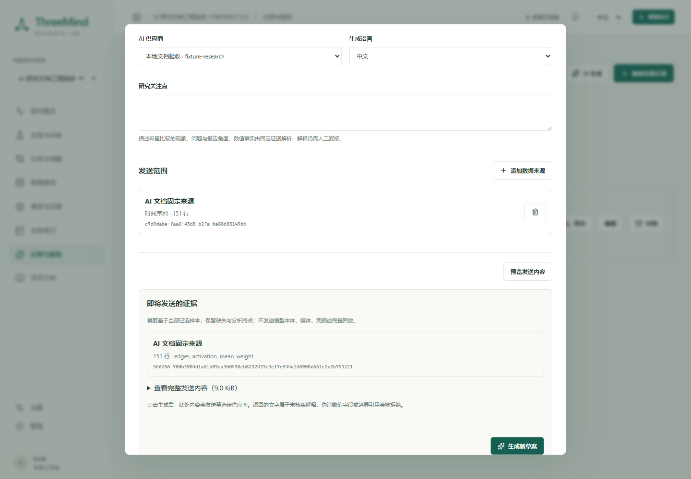

# 用 AI 生成研究记录与报告草案

E2c 已接入“记录与报告”右上角的 **AI 生成**。人工取数、编辑、制图和导出无需 AI；生成器使用“设置 → AI 供应商”中已启用、已授权的供应商，也可以连接本地兼容服务。

## 使用过程

1. 在实验记录或实验报告子页点击“AI 生成”，选择供应商、输出语言和研究关注点。
2. 添加固定来源，可复用已有采集，也可按意识、实验、恢复点和指标采集。报告还可选择记录的具体修订和内容块；之后原记录修改不会改变本次范围。
3. 点击“预览发送内容”。页面展示来源、样本数、指标、来源哈希；可展开完整系统提示及请求正文。改变范围、语言或供应商后需重新预览。
4. 点击“生成新草案”才发送至供应商。排队、请求和校验在后台进行，离开页面不会取消任务。
5. 打开生成的草案，核查图表、数值、文字解释和局限。通过人工复核后可以显式修改复核状态，再保存新修订。

同一实验可以反复生成多份草案，每次都是新的文档。确认响应丢失时，“重试提交”使用原操作编号，返回原调用；不会因为一次网络重试再收费。若页面已经关闭或刷新，可以在“生成历史与调用记录”查找原调用，查看、取消或打开结果。请求发送后的不确定故障沿用供应商模块规则，不会自动再次发送。

## 实际发送的内容

摘要统计来自所选固定来源的**全部采集行**，不是最近 32 条。非分析来源用一次聚合扫描计算全部已选指标的有效／缺失数、首末值、最小／最大和样本均值。提供范围、覆盖、恢复点与协议哈希，但不把汇总统计冒充逐点轨迹，不由均值或极值推断振荡、顺序和因果关系。

统计来源保留每个终点的原分析结果，包括阴性、缺失、置信区间、多重校正及独立配对单位。逐配对大数组仍保存在本地，发送配对总数，以及含右删失、不完整或失败标记的配对数量。此处是明确标记的汇总，不宣称统计标记不存在就证明实验没有失败。

所选记录只发送指定修订的指定内容块。作者文字明确属于未经事实验证的材料。意识模型本体、原媒体、连接凭据、完整协议回放和项目其他数据不会自动加入请求。项目内的标题、说明等也可能含个人内容，应以发送预览为准。

每次最多 8 个来源（含引用记录涉及的来源）、合计 64 个指标、120 KB 证据摘要，最终提示仍受供应商模块的 200 KB 请求上限约束。超过时明确要求缩小范围，不静默丢弃末尾来源或阴性结果。以上是研究工具预算，不改变意识内核参数。

## AI 可以生成什么

输出使用与人工编辑相同的 `threemind.research-document/1` 结构：说明、图表、表格、数值引用及固定记录引用。返回内容不允许携带原始测量数组、任意数值字段、SQL 或运行命令。服务端先校验类型和允许引用，再解析来源和保存草案。

所有已选来源必须保留并有数据内容块。统计来源必须包含选择全部指标的数据表，不接受仅保留有利终点。必须有非空局限说明。错误引用、擅改文档类型、遗漏来源、重复 JSON 键或结构错误均保留为被拒绝的调用，不创建半成品文档。

这些约束保护原始数据并检查结构，**不能证明自然语言解释正确**。AI 可以错误描述趋势或过度推断，需人工审阅；数值事实应通过 `fact`、表格和图表由服务端解析。工程测试验证软件边界，不证明 ThreeMind 已有意识或 AGI。

## 来源、权限与存储

schema 28 在现有 PostgreSQL 增加生成请求及其来源／记录引用。引用在请求入队时固定并受外键保护，不能在请求期间释放证据。没有新增数据库、MQ 或自动模型文件。

任务需要 `worker.ai` 和 `worker.research_ai_v1`，旧 AI 节点不领取自己不会应用的文档结果。发起时和保存结果前均检查项目权限、供应商可用性及版本；取消与结果提交使用相同调用锁。草案、引用、版本及应用回执在同一租约约束的事务中保存；故障回滚后不会留下半份报告。

调用保存模板版本、完整发送内容、来源哈希、供应商／模型和配置版本、原始响应、用量、费用与拒绝原因。生成文档的修订保留调用编号；列表、编辑器和调用详情可以相互定位，预览和文件导出也标注 AI 来源。后续人工编辑保留来源身份，复核状态由具体修订决定。

默认仍为本地或项目内材料；公开分享另行实施。运行在机器人或机器上的独立 Runtime 没有增加 AI 供应商或数据库依赖。

## 验证

全量回归 **347 项通过、0 跳过，544.46 秒**；AI 工具与供应商专项 21 项通过。最后补充导出来源标记后的 AI／导出专项 **10 项通过，48.32 秒**。覆盖完整摘要、负差值／缺失终点／删失、固定记录引用、原编号重试、旧节点排除、取消、拒绝越界和事务回滚。浏览器验证使用本地模拟供应商，不向外部或付费模型发送研究数据。

最终 Edge **6 条流程通过，36.2 秒**，包括新增的两条 AI 全流程及原有四条记录／报告／导出回归。修复嵌套选择框的可访问名称后复验通过；未保存提示、确认丢失后的原编号重试、拒绝伪造数值、调用来源跳转、固定记录修订与手机深色布局均已检查。详见[验证记录](../benchmarks/2026-09-07-research-ai-validation.json)。

E2d 增加[事件来源](v2-research-events.md)，模板 `/2` 的事件摘要保留全部所选行的分类计数、阶段、范围与哈希，不自动发送原始载体和参数内容。

F5c 的当前模板为 `threemind.research-authoring/3`，增加[独立评估来源](v2-assessments.md)。发送全部固定规则判定及试验覆盖范围；AI 草案必须引用完整的固定判定块，不能只挑通过项，也不能填写判定数值。人工解释与规则结果分开保存。固定修订分享、先天演化和此前容器验收的后续交付见[恢复清单](v2-capability-restoration.md)，不以旧验收替代当前版本验收。

使用与导出边界另见[记录与报告](v2-research-documents.md)、[导出](v2-research-exports.md)和[供应商](v2-ai-tools.md)。
