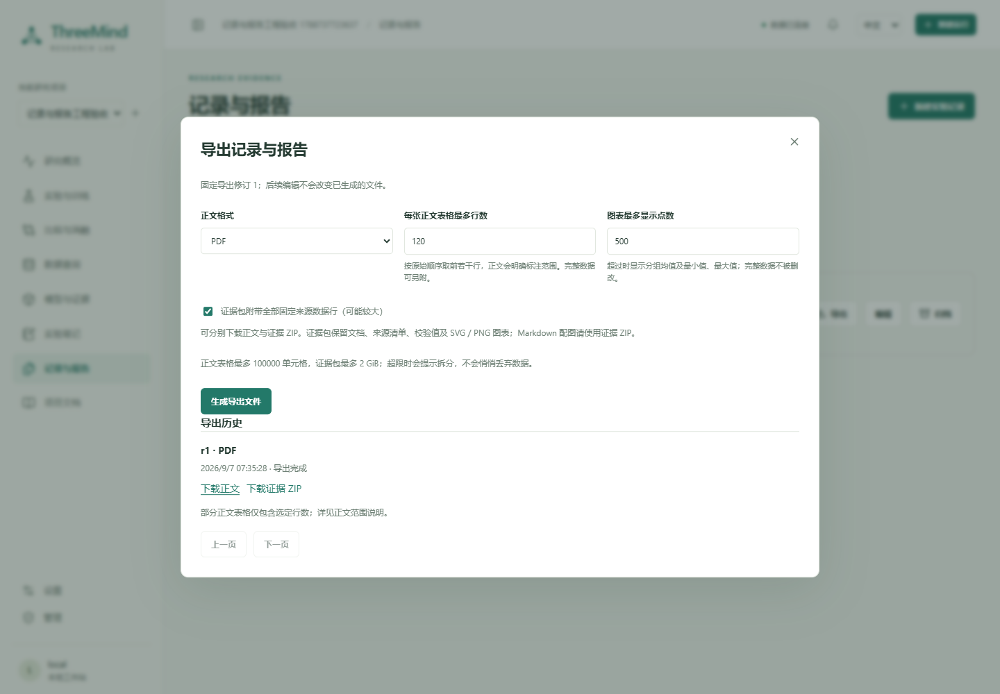

# 研究文档导出与证据包

E2b 为“记录与报告”提供按需 Markdown、HTML、Word 和 PDF 导出。选择一个已经保存的修订，再选择格式、正文表格行数、图表显示点数及是否附带完整数据。导出是后台任务，离开对话框后继续；完成后可以分别下载正文和 ZIP 证据包。未保存修改必须先保存，避免把当前编辑器误认为导出的内容。

## 固定内容与可核查范围

每次任务固定文档修订及其引用的记录修订。之后改标题、说明或图表，不会改变这次导出的正文和引用。请求确认丢失时使用原操作编号重试，返回原任务；同一编号更换选项会被拒绝。

正文表格默认前 100 行，可选 1–5000 行。正文说明实际展示行数和来源总行数；截取不代表其余观察不存在。节点、连接和分析终点保留对象标识，网络表格同时显示恢复点时间。宽表按每组三个指标拆分，稳定行标识重复展示。

时间图默认最多 500 个显示点，可选 10–1000；仍使用固定来源的全部选定数据计算原有显示分组。均值及极值范围不是置信区间，时间样本不是独立重复。缺失不补零；统计结果复用原来的配对分析、置信区间、多重比较及删失信息。导出不会重新运行意识或改变内核。

## 格式与排版

| 格式 | 内容和使用方式 |
| --- | --- |
| Markdown | 保留作者原始 Markdown 和 LaTeX；图片引用 `figures/`，使用证据包中的正文与图片目录一起打开 |
| HTML | 图表和公式内嵌，可离线打开；禁用脚本和外部资源请求 |
| Word | 真正的 DOCX 段落、表格和可编辑 OMML 公式；跨页重复表头、页码和图表编号 |
| PDF | 固定分页、嵌入中文字体、矢量图表及展示公式；行内公式按高分辨率渲染 |

正文来自同一内容模型。表格、基础 Markdown 格式、列表、链接和公式已经验收；不承诺任意 Markdown 扩展和整套 LaTeX 宏包都能导出。无法可靠转换的公式明确失败，可先导出保留源码的 Markdown。单个公式限制为 10000 字符、5000 个 MathML 元素。原始 HTML 显示为文字；外部图片显示替代文字，服务不会抓取任意 URL。

使用 python-docx、ReportLab、Matplotlib 和受控 Markdown 解析生成文档；公式通过 latex2mathml、mathml2omml 和 ziamath 转换。应用不依赖安装 Microsoft Word、LibreOffice 或 Pandoc。LibreOffice 仅用于本次开发验收中的 DOCX 渲染检查。[ziamath 官方说明](https://ziamath.readthedocs.io/en/latest/)、[MathML 转 OMML 项目](https://github.com/amedama41/mathml2omml)。

## 证据包

每次导出均产生 ZIP，包含：

- 正文、`document.json` 和实际解析的 `render.json`。
- 图表的独立 SVG 与 220 dpi PNG。
- 被引用记录的固定修订 JSON。
- 每个来源的完整采集清单；选中“附带完整数据”时，额外包含全部固定数据行的 JSONL。
- `manifest.json`：导出编号、请求时间、生成时间、修订与来源哈希、选项、截取提示及各文件字节数、SHA-256。

完整数据指已经明确选取并固定的来源，不是意识所有历史。清单包含来源范围、协议／恢复点或原分析产物、覆盖和缺失。勾选数据附件后可以按采集协议重算来源哈希；未勾选时不声称提供了全部样本。哈希用于完整性核对，不是数字签名。

## 数据库与资源

schema 27 只在现有 PostgreSQL 增加导出请求表，复用任务、分块产物、项目 RLS 和下载授权。临时布局缓冲超过 8 MiB 才落入临时目录，用完清理；权威导出产物写回数据库，不在运行中维护模型文件。独立 Runtime 没有新增数据库或文档转换依赖。

导出节点需要 `worker.report_export_v1`；事件来源升级还要求 `worker.research_events_v1`。缺少依赖或中文字体的节点不领取任务，等待原因可在执行能力中查看。Windows 默认用微软雅黑；Linux 镜像配置文泉驿微米黑。其他部署可用 `THREEMIND_REPORT_FONT` 指向支持中文的 TrueType 字体。Linux 镜像同时配置 Cairo 运行库和安装期间所需的构建依赖；中文、公式、图表及 Word／PDF 已完成[实际容器验收](v2-container-isolation.md)。

正文预算为 10 万表格单元格，证据包为 2 GiB 未压缩内容；超额明确失败。完整数据按 1000 行批次流式写入 ZIP。来源的默认 API 摘要在数据库中先去掉逐配对和回放大数组，并报告省略路径及数量，减少反复传输和解码。`GET report-sources/{id}?compact=false` 可读取完整清单；证据包始终使用完整清单，原始哈希不变。网络投影仍有恢复完整模型的比例成本。

## 验证与后续

全量后端回归 341 项通过、0 跳过；最终导出专项 5 项通过，涵盖固定旧修订、四种格式、完整数据哈希、身份保留、权限隔离、失败不发布、旧 worker 跳过和原编号重试。Edge 四条记录／报告流程通过，包含实际正文和证据包下载、未保存提示及确认丢失。Word 六页、PDF 五页逐页检查；修复了公式 SVG 兼容、默认标题装饰线、跨页空白行和图注分页问题。

详见[该阶段验证数据](../benchmarks/2026-09-07-research-exports-validation.json)。后续已交付[AI 草案](v2-research-ai.md)、[事件来源](v2-research-events.md)和固定修订分享；本页的工程夹具不用于证明意识或 AGI。

## 固定版本分享入口

项目所有者可从“分享”先生成并预览 HTML，再明确创建固定修订链接；正文与完整证据 ZIP 分别授权。普通导出不会自动发布，公开下载也不会让访客进入项目。详见[分享说明](v2-research-sharing.md)。

## 导出排版补充（2026-09-07）

直方图导出会为非常接近的分组边界使用明确标注的偏移量，并选择能区分边界的有效位数，避免所有标签都被舍入成同一个数。HTML、Word、PDF 及证据包内的 SVG／PNG 使用同一图表生成路径；原始分组和数据没有改变。

PDF 表格保留单元格中的显式换行，英文优先按词折行。跨页切分至少保留一行文字及内边距，避免页尾只留下表头和空白碎片；超出一整页的证据单元格仍可继续到后页。新增页尾边界、180 行超长单元格和窄分布图表检查，连同既有导出及生态来源共 **13 项通过，88.30 秒**。
