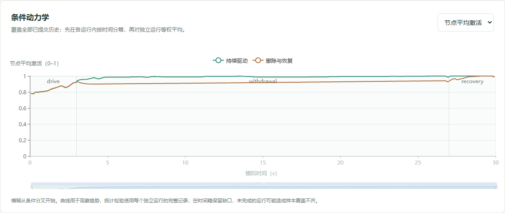

# 刺激撤除、饱和诊断与持续运行优化

本轮在第二代工作台上增加了可执行的刺激撤除／恢复、感官带宽与动作反馈对照、单参数扫描，以及增量检查点和后台持久化。核心动力学参数没有为消除饱和现象而调低；新观测指标只读取状态，不参与学习、传播或死亡判定。

## 可以直接进行的实验

在「实验与训练 → 设计新实验」选择模板：

| 模板 | 条件与用途 |
| --- | --- |
| 局部机制消融 | 完整可塑性、关闭可塑性、关闭局部抑制 |
| 刺激撤除与恢复 | 持续驱动、撤除后恢复、撤除并关闭传播；阶段时长由表单指定 |
| 感官带宽与动作反馈 | 完整感官、单／双通道感官、关闭动作反馈；检验编码及闭环造成的混杂 |
| 单参数扫描 | 同一发育起点下扫描传播率、学习率、抑制增益或遗忘率，2–12 个取值 |
| 自定义条件 | 通过 JSON 指定机制补丁、结构干预、阶段与环境接口约束 |

每个种子先在完整感官和动作反馈下共同培养，再分叉条件。共同培养的物理状态和核心状态均保存；条件运行的时钟从分叉起点计时。所有条件的阶段名称与时长必须相同，允许改变门控。扫描的是发育后条件参数，不等同于已经实现跨代先天模型演化训练。

## 撤除的确切语义

阶段区间为相对于分叉起点的半开区间 `[start, end)`，以整数微秒判断**刺激递送时间**。当输入关闭时，物理身体仍按相同物理时钟演化，已有内部信号按原时间戳递送，感官事件被门控。恢复阶段允许新的感官事件进入。MuJoCo 的动作在 `t` 生成，模拟 `[t,t+20ms]` 后得到的感官事件在 `t+20ms` 递送；不会反向写入 `t`。

共同培养阶段已经排队、但尚未递送的外部刺激，也受新条件的门控和感官带宽限制。它们的原始状态可从共同培养恢复点检查；内源传播事件不被门控删除。回放环境采用同一规则。最大通道数按幅值降序、通道身份打破平局，保留排序后的真实数值，不创造替代语义输入。

`input_enabled=false` 表示计划内的感官撤除，源仍可在后续阶段恢复；它不等于死亡。自定义阶段还可设 `close_sources=true` 永久关闭输入源，该阶段及所有后续阶段都必须关闭输入。只有内核满足自己的活动耗尽条件才进入 `dead`。执行暂停、数据库故障和模型死亡仍是不同状态。

精确恢复上下文还保存当前阶段索引、下一次输入和观察时间、身体积分状态。暂停后继续运行不会从头重复阶段。配对运行不能追加未登记的刺激、结构干预或手动源关闭；要改变设计，应新建实验，或分叉为不属于原统计队列的独立运行。独立分叉保留来源哈希，默认不继承实验阶段和统计身份。

## 新指标与统计解释

设节点数为 `N`、有向边数为 `E`，节点激活为 `a_i`，内核阈值为 `epsilon`：

$$\bar a=\frac{1}{N}\sum_i a_i,\quad f_{active}=\frac{\#\{i:a_i>\epsilon\}}{N},\quad f_{sat}=\frac{\#\{i:a_i\ge0.95\}}{N}$$

$$d=\frac{E}{N(N-1)}$$

无节点时比例记为缺失；少于两个节点时密度记为缺失。0.95 是明确记录的饱和观察阈值，不是意识判据。每个阶段计算平均激活、饱和比例、活动比例、密度、平均权重的**时间加权均值**，以实际采样时间作梯形积分再除以阶段时长。

阶段统计严格选择 `[start, end)`：运行器额外采集 `end−1µs`，避免把 `end` 时刻恢复的刺激混入上一窗口。最后一个微秒使用末值保持完成积分；其余点使用梯形估计。缺少起点或这个左端极限采样时，阶段终点返回缺失，不补零。统计版本为 `half-open-microsecond/2`；旧阶段数据若缺少该采样，须重新运行协议才能得到完整覆盖。该积分仍是采样估计，不是逐事件精确积分。

关闭输入的阶段额外报告稳定衰减：节点平均激活不超过 `0.0001`，保持至少 `0.5s` 且直到窗口结束。记录从撤除起点到第一个满足此条件的采样点的时长。若窗口内未确认，则报告右删失和实际随访长度，不将窗口长度当作衰减时长，不删除这些运行后再比较剩余时长的均值。

条件曲线覆盖所有已提交历史，经有界时间分箱后绘制。先在每个运行内对箱内样本平均，再给独立运行相同权重；这是显示估计，不是阶段的时间加权终点，也不是置信区间。空箱留缺口，结果包含有效独立运行数。配对检验仍使用每个运行的完整观察记录，避免把时间点当作独立重复。

证据 ZIP 增加 `phase-evidence.json` 和饱和／活动比例图，分析 JSON 包含每个种子的阶段覆盖、删失情况、配对来源、最终模型哈希和效应统计；可单独下载统计表 CSV。界面可按整体／阶段筛选中文指标，筛选不改变 Holm 校正范围。曲线的显示分箱不影响导出的原始观察数据。

## 性能改动和复验

执行器现在从 Core 读取有序 `(node_id, activation)`，不再为两轴动作序列化全部边和节点历史。固定的执行器接线符号在环境适配器中缓存，已删除节点不会累积；同一时刻的新旧读取路径须产生相同的动作、感官事件和物理状态。

检查点采用完整锚点／有界增量、变化行投影和单槽后台写入，详见[存储设计](v2-storage.md)。这是用内存和有界恢复成本换取较低的阻塞及重复写入。密集学习时大量行可能同时变化，仍会写入完整恢复点，不能宣称获得稀疏负载下同样的提速。

`scripts/benchmark-checkpoints.py --seconds 300` 在独立测试库中比较 10,000 节点／100,000 边的新旧读取、稀疏和密集检查点，并对 1,000 节点／10,000 边运行有界后台写入压力测试。所有拓扑都标为合成工程夹具，不作为学习证据。原始记录和本机结果见[验证状态](v2-validation.md)。

这批机制诊断仍不能证明长期记忆、泛化、AGI 或主观意识。尤其要区分持续物理驱动、编码造成的共同激活、内部传播和真正有用的可塑性；模板让这些差异可以重复检验，不预设哪一种解释正确。

## 本机四种子探索结果

项目「机制验证 · 刺激撤除（探索性）」中保留了可直接查看的运行和分析。当前有效实验为「物理驱动与 24 秒撤除 · 半开区间复验」，使用种子 11、23、47、89：共同培养 2 秒，条件驱动 3 秒、撤除窗口 24 秒、恢复 3 秒，共 12 个条件运行。

| 条件 | 撤除窗口的平均激活时间均值（四种子范围） | 饱和比例时间均值 | 观察到的稳定衰减 |
| --- | ---: | ---: | --- |
| 持续驱动 | 0.981–0.997 | 0.929–0.986 | 此组持续输入，不评估撤除时长 |
| 撤除与恢复 | 0.879–0.945 | 0.791–0.900 | 四组均在 24 秒窗口内未确认，右删失 |
| 撤除＋关闭传播 | 0.00481–0.00684 | 0 | 2.6–2.7 秒 |

这支持一个有限判断：当前条件下，高活动不完全来自持续外部输入，内部传播足以维持较高激活。它尚不能区分有用的持续处理和失去动态范围的自激状态。下一轮应优先扫描传播增益、局部抑制、连接密度与感官共同激活，观察稳定性、扰动响应与可分辨状态，而不是先以调参得到好看的曲线。

边界修复前后，12 个运行的最终模型哈希全部一致，说明新增采样没有改变模型动力学。修复纠正的是关闭传播对照组被错误标为右删失的问题。原始协议、逐种子摘要与统计见[本机探索记录](../benchmarks/2026-09-05-withdrawal-diagnostic.json)。仅四个种子、一个身体环境、短培养时间，这是一轮探索性诊断，不是统计充分的论文结论。
