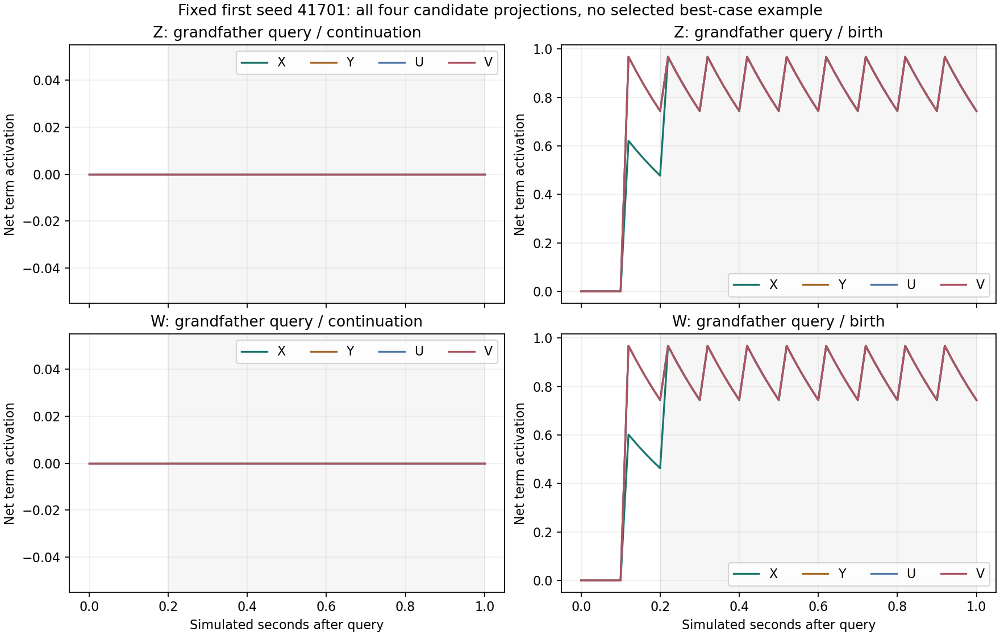

## 爷爷关系与交叉家系检验

普通家系期待Z→X、W→U；交叉家系期待Z→U、W→X。两种情况下Z的父亲仍是Y，W的父亲仍是V。“爷爷较强”要求预期爷爷在X/Y/U/V全部可评分候选中严格最高；平局不算命中。角色区分量比较爷爷问题与父亲问题是否产生不同的爷爷/父亲活动偏向。

| 测量 | 家系 | 角色区分量均值 | 完整种子 | 爷爷较强/可评分问题 | 无法评分问题 |
| --- | --- | --- | --- | --- | --- |
| 连续状态 | 已教例子 | 0 | 3 | 0/6 | 2 |
| 结构出生 | 已教例子 | 0.00038170114 | 3 | 0/6 | 2 |
| 连续状态 | 新家系 | 0 | 3 | 0/6 | 2 |
| 结构出生 | 新家系 | -1.0376957e-05 | 3 | 1/6 | 2 |
| 连续状态 | 交叉新家系 | 0 | 3 | 0/6 | 2 |
| 结构出生 | 交叉新家系 | -3.6020469e-06 | 3 | 1/6 | 2 |

### 每个新家系问题的全部候选（主要0.2—1秒窗口）

| 种子 | 家系 | 测量 | 被问者 | 预期爷爷 | X | Y | U | V | 预期减最强其他 |
| --- | --- | --- | --- | --- | --- | --- | --- | --- | --- |
| 41701 | normal | continuation | Z | X | 0 | 0 | 0 | 0 | 0 |
| 41701 | normal | continuation | W | U | 0 | 0 | 0 | 0 | 0 |
| 41701 | normal | birth | Z | X | 0.84886447 | 0.85219537 | 0.85219537 | 0.85219537 | -0.0033308997 |
| 41701 | normal | birth | W | U | 0.84867865 | 0.85219537 | 0.85219537 | 0.85219537 | 0 |
| 41701 | crossed | continuation | Z | U | 0 | 0 | 0 | 0 | 0 |
| 41701 | crossed | continuation | W | X | 0 | 0 | 0 | 0 | 0 |
| 41701 | crossed | birth | Z | U | 0.848969 | 0.85219537 | 0.85219537 | 0.85219537 | 0 |
| 41701 | crossed | birth | W | X | 0.84878317 | 0.85219537 | 0.85219537 | 0.85219537 | -0.0034121986 |
| 41702 | normal | continuation | Z | X | 0 | 0 | 0 | 0 | 0 |
| 41702 | normal | continuation | W | U | 0 | 0 | 0 | 0 | 0 |
| 41702 | normal | birth | Z | X | 0 | 0.85219537 | 0.85219537 | 0.85120307 | -0.85219537 |
| 41702 | normal | birth | W | U | 0 | 0.85219537 | 0.85219537 | 0.85120307 | 0 |
| 41702 | crossed | continuation | Z | U | 0 | 0 | 0 | 0 | 0 |
| 41702 | crossed | continuation | W | X | 0 | 0 | 0 | 0 | 0 |
| 41702 | crossed | birth | Z | U | 0 | 0.85219537 | 0.85219537 | 0.85120307 | 0 |
| 41702 | crossed | birth | W | X | 0 | 0.85219537 | 0.85219537 | 0.85120307 | -0.85219537 |
| 41703 | normal | continuation | Z | X | 无法评分 | 0 | 0 | 0 | 无法评分 |
| 41703 | normal | continuation | W | U | 无法评分 | 0 | 0 | 0 | 无法评分 |
| 41703 | normal | birth | Z | X | 无法评分 | 0.85219537 | 0.85219537 | 0.85219537 | 无法评分 |
| 41703 | normal | birth | W | U | 无法评分 | 0.8519306 | 0.85211643 | 0.85219537 | 无法评分 |
| 41703 | crossed | continuation | Z | U | 无法评分 | 0 | 0 | 0 | 无法评分 |
| 41703 | crossed | continuation | W | X | 无法评分 | 0 | 0 | 0 | 无法评分 |
| 41703 | crossed | birth | Z | U | 无法评分 | 0.85219537 | 0.85219537 | 0.85219537 | 无法评分 |
| 41703 | crossed | birth | W | X | 无法评分 | 0.8519306 | 0.85211643 | 0.85219537 | 无法评分 |
| 41704 | normal | continuation | Z | X | 0 | 0 | 0 | 0 | 0 |
| 41704 | normal | continuation | W | U | 0 | 0 | 0 | 0 | 0 |
| 41704 | normal | birth | Z | X | 0.85218214 | 0.85101309 | 0.85123027 | 0.85199378 | 0.00018836789 |
| 41704 | normal | birth | W | U | 0.85219537 | 0.85076919 | 0.85139171 | 0.85212385 | -0.0008036646 |
| 41704 | crossed | continuation | Z | U | 0 | 0 | 0 | 0 | 0 |
| 41704 | crossed | continuation | W | X | 0 | 0 | 0 | 0 | 0 |
| 41704 | crossed | birth | Z | U | 0.85218214 | 0.85101309 | 0.85123027 | 0.85199378 | -0.00095187092 |
| 41704 | crossed | birth | W | X | 0.85219537 | 0.85076919 | 0.85139171 | 0.85212385 | 7.1519728e-05 |

### 活动是否跟随交换后的事实

| 种子 | 测量 | 两个家系平均事实跟随差 |
| --- | --- | --- |
| 41701 | continuation | 0 |
| 41702 | continuation | 0 |
| 41703 | continuation | 无法评分 |
| 41704 | continuation | 0 |
| 41701 | birth | 0 |
| 41702 | birth | 0 |
| 41703 | birth | 无法评分 |
| 41704 | birth | 0 |

事实跟随差先计算普通家系的原爷爷减另一个家系爷爷，再减交叉家系中相同两个名字的差；正值才表示该投影随交换事实向相应方向移动。完整种子需要两个家系都可评分。

下图固定展示第一个种子41701，未按最好结果选例子。

### 补充核查原始激活，避免把零差误解成没有反应

直接读取既有ZIP的全部匿名通道，不使用词评分掩码：四个种子的16个完整父亲/爷爷问题，在到达时均有相对于无问题对照的激活变化；从下一次20毫秒采样直到1秒，全部节点的激活差均在1e-12内。因此此处有即时输入反应，但未保持到后续采样；词评分为零不是没有输入或没有活动。该结论只涉及这16个问题与这些采样时点，不能排除20毫秒以内的差异或其他内部状态差异。种子41703的裸名字Z/W存在持续的其他通道差异，不能把完整问题的结果泛化到所有输入。完整诊断见`raw-activity-differences.json`。
