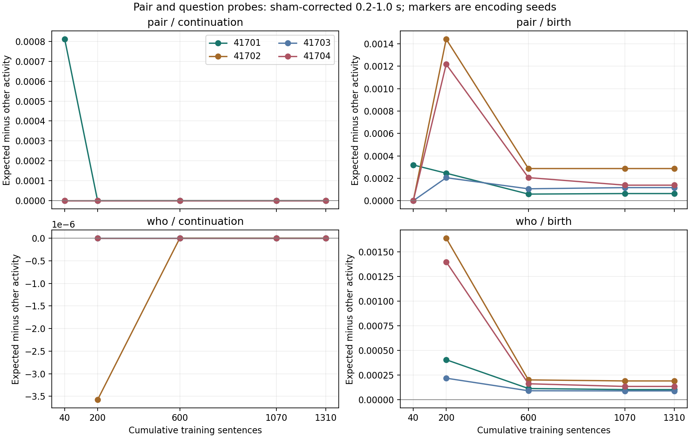

## 配对与问答的分阶段检验

表中数值是预期对象减另一个对象的净活动差：配对检查甲→松子、乙→铃铛；问答检查四个“谁是/是谁”问题。正值表示这个外部投影更偏向预期对象，零不代表无活动。

### 主检验：保留当前活动

| 阶段 | 检查 | 平均差 | 正方向种子/可评分种子 | 预期对象较强/可评分问题 |
| --- | --- | --- | --- | --- |
| 各20次后 | 配对 | 0.00020283012 | 1/4 | 1/8 |
| 对话第1轮后 | 配对 | 0 | 0/4 | 0/8 |
| 对话第1轮后 | 问答 | -8.9398164e-07 | 0/4 | 2/16 |
| 对话第3轮后 | 配对 | 0 | 0/4 | 0/8 |
| 对话第3轮后 | 问答 | 0 | 0/4 | 0/16 |
| 家系学习及回顾后 | 配对 | 0 | 0/4 | 0/8 |
| 家系学习及回顾后 | 问答 | 0 | 0/4 | 0/16 |
| 新家系学习后 | 配对 | 0 | 0/4 | 0/8 |
| 新家系学习后 | 问答 | 0 | 0/4 | 0/16 |

### 辅助：清空活动的结构出生副本

| 阶段 | 检查 | 平均差 | 正方向种子/可评分种子 | 预期对象较强/可评分问题 |
| --- | --- | --- | --- | --- |
| 各20次后 | 配对 | 7.9784718e-05 | 1/4 | 1/8 |
| 对话第1轮后 | 配对 | 0.00077790472 | 4/4 | 7/8 |
| 对话第1轮后 | 问答 | 0.00091608136 | 4/4 | 9/16 |
| 对话第3轮后 | 配对 | 0.00016466017 | 4/4 | 7/8 |
| 对话第3轮后 | 问答 | 0.00014239898 | 4/4 | 14/16 |
| 家系学习及回顾后 | 配对 | 0.00015166789 | 4/4 | 7/8 |
| 家系学习及回顾后 | 问答 | 0.00012983939 | 4/4 | 14/16 |
| 新家系学习后 | 配对 | 0.00015166789 | 4/4 | 7/8 |
| 新家系学习后 | 问答 | 0.00012983939 | 4/4 | 14/16 |

### 补充：配对互换后，偏向是否随教学变化

互换组一致训练甲＝铃铛、乙＝松子。下面两列分别按各自教学对应计算正负：如果只是词本身的固定偏向，互换组的“正确方向”通常反而变负；若两列都为正，则该组活动偏向跟随了相反的教学对应。两个种子是探索性复核。

| 种子 | 测量 | 检查 | 普通组正确方向差 | 互换组正确方向差 | 事实跟随差 |
| --- | --- | --- | --- | --- | --- |
| 41701 | continuation | pair | 0 | 0 | 0 |
| 41701 | continuation | who | 0 | 0 | 0 |
| 41701 | birth | pair | 6.3812044e-05 | 9.6169233e-05 | 0.00015998128 |
| 41701 | birth | who | 0.00010324232 | 0.00011107181 | 0.00021431413 |
| 41702 | continuation | pair | 0 | 0 | 0 |
| 41702 | continuation | who | 0 | 0 | 0 |
| 41702 | birth | pair | 0.00028710843 | 0.00026683654 | 0.00055394496 |
| 41702 | birth | who | 0.00019102541 | 0.00020581554 | 0.00039684095 |
