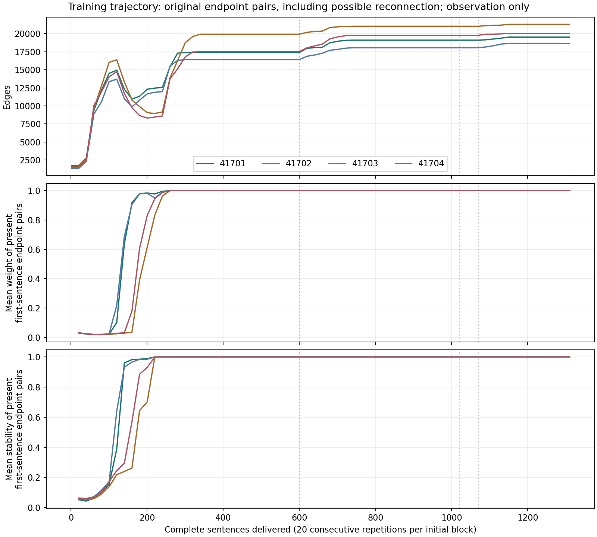
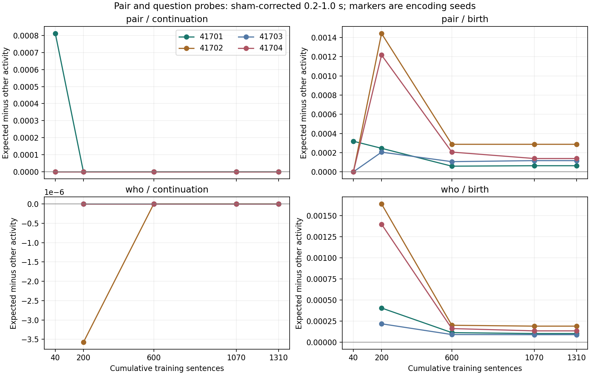
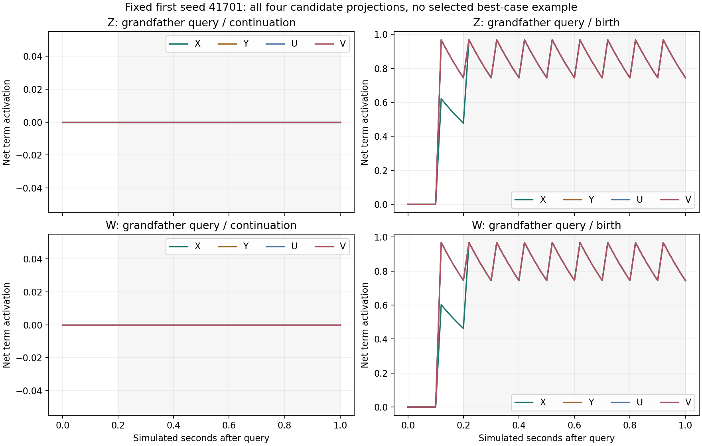

# Blocked sentence teaching with intact speakers and punctuation

> **Revision r3 · 2026-10-10**
> Revision reason: Verified original-file relocation; append location-resolution guidance and preserve the experiment conclusions.
> Original: [report.en.md](report.en.md); parent r2: [report.r2.en.md](report.r2.en.md)

> **Revision r2 · 2026-10-10**
> Revision reason: Relocate generated evidence out of Git; preserve original bytes and conclusions.
> Original: [report.en.md](report.en.md); parent r1: [report.en.md](report.en.md)

2026-09-09. Project `5f779f43-ab27-4638-bb11-458a43598637`. The full Chinese report is in `report.md`.

## Exact execution

Each complete sentence was delivered **20 consecutive times before switching**, for three full sweeps. The ten original dialogue sentences retained every speaker, component and punctuation mark. This produced 600 dialogue inputs. Seven family/rule sentences received the same schedule (420 inputs), followed by five repetitions of each dialogue sentence (50 inputs), and three 20-repetition sweeps of four held-out family facts (240 inputs). Each normal trajectory received **1,310 inputs over 1,048 simulated seconds**.

The four user family examples had no final punctuation and were preserved as supplied. Every training carrier fit one frame (maximum 17 characters). Anonymous distributed encoding used 192 channels, intensity 1 and a fixed 0.8-second interval. Unicode normalization was explicitly set to `none` so full-width punctuation was not converted. Core causal/9 defaults were unchanged.

Four fixed seeds 41701-41704 were trained. Each also had a continuation branch from the common 1,070-input checkpoint with X/U swapped in the subsequent family facts, preserving total character counts and time. After the original study completed, positive pair projections motivated a prospectively recorded follow-up using the first two fixed seeds: complete new training with pinecone/bell swapped consistently everywhere in the dialogue. Speakers, sentence form, punctuation and repetitions were unchanged. This follow-up was exploratory, not part of the original plan. There was no confirmatory statistical test in either part.

All 8,820 delivered training frames were checked against their exact literal carrier, channel encoding and timestamp. Previous projects were not modified.

## Measurements

The primary route preserved trained activity, inhibition, clocks and in-flight events. Each query and no-query baseline used an independent continuation copy, no blank delay, and learning enabled. Auxiliary birth copies inherited structure with activity cleared. Tests never wrote back to teaching sources. Both routes sampled all nodes at 20 ms intervals for one second. The declared primary summary was the 0.2-1.0 s trapezoidal mean minus the no-query baseline; 0-0.2 s summaries were also retained.

Word masks only affect the observer score, never raw activity. Missing exclusive channels are reported as unscorable, not replaced by zero. Saturation did not cancel training. A difference tolerance of 1e-12 handles floating-point ties only. These projections are not generated language responses or calibrated language accuracy.

## Final descriptive measurements

| Arm | Group | Route | Mean contrast | Complete seeds | Expected target strongest / scorable |
| --- | --- | --- | --- | --- | --- |
| normal | pair | continuation | 0 | 4 | 0/8 |
| normal | pair | birth | 0.00015166789 | 4 | 7/8 |
| normal | who | continuation | 0 | 4 | 0/16 |
| normal | who | birth | 0.00012983939 | 4 | 14/16 |
| normal | family | continuation | 0 | 3 | 0/6 |
| normal | family | birth | -1.0376957e-05 | 3 | 1/6 |
| crossed | family | continuation | 0 | 3 | 0/6 |
| crossed | family | birth | -3.6020469e-06 | 3 | 1/6 |
| pair_swap | pair | continuation | 0 | 2 | 0/4 |
| pair_swap | pair | birth | 0.00018150288 | 2 | 3/4 |
| pair_swap | who | continuation | 0 | 2 | 0/8 |
| pair_swap | who | birth | 0.00015844368 | 2 | 7/8 |

## Pair-swap follow-up

| Seed | Route | Group | Normal correct margin | Swapped correct margin | Following difference |
| --- | --- | --- | --- | --- | --- |
| 41701 | continuation | pair | 0 | 0 | 0 |
| 41701 | continuation | who | 0 | 0 | 0 |
| 41701 | birth | pair | 6.3812044e-05 | 9.6169233e-05 | 0.00015998128 |
| 41701 | birth | who | 0.00010324232 | 0.00011107181 | 0.00021431413 |
| 41702 | continuation | pair | 0 | 0 | 0 |
| 41702 | continuation | who | 0 | 0 | 0 |
| 41702 | birth | pair | 0.00028710843 | 0.00026683654 | 0.00055394496 |
| 41702 | birth | who | 0.00019102541 | 0.00020581554 | 0.00039684095 |

## Structural and raw-activity checks

Some initial edges were removed and some endpoint pairs reconnected. Birth timestamps distinguish these cases in `edge-continuity.json`. By the 600-input checkpoint, every extant edge in all four normal trajectories had reached weight 1; the final checkpoints had the same property. This describes the sampled states, not a claim that every edge was always saturated between checkpoints.

For the 16 complete grandfather/father questions in final primary copies, the all-channel raw traces show an immediate response at input time. At the subsequent 20 ms samples through one second, their activation vectors matched the no-query baseline within 1e-12. This does not exclude sub-20 ms effects or differences in other state variables. Bare-name probes in seed 41703 had continuing differences in other channels, so the complete-question result is not generalized to every stimulus. No word mask was used for this diagnostic.

The training schedule, framing, normalization and measurement route differ from the preceding study. Cross-study differences cannot be attributed exclusively to blocked repetition. Four encoding seeds and two exploratory pair-swap controls do not establish general language understanding or role composition. Positive cases, ties, negative margins and unscorable cases are all retained.

## Interpretation

The original birth-copy probes favored the taught targets in 7/8 pair queries and 14/16 who-queries. In the two follow-up seeds, mean pair and who-query preferences reversed with the consistently swapped teaching; the swapped targets were favored in 3/4 pair queries and 7/8 who-queries. This supports a small-scale trainable reactivation preference, beyond a fixed word preference, under the tested auxiliary route. It does not establish general command of the meaning of “is” or speaker roles.

Late primary continuation measurements had zero target contrasts. The source was active and input-responsive, but the difference in sampled activation did not persist for the complete family questions. Learned reactivation preference and usable differentiation in ongoing activity must therefore be assessed separately.

Only 1/6 fully scorable novel-grandfather queries in normal birth copies had the expected grandfather strictly strongest; two additional queries were unscorable. The positive case was seed 41704, Z: X=0.85218214 versus the strongest other candidate V=0.85199378. W did not favor its expected U, and this seed's query projections did not change when the held-out family facts were crossed. This isolated case does not establish relational composition.

The next useful investigation is the transition to widespread recurrent strengthening, not an automatic increase in training scale. Preserve the explicit teaching format while isolating sensory overlap, stimulus timing/strength and existing consolidation/inhibition/decay settings one factor at a time. Inspect finer temporal or other state representations before equating a zero word projection with absent internal differentiation. No such parameter search or Core revision was performed here.

## Resources and evidence

20.10 minutes of experiment-process time; 10 database sources, 44 checkpoints, 132 measurement jobs and 588 probe/sham copies. Highest sampled process RSS 196.49 MiB. The budget remained 30 minutes and 4 GiB. Final storage and integrity checks are in `acceptance.json`; account-level quota observations are in `quota-monitor.json` and are not exact per-task billing.

The plan, supplemental plan, three records, linked report, notebook and Markdown/HTML exports are stored in the project. `evidence-index.json` links original ZIPs and all source hashes. No Core modification, old-data migration or cleanup was performed.

## Data location revision

Selected generated evidence has been archived and verified byte for byte. Original reports, criteria, conclusions and embedded source_commit values are preserved. The logical downloads below require the current host administrator. The data directory is not public.

`data/experiments/2026-09-09-blocked-sentence-teaching/`

[Location and hash index / 位置及哈希登记](../../artifact-index/2026-10-09-relocations.json)

- [measurements.json](/api/v2/storage/research-artifacts/research-artifact:da8236a1ffa136cdac713ca9/content) — 681889 B; SHA-256 `9e0669dc685d327ade76dc05ee7c8969f4c9970de34b1dfa35c737a157fb7b72`.
- [raw-activity-differences.json](/api/v2/storage/research-artifacts/research-artifact:b167a48cd4c0bd2e798155f2/content) — 170406 B; SHA-256 `e4007d0b85bd2c71b34f0e5201476e5c01acf12c2bb8b4527e1e1ee83fbcf48e`.
- [time-courses.json](/api/v2/storage/research-artifacts/research-artifact:52e07c0b2217879a3eca28b7/content) — 973789 B; SHA-256 `d6be83c4ab1768aa5e9b772cb337fa39c034446bd0b3e786c6064afc3c7749f8`.
- [training-traces.json](/api/v2/storage/research-artifacts/research-artifact:5024d015e4fa46a1821c1f0d/content) — 1987149 B; SHA-256 `753b6709e0c6b12cbe7c1faa584cbf5293bac928c0830d81734eb7441b706aff`.

> **Storage-location revision · 2026-10-10**
> This edition adds the verified move of the selected originals to `E:\ThreeMindData`. Stable scientific identities and hashes, experiment dates, measurements and conclusions remain unchanged. Paths in the preserved body describe historical sources; use the registered evidence resolver for current locations. Repository documents and frozen fixtures remain in place, and source copies are retained. Structured query data and running checkpoints remain in the database. This annotation does not assert that missing historical evidence was recovered.
