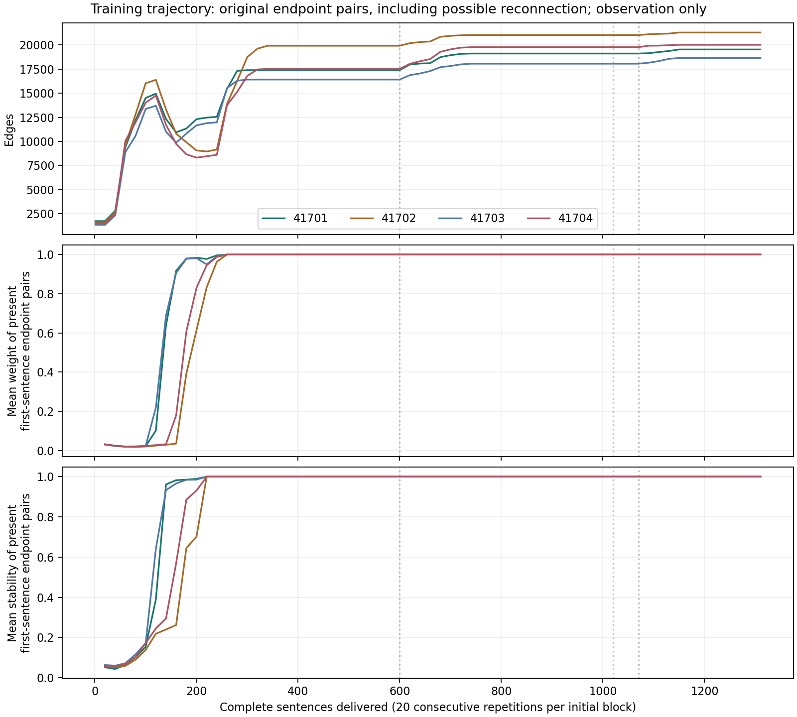
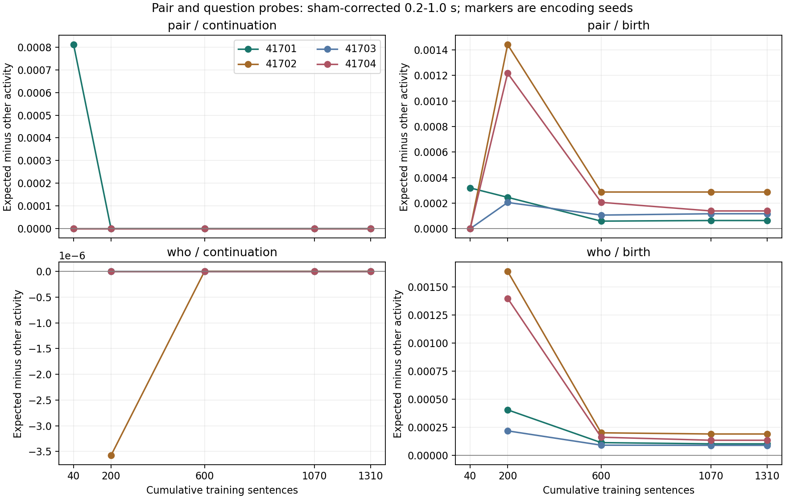
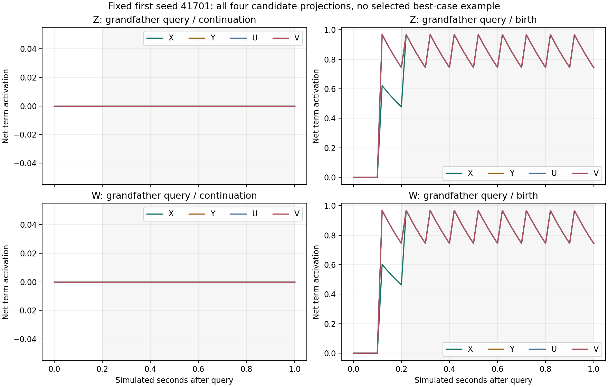

# 逐句重复教学：完整说话人与祖父关系

> **修订 r3 · 2026-10-10**
> 修订原因：原件存储位置已迁移并核验，追加当前位置解析说明，保留原实验结论。
> 原版：[report.md](report.md)；父版本 r2：[report.r2.md](report.r2.md)

> **修订 r2 · 2026-10-10**
> 修订原因：生成证据移出 Git 并完成校验归档；追加位置登记，保留原字节与结论。
> 原版：[report.md](report.md)；父版本 r1：[report.md](report.md)

实验日期：2026-09-09。项目：**逐句重复教学：完整说话人与祖父关系 · 2026-09-09**。
项目编号：`5f779f43-ab27-4638-bb11-458a43598637`。

## 这次实际怎样教

每句先连续发送 **20次**，然后才换下一句。用户给出的10条对话句，按原顺序完整练习3轮，每句60次；家系及规则7条短句也完整练习3轮，每句60次；随后10条对话各回顾5次；最后学习新家系4条短句，每句连续20次、3轮，共240次。每个正式意识累计 **1,310次输入、1,048模拟秒（17分28秒）**。

| 阶段 | 连续重复与轮数 | 阶段输入数 | 累计输入数 |
| --- | --- | --- | --- |
| 原文对话 | 每句20次 × 10句 × 3轮 | 600 | 600 |
| 两个已教家系及规则 | 每句20次 × 7句 × 3轮 | 420 | 1020 |
| 对话回顾 | 每句5次 × 10句 | 50 | 1070 |
| 新家系两条链 | 每句20次 × 4句 × 3轮 | 240 | 1310 |

`甲是松子。`等10条原文的说话人、字词、成分、标点全部保留。`C的父亲是B`等4条用户家系示例没有句末标点，也原样保留。最长训练句17字符，所有训练句均为一个完整输入帧；没有拆开问答、没有去除说话人、没有拼接成长文本。完整逐句清单见`protocol.md`与`curriculum.json`。

4个固定编码种子为41701至41704。每个种子在前1070次输入后另取一个完整状态副本，仅交换新家系中X/U的位置作为对照，仍完整重复。原方案共交付6,200条训练载体，形成4个正式意识、4个同源家系对照；统计独立单位是4个种子。

完成原方案后，针对结构副本出现的正向配对偏好，先登记补充方案，再用前两个固定种子增加2个完整的名词配对互换对照：从空白开始，把所有对话中的松子/铃铛一致互换，其他内容及20次重复安排不动。每个仍1310次输入。它是预先登记后执行的探索性跟进，不冒充最初方案。本轮含此补充共交付 **8,820条训练载体**，共10个数据库意识。

## 实现与检验约束

Core causal/9保持默认参数；匿名分布式感官192通道，输入强度1，间隔0.8模拟秒。为保留全角标点，显式关闭感官NFKC规范化，设置`normalization=none`。与上轮还存在句式、教学安排和测量方式差异，跨轮差异不能全部归因于重复次数。

主检验保留训练后的激活、抑制、时钟与在途信号，在同一恢复点分别接收各个问题；无问题对照也从同一点开始。等待时间0，检验副本保持学习开启，测试结果不写回正式意识。辅助测量清空活动后从继承结构出生，单独报告。两者没有混成一种结论。

观察0—1秒的全部节点活动，主摘要为0.2—1秒积分平均减无提示对照；0—0.2秒摘要及原始曲线也保存。评分才排除共享通道和问题直接触达的通道；原始活动完整保存。无法形成独占观察通道的案例标记为无法评分，不填零、不换种子。饱和不作为取消教学的条件。

4个种子的小规模结果采用描述统计，没有确认性p值或“理解准确率”。数值等于零的判定容差1e-12只用于浮点比较，不代表心理或生物学阈值。词投影是外部测量，不是自动生成的自然语言回答。

## 连接在重复和后续教学中怎样变化

| 种子 | 累计输入 | 节点/边 | 最初端点对仍有连接 | 这些边平均权重 | 这些边平均稳定度 |
| --- | --- | --- | --- | --- | --- |
| 41701 | 20 | 42/1722 | 1722/1722 | 0.030624286 | 0.051877096 |
| 41701 | 40 | 61/2786 | 1722/1722 | 0.022972865 | 0.043490908 |
| 41701 | 600 | 147/17396 | 1560/1722 | 1 | 0.99990632 |
| 41701 | 1310 | 166/19542 | 1560/1722 | 1 | 0.99990557 |
| 41702 | 20 | 40/1560 | 1560/1560 | 0.031179093 | 0.056064287 |
| 41702 | 40 | 58/2622 | 1560/1560 | 0.023789363 | 0.051959752 |
| 41702 | 600 | 159/19928 | 1260/1560 | 1 | 0.99990625 |
| 41702 | 1310 | 166/21302 | 1260/1560 | 1 | 0.99990614 |
| 41703 | 20 | 37/1332 | 1332/1332 | 0.032170059 | 0.063314628 |
| 41703 | 40 | 55/2322 | 1332/1332 | 0.024704236 | 0.060027267 |
| 41703 | 600 | 144/16418 | 1190/1332 | 1 | 0.99990646 |
| 41703 | 1310 | 165/18658 | 1190/1332 | 1 | 0.99990547 |
| 41704 | 20 | 39/1482 | 1482/1482 | 0.031520348 | 0.058492133 |
| 41704 | 40 | 55/2394 | 1482/1482 | 0.024421166 | 0.057142379 |
| 41704 | 600 | 146/17522 | 1190/1482 | 1 | 0.99990645 |
| 41704 | 1310 | 168/20028 | 1190/1482 | 1 | 0.99990553 |

观察集合来自第20次输入后的连接端点，程序没有给予保护。表中端点对仍有连接的数量，可能包含原边消失后在同一端点重新形成的边，不能据此声称它始终存在。为区分二者，额外读取已保存模型中的连接出生时间，得到下表。此项核查在发现端点数量可重新增加后补充，未改变训练或预定联想指标。每个重复块的完整统计见`training-traces.json`。

| 种子 | 累计输入 | 原出生连接仍在 | 同端点重建 | 端点已无连接 | 全部边中权重已达1 |
| --- | --- | --- | --- | --- | --- |
| 41701 | 200 | 1190/1722 | 292 | 240 | 6214/12306 |
| 41701 | 600 | 1190/1722 | 370 | 162 | 17396/17396 |
| 41701 | 1310 | 1190/1722 | 370 | 162 | 19542/19542 |
| 41702 | 200 | 776/1560 | 266 | 518 | 777/9056 |
| 41702 | 600 | 776/1560 | 484 | 300 | 19928/19928 |
| 41702 | 1310 | 776/1560 | 484 | 300 | 21302/21302 |
| 41703 | 200 | 793/1332 | 250 | 289 | 9039/11663 |
| 41703 | 600 | 793/1332 | 397 | 142 | 16418/16418 |
| 41703 | 1310 | 793/1332 | 397 | 142 | 18658/18658 |
| 41704 | 200 | 874/1482 | 225 | 383 | 1515/8313 |
| 41704 | 600 | 874/1482 | 316 | 292 | 17522/17522 |
| 41704 | 1310 | 874/1482 | 316 | 292 | 20028/20028 |

## 配对与问答的分阶段检验

表中数值是预期对象减另一个对象的净活动差：配对检查甲→松子、乙→铃铛；问答检查四个“谁是/是谁”问题。正值表示这个外部投影更偏向预期对象，零不代表无活动。

### 主检验：保留当前活动

| 阶段 | 检查 | 平均差 | 正方向种子/可评分种子 | 预期对象较强/可评分问题 |
| --- | --- | --- | --- | --- |
| 各20次后 | 配对 | 0.00020283012 | 1/4 | 1/8 |
| 对话第1轮后 | 配对 | 0 | 0/4 | 0/8 |
| 对话第1轮后 | 问答 | -8.9398164e-07 | 0/4 | 2/16 |
| 对话第3轮后 | 配对 | 0 | 0/4 | 0/8 |
| 对话第3轮后 | 问答 | 0 | 0/4 | 0/16 |
| 家系学习及回顾后 | 配对 | 0 | 0/4 | 0/8 |
| 家系学习及回顾后 | 问答 | 0 | 0/4 | 0/16 |
| 新家系学习后 | 配对 | 0 | 0/4 | 0/8 |
| 新家系学习后 | 问答 | 0 | 0/4 | 0/16 |

### 辅助：清空活动的结构出生副本

| 阶段 | 检查 | 平均差 | 正方向种子/可评分种子 | 预期对象较强/可评分问题 |
| --- | --- | --- | --- | --- |
| 各20次后 | 配对 | 7.9784718e-05 | 1/4 | 1/8 |
| 对话第1轮后 | 配对 | 0.00077790472 | 4/4 | 7/8 |
| 对话第1轮后 | 问答 | 0.00091608136 | 4/4 | 9/16 |
| 对话第3轮后 | 配对 | 0.00016466017 | 4/4 | 7/8 |
| 对话第3轮后 | 问答 | 0.00014239898 | 4/4 | 14/16 |
| 家系学习及回顾后 | 配对 | 0.00015166789 | 4/4 | 7/8 |
| 家系学习及回顾后 | 问答 | 0.00012983939 | 4/4 | 14/16 |
| 新家系学习后 | 配对 | 0.00015166789 | 4/4 | 7/8 |
| 新家系学习后 | 问答 | 0.00012983939 | 4/4 | 14/16 |

### 补充：配对互换后，偏向是否随教学变化

互换组一致训练甲＝铃铛、乙＝松子。下面两列分别按各自教学对应计算正负：如果只是词本身的固定偏向，互换组的“正确方向”通常反而变负；若两列都为正，则该组活动偏向跟随了相反的教学对应。两个种子是探索性复核。

| 种子 | 测量 | 检查 | 普通组正确方向差 | 互换组正确方向差 | 事实跟随差 |
| --- | --- | --- | --- | --- | --- |
| 41701 | continuation | pair | 0 | 0 | 0 |
| 41701 | continuation | who | 0 | 0 | 0 |
| 41701 | birth | pair | 6.3812044e-05 | 9.6169233e-05 | 0.00015998128 |
| 41701 | birth | who | 0.00010324232 | 0.00011107181 | 0.00021431413 |
| 41702 | continuation | pair | 0 | 0 | 0 |
| 41702 | continuation | who | 0 | 0 | 0 |
| 41702 | birth | pair | 0.00028710843 | 0.00026683654 | 0.00055394496 |
| 41702 | birth | who | 0.00019102541 | 0.00020581554 | 0.00039684095 |

## 爷爷关系与交叉家系检验

普通家系期待Z→X、W→U；交叉家系期待Z→U、W→X。两种情况下Z的父亲仍是Y，W的父亲仍是V。“爷爷较强”要求预期爷爷在X/Y/U/V全部可评分候选中严格最高；平局不算命中。角色区分量比较爷爷问题与父亲问题是否产生不同的爷爷/父亲活动偏向。

| 测量 | 家系 | 角色区分量均值 | 完整种子 | 爷爷较强/可评分问题 | 无法评分问题 |
| --- | --- | --- | --- | --- | --- |
| 连续状态 | 已教例子 | 0 | 3 | 0/6 | 2 |
| 结构出生 | 已教例子 | 0.00038170114 | 3 | 0/6 | 2 |
| 连续状态 | 新家系 | 0 | 3 | 0/6 | 2 |
| 结构出生 | 新家系 | -1.0376957e-05 | 3 | 1/6 | 2 |
| 连续状态 | 交叉新家系 | 0 | 3 | 0/6 | 2 |
| 结构出生 | 交叉新家系 | -3.6020469e-06 | 3 | 1/6 | 2 |

### 每个新家系问题的全部候选（主要0.2—1秒窗口）

| 种子 | 家系 | 测量 | 被问者 | 预期爷爷 | X | Y | U | V | 预期减最强其他 |
| --- | --- | --- | --- | --- | --- | --- | --- | --- | --- |
| 41701 | normal | continuation | Z | X | 0 | 0 | 0 | 0 | 0 |
| 41701 | normal | continuation | W | U | 0 | 0 | 0 | 0 | 0 |
| 41701 | normal | birth | Z | X | 0.84886447 | 0.85219537 | 0.85219537 | 0.85219537 | -0.0033308997 |
| 41701 | normal | birth | W | U | 0.84867865 | 0.85219537 | 0.85219537 | 0.85219537 | 0 |
| 41701 | crossed | continuation | Z | U | 0 | 0 | 0 | 0 | 0 |
| 41701 | crossed | continuation | W | X | 0 | 0 | 0 | 0 | 0 |
| 41701 | crossed | birth | Z | U | 0.848969 | 0.85219537 | 0.85219537 | 0.85219537 | 0 |
| 41701 | crossed | birth | W | X | 0.84878317 | 0.85219537 | 0.85219537 | 0.85219537 | -0.0034121986 |
| 41702 | normal | continuation | Z | X | 0 | 0 | 0 | 0 | 0 |
| 41702 | normal | continuation | W | U | 0 | 0 | 0 | 0 | 0 |
| 41702 | normal | birth | Z | X | 0 | 0.85219537 | 0.85219537 | 0.85120307 | -0.85219537 |
| 41702 | normal | birth | W | U | 0 | 0.85219537 | 0.85219537 | 0.85120307 | 0 |
| 41702 | crossed | continuation | Z | U | 0 | 0 | 0 | 0 | 0 |
| 41702 | crossed | continuation | W | X | 0 | 0 | 0 | 0 | 0 |
| 41702 | crossed | birth | Z | U | 0 | 0.85219537 | 0.85219537 | 0.85120307 | 0 |
| 41702 | crossed | birth | W | X | 0 | 0.85219537 | 0.85219537 | 0.85120307 | -0.85219537 |
| 41703 | normal | continuation | Z | X | 无法评分 | 0 | 0 | 0 | 无法评分 |
| 41703 | normal | continuation | W | U | 无法评分 | 0 | 0 | 0 | 无法评分 |
| 41703 | normal | birth | Z | X | 无法评分 | 0.85219537 | 0.85219537 | 0.85219537 | 无法评分 |
| 41703 | normal | birth | W | U | 无法评分 | 0.8519306 | 0.85211643 | 0.85219537 | 无法评分 |
| 41703 | crossed | continuation | Z | U | 无法评分 | 0 | 0 | 0 | 无法评分 |
| 41703 | crossed | continuation | W | X | 无法评分 | 0 | 0 | 0 | 无法评分 |
| 41703 | crossed | birth | Z | U | 无法评分 | 0.85219537 | 0.85219537 | 0.85219537 | 无法评分 |
| 41703 | crossed | birth | W | X | 无法评分 | 0.8519306 | 0.85211643 | 0.85219537 | 无法评分 |
| 41704 | normal | continuation | Z | X | 0 | 0 | 0 | 0 | 0 |
| 41704 | normal | continuation | W | U | 0 | 0 | 0 | 0 | 0 |
| 41704 | normal | birth | Z | X | 0.85218214 | 0.85101309 | 0.85123027 | 0.85199378 | 0.00018836789 |
| 41704 | normal | birth | W | U | 0.85219537 | 0.85076919 | 0.85139171 | 0.85212385 | -0.0008036646 |
| 41704 | crossed | continuation | Z | U | 0 | 0 | 0 | 0 | 0 |
| 41704 | crossed | continuation | W | X | 0 | 0 | 0 | 0 | 0 |
| 41704 | crossed | birth | Z | U | 0.85218214 | 0.85101309 | 0.85123027 | 0.85199378 | -0.00095187092 |
| 41704 | crossed | birth | W | X | 0.85219537 | 0.85076919 | 0.85139171 | 0.85212385 | 7.1519728e-05 |

### 活动是否跟随交换后的事实

| 种子 | 测量 | 两个家系平均事实跟随差 |
| --- | --- | --- |
| 41701 | continuation | 0 |
| 41702 | continuation | 0 |
| 41703 | continuation | 无法评分 |
| 41704 | continuation | 0 |
| 41701 | birth | 0 |
| 41702 | birth | 0 |
| 41703 | birth | 无法评分 |
| 41704 | birth | 0 |

事实跟随差先计算普通家系的原爷爷减另一个家系爷爷，再减交叉家系中相同两个名字的差；正值才表示该投影随交换事实向相应方向移动。完整种子需要两个家系都可评分。

下图固定展示第一个种子41701，未按最好结果选例子。

### 补充核查原始激活，避免把零差误解成没有反应

直接读取既有ZIP的全部匿名通道，不使用词评分掩码：四个种子的16个完整父亲/爷爷问题，在到达时均有相对于无问题对照的激活变化；从下一次20毫秒采样直到1秒，全部节点的激活差均在1e-12内。因此此处有即时输入反应，但未保持到后续采样；词评分为零不是没有输入或没有活动。该结论只涉及这16个问题与这些采样时点，不能排除20毫秒以内的差异或其他内部状态差异。种子41703的裸名字Z/W存在持续的其他通道差异，不能把完整问题的结果泛化到所有输入。完整诊断见`raw-activity-differences.json`。

## 本轮结论

**本轮出现了随教学对应改变的配对活动偏向；持续活动状态下的可区分读出，以及未见家系的关系组合，仍没有得到稳定验证。** 这三个结论需要分开。

1. **重复教学确实留下了可再次激活的差别。** 原方案的结构出生副本中，甲/乙配对有7/8个问题偏向预期对象，“谁是/是谁”有14/16个问题偏向预期人物。四个编码种子的平均方向都为正。进一步把全套对话统一改为甲＝铃铛、乙＝松子，前两个固定种子的平均配对及问答偏向也跟着所教对应反转；互换组分别为3/4和7/8个问题偏向该组预期对象。这为“对应关系能通过这套教学改变再激活倾向”提供了小规模实验支持，不能说全部输入只成为了没有区别的噪声。它尚不是每道问题都正确，也不是自然语言回答准确率。
2. **结构出生副本的结果不能替代持续活动中的表现。** 后期连续状态主检验中，配对、问答及家系问题的预定词投影净差均为零。这里并非模型没有接收输入或没有活动：完整家系问题到达时，全通道原始激活发生了变化；到下一个20毫秒采样点之后，与无问题对照的激活快照重合。出生副本能显露的偏向，在这些持续活动测量条件下没有形成可保持的区分。此结论不排除其他内部状态或采样间隙中的差异。
3. **连接既有消失，也有明显强化，不能再概括为“所有连接都没被巩固”。** 四个正式意识在第600次输入后的恢复点以及最终恢复点中，全部现存连接权重都为1。最初连接中有49.7%至69.1%以原出生身份保留到最终恢复点，另有一部分同端点重建。需要解释的是为何后期形成这样广泛的强化与同步激活，同时保留着一定的结构再激活偏好，而不是直接把原因归为“没有重复”或“模型一定不能学习”。
4. **爷爷关系仍缺少跨家系的稳定证据。** 结构出生副本的6个完整可评分新家系问题中，1个问题的预期爷爷严格最强，另外2个问题因观察通道不足无法完整排名。正例是种子41704的`Z的爷爷是谁？`：X约0.85218214，最强其他候选V约0.85199378，差约0.00018837；但同一种子的W问题没有按预期偏向U。更关键的是，在互换家系事实的对照中，该种子的这些候选值没有随事实改变。因此这一个正例不足以说明学会了父亲关系组合。其他种子也未给出稳定的双家系跟随结果；不能只挑那个正例，也不能删掉它。

## 结果的适用范围

这里检验了用户指定风格的完整短句与逐句20次教学，并没有建立具象的视觉、听觉、触觉他者。说话人完整保留在文本中，但“我/你/他”的跨说话人角色转换需要另设未见场景检验；普通配对及见过的问句偏好不能自动证明角色概念形成。已有感官模板只是一个观察投影，覆盖不等于捕获了全部内部表征。例如种子41703的X没有可分离观察通道；其他种子某个候选投影为零，也不等于已证明它在所有内部表征中不存在。

本轮与上轮同时改变了连续重复安排、总输入量、家系表达方向、规范化设置和主测量方式。因此本轮的正向结果不能单独归功于“20次”这一个因素；但它明确说明，此前教学安排的结果不应被扩大解释成充分重复教学不可能形成对应。

## 建议的下一步

- 保留完整句式、说话人、标点和充分重复，优先检查从局部响应走向广泛强化的阶段。本轮转折发生在前几百次输入内，可复用已保存的第40、200、600次恢复点，不必重新从大规模训练开始。
- 在不改Core公式的前提下，分别检查感官通道重叠、输入间隔/强度、传播巩固与抑制/衰减参数对“可保留区别”的影响，每次明确变更一个因素。当前数据提示这些是候选机制，尚未证明哪一个是主要原因，更没有据此擅自修内核。
- 进一步测量完整动态状态以及更细的短时变化，区分“活动很快趋同”与“读出工具遗漏了其他表征”。不使用AI补出模型没有输出的答案，不根据人类觉得联想合理与否裁剪原始激活。
- 将简单配对、未见问句、说话人角色转换和家系组合分别验收。先得到持续状态下可重复的基础对应，再扩大词表和关系结构，比仅增加训练规模更能定位问题。

本轮停止在既定规模及两个配对复核对照，不继续搜索参数或修改内核。结果既支持一个具体的学习现象，也暴露了持续活动读出的限制；不足以否定ThreeMind的整体研究方向。

## 资源与证据核对

- 累计实验进程时间：1206.24秒（20.10分钟）；包含训练、测量及其数据库操作，不含写报告时间。
- 10个数据库意识，44个阶段恢复点，132次测量任务，588个探针/无提示副本。
- 采样到的单进程RSS最高196.49 MiB；不是整机或数据库服务内存峰值。
- 发布前数据库增长383.51 MiB，本地证据9.33 MiB；最终值另见`acceptance.json`。
- 预算4 GiB、累计计算30分钟；Codex基线65%，83%停止新实验、为20个百分点上限留余量。最终账户级观测见`quota-monitor.json`。
- 数据库逐一核对8,820个训练帧：原文、全角标点、次数、发送顺序、编码后的通道、计划及实际递送时间全部一致，均已递送。
- 44个恢复点摘要、132个测量来源摘要核对通过；4个固定代表ZIP中的28个最终模型和全部零/非零采样结构核对通过。
- 此前三个实验项目共1902个意识及其文档/笔记头摘要保持不变。没有清理旧数据，没有修改Core。

完整数据在ThreeMind本实验项目的恢复点与实验记录/报告中；`evidence-index.json`提供探针ZIP和结果的下载路径。`curriculum.json`保存完整发送清单，`measurements.json`包括早期窗口、晚期窗口、无提示基线和全部候选；不能只用表中的排名代替原始活动。

## 数据位置修订

选定的生成证据已逐字节校验归档。原报告、评判标准、结论及数据内 source_commit 均保留。以下逻辑下载需要当前主机管理员身份，数据目录未整体公开。

`data/experiments/2026-09-09-blocked-sentence-teaching/`

[Location and hash index / 位置及哈希登记](../../artifact-index/2026-10-09-relocations.json)

- [measurements.json](/api/v2/storage/research-artifacts/research-artifact:da8236a1ffa136cdac713ca9/content) — 681889 B; SHA-256 `9e0669dc685d327ade76dc05ee7c8969f4c9970de34b1dfa35c737a157fb7b72`.
- [raw-activity-differences.json](/api/v2/storage/research-artifacts/research-artifact:b167a48cd4c0bd2e798155f2/content) — 170406 B; SHA-256 `e4007d0b85bd2c71b34f0e5201476e5c01acf12c2bb8b4527e1e1ee83fbcf48e`.
- [time-courses.json](/api/v2/storage/research-artifacts/research-artifact:52e07c0b2217879a3eca28b7/content) — 973789 B; SHA-256 `d6be83c4ab1768aa5e9b772cb337fa39c034446bd0b3e786c6064afc3c7749f8`.
- [training-traces.json](/api/v2/storage/research-artifacts/research-artifact:5024d015e4fa46a1821c1f0d/content) — 1987149 B; SHA-256 `753b6709e0c6b12cbe7c1faa584cbf5293bac928c0830d81734eb7441b706aff`.

> **存储位置修订 · 2026-10-10**
> 本版追加已核验的原件迁移说明：本次清单中的原件迁至 `E:\ThreeMindData`，科学身份、哈希、原实验日期、测量与结论不变。保留正文中的路径表示历史来源，当前位置通过已登记的证据引用解析。仓库文档与冻结夹具留在原处，源副本保留；结构化查询数据及运行中的检查点仍存数据库。本说明不表示缺失的历史资料已恢复。
