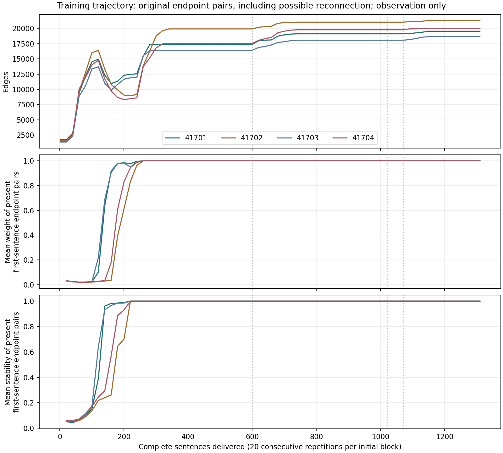

## 连接在重复和后续教学中怎样变化

| 种子 | 累计输入 | 节点/边 | 最初端点对仍有连接 | 这些边平均权重 | 这些边平均稳定度 |
| --- | --- | --- | --- | --- | --- |
| 41701 | 20 | 42/1722 | 1722/1722 | 0.030624286 | 0.051877096 |
| 41701 | 40 | 61/2786 | 1722/1722 | 0.022972865 | 0.043490908 |
| 41701 | 600 | 147/17396 | 1560/1722 | 1 | 0.99990632 |
| 41701 | 1310 | 166/19542 | 1560/1722 | 1 | 0.99990557 |
| 41702 | 20 | 40/1560 | 1560/1560 | 0.031179093 | 0.056064287 |
| 41702 | 40 | 58/2622 | 1560/1560 | 0.023789363 | 0.051959752 |
| 41702 | 600 | 159/19928 | 1260/1560 | 1 | 0.99990625 |
| 41702 | 1310 | 166/21302 | 1260/1560 | 1 | 0.99990614 |
| 41703 | 20 | 37/1332 | 1332/1332 | 0.032170059 | 0.063314628 |
| 41703 | 40 | 55/2322 | 1332/1332 | 0.024704236 | 0.060027267 |
| 41703 | 600 | 144/16418 | 1190/1332 | 1 | 0.99990646 |
| 41703 | 1310 | 165/18658 | 1190/1332 | 1 | 0.99990547 |
| 41704 | 20 | 39/1482 | 1482/1482 | 0.031520348 | 0.058492133 |
| 41704 | 40 | 55/2394 | 1482/1482 | 0.024421166 | 0.057142379 |
| 41704 | 600 | 146/17522 | 1190/1482 | 1 | 0.99990645 |
| 41704 | 1310 | 168/20028 | 1190/1482 | 1 | 0.99990553 |

观察集合来自第20次输入后的连接端点，程序没有给予保护。表中端点对仍有连接的数量，可能包含原边消失后在同一端点重新形成的边，不能据此声称它始终存在。为区分二者，额外读取已保存模型中的连接出生时间，得到下表。此项核查在发现端点数量可重新增加后补充，未改变训练或预定联想指标。每个重复块的完整统计见`training-traces.json`。

| 种子 | 累计输入 | 原出生连接仍在 | 同端点重建 | 端点已无连接 | 全部边中权重已达1 |
| --- | --- | --- | --- | --- | --- |
| 41701 | 200 | 1190/1722 | 292 | 240 | 6214/12306 |
| 41701 | 600 | 1190/1722 | 370 | 162 | 17396/17396 |
| 41701 | 1310 | 1190/1722 | 370 | 162 | 19542/19542 |
| 41702 | 200 | 776/1560 | 266 | 518 | 777/9056 |
| 41702 | 600 | 776/1560 | 484 | 300 | 19928/19928 |
| 41702 | 1310 | 776/1560 | 484 | 300 | 21302/21302 |
| 41703 | 200 | 793/1332 | 250 | 289 | 9039/11663 |
| 41703 | 600 | 793/1332 | 397 | 142 | 16418/16418 |
| 41703 | 1310 | 793/1332 | 397 | 142 | 18658/18658 |
| 41704 | 200 | 874/1482 | 225 | 383 | 1515/8313 |
| 41704 | 600 | 874/1482 | 316 | 292 | 17522/17522 |
| 41704 | 1310 | 874/1482 | 316 | 292 | 20028/20028 |
