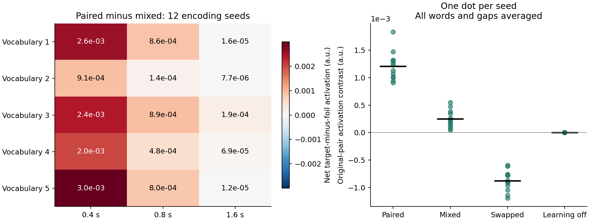
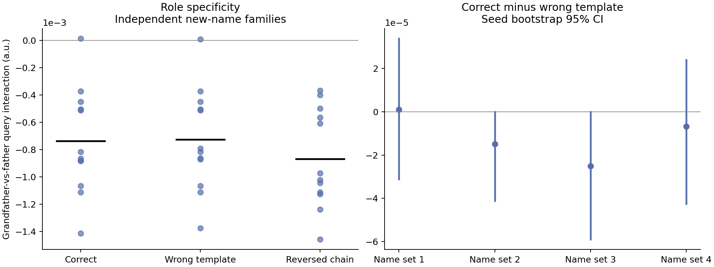

# 校准后验证报告：配对关联与未见名字家系

2026-09-09 · Core `causal/9` · 全程未改内核动力学。

**扩大验证复现了配对关联，尚未验证出新名字的祖父关系组合。** 这个结果比上一轮更明确：匿名探针先经过独立校准，正式验证更换了词表、编码种子和刺激间隔；关系实验全部864次有输入的探针都发生了真实联想递送，不能再简单把这次关系负结果归因为探针完全没有传进去。但可观测的活动仍不等于语义答案。

平台项目：**校准验证：扩大词表与未见家系 · 2026-09-09**。实验笔记中保存预先方案、校准与执行说明及完整报告；记录与报告中有三份实验记录和一份综合报告。

## 直观结果

| 问题 | 实际观察 | 可以得出的结论 |
|---|---|---|
| 重复“甲→松子、乙→铃铛”后，只提示“甲”是否有配对偏向？ | 五组词表的总体结果支持；稳定配对强于混合配对 | 经历可在结构中留下特定配对关联，出生副本清空活动后仍可测到 |
| 换掉配对内容会怎样？ | 种子块平均偏向随交换配对反转；关闭学习后全部为零 | 偏向与学习到的配对有关，不只是提示本身或固定编码偏好 |
| 各种词表、间隔都一样吗？ | 效应大小明显不同，间隔1.6秒时普遍很弱；个别交换条件仍有原配对偏向 | 不应把总体正效应说成所有条件都稳定、同样好用 |
| 能把“父亲的父亲”迁移到新名字吗？ | 正确模板未优于错误模板；问爷爷时预期名字很少最强 | 本轮没有建立角色组合迁移证据 |

这里的“关联”是原始活动投影的可重复差异，不是模型已经能给出聊天式明文答案，也不证明 AGI 或意识假设成立。

## 校准先于验证

校准使用41221–41224四个种子、两组独立词表，共8个训练父本。探针强度1、2、4各有16个提示案例。事先规定：真实发出及递送非零信号、最大饱和比例小于20%、每个观察词有专属评分通道；至少80%的案例合格。

强度1合格3/16；强度2和4均为16/16。选择最低合格强度**2**，随后冻结。没有根据期望词是否胜出来选剂量。训练强度仍为1，192通道匿名编码、原分帧、传播门槛和内核参数保持原值。所有副本默认不学习，且有独立无探针对照。

工具记录真实输入帧、幅值、发送／接收／激活量和完整活动。评分排除观察词间共享通道以及任何探针直接触达通道，完整证据不裁剪。全部正式案例均可评分，最少仍有2个专属通道；“有2个”不等于测量已充分覆盖一个概念。

## 配对实验

12个新种子41301–41312；五组词表各包含两个配对：甲松子／乙铃铛、丙陶杯／丁柳叶、戊星河／己木舟、庚雨滴／辛沙丘、壬海螺／癸铜镜。间隔0.4、0.8、1.6秒，12轮，四个条件为稳定、混合、交换、关闭学习。另有4轮及明文编码对照，共824个父本、2472个测量副本。

主终点：提示后0.2–1.0秒的目标词减干扰词平均净激活；先平均每种子内的提示、五组词表与三种间隔，再比较12个种子的稳定−混合。单位为模型激活量，不是准确率。

| 条件 | 12个种子块的平均原配对偏向 |
|---|---:|
| 稳定配对 | 0.00121010 |
| 混合配对 | 0.000251981 |
| 交换配对 | −0.000879151 |
| 关闭学习 | 0 |

稳定−混合为 **0.000958120**；95%种子块bootstrap区间 **[0.000870563, 0.001067789]**；两主比较间Holm校正后 **p=0.000976563**。12个种子块的差均为正。五组词表×三种间隔的15个条件均值也均为正，但不把这些格子作为15个独立显著性结论。

词表1就是甲松子／乙铃铛，其余顺序见上文。黑线为种子均值，每个点是一个编码种子块。

**一个值得后续研究的现象：重复更多并不总是测得更强。** 只比较相同前四种子、前两词表，稳定−混合的均值在0.4秒间隔时由4轮的0.00119949增至12轮的0.00150184；0.8秒时由0.00110517降至0.000466458；1.6秒时由0.000312221降至0.00000933989。这里轮数同时改变了总模拟经历时长；不能把差别单独归为“多练反而学不会”。遗忘、局部可塑性、结构演变及投影变化均可能参与，尚未做机制分离实验。

明文对照也出现稳定偏向和交换反转，但明文种子主要改变标识，不能按四个独立随机编码重复来夸大证据。全部结果、零值和逐案例分数见CSV与冻结测量包。

## 关系组合实验

独立种子41401–41412，四组新名字，每组两条家系。先学习A–B–C、D–E–F两条模板家系8轮，再输入新名字的父亲链4轮，**从未输入新名字的祖父答案**。新名字不在模板训练中出现，但在父亲链接入阶段出现过，不能称整个意识从未见过这些名字。

比较正确模板、互换祖父答案的错误模板、反向新家系。每条家系分别用“孙辈的爷爷”“孙辈的父亲”和裸名字查询，并有无提示副本。共144个父本、1008个副本；864次有输入查询均有实际联想递送，最高饱和比例约0.88%。

角色特异终点是 `(祖父−父亲)在爷爷查询 − (祖父−父亲)在父亲查询`。它要求查询角色改变时活动相对偏向也改变。

| 条件 | 种子块平均角色特异指标 |
|---|---:|
| 正确模板 | −0.000737406 |
| 错误模板 | −0.000725930 |
| 反向新家系 | −0.000866738 |

正确−错误为 **−0.0000114757**，方向不支持预期改善；精确符号翻转检验及Holm校正 **p=0.0703125**。bootstrap 95%区间为[−0.0000263042, −0.000000897563]。小样本偏斜差值下，百分位bootstrap区间与符号翻转检验可能不一致；不能选择更有利的一种来宣布成功或确定性劣化。

补充描述性检查：正确条件96个祖父查询中，预期祖父的净投影严格高于其余三个候选只有**4个**；错误模板也是4个，反向链中的原定祖父名字也是4个。正确条件父亲查询为46/96，错误模板同为46/96。查询及家系之间不独立，这些不是96个独立被试，更不能当作语言问答准确率。原始活动中名字可以同时被唤起，工具没有按人类因果观裁剪它们。

## 结论的范围与下一步

1. **保留配对关联作为可重复的研究现象。** 它在独立校准后的新种子、多个词表和间隔下出现，并通过交换及学习关闭对照。
2. **不把配对关联升级为关系推理。** 本轮正确关系模板没有带来预期角色迁移，暂不建议直接扩大同一训练方式的规模。
3. 下一个小实验宜固定总模拟时长，分离重复次数、间隔和遗忘，检查为何长间隔下4轮与12轮的结果不同。本轮只是记录，不继续消耗资源。
4. 关系研究先补“上下文编码与角色测量”校准：检查同一名字在不同句子位置的通道重叠；用同一种名字书写形式构造模板与留出材料。本轮旧模板为拉丁字母，新名字为中文，包含编码域差异，不能把失败全归到抽象组合能力。先用最小角色交换对照检查方向选择，再考虑更复杂家系。
5. 本评分只观察预定词通道，无法排除其他分布式表示存在；完整活动和终态已保存，后续可以另行检验。需要更有辨别力的证据才能决定是否改内核，**本轮没有提出已证实的内核BUG，也未修改内核**。

统计随机性来自所测编码种子及固定呈现顺序，不是人群样本；对这些固定材料的结论不能外推到全部语言。主比较各n=12，5000次seed bootstrap及精确符号翻转，两个主比较统一Holm校正；分格区间为描述性、未作多重比较确认。

## 数据、资源和复查

- 正式分析8个校准、824个配对、144个关系训练父本；另保留首个因脚本记账异常中断的校准父本，共**977个新模型、977条校准记录、3543个副本证据**。首次异常不影响已保存动力学，未纳入正式分析。详见执行说明。
- 训练、测量和写库累计约**890.8秒（14.85分钟）**；记录到的进程RSS最高约159MiB（校准内部另有2GiB守卫），不代表整个电脑的峰值。到此停止进一步实验。
- 报告生成前，数据库物理增长约**1.24GiB**；恢复点和证据载荷约334MiB，网络查询投影预算估计约742MiB，本地结果与代码证据约13MiB。它们存在包含关系，不能全部相加当作数据库真实大小；预算取保守较大值并计本地文件。低于4GiB上限。
- 旧项目900个模型的编号、修订、状态哈希和状态整体摘要前后一致。没有自动删除、迁移或覆盖任何旧实验。
- `evidence-index.json` 给出每个校准的来源检查点、哈希、协议以及两个证据下载地址。完整ZIP含源模型、逐副本终态、所有节点采样（含零）、全部实际输入帧和事件；`implementation-source.zip` 固定实际实现源码与原生二进制哈希。统计CSV和summary.json足以复算这里的表图。
- 设置中的“实验存储检查”为只读元数据扫描；本项目含笔记、报告和测量来源，应保留。清理由用户另行预览和决定。
