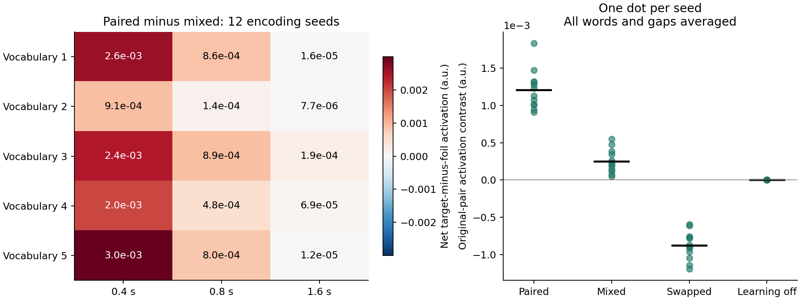
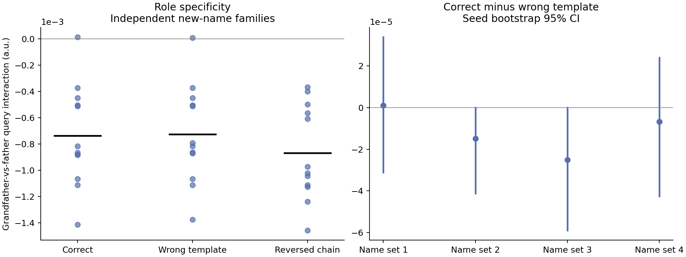

# Calibrated validation: associative pairs and unseen-name families

> **Revision r2 · 2026-10-10**
> Revision reason: Relocate generated evidence out of Git; preserve original bytes and conclusions.
> Original: [report.en.md](report.en.md); parent r1: [report.en.md](report.en.md)

2026-09-09 · Core causal/9 · No Core dynamics changed.

**Pair-specific association replicated after independent sensory calibration. Transfer of the grandfather relation to new names was not demonstrated.** This is evidence for a bounded associative phenomenon, not a demonstration of AGI, consciousness, semantic understanding or natural-language answer accuracy.

The separate platform project is **校准验证：扩大词表与未见家系 · 2026-09-09**. The original experiment project and its data remain intact. Three notes, three experiment records and a report provide the protocol, calibration decision, analyses and evidence links.

## Calibration

Four calibration seeds (41221–41224) and two independent vocabularies were trained for twelve rounds at 0.8-second stimulus intervals and intensity 1. Each of eight parent models supplied independent inherited-structure copies with cleared activity. Probe learning was disabled. Doses 1, 2 and 4 were compared with sham.

The frozen eligibility rule required actual nonzero associative transmission and delivery, peak saturation below 20%, and exclusive scoring channels for every observation term. At least 80% of 16 cue cases had to qualify. Dose 1 qualified in 3/16 cases; doses 2 and 4 qualified in 16/16. The lowest qualifying dose, **2**, was frozen before validation. Target-word hits were not used to select it. Training intensity, default 192-channel encoding, framing and Core thresholds were unchanged.

Every actual frame and node activation, including zeros, is retained. Shared channels and directly stimulated channels are excluded only from scoring. Missing scoring channels are unscorable rather than zero. Signal arrival groups can aggregate accepted edges; the instrument does not infer rejected-edge counts.

## Expanded pair validation

Twelve new seeds (41301–41312), five two-pair vocabularies and 0.4/0.8/1.6-second intervals were crossed with stable, mixed, swapped and learning-disabled training. Twelve-round validation plus four-round and literal-encoding controls produced 824 parents and 2,472 probe copies.

The primary outcome is target-minus-foil activation, time-averaged over 0.2–1.0 seconds and sham-subtracted. Cues, vocabularies and intervals are balanced within each encoding seed before comparing stable versus mixed. Samples and copies are not independent subjects.

| Condition | Mean original-pair contrast |
|---|---:|
| Stable | 0.00121010 |
| Mixed | 0.000251981 |
| Swapped | −0.000879151 |
| Learning disabled | 0 |

Stable minus mixed: **0.000958120**, seed-block bootstrap 95% CI **[0.000870563, 0.001067789]**, Holm-adjusted **p=0.000976563** across the two primary comparisons. All twelve seed-block differences were positive. All fifteen vocabulary-by-interval mean differences were positive, without claiming fifteen independent significant findings. Overall swapped preference reversed and learning-disabled controls were zero.

The effect was much weaker at 1.6 seconds and varied by vocabulary. One swapped vocabulary/long-interval cell retained a positive original-pair contrast. More repetition was not uniformly better: within the same four-seed/two-vocabulary subset, stable-minus-mixed rose from 0.00119949 to 0.00150184 at 0.4 seconds, but fell from 0.00110517 to 0.000466458 at 0.8 seconds, and from 0.000312221 to 0.00000933989 at 1.6 seconds when moving from four to twelve rounds. Total simulated exposure duration also changes; this does not isolate a harmful effect of repetition. Literal controls were descriptive because their seeds mostly relabel a deterministic mapping.

## Independent relation composition

Twelve separate seeds (41401–41412) and four sets of two new-name families were used. Two A–B–C/D–E–F example families taught father and grandfather templates for eight rounds. New names then appeared only in father chains for four rounds; their grandfather answers were never supplied. Thus names were unseen during template training, not unseen throughout the entire experiment.

Correct templates were compared with swapped grandfather answers and reversed new-family chains. Grandfather, father, bare-name and sham probes produced 144 parents and 1,008 copies. All 864 non-sham probes actually delivered associative signals; peak saturation was approximately 0.88%. Every formal case was scorable, though some terms had only two exclusive channels.

The role outcome is `(grandfather − father) for the grandfather query − (grandfather − father) for the father query`.

| Training | Mean role-specificity outcome |
|---|---:|
| Correct template | −0.000737406 |
| Wrong template | −0.000725930 |
| Reversed new chain | −0.000866738 |

Correct minus wrong: **−0.0000114757**, exact sign-flip and Holm-adjusted **p=0.0703125**. The bootstrap 95% interval was [−0.0000263042, −0.000000897563]. A percentile bootstrap interval and sign-flip test can disagree for a small, skewed sample; neither is selectively preferred. The direction does not support the proposed improvement.

Descriptively, the canonical grandfather projection strictly exceeded all three competing candidates in only 4/96 correct-template grandfather queries. Wrong templates also produced 4/96; reversed chains also activated the originally designated grandfather most strongly in 4/96. Father queries produced 46/96 for both correct and wrong templates. These dependent queries are not 96 independent subjects or an answer-accuracy benchmark. Coactivation remains in the raw evidence.

## Limits and next steps

Preserve the replicated pair phenomenon. Before more scaling, separate repetition from total elapsed time and forgetting, and calibrate how the same name is encoded in different sentence positions. Use matched writing systems for relation templates and held-out names: this experiment shifted from Latin template names to Chinese names, creating an encoding-domain difference. Test minimal role reversal before deeper composition.

A word-channel projection does not exhaust possible distributed representations. Failure here does not prove the Core can never compose relations, but offers no basis to claim that it did. No demonstrated Core defect was identified and no Core modification was made. Future changes require discriminating evidence.

Both primary comparisons used n=12 seed blocks, 5,000 paired bootstrap resamples, exact sign flips and joint Holm correction. Results are conditional on these fixed materials and encoding seeds; cell intervals and additional dominance counts are descriptive.

## Preservation and resources

There are 977 new parents/calibration records and 3,543 complete probe-copy evidence sets, including the first calibration case retained after a bookkeeping type error. That error occurred after evidence was saved (`int += SQL numeric string`); explicit conversion fixed the harness, and a new complete calibration attempt was run without overwriting the first. It was not a dynamics or scoring change.

Training, measurement and database execution took approximately **890.8 seconds (14.85 minutes)**, including the failed attempt. Observed process RSS peaked around 159 MiB; an internal 2 GiB calibration guard also remained active. This is not total host memory usage. Experiments stopped at the planned scope.

Before report publication, physical database growth was approximately **1.24 GiB**, with about 334 MiB checkpoint/evidence payload and 742 MiB estimated query projection, plus 13 MiB local evidence. These overlap and are not simply additive; the conservative budget remained below 4 GiB. Fifteen GiB disk reserves were maintained on both database and evidence drives.

The original 900-model project's IDs, revisions, state hashes and statuses matched its starting digest. No old data were deleted, migrated or overwritten. `evidence-index.json` contains every checkpoint, protocol and authenticated evidence URL; bundles retain full initial/final states, frames and activation traces. `implementation-source.zip` freezes implementation sources and the native binary hash. CSVs and summary JSON support recomputation. The settings audit is read-only; any later cleanup requires the user's separate review and decision.

## Data location revision

Selected generated evidence has been archived and verified byte for byte. Original reports, criteria, conclusions and embedded source_commit values are preserved. The logical downloads below require the current host administrator. The data directory is not public.

`data/experiments/2026-09-09-calibrated-generalization/`

[Location and hash index / 位置及哈希登记](../../artifact-index/2026-10-09-relocations.json)

- [evidence-index.json](/api/v2/storage/research-artifacts/research-artifact:a7d58c69bb50d0a0ea94263a/content) — 1907032 B; SHA-256 `7f78fba5b192449f07803b542ef51b74a7c920919781e75ff5c70740461ebe5b`.
- [implementation-source.zip](/api/v2/storage/research-artifacts/research-artifact:0a07a4565eb15bbe5a09c629/content) — 614159 B; SHA-256 `b49bbbcc014adae8b97cc754a8e25bd8140b1a58bdc242d6ec686558f640fe2e`.
- [memory-cases.csv](/api/v2/storage/research-artifacts/research-artifact:781b21047f7ca3b6f91834ff/content) — 168372 B; SHA-256 `b8df0f42e6edd22729eb0ad500e8cabad4777c5315e53ade76dee433bf8680fc`.
- [relations-cases.csv](/api/v2/storage/research-artifacts/research-artifact:933e43f64d199036293addf0/content) — 35564 B; SHA-256 `b2beca67815b255e3e8b9d2319d640e09ce989464762729e03b94e9ef592e202`.
