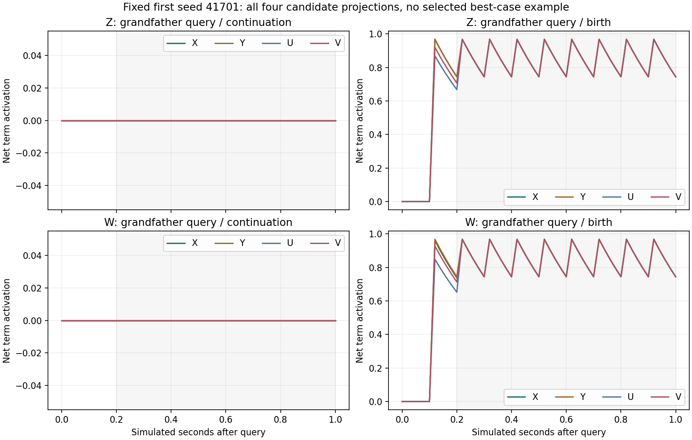

## 已教家系及未见名字关系组合

已教C→B→A、F→E→D，同时教授其爷爷事实及“父亲的父亲是爷爷。”。未见Z→Y→X、W→V→U只提供父亲事实；最终独立提示“Z的爷爷是谁？”等。家系互换分支改为Z→Y→U、W→V→X，没有输入对应爷爷答案。

角色区分量R为：(爷爷问题中预期爷爷减父亲的活动)−(父亲问题中预期爷爷减父亲的活动)。它须结合目标是否领先、裸名字对照及事实互换方向判断；R为正不自动表示答对。

### 已教家系阶段

| 方式 | 严格领先/可评分 | 总提示数 | 平均R |
| --- | --- | --- | --- |
| 连续状态 | 0/6 | 8 | 0 |
| 结构出生副本 | 2/6 | 8 | 0.0005909699623 |

### 最终所有祖父问题的完整候选

| 种子 | 教学 | 方式 | 孩子 | 预期爷爷 | X | Y | U | V | 目标减最强其他 | R |
| --- | --- | --- | --- | --- | --- | --- | --- | --- | --- | --- |
| 41701 | 原对应 | 连续状态 | Z | X | 0 | 0 | 0 | 0 | 0 | 0 |
| 41701 | 原对应 | 连续状态 | W | U | 0 | 0 | 0 | 0 | 0 | 0 |
| 41701 | 原对应 | 结构出生副本 | Z | X | 0.8521953735 | 0.8521953735 | 0.8512440704 | 0.8517315198 | 0 | 0 |
| 41701 | 原对应 | 结构出生副本 | W | U | 0.8521158314 | 0.8521953735 | 0.8510476172 | 0.8518088733 | -0.001147756279 | -0.0003929063695 |
| 41701 | 家系互换 | 连续状态 | Z | U | 0 | 0 | 0 | 0 | 0 | 0 |
| 41701 | 家系互换 | 连续状态 | W | X | 0 | 0 | 0 | 0 | 0 | 0 |
| 41701 | 家系互换 | 结构出生副本 | Z | U | 0.8521953735 | 0.8521953735 | 0.8512440704 | 0.8517315198 | -0.0009513030945 | -0.0006998644707 |
| 41701 | 家系互换 | 结构出生副本 | W | X | 0.8521158314 | 0.8521953735 | 0.8510476172 | 0.8518088733 | -7.954208709e-05 | 0.0003069581012 |
| 41702 | 原对应 | 连续状态 | Z | X | 0 | 0 | 0 | 0 | 0 | 0 |
| 41702 | 原对应 | 连续状态 | W | U | 0 | 0 | 0 | 0 | 0 | 0 |
| 41702 | 原对应 | 结构出生副本 | Z | X | 0.8480885411 | 0.8516836344 | 0.8516615334 | 0.8508315187 | -0.003595093281 | -0.0004661493111 |
| 41702 | 原对应 | 结构出生副本 | W | U | 0.8484568908 | 0.8517941393 | 0.8519193782 | 0.8512268807 | 0.0001252389053 | -9.182041114e-05 |
| 41702 | 家系互换 | 连续状态 | Z | U | 0 | 0 | 0 | 0 | 0 | 0 |
| 41702 | 家系互换 | 连续状态 | W | X | 0 | 0 | 0 | 0 | 0 | 0 |
| 41702 | 家系互换 | 结构出生副本 | Z | U | 0.8480885411 | 0.8516836344 | 0.8516615334 | 0.8508315187 | -2.210098329e-05 | -4.868629344e-05 |
| 41702 | 家系互换 | 结构出生副本 | W | X | 0.8484568908 | 0.8517941393 | 0.8519193782 | 0.8512268807 | -0.003462487382 | -0.0006261945264 |
| 41703 | 原对应 | 连续状态 | Z | X | 无法评分 | 0 | 0 | 0 | 无法评分 | 无法评分 |
| 41703 | 原对应 | 连续状态 | W | U | 无法评分 | 0 | 0 | 0 | 无法评分 | 0 |
| 41703 | 原对应 | 结构出生副本 | Z | X | 无法评分 | 0.8503723094 | 0.8521953735 | 0.8515019152 | 无法评分 | 无法评分 |
| 41703 | 原对应 | 结构出生副本 | W | U | 无法评分 | 0.8501144646 | 0.8521953735 | 0.8514405236 | 无法评分 | 0.000503411286 |
| 41703 | 家系互换 | 连续状态 | Z | U | 无法评分 | 0 | 0 | 0 | 无法评分 | 0 |
| 41703 | 家系互换 | 连续状态 | W | X | 无法评分 | 0 | 0 | 0 | 无法评分 | 无法评分 |
| 41703 | 家系互换 | 结构出生副本 | Z | U | 无法评分 | 0.8502249695 | 0.8521953735 | 0.8513914103 | 无法评分 | 0.0003069581012 |
| 41703 | 家系互换 | 结构出生副本 | W | X | 无法评分 | 0.8502249695 | 0.8521953735 | 0.8513300187 | 无法评分 | 无法评分 |
| 41704 | 原对应 | 连续状态 | Z | X | 0 | 0 | 0 | 0 | 0 | 0 |
| 41704 | 原对应 | 连续状态 | W | U | 0 | 0 | 0 | 0 | 0 | 0 |
| 41704 | 原对应 | 结构出生副本 | Z | X | 0.8516308376 | 0.8509739473 | 0.8508560753 | 0.8513680815 | 0.0002627561346 | 0.0006789913199 |
| 41704 | 原对应 | 结构出生副本 | W | U | 0.8519046442 | 0.8508634423 | 0.8512072354 | 0.8516068148 | -0.0006974088059 | 0.0001911148524 |
| 41704 | 家系互换 | 连续状态 | Z | U | 0 | 0 | 0 | 0 | 0 | 0 |
| 41704 | 家系互换 | 连续状态 | W | X | 0 | 0 | 0 | 0 | 0 | 0 |
| 41704 | 家系互换 | 结构出生副本 | Z | U | 0.8516308376 | 0.8509739473 | 0.8508560753 | 0.8511875901 | -0.0007747622474 | 0.0006335615209 |
| 41704 | 家系互换 | 结构出生副本 | W | X | 0.8519046442 | 0.8508634423 | 0.8512072354 | 0.8514263234 | 0.0004783208274 | 0.0002365446514 |

### 相同名字在家系事实互换后的变化

| 种子 | 方式 | Z家系方向变化 | W家系方向变化 | 两家系平均 |
| --- | --- | --- | --- | --- |
| 41701 | 连续状态 | 0 | 0 | 0 |
| 41702 | 连续状态 | 0 | 0 | 0 |
| 41703 | 连续状态 | 无法评分 | 无法评分 | 无法评分 |
| 41704 | 连续状态 | 0 | 0 | 0 |
| 41701 | 结构出生副本 | 0 | 0 | 0 |
| 41702 | 结构出生副本 | 0 | 0 | 0 |
| 41703 | 结构出生副本 | 无法评分 | 无法评分 | 无法评分 |
| 41704 | 结构出生副本 | 0 | 0 | 0 |

### 不依赖词投影的全节点活动检查

以下只读取原有连续状态探针ZIP，以通道对应比较提示与无提示的全部激活，不额外模拟。末次差异采样点单位是微秒，数值容差仅为1e-12。每20毫秒采样可能漏掉间隔中的变化，激活也不是全部动力学状态，不能由这里的相同断言全部状态相同。

| 种子 | 提示 | 最大L1差异 | 末次有差异采样点 |
| --- | --- | --- | --- |
| 41701 | Z的爷爷是谁？ | 2.456208892 | 0 |
| 41701 | Z的父亲是谁？ | 2.471517055 | 0 |
| 41701 | Z | 0.5178607873 | 0 |
| 41701 | W的爷爷是谁？ | 2.458544912 | 0 |
| 41701 | W的父亲是谁？ | 2.473853075 | 0 |
| 41701 | W | 0.5268182826 | 0 |
| 41702 | Z的爷爷是谁？ | 2.497831201 | 1000000 |
| 41702 | Z的父亲是谁？ | 2.489171087 | 1000000 |
| 41702 | Z | 0.5229754581 | 0 |
| 41702 | W的爷爷是谁？ | 2.49040915 | 1000000 |
| 41702 | W的父亲是谁？ | 2.481749037 | 1000000 |
| 41702 | W | 0.5199261608 | 0 |
| 41703 | Z的爷爷是谁？ | 2.490331654 | 0 |
| 41703 | Z的父亲是谁？ | 2.47926702 | 0 |
| 41703 | Z | 0.5688257355 | 1000000 |
| 41703 | W的爷爷是谁？ | 2.494347857 | 0 |
| 41703 | W的父亲是谁？ | 2.483283223 | 0 |
| 41703 | W | 0.5688660533 | 1000000 |
| 41704 | Z的爷爷是谁？ | 2.502400116 | 0 |
| 41704 | Z的父亲是谁？ | 2.500746724 | 0 |
| 41704 | Z | 0.5185241303 | 0 |
| 41704 | W的爷爷是谁？ | 2.492809144 | 0 |
| 41704 | W的父亲是谁？ | 2.491155752 | 0 |
| 41704 | W | 0.5089480105 | 0 |
