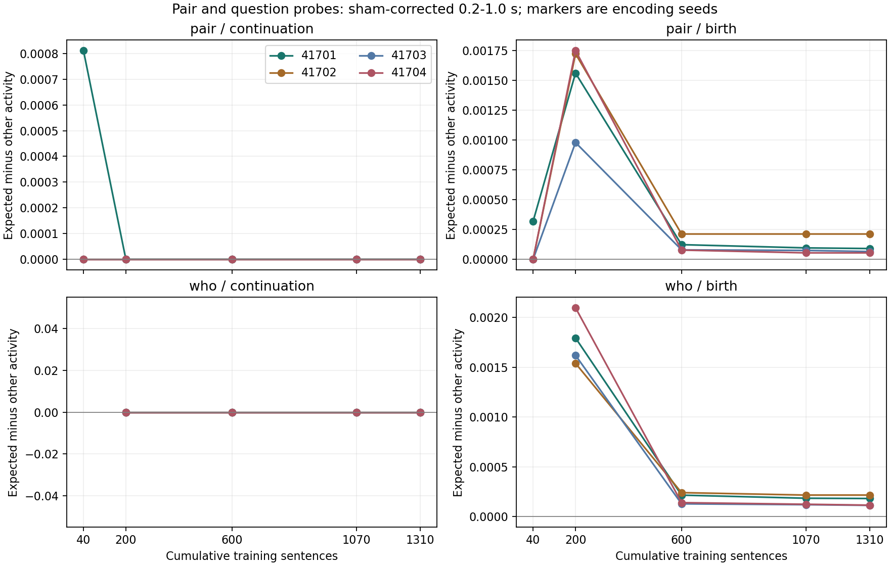

## 配对、问答与名词互换

每个提示和无提示对照从同一阶段独立复制。连续状态保留当前活动、抑制、在途信号和时钟，等待0秒。结构出生副本依据既有`threemind.birth/1`规则保留长期网络结构，清空激活、抑制、近期痕迹、资格迹和在途队列，并重置时钟及相关运行状态；它不是原意识暂停后恢复，也不只是换了显示方式。测试期间学习开启，但绝不写回教学意识。

主要数值为0.2至1模拟秒的活动积分平均减同源无提示对照。另保存0至0.2秒和全部曲线。词模板重叠与直接提示通道仅在评分中排除；完整零/非零激活仍保存在原始ZIP中。此工具没有让AI填词或生成答句。

### 原对应的阶段结果

| 输入阶段 | 项目 | 观察方式 | 目标严格领先/可评分 | 种子平均差值 |
| --- | --- | --- | --- | --- |
| pair_20_each | 配对 | 连续状态 | 1/8 | 0.000202830118 |
| pair_20_each | 配对 | 结构出生副本 | 1/8 | 7.978471785e-05 |
| dialogue_1 | 配对 | 连续状态 | 0/8 | 0 |
| dialogue_1 | 配对 | 结构出生副本 | 8/8 | 0.001502505496 |
| dialogue_1 | 问答 | 连续状态 | 0/16 | 0 |
| dialogue_1 | 问答 | 结构出生副本 | 16/16 | 0.001763537224 |
| dialogue_3 | 配对 | 连续状态 | 0/8 | 0 |
| dialogue_3 | 配对 | 结构出生副本 | 8/8 | 0.0001231721324 |
| dialogue_3 | 问答 | 连续状态 | 0/16 | 0 |
| dialogue_3 | 问答 | 结构出生副本 | 15/16 | 0.0001811020529 |
| review | 配对 | 连续状态 | 0/8 | 0 |
| review | 配对 | 结构出生副本 | 8/8 | 0.0001094299478 |
| review | 问答 | 连续状态 | 0/16 | 0 |
| review | 问答 | 结构出生副本 | 15/16 | 0.000160973442 |
| final | 配对 | 连续状态 | 0/8 | 0 |
| final | 配对 | 结构出生副本 | 8/8 | 0.0001057436485 |
| final | 问答 | 连续状态 | 0/16 | 0 |
| final | 问答 | 结构出生副本 | 15/16 | 0.0001563656276 |

### 最终每条提示的候选活动

| 种子 | 教学 | 方式 | 提示 | 预期 | 目标减另一个 | 候选净活动 |
| --- | --- | --- | --- | --- | --- | --- |
| 41701 | 原对应 | 连续状态 | 甲 | 松子 | 0 | 松子=0; 铃铛=0 |
| 41701 | 原对应 | 连续状态 | 乙 | 铃铛 | 0 | 松子=0; 铃铛=0 |
| 41701 | 原对应 | 结构出生副本 | 甲 | 松子 | 0.000105850542 | 松子=0.84675294; 铃铛=0.8466470895 |
| 41701 | 原对应 | 结构出生副本 | 乙 | 铃铛 | 7.549540943e-05 | 松子=0.8466774446; 铃铛=0.84675294 |
| 41701 | 原对应 | 连续状态 | 谁是松子？ | 甲 | 0 | 甲=0; 乙=0 |
| 41701 | 原对应 | 连续状态 | 谁是铃铛？ | 乙 | 0 | 甲=0; 乙=0 |
| 41701 | 原对应 | 连续状态 | 松子是谁？ | 甲 | 0 | 甲=0; 乙=0 |
| 41701 | 原对应 | 连续状态 | 铃铛是谁？ | 乙 | 0 | 甲=0; 乙=0 |
| 41701 | 原对应 | 结构出生副本 | 谁是松子？ | 甲 | 9.133471361e-05 | 甲=0.8512069641; 乙=0.8511156293 |
| 41701 | 原对应 | 结构出生副本 | 谁是铃铛？ | 乙 | 0.0002197914871 | 甲=0.8509646517; 乙=0.8511844432 |
| 41701 | 原对应 | 结构出生副本 | 松子是谁？ | 甲 | 0.000304727081 | 甲=0.8512069641; 乙=0.850902237 |
| 41701 | 原对应 | 结构出生副本 | 铃铛是谁？ | 乙 | 0.00011073415 | 甲=0.8510962299; 乙=0.8512069641 |
| 41702 | 原对应 | 连续状态 | 甲 | 松子 | 0 | 松子=0; 铃铛=0 |
| 41702 | 原对应 | 连续状态 | 乙 | 铃铛 | 0 | 松子=0; 铃铛=0 |
| 41702 | 原对应 | 结构出生副本 | 甲 | 松子 | 0.0001868095893 | 松子=0.8466891693; 铃铛=0.8465023597 |
| 41702 | 原对应 | 结构出生副本 | 乙 | 铃铛 | 0.0002379662663 | 松子=0.846408578; 铃铛=0.8466465443 |
| 41702 | 原对应 | 连续状态 | 谁是松子？ | 甲 | 0 | 甲=0; 乙=0 |
| 41702 | 原对应 | 连续状态 | 谁是铃铛？ | 乙 | 0 | 甲=0; 乙=0 |
| 41702 | 原对应 | 连续状态 | 松子是谁？ | 甲 | 0 | 甲=0; 乙=0 |
| 41702 | 原对应 | 连续状态 | 铃铛是谁？ | 乙 | 0 | 甲=0; 乙=0 |
| 41702 | 原对应 | 结构出生副本 | 谁是松子？ | 甲 | 0.0002744856534 | 甲=0.8511679618; 乙=0.8508934762 |
| 41702 | 原对应 | 结构出生副本 | 谁是铃铛？ | 乙 | 0.0002215176328 | 甲=0.8509745108; 乙=0.8511960284 |
| 41702 | 原对应 | 结构出生副本 | 松子是谁？ | 甲 | 0.0002138521956 | 甲=0.8512069641; 乙=0.8509931119 |
| 41702 | 原对应 | 结构出生副本 | 铃铛是谁？ | 乙 | 0.000154448808 | 甲=0.8510525153; 乙=0.8512069641 |
| 41703 | 原对应 | 连续状态 | 甲 | 松子 | 0 | 松子=0; 铃铛=0 |
| 41703 | 原对应 | 连续状态 | 乙 | 铃铛 | 0 | 松子=0; 铃铛=0 |
| 41703 | 原对应 | 结构出生副本 | 甲 | 松子 | 6.374008456e-05 | 松子=0.8464606574; 铃铛=0.8463969174 |
| 41703 | 原对应 | 结构出生副本 | 乙 | 铃铛 | 6.723809902e-05 | 松子=0.8463934193; 铃铛=0.8464606574 |
| 41703 | 原对应 | 连续状态 | 谁是松子？ | 甲 | 0 | 甲=0; 乙=0 |
| 41703 | 原对应 | 连续状态 | 谁是铃铛？ | 乙 | 0 | 甲=0; 乙=0 |
| 41703 | 原对应 | 连续状态 | 松子是谁？ | 甲 | 0 | 甲=0; 乙=0 |
| 41703 | 原对应 | 连续状态 | 铃铛是谁？ | 乙 | 0 | 甲=0; 乙=0 |
| 41703 | 原对应 | 结构出生副本 | 谁是松子？ | 甲 | 0.0001857114233 | 甲=0.8511449292; 乙=0.8509592178 |
| 41703 | 原对应 | 结构出生副本 | 谁是铃铛？ | 乙 | 4.685865313e-05 | 甲=0.8511035727; 乙=0.8511504314 |
| 41703 | 原对应 | 结构出生副本 | 松子是谁？ | 甲 | 9.477540488e-05 | 甲=0.8512069641; 乙=0.8511121887 |
| 41703 | 原对应 | 结构出生副本 | 铃铛是谁？ | 乙 | 0.0001240696209 | 甲=0.8510828944; 乙=0.8512069641 |
| 41704 | 原对应 | 连续状态 | 甲 | 松子 | 0 | 松子=0; 铃铛=0 |
| 41704 | 原对应 | 连续状态 | 乙 | 铃铛 | 0 | 松子=0; 铃铛=0 |
| 41704 | 原对应 | 结构出生副本 | 甲 | 松子 | 2.829667954e-05 | 松子=0.84675294; 铃铛=0.8467246433 |
| 41704 | 原对应 | 结构出生副本 | 乙 | 铃铛 | 8.05525182e-05 | 松子=0.8466723875; 铃铛=0.84675294 |
| 41704 | 原对应 | 连续状态 | 谁是松子？ | 甲 | 0 | 甲=0; 乙=0 |
| 41704 | 原对应 | 连续状态 | 谁是铃铛？ | 乙 | 0 | 甲=0; 乙=0 |
| 41704 | 原对应 | 连续状态 | 松子是谁？ | 甲 | 0 | 甲=0; 乙=0 |
| 41704 | 原对应 | 连续状态 | 铃铛是谁？ | 乙 | 0 | 甲=0; 乙=0 |
| 41704 | 原对应 | 结构出生副本 | 谁是松子？ | 甲 | 0.000277336878 | 甲=0.8512069641; 乙=0.8509296272 |
| 41704 | 原对应 | 结构出生副本 | 谁是铃铛？ | 乙 | 5.472083889e-05 | 甲=0.8511164578; 乙=0.8511711787 |
| 41704 | 原对应 | 结构出生副本 | 松子是谁？ | 甲 | 0.0001274855004 | 甲=0.8512069641; 乙=0.8510794786 |
| 41704 | 原对应 | 结构出生副本 | 铃铛是谁？ | 乙 | 0 | 甲=0.8512069641; 乙=0.8512069641 |
| 41701 | 名词互换 | 连续状态 | 甲 | 铃铛 | 0 | 松子=0; 铃铛=0 |
| 41701 | 名词互换 | 连续状态 | 乙 | 松子 | 0 | 松子=0; 铃铛=0 |
| 41701 | 名词互换 | 结构出生副本 | 甲 | 铃铛 | 7.549540943e-05 | 松子=0.8466774446; 铃铛=0.84675294 |
| 41701 | 名词互换 | 结构出生副本 | 乙 | 松子 | 0.0001467235236 | 松子=0.84675294; 铃铛=0.8466062165 |
| 41701 | 名词互换 | 连续状态 | 谁是松子？ | 乙 | 0 | 甲=0; 乙=0 |
| 41701 | 名词互换 | 连续状态 | 谁是铃铛？ | 甲 | 0 | 甲=0; 乙=0 |
| 41701 | 名词互换 | 连续状态 | 松子是谁？ | 乙 | 0 | 甲=0; 乙=0 |
| 41701 | 名词互换 | 连续状态 | 铃铛是谁？ | 甲 | 0 | 甲=0; 乙=0 |
| 41701 | 名词互换 | 结构出生副本 | 谁是松子？ | 乙 | 8.728456532e-05 | 甲=0.8511196795; 乙=0.8512069641 |
| 41701 | 名词互换 | 结构出生副本 | 谁是铃铛？ | 甲 | 0.0002289623643 | 甲=0.8512069641; 乙=0.8509780017 |
| 41701 | 名词互换 | 结构出生副本 | 松子是谁？ | 乙 | 0.0002385488618 | 甲=0.8509684152; 乙=0.8512069641 |
| 41701 | 名词互换 | 结构出生副本 | 铃铛是谁？ | 甲 | 0.0001488880948 | 甲=0.8512069641; 乙=0.851058076 |
| 41702 | 名词互换 | 连续状态 | 甲 | 铃铛 | 0 | 松子=0; 铃铛=0 |
| 41702 | 名词互换 | 连续状态 | 乙 | 松子 | 0 | 松子=0; 铃铛=0 |
| 41702 | 名词互换 | 结构出生副本 | 甲 | 铃铛 | 9.271438963e-05 | 松子=0.8465281481; 铃铛=0.8466208625 |
| 41702 | 名词互换 | 结构出生副本 | 乙 | 松子 | 0.0002185281966 | 松子=0.846705112; 铃铛=0.8464865838 |
| 41702 | 名词互换 | 连续状态 | 谁是松子？ | 乙 | 0 | 甲=0; 乙=0 |
| 41702 | 名词互换 | 连续状态 | 谁是铃铛？ | 甲 | 0 | 甲=0; 乙=0 |
| 41702 | 名词互换 | 连续状态 | 松子是谁？ | 乙 | 0 | 甲=0; 乙=0 |
| 41702 | 名词互换 | 连续状态 | 铃铛是谁？ | 甲 | 0 | 甲=0; 乙=0 |
| 41702 | 名词互换 | 结构出生副本 | 谁是松子？ | 乙 | 0.000209036921 | 甲=0.8509869915; 乙=0.8511960284 |
| 41702 | 名词互换 | 结构出生副本 | 谁是铃铛？ | 甲 | 0.0001797102486 | 甲=0.8511679618; 乙=0.8509882516 |
| 41702 | 名词互换 | 结构出生副本 | 松子是谁？ | 乙 | 0.0001731698756 | 甲=0.8510337942; 乙=0.8512069641 |
| 41702 | 名词互换 | 结构出生副本 | 铃铛是谁？ | 甲 | 0.0001263672065 | 甲=0.8512069641; 乙=0.8510805969 |

### 是否跟随名词互换

以下比较同一个编码种子在两种完整教学中的偏向。两列“正确方向差值”均按各组实际对应计算；其和是固定词方向下原组减互换组的差异。若要认为两组都偏向自身学到的对应，两组差值都应为正，不能只检查和为正。

| 种子 | 方式 | 项目 | 原对应正确方向差值 | 互换后正确方向差值 | 固定词方向的组间变化 |
| --- | --- | --- | --- | --- | --- |
| 41701 | 连续状态 | 配对 | 0 | 0 | 0 |
| 41701 | 连续状态 | 问答 | 0 | 0 | 0 |
| 41701 | 结构出生副本 | 配对 | 9.067297571e-05 | 0.0001111094665 | 0.0002017824422 |
| 41701 | 结构出生副本 | 问答 | 0.0001816468579 | 0.0001759209715 | 0.0003575678295 |
| 41702 | 连续状态 | 配对 | 0 | 0 | 0 |
| 41702 | 连续状态 | 问答 | 0 | 0 | 0 |
| 41702 | 结构出生副本 | 配对 | 0.0002123879278 | 0.0001556212931 | 0.0003680092209 |
| 41702 | 结构出生副本 | 问答 | 0.0002160760725 | 0.0001720710629 | 0.0003881471354 |
