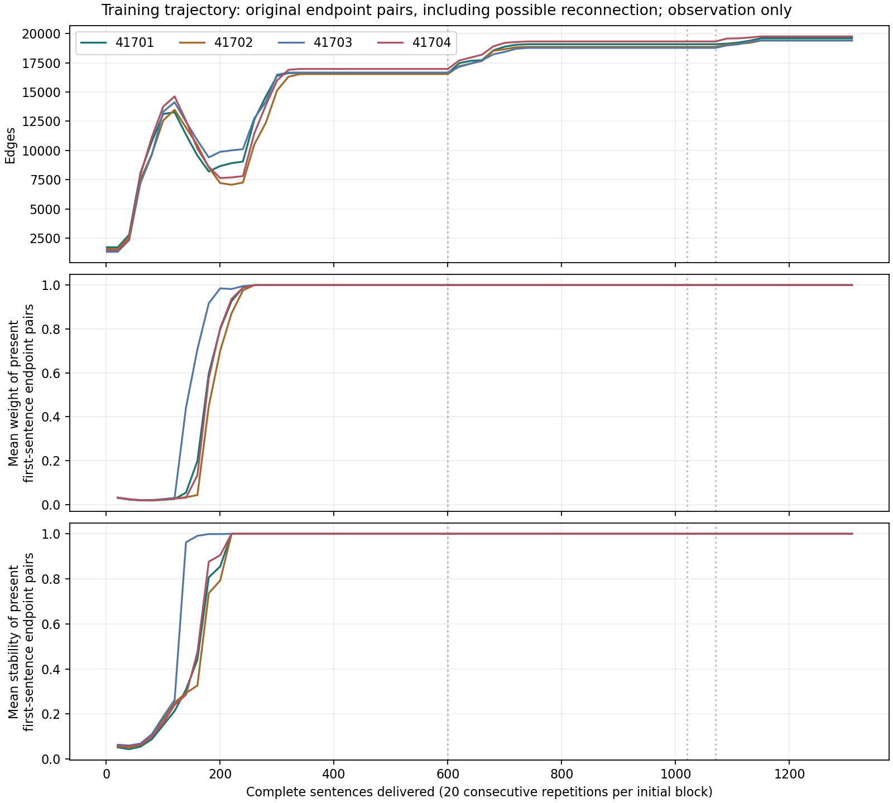
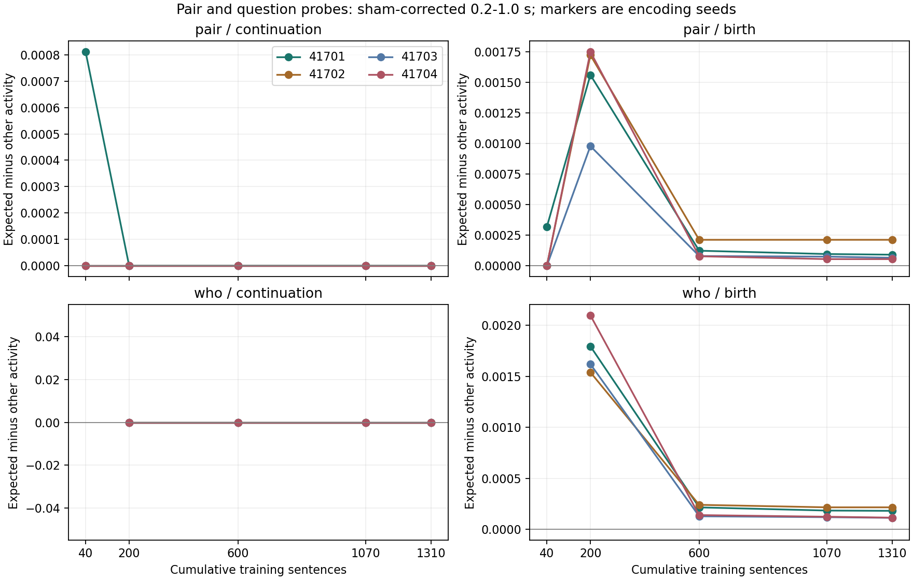
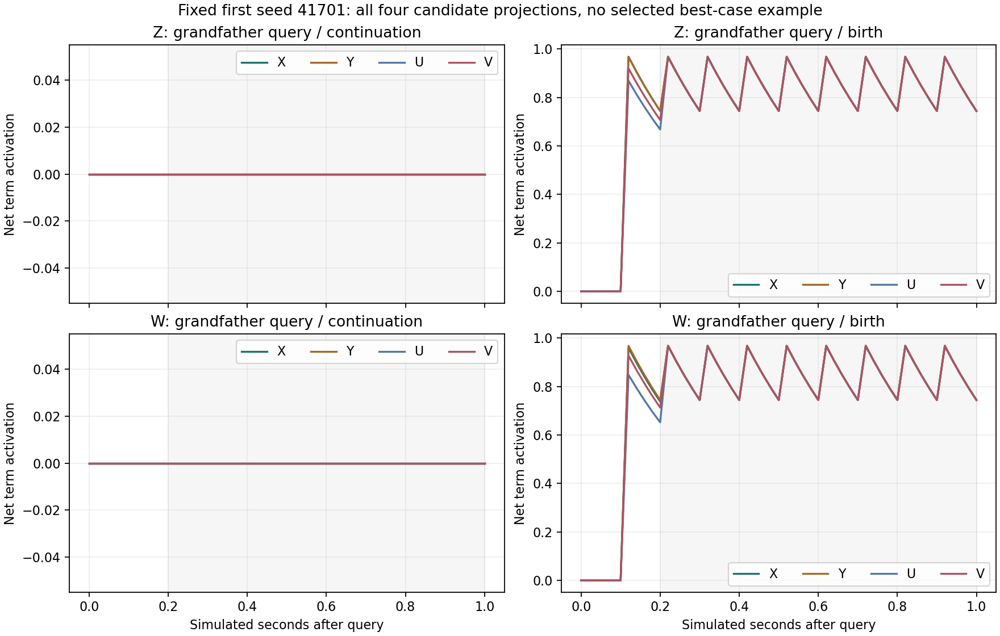

# 默认映射复验：逐句20次与完整标点

2026-09-09。平台项目：默认映射复验：逐句20次与完整标点 · 2026-09-09。
项目编号：`a9bd83bb-3d57-4eab-859d-68312f6b2b17`。

本次按用户纠正重新实验：完整原句由发送层原样提交，现有默认感官继续执行NFKC。没有为标点改变映射器、感官参数或内核。上一轮关闭NFKC是执行条件错误，旧记录保留但不作为本轮条件的证据。

下面的“目标领先”是外部词模板相关活动超过其他候选，不能自动解释为意识生成了该文字答案。连续状态是主观察；结构出生副本清空活动后再激活，必须分开理解。配对/问答的平均量是目标减另一个候选；家系平均量是角色区分量，不是准确率。

## 最终观察汇总

| 教学 | 观察方式 | 项目 | 目标严格领先/可评分 | 总提示数 | 并列 | 种子平均量 |
| --- | --- | --- | --- | --- | --- | --- |
| 原对应 | 连续状态 | 配对 | 0/8 | 8 | 8 | 0 |
| 原对应 | 结构出生副本 | 配对 | 8/8 | 8 | 0 | 0.0001057436485 |
| 原对应 | 连续状态 | 问答 | 0/16 | 16 | 16 | 0 |
| 原对应 | 结构出生副本 | 问答 | 15/16 | 16 | 1 | 0.0001563656276 |
| 原对应 | 连续状态 | 未见家系 | 0/6 | 8 | 6 | 0 |
| 原对应 | 结构出生副本 | 未见家系 | 2/6 | 8 | 1 | -1.346165325e-05 |
| 家系互换 | 连续状态 | 未见家系 | 0/6 | 8 | 6 | 0 |
| 家系互换 | 结构出生副本 | 未见家系 | 1/6 | 8 | 0 | -3.29468362e-05 |
| 名词互换 | 连续状态 | 配对 | 0/4 | 4 | 4 | 0 |
| 名词互换 | 结构出生副本 | 配对 | 4/4 | 4 | 0 | 0.0001333653798 |
| 名词互换 | 连续状态 | 问答 | 0/8 | 8 | 8 | 0 |
| 名词互换 | 结构出生副本 | 问答 | 8/8 | 8 | 0 | 0.0001739960172 |

完整候选数值、阶段变化、对照及方法限制在以下记录中；无法评分不填零，并列不计为严格领先。


## 如何理解这次结果

**本轮在现有默认映射下测到了可训练的配对联想偏向；祖父关系组合还没有取得同样的事实跟随证据。** 这两项结果需要分开看，也不能把结构出生副本的表现当作原意识持续活动时的即时回复。

### 配对确实呈现了随教学改变的偏向

在保留长期网络结构、按既有出生规则重置运行状态的辅助副本中，原对应组最终8/8配对提示都使正确物体候选更强；16条问答提示中15条使正确名字候选更强，另1条并列。4个编码种子的平均方向全部为正。末期平均差值分别为0.000105744和0.000156366，原始数值和全部曲线均保留。

预先安排的两个名词互换对照中，甲改为对应铃铛、乙改为对应松子后，4/4配对提示和8/8问答提示都偏向互换后实际教给它的对应。两种子原组和互换组的平均正确方向差值都为正。因此，在这些条件和样本里，结果不能仅用“天生固定偏爱甲、松子或某个通道”解释，存在随教学对应改变的读出偏向。

这些数字表示候选相关活动领先的次数，不是自然语言回答准确率，也不自动证明已经掌握“是”“谁”或我/你/他说话角色。它们为较低层次的可训练关联提供了正面证据，应当保留并继续研究。

### 重复后的结果不是简单地越来越强

最初两条各20次后的结构出生副本只有1/8配对提示严格领先；完整第一轮10条对话之后，配对已是8/8，问答是16/16。后续三轮及全部课程完成后，配对仍为8/8，问答为15/16，但平均活动差值从第一轮的约0.00150/0.00176减小到了最终约0.000106/0.000156。

因此不能说增加重复必然增加当前读出的分离程度，也不能说“所有连接都没有巩固”。原第一句20次时形成的连接，到最终约48%—58%仍保留原出生身份，另有同端点重新形成的连接。第600次和最终恢复点，4个主意识当时存在的全部连接权重均已达到1。这里既有消退，也有很强的增强和保持。

权重普遍触及上限，是后续值得检查的状态；本轮没有通过消融证明它就是连续读出或关系组合困难的原因。拓扑、局部状态和时序仍可携带差异，不能因为权重都到1就宣布网络什么都没学到。

### 连续意识中的词评分与原始响应不同

在保留当前活动、抑制、痕迹、队列和时钟的主观察中，最终配对、问答以及可完整评分的家系候选，在预定0.2—1秒窗口里的净活动差值均为0。这个结果没有被辅助副本的正结果替代。

但“候选词差值为0”并不等于“没有刺激进入”或“意识没有响应”。全部16条原组完整家系问题都在输入时产生了全节点活动差异。种子41701、41703、41704的12条完整问题，在之后20毫秒至1秒的采样点上，激活向量与无提示对照相同；种子41702的4条完整问题却在另一个匿名通道上持续不同，到1秒时L1差异约0.649—0.732。种子41703的裸名字Z/W提示也保留了持续差异。

因此既存在主要活动快速回到相同轨迹的情形，也存在当前词模板没有反映出来的差异。每20毫秒的采样可能漏掉更短的变化；活动向量也不是全部内核状态。本轮保留了这些原始现象，不给该匿名通道擅加“爷爷”“理解”或其他语义标签。

### 家系有个别正例，尚未呈现稳定的规则迁移

已教家系的结构出生副本有2/6个可完整评分的祖父提示严格领先，另2项因观察通道不足无法完整评分。未见家系的原组同样为2/6严格领先，另2项无法评分；互换家系组为1/6严格领先。

两个原组正例都保留：种子41702的W问题中U领先；种子41704的Z问题中X领先。在41704的Z例子里，爷爷问题的X领先约0.000262756，父亲问题的Y也领先约0.000022101，单独看确实像一个值得注意的角色区分案例。

但把同源后续家系事实改成Z的爷爷应为U、W的爷爷应为X后，3个可完整比较的种子，其X/U相对偏向均没有随事实改变；每个家系的预定跟随差值都是0。41704的其他候选V会变，41703的部分可见候选也会变，故不能说训练没有影响任何状态；只是当前证据没有显示预期祖父身份随新事实可靠迁移。

此外，已经明确教过的家系也未能被这套工具稳定读出，因此不能将上述限制全部归罪于“组合推理能力缺失”。家系事实的学习、持续状态、提问刺激和观察模板都需要进一步分开验证。本轮结果既不足以宣布掌握了祖父规则，也不足以据此否定ThreeMind的总体假设。

### 后续优先事项

本轮已按计划结束，未继续新增实验或改动内核。下一步更有价值的是，在固定现有映射协议的前提下，先弄清配对偏向如何在持续意识中被稳定观察、独占词模板遗漏了什么，以及已教家系如何可靠读出，再扩大关系组合测试。对于权重增长、刺激间隔或强度等候选因素，可以另立明确的参数实验；不把本轮相关现象直接当作改公式的依据。


## 实际教学与映射核验

用户14条原句如下；每行完整发送，不带方括号：

```text
甲是松子。
乙是铃铛。
丙问甲，谁是铃铛？甲说：乙是铃铛。
丙问乙，谁是松子？乙说：甲是松子。
甲对乙说：我是松子，你是铃铛。
乙对甲说：我是铃铛，你是松子。
谁是松子？甲是松子。
谁是铃铛？乙是铃铛。
松子是谁？松子是甲。
铃铛是谁？铃铛是乙。
C的父亲是B。
B的父亲是A。
C的爷爷是A。
父亲的父亲是爷爷。
```

对话每句连续20次后换句，完整3轮共600次；7条家系/规则句同样每句20次、3轮共420次；再回顾10条对话，每句5次共50次；最后4条未见家系事实每句20次、3轮共240次。对话最终每句65次，家系句每句60次。每条完整课程1,310次，间隔0.8模拟秒，共1,048模拟秒。附加家系仅替换名字，陈述句都以句号结束。

4个固定种子41701—41704。每个种子的家系互换分支继承第1,070次后的完整状态；名词互换另用前两个固定种子从空白开始。这些对照均在任何本轮教学前登记。名词互换仅将松子/铃铛在所有相关对话中一致交换，所有说话人及标点保持。

完整使用`TextSensorConfig()`：默认匿名分布式192通道、NFKC、24字符分帧、20毫秒帧间隔、增益1。输入强度1；本轮每条训练句都只有1帧，最长17字符。原文全角标点在信封中不变，感官按既有NFKC规则转换后编码；这两个阶段分别审计。Core使用`Config()`，源码与原生二进制摘要与训练前一致。

本次与上一轮同时存在NFKC设置纠正和家系句号补全，不能把跨轮差别仅归因于某一项。所有新增证据属于独立项目，旧意识、笔记和报告均未改写。

### 每条实际意识记录

| 种子 | 教学 | 实际递送帧数 | 意识ID |
| --- | --- | --- | --- |
| 41701 | 家系互换 | 240 | 6bd02af3-ba1e-4dcb-b4e3-8d40eb49ab5a |
| 41701 | 原对应 | 1310 | 53f9c2c5-6d9f-43a0-964d-030ad8093326 |
| 41701 | 名词互换 | 1310 | 0ef9b8e4-ce4d-45cb-ba51-00d777eed2d1 |
| 41702 | 家系互换 | 240 | 530c5c94-17f0-400c-93d8-ef195d4550ad |
| 41702 | 原对应 | 1310 | 0da51726-e100-4f32-947f-514d118238eb |
| 41702 | 名词互换 | 1310 | 81870721-09c9-49d0-b513-ddc8952d41b3 |
| 41703 | 家系互换 | 240 | 79b216bf-be1c-4b6f-aab6-f351706dec14 |
| 41703 | 原对应 | 1310 | b9800302-0664-4792-9f79-3fc1b5f4a063 |
| 41704 | 家系互换 | 240 | a41c51f3-056a-4abe-9b96-327642948cfb |
| 41704 | 原对应 | 1310 | 4e87a117-7953-4b89-b4b4-fae4b3d1047b |

已逐条核验 8820 个原文载体、默认配置、规范化摘要、输入强度、帧通道与幅度、递送顺序和时间；核验 44 个恢复点及 132 个测量来源摘要。

### 连接形成、保持及重新形成

下表追踪第20次输入时的连接，以起点、终点及出生时间区分原连接延续和同端点重新生边。缺失不隐藏，重新形成不冒充一直保留。均为只读观察，不保护或指定任何连接。

| 种子 | 输入数 | 节点 | 边 | 权重为1的边 | 原出生连接仍在 | 同端点新生 | 原端点缺失 |
| --- | --- | --- | --- | --- | --- | --- | --- |
| 41701 | 20 | 42 | 1722 | 0 | 1722/1722 | 0 | 0 |
| 41701 | 40 | 61 | 2786 | 0 | 1722/1722 | 0 | 0 |
| 41701 | 200 | 128 | 8669 | 3436 | 940/1722 | 264 | 518 |
| 41701 | 600 | 146 | 16626 | 16626 | 940/1722 | 320 | 462 |
| 41701 | 1310 | 169 | 19600 | 19600 | 940/1722 | 320 | 462 |
| 41702 | 20 | 40 | 1560 | 0 | 1560/1560 | 0 | 0 |
| 41702 | 40 | 58 | 2622 | 0 | 1560/1560 | 0 | 0 |
| 41702 | 200 | 126 | 7214 | 773 | 754/1560 | 219 | 587 |
| 41702 | 600 | 150 | 16540 | 16540 | 754/1560 | 368 | 438 |
| 41702 | 1310 | 167 | 19406 | 19406 | 754/1560 | 368 | 438 |
| 41703 | 20 | 37 | 1332 | 0 | 1332/1332 | 0 | 0 |
| 41703 | 40 | 55 | 2322 | 0 | 1332/1332 | 0 | 0 |
| 41703 | 200 | 134 | 9889 | 5360 | 732/1332 | 275 | 325 |
| 41703 | 600 | 146 | 16670 | 16670 | 732/1332 | 324 | 276 |
| 41703 | 1310 | 166 | 19416 | 19416 | 732/1332 | 324 | 276 |
| 41704 | 20 | 39 | 1482 | 0 | 1482/1482 | 0 | 0 |
| 41704 | 40 | 55 | 2394 | 0 | 1482/1482 | 0 | 0 |
| 41704 | 200 | 120 | 7641 | 1153 | 856/1482 | 256 | 370 |
| 41704 | 600 | 145 | 16978 | 16978 | 856/1482 | 334 | 292 |
| 41704 | 1310 | 164 | 19760 | 19760 | 856/1482 | 334 | 292 |



图中原端点集合可能包含重新生边；出生身份区分以上表和原始JSON为准。


## 配对、问答与名词互换

每个提示和无提示对照从同一阶段独立复制。连续状态保留当前活动、抑制、在途信号和时钟，等待0秒。结构出生副本依据既有`threemind.birth/1`规则保留长期网络结构，清空激活、抑制、近期痕迹、资格迹和在途队列，并重置时钟及相关运行状态；它不是原意识暂停后恢复，也不只是换了显示方式。测试期间学习开启，但绝不写回教学意识。

主要数值为0.2至1模拟秒的活动积分平均减同源无提示对照。另保存0至0.2秒和全部曲线。词模板重叠与直接提示通道仅在评分中排除；完整零/非零激活仍保存在原始ZIP中。此工具没有让AI填词或生成答句。

### 原对应的阶段结果

| 输入阶段 | 项目 | 观察方式 | 目标严格领先/可评分 | 种子平均差值 |
| --- | --- | --- | --- | --- |
| pair_20_each | 配对 | 连续状态 | 1/8 | 0.000202830118 |
| pair_20_each | 配对 | 结构出生副本 | 1/8 | 7.978471785e-05 |
| dialogue_1 | 配对 | 连续状态 | 0/8 | 0 |
| dialogue_1 | 配对 | 结构出生副本 | 8/8 | 0.001502505496 |
| dialogue_1 | 问答 | 连续状态 | 0/16 | 0 |
| dialogue_1 | 问答 | 结构出生副本 | 16/16 | 0.001763537224 |
| dialogue_3 | 配对 | 连续状态 | 0/8 | 0 |
| dialogue_3 | 配对 | 结构出生副本 | 8/8 | 0.0001231721324 |
| dialogue_3 | 问答 | 连续状态 | 0/16 | 0 |
| dialogue_3 | 问答 | 结构出生副本 | 15/16 | 0.0001811020529 |
| review | 配对 | 连续状态 | 0/8 | 0 |
| review | 配对 | 结构出生副本 | 8/8 | 0.0001094299478 |
| review | 问答 | 连续状态 | 0/16 | 0 |
| review | 问答 | 结构出生副本 | 15/16 | 0.000160973442 |
| final | 配对 | 连续状态 | 0/8 | 0 |
| final | 配对 | 结构出生副本 | 8/8 | 0.0001057436485 |
| final | 问答 | 连续状态 | 0/16 | 0 |
| final | 问答 | 结构出生副本 | 15/16 | 0.0001563656276 |



### 最终每条提示的候选活动

| 种子 | 教学 | 方式 | 提示 | 预期 | 目标减另一个 | 候选净活动 |
| --- | --- | --- | --- | --- | --- | --- |
| 41701 | 原对应 | 连续状态 | 甲 | 松子 | 0 | 松子=0; 铃铛=0 |
| 41701 | 原对应 | 连续状态 | 乙 | 铃铛 | 0 | 松子=0; 铃铛=0 |
| 41701 | 原对应 | 结构出生副本 | 甲 | 松子 | 0.000105850542 | 松子=0.84675294; 铃铛=0.8466470895 |
| 41701 | 原对应 | 结构出生副本 | 乙 | 铃铛 | 7.549540943e-05 | 松子=0.8466774446; 铃铛=0.84675294 |
| 41701 | 原对应 | 连续状态 | 谁是松子？ | 甲 | 0 | 甲=0; 乙=0 |
| 41701 | 原对应 | 连续状态 | 谁是铃铛？ | 乙 | 0 | 甲=0; 乙=0 |
| 41701 | 原对应 | 连续状态 | 松子是谁？ | 甲 | 0 | 甲=0; 乙=0 |
| 41701 | 原对应 | 连续状态 | 铃铛是谁？ | 乙 | 0 | 甲=0; 乙=0 |
| 41701 | 原对应 | 结构出生副本 | 谁是松子？ | 甲 | 9.133471361e-05 | 甲=0.8512069641; 乙=0.8511156293 |
| 41701 | 原对应 | 结构出生副本 | 谁是铃铛？ | 乙 | 0.0002197914871 | 甲=0.8509646517; 乙=0.8511844432 |
| 41701 | 原对应 | 结构出生副本 | 松子是谁？ | 甲 | 0.000304727081 | 甲=0.8512069641; 乙=0.850902237 |
| 41701 | 原对应 | 结构出生副本 | 铃铛是谁？ | 乙 | 0.00011073415 | 甲=0.8510962299; 乙=0.8512069641 |
| 41702 | 原对应 | 连续状态 | 甲 | 松子 | 0 | 松子=0; 铃铛=0 |
| 41702 | 原对应 | 连续状态 | 乙 | 铃铛 | 0 | 松子=0; 铃铛=0 |
| 41702 | 原对应 | 结构出生副本 | 甲 | 松子 | 0.0001868095893 | 松子=0.8466891693; 铃铛=0.8465023597 |
| 41702 | 原对应 | 结构出生副本 | 乙 | 铃铛 | 0.0002379662663 | 松子=0.846408578; 铃铛=0.8466465443 |
| 41702 | 原对应 | 连续状态 | 谁是松子？ | 甲 | 0 | 甲=0; 乙=0 |
| 41702 | 原对应 | 连续状态 | 谁是铃铛？ | 乙 | 0 | 甲=0; 乙=0 |
| 41702 | 原对应 | 连续状态 | 松子是谁？ | 甲 | 0 | 甲=0; 乙=0 |
| 41702 | 原对应 | 连续状态 | 铃铛是谁？ | 乙 | 0 | 甲=0; 乙=0 |
| 41702 | 原对应 | 结构出生副本 | 谁是松子？ | 甲 | 0.0002744856534 | 甲=0.8511679618; 乙=0.8508934762 |
| 41702 | 原对应 | 结构出生副本 | 谁是铃铛？ | 乙 | 0.0002215176328 | 甲=0.8509745108; 乙=0.8511960284 |
| 41702 | 原对应 | 结构出生副本 | 松子是谁？ | 甲 | 0.0002138521956 | 甲=0.8512069641; 乙=0.8509931119 |
| 41702 | 原对应 | 结构出生副本 | 铃铛是谁？ | 乙 | 0.000154448808 | 甲=0.8510525153; 乙=0.8512069641 |
| 41703 | 原对应 | 连续状态 | 甲 | 松子 | 0 | 松子=0; 铃铛=0 |
| 41703 | 原对应 | 连续状态 | 乙 | 铃铛 | 0 | 松子=0; 铃铛=0 |
| 41703 | 原对应 | 结构出生副本 | 甲 | 松子 | 6.374008456e-05 | 松子=0.8464606574; 铃铛=0.8463969174 |
| 41703 | 原对应 | 结构出生副本 | 乙 | 铃铛 | 6.723809902e-05 | 松子=0.8463934193; 铃铛=0.8464606574 |
| 41703 | 原对应 | 连续状态 | 谁是松子？ | 甲 | 0 | 甲=0; 乙=0 |
| 41703 | 原对应 | 连续状态 | 谁是铃铛？ | 乙 | 0 | 甲=0; 乙=0 |
| 41703 | 原对应 | 连续状态 | 松子是谁？ | 甲 | 0 | 甲=0; 乙=0 |
| 41703 | 原对应 | 连续状态 | 铃铛是谁？ | 乙 | 0 | 甲=0; 乙=0 |
| 41703 | 原对应 | 结构出生副本 | 谁是松子？ | 甲 | 0.0001857114233 | 甲=0.8511449292; 乙=0.8509592178 |
| 41703 | 原对应 | 结构出生副本 | 谁是铃铛？ | 乙 | 4.685865313e-05 | 甲=0.8511035727; 乙=0.8511504314 |
| 41703 | 原对应 | 结构出生副本 | 松子是谁？ | 甲 | 9.477540488e-05 | 甲=0.8512069641; 乙=0.8511121887 |
| 41703 | 原对应 | 结构出生副本 | 铃铛是谁？ | 乙 | 0.0001240696209 | 甲=0.8510828944; 乙=0.8512069641 |
| 41704 | 原对应 | 连续状态 | 甲 | 松子 | 0 | 松子=0; 铃铛=0 |
| 41704 | 原对应 | 连续状态 | 乙 | 铃铛 | 0 | 松子=0; 铃铛=0 |
| 41704 | 原对应 | 结构出生副本 | 甲 | 松子 | 2.829667954e-05 | 松子=0.84675294; 铃铛=0.8467246433 |
| 41704 | 原对应 | 结构出生副本 | 乙 | 铃铛 | 8.05525182e-05 | 松子=0.8466723875; 铃铛=0.84675294 |
| 41704 | 原对应 | 连续状态 | 谁是松子？ | 甲 | 0 | 甲=0; 乙=0 |
| 41704 | 原对应 | 连续状态 | 谁是铃铛？ | 乙 | 0 | 甲=0; 乙=0 |
| 41704 | 原对应 | 连续状态 | 松子是谁？ | 甲 | 0 | 甲=0; 乙=0 |
| 41704 | 原对应 | 连续状态 | 铃铛是谁？ | 乙 | 0 | 甲=0; 乙=0 |
| 41704 | 原对应 | 结构出生副本 | 谁是松子？ | 甲 | 0.000277336878 | 甲=0.8512069641; 乙=0.8509296272 |
| 41704 | 原对应 | 结构出生副本 | 谁是铃铛？ | 乙 | 5.472083889e-05 | 甲=0.8511164578; 乙=0.8511711787 |
| 41704 | 原对应 | 结构出生副本 | 松子是谁？ | 甲 | 0.0001274855004 | 甲=0.8512069641; 乙=0.8510794786 |
| 41704 | 原对应 | 结构出生副本 | 铃铛是谁？ | 乙 | 0 | 甲=0.8512069641; 乙=0.8512069641 |
| 41701 | 名词互换 | 连续状态 | 甲 | 铃铛 | 0 | 松子=0; 铃铛=0 |
| 41701 | 名词互换 | 连续状态 | 乙 | 松子 | 0 | 松子=0; 铃铛=0 |
| 41701 | 名词互换 | 结构出生副本 | 甲 | 铃铛 | 7.549540943e-05 | 松子=0.8466774446; 铃铛=0.84675294 |
| 41701 | 名词互换 | 结构出生副本 | 乙 | 松子 | 0.0001467235236 | 松子=0.84675294; 铃铛=0.8466062165 |
| 41701 | 名词互换 | 连续状态 | 谁是松子？ | 乙 | 0 | 甲=0; 乙=0 |
| 41701 | 名词互换 | 连续状态 | 谁是铃铛？ | 甲 | 0 | 甲=0; 乙=0 |
| 41701 | 名词互换 | 连续状态 | 松子是谁？ | 乙 | 0 | 甲=0; 乙=0 |
| 41701 | 名词互换 | 连续状态 | 铃铛是谁？ | 甲 | 0 | 甲=0; 乙=0 |
| 41701 | 名词互换 | 结构出生副本 | 谁是松子？ | 乙 | 8.728456532e-05 | 甲=0.8511196795; 乙=0.8512069641 |
| 41701 | 名词互换 | 结构出生副本 | 谁是铃铛？ | 甲 | 0.0002289623643 | 甲=0.8512069641; 乙=0.8509780017 |
| 41701 | 名词互换 | 结构出生副本 | 松子是谁？ | 乙 | 0.0002385488618 | 甲=0.8509684152; 乙=0.8512069641 |
| 41701 | 名词互换 | 结构出生副本 | 铃铛是谁？ | 甲 | 0.0001488880948 | 甲=0.8512069641; 乙=0.851058076 |
| 41702 | 名词互换 | 连续状态 | 甲 | 铃铛 | 0 | 松子=0; 铃铛=0 |
| 41702 | 名词互换 | 连续状态 | 乙 | 松子 | 0 | 松子=0; 铃铛=0 |
| 41702 | 名词互换 | 结构出生副本 | 甲 | 铃铛 | 9.271438963e-05 | 松子=0.8465281481; 铃铛=0.8466208625 |
| 41702 | 名词互换 | 结构出生副本 | 乙 | 松子 | 0.0002185281966 | 松子=0.846705112; 铃铛=0.8464865838 |
| 41702 | 名词互换 | 连续状态 | 谁是松子？ | 乙 | 0 | 甲=0; 乙=0 |
| 41702 | 名词互换 | 连续状态 | 谁是铃铛？ | 甲 | 0 | 甲=0; 乙=0 |
| 41702 | 名词互换 | 连续状态 | 松子是谁？ | 乙 | 0 | 甲=0; 乙=0 |
| 41702 | 名词互换 | 连续状态 | 铃铛是谁？ | 甲 | 0 | 甲=0; 乙=0 |
| 41702 | 名词互换 | 结构出生副本 | 谁是松子？ | 乙 | 0.000209036921 | 甲=0.8509869915; 乙=0.8511960284 |
| 41702 | 名词互换 | 结构出生副本 | 谁是铃铛？ | 甲 | 0.0001797102486 | 甲=0.8511679618; 乙=0.8509882516 |
| 41702 | 名词互换 | 结构出生副本 | 松子是谁？ | 乙 | 0.0001731698756 | 甲=0.8510337942; 乙=0.8512069641 |
| 41702 | 名词互换 | 结构出生副本 | 铃铛是谁？ | 甲 | 0.0001263672065 | 甲=0.8512069641; 乙=0.8510805969 |

### 是否跟随名词互换

以下比较同一个编码种子在两种完整教学中的偏向。两列“正确方向差值”均按各组实际对应计算；其和是固定词方向下原组减互换组的差异。若要认为两组都偏向自身学到的对应，两组差值都应为正，不能只检查和为正。

| 种子 | 方式 | 项目 | 原对应正确方向差值 | 互换后正确方向差值 | 固定词方向的组间变化 |
| --- | --- | --- | --- | --- | --- |
| 41701 | 连续状态 | 配对 | 0 | 0 | 0 |
| 41701 | 连续状态 | 问答 | 0 | 0 | 0 |
| 41701 | 结构出生副本 | 配对 | 9.067297571e-05 | 0.0001111094665 | 0.0002017824422 |
| 41701 | 结构出生副本 | 问答 | 0.0001816468579 | 0.0001759209715 | 0.0003575678295 |
| 41702 | 连续状态 | 配对 | 0 | 0 | 0 |
| 41702 | 连续状态 | 问答 | 0 | 0 | 0 |
| 41702 | 结构出生副本 | 配对 | 0.0002123879278 | 0.0001556212931 | 0.0003680092209 |
| 41702 | 结构出生副本 | 问答 | 0.0002160760725 | 0.0001720710629 | 0.0003881471354 |


## 已教家系及未见名字关系组合

已教C→B→A、F→E→D，同时教授其爷爷事实及“父亲的父亲是爷爷。”。未见Z→Y→X、W→V→U只提供父亲事实；最终独立提示“Z的爷爷是谁？”等。家系互换分支改为Z→Y→U、W→V→X，没有输入对应爷爷答案。

角色区分量R为：(爷爷问题中预期爷爷减父亲的活动)−(父亲问题中预期爷爷减父亲的活动)。它须结合目标是否领先、裸名字对照及事实互换方向判断；R为正不自动表示答对。

### 已教家系阶段

| 方式 | 严格领先/可评分 | 总提示数 | 平均R |
| --- | --- | --- | --- |
| 连续状态 | 0/6 | 8 | 0 |
| 结构出生副本 | 2/6 | 8 | 0.0005909699623 |

### 最终所有祖父问题的完整候选

| 种子 | 教学 | 方式 | 孩子 | 预期爷爷 | X | Y | U | V | 目标减最强其他 | R |
| --- | --- | --- | --- | --- | --- | --- | --- | --- | --- | --- |
| 41701 | 原对应 | 连续状态 | Z | X | 0 | 0 | 0 | 0 | 0 | 0 |
| 41701 | 原对应 | 连续状态 | W | U | 0 | 0 | 0 | 0 | 0 | 0 |
| 41701 | 原对应 | 结构出生副本 | Z | X | 0.8521953735 | 0.8521953735 | 0.8512440704 | 0.8517315198 | 0 | 0 |
| 41701 | 原对应 | 结构出生副本 | W | U | 0.8521158314 | 0.8521953735 | 0.8510476172 | 0.8518088733 | -0.001147756279 | -0.0003929063695 |
| 41701 | 家系互换 | 连续状态 | Z | U | 0 | 0 | 0 | 0 | 0 | 0 |
| 41701 | 家系互换 | 连续状态 | W | X | 0 | 0 | 0 | 0 | 0 | 0 |
| 41701 | 家系互换 | 结构出生副本 | Z | U | 0.8521953735 | 0.8521953735 | 0.8512440704 | 0.8517315198 | -0.0009513030945 | -0.0006998644707 |
| 41701 | 家系互换 | 结构出生副本 | W | X | 0.8521158314 | 0.8521953735 | 0.8510476172 | 0.8518088733 | -7.954208709e-05 | 0.0003069581012 |
| 41702 | 原对应 | 连续状态 | Z | X | 0 | 0 | 0 | 0 | 0 | 0 |
| 41702 | 原对应 | 连续状态 | W | U | 0 | 0 | 0 | 0 | 0 | 0 |
| 41702 | 原对应 | 结构出生副本 | Z | X | 0.8480885411 | 0.8516836344 | 0.8516615334 | 0.8508315187 | -0.003595093281 | -0.0004661493111 |
| 41702 | 原对应 | 结构出生副本 | W | U | 0.8484568908 | 0.8517941393 | 0.8519193782 | 0.8512268807 | 0.0001252389053 | -9.182041114e-05 |
| 41702 | 家系互换 | 连续状态 | Z | U | 0 | 0 | 0 | 0 | 0 | 0 |
| 41702 | 家系互换 | 连续状态 | W | X | 0 | 0 | 0 | 0 | 0 | 0 |
| 41702 | 家系互换 | 结构出生副本 | Z | U | 0.8480885411 | 0.8516836344 | 0.8516615334 | 0.8508315187 | -2.210098329e-05 | -4.868629344e-05 |
| 41702 | 家系互换 | 结构出生副本 | W | X | 0.8484568908 | 0.8517941393 | 0.8519193782 | 0.8512268807 | -0.003462487382 | -0.0006261945264 |
| 41703 | 原对应 | 连续状态 | Z | X | 无法评分 | 0 | 0 | 0 | 无法评分 | 无法评分 |
| 41703 | 原对应 | 连续状态 | W | U | 无法评分 | 0 | 0 | 0 | 无法评分 | 0 |
| 41703 | 原对应 | 结构出生副本 | Z | X | 无法评分 | 0.8503723094 | 0.8521953735 | 0.8515019152 | 无法评分 | 无法评分 |
| 41703 | 原对应 | 结构出生副本 | W | U | 无法评分 | 0.8501144646 | 0.8521953735 | 0.8514405236 | 无法评分 | 0.000503411286 |
| 41703 | 家系互换 | 连续状态 | Z | U | 无法评分 | 0 | 0 | 0 | 无法评分 | 0 |
| 41703 | 家系互换 | 连续状态 | W | X | 无法评分 | 0 | 0 | 0 | 无法评分 | 无法评分 |
| 41703 | 家系互换 | 结构出生副本 | Z | U | 无法评分 | 0.8502249695 | 0.8521953735 | 0.8513914103 | 无法评分 | 0.0003069581012 |
| 41703 | 家系互换 | 结构出生副本 | W | X | 无法评分 | 0.8502249695 | 0.8521953735 | 0.8513300187 | 无法评分 | 无法评分 |
| 41704 | 原对应 | 连续状态 | Z | X | 0 | 0 | 0 | 0 | 0 | 0 |
| 41704 | 原对应 | 连续状态 | W | U | 0 | 0 | 0 | 0 | 0 | 0 |
| 41704 | 原对应 | 结构出生副本 | Z | X | 0.8516308376 | 0.8509739473 | 0.8508560753 | 0.8513680815 | 0.0002627561346 | 0.0006789913199 |
| 41704 | 原对应 | 结构出生副本 | W | U | 0.8519046442 | 0.8508634423 | 0.8512072354 | 0.8516068148 | -0.0006974088059 | 0.0001911148524 |
| 41704 | 家系互换 | 连续状态 | Z | U | 0 | 0 | 0 | 0 | 0 | 0 |
| 41704 | 家系互换 | 连续状态 | W | X | 0 | 0 | 0 | 0 | 0 | 0 |
| 41704 | 家系互换 | 结构出生副本 | Z | U | 0.8516308376 | 0.8509739473 | 0.8508560753 | 0.8511875901 | -0.0007747622474 | 0.0006335615209 |
| 41704 | 家系互换 | 结构出生副本 | W | X | 0.8519046442 | 0.8508634423 | 0.8512072354 | 0.8514263234 | 0.0004783208274 | 0.0002365446514 |

### 相同名字在家系事实互换后的变化

| 种子 | 方式 | Z家系方向变化 | W家系方向变化 | 两家系平均 |
| --- | --- | --- | --- | --- |
| 41701 | 连续状态 | 0 | 0 | 0 |
| 41702 | 连续状态 | 0 | 0 | 0 |
| 41703 | 连续状态 | 无法评分 | 无法评分 | 无法评分 |
| 41704 | 连续状态 | 0 | 0 | 0 |
| 41701 | 结构出生副本 | 0 | 0 | 0 |
| 41702 | 结构出生副本 | 0 | 0 | 0 |
| 41703 | 结构出生副本 | 无法评分 | 无法评分 | 无法评分 |
| 41704 | 结构出生副本 | 0 | 0 | 0 |



### 不依赖词投影的全节点活动检查

以下只读取原有连续状态探针ZIP，以通道对应比较提示与无提示的全部激活，不额外模拟。末次差异采样点单位是微秒，数值容差仅为1e-12。每20毫秒采样可能漏掉间隔中的变化，激活也不是全部动力学状态，不能由这里的相同断言全部状态相同。

| 种子 | 提示 | 最大L1差异 | 末次有差异采样点 |
| --- | --- | --- | --- |
| 41701 | Z的爷爷是谁？ | 2.456208892 | 0 |
| 41701 | Z的父亲是谁？ | 2.471517055 | 0 |
| 41701 | Z | 0.5178607873 | 0 |
| 41701 | W的爷爷是谁？ | 2.458544912 | 0 |
| 41701 | W的父亲是谁？ | 2.473853075 | 0 |
| 41701 | W | 0.5268182826 | 0 |
| 41702 | Z的爷爷是谁？ | 2.497831201 | 1000000 |
| 41702 | Z的父亲是谁？ | 2.489171087 | 1000000 |
| 41702 | Z | 0.5229754581 | 0 |
| 41702 | W的爷爷是谁？ | 2.49040915 | 1000000 |
| 41702 | W的父亲是谁？ | 2.481749037 | 1000000 |
| 41702 | W | 0.5199261608 | 0 |
| 41703 | Z的爷爷是谁？ | 2.490331654 | 0 |
| 41703 | Z的父亲是谁？ | 2.47926702 | 0 |
| 41703 | Z | 0.5688257355 | 1000000 |
| 41703 | W的爷爷是谁？ | 2.494347857 | 0 |
| 41703 | W的父亲是谁？ | 2.483283223 | 0 |
| 41703 | W | 0.5688660533 | 1000000 |
| 41704 | Z的爷爷是谁？ | 2.502400116 | 0 |
| 41704 | Z的父亲是谁？ | 2.500746724 | 0 |
| 41704 | Z | 0.5185241303 | 0 |
| 41704 | W的爷爷是谁？ | 2.492809144 | 0 |
| 41704 | W的父亲是谁？ | 2.491155752 | 0 |
| 41704 | W | 0.5089480105 | 0 |


## 资源与验收

- 固定预算：新增4 GiB、累计实验计算30分钟，达到3 GiB先停止计算并留发布余量；账户66%起始、84%停止。
- 本轮实验进程计时 **20.72分钟**，包含训练、测量和相关数据库操作，不含报告编写。
- 进程采样最大RSS **194.74 MiB**；这不是整机内存峰值或未采样瞬间的保证。
- 发布前数据库增长 **365.67 MiB**，本地证据 **9.28 MiB**；发布后的最终数值见`acceptance.json`。
- 10条教学意识、8820次实际教学输入、44个恢复点、132个测量任务、588个提示/无提示副本。
- 最近额度观测66%，起始66%；账户级读数可能滞后且包含其他任务。最终记录见`quota-monitor.json`。
- 1912条既有实验意识及其所在项目笔记/记录/报告头摘要未改变；未清理旧数据。产品源码和原生二进制摘要一致，感官与内核完整默认配置一致。
- 逐条输入、所有恢复点与测量来源摘要已校验；固定首种子的正常/交叉家系、连续/出生共4个原始ZIP及其中所有最终模型和完整活动采样已抽检。其余ZIP保留可审计，但不声称逐个解压检查过。
- 仅运行本轮自有任务，不启动通用worker领取其他任务。不声称做过本轮未执行的浏览器交互验收。

平台内保存方案笔记、3份实验记录、关联报告、结果笔记以及Markdown/HTML导出；`evidence-index.json`连接原始ZIP、恢复点和输入核验，`implementation.json`固定实际实现身份。
