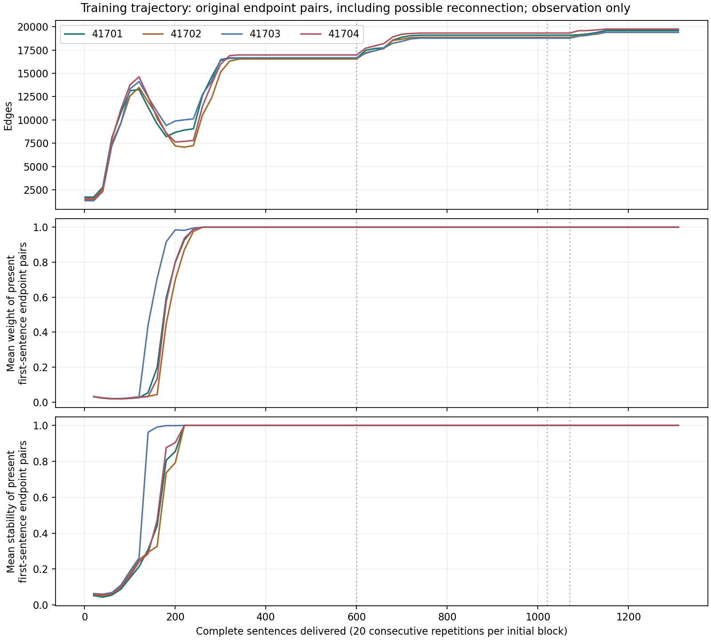

## 实际教学与映射核验

用户14条原句如下；每行完整发送，不带方括号：

```text
甲是松子。
乙是铃铛。
丙问甲，谁是铃铛？甲说：乙是铃铛。
丙问乙，谁是松子？乙说：甲是松子。
甲对乙说：我是松子，你是铃铛。
乙对甲说：我是铃铛，你是松子。
谁是松子？甲是松子。
谁是铃铛？乙是铃铛。
松子是谁？松子是甲。
铃铛是谁？铃铛是乙。
C的父亲是B。
B的父亲是A。
C的爷爷是A。
父亲的父亲是爷爷。
```

对话每句连续20次后换句，完整3轮共600次；7条家系/规则句同样每句20次、3轮共420次；再回顾10条对话，每句5次共50次；最后4条未见家系事实每句20次、3轮共240次。对话最终每句65次，家系句每句60次。每条完整课程1,310次，间隔0.8模拟秒，共1,048模拟秒。附加家系仅替换名字，陈述句都以句号结束。

4个固定种子41701—41704。每个种子的家系互换分支继承第1,070次后的完整状态；名词互换另用前两个固定种子从空白开始。这些对照均在任何本轮教学前登记。名词互换仅将松子/铃铛在所有相关对话中一致交换，所有说话人及标点保持。

完整使用`TextSensorConfig()`：默认匿名分布式192通道、NFKC、24字符分帧、20毫秒帧间隔、增益1。输入强度1；本轮每条训练句都只有1帧，最长17字符。原文全角标点在信封中不变，感官按既有NFKC规则转换后编码；这两个阶段分别审计。Core使用`Config()`，源码与原生二进制摘要与训练前一致。

本次与上一轮同时存在NFKC设置纠正和家系句号补全，不能把跨轮差别仅归因于某一项。所有新增证据属于独立项目，旧意识、笔记和报告均未改写。

### 每条实际意识记录

| 种子 | 教学 | 实际递送帧数 | 意识ID |
| --- | --- | --- | --- |
| 41701 | 家系互换 | 240 | 6bd02af3-ba1e-4dcb-b4e3-8d40eb49ab5a |
| 41701 | 原对应 | 1310 | 53f9c2c5-6d9f-43a0-964d-030ad8093326 |
| 41701 | 名词互换 | 1310 | 0ef9b8e4-ce4d-45cb-ba51-00d777eed2d1 |
| 41702 | 家系互换 | 240 | 530c5c94-17f0-400c-93d8-ef195d4550ad |
| 41702 | 原对应 | 1310 | 0da51726-e100-4f32-947f-514d118238eb |
| 41702 | 名词互换 | 1310 | 81870721-09c9-49d0-b513-ddc8952d41b3 |
| 41703 | 家系互换 | 240 | 79b216bf-be1c-4b6f-aab6-f351706dec14 |
| 41703 | 原对应 | 1310 | b9800302-0664-4792-9f79-3fc1b5f4a063 |
| 41704 | 家系互换 | 240 | a41c51f3-056a-4abe-9b96-327642948cfb |
| 41704 | 原对应 | 1310 | 4e87a117-7953-4b89-b4b4-fae4b3d1047b |

已逐条核验 8820 个原文载体、默认配置、规范化摘要、输入强度、帧通道与幅度、递送顺序和时间；核验 44 个恢复点及 132 个测量来源摘要。

### 连接形成、保持及重新形成

下表追踪第20次输入时的连接，以起点、终点及出生时间区分原连接延续和同端点重新生边。缺失不隐藏，重新形成不冒充一直保留。均为只读观察，不保护或指定任何连接。

| 种子 | 输入数 | 节点 | 边 | 权重为1的边 | 原出生连接仍在 | 同端点新生 | 原端点缺失 |
| --- | --- | --- | --- | --- | --- | --- | --- |
| 41701 | 20 | 42 | 1722 | 0 | 1722/1722 | 0 | 0 |
| 41701 | 40 | 61 | 2786 | 0 | 1722/1722 | 0 | 0 |
| 41701 | 200 | 128 | 8669 | 3436 | 940/1722 | 264 | 518 |
| 41701 | 600 | 146 | 16626 | 16626 | 940/1722 | 320 | 462 |
| 41701 | 1310 | 169 | 19600 | 19600 | 940/1722 | 320 | 462 |
| 41702 | 20 | 40 | 1560 | 0 | 1560/1560 | 0 | 0 |
| 41702 | 40 | 58 | 2622 | 0 | 1560/1560 | 0 | 0 |
| 41702 | 200 | 126 | 7214 | 773 | 754/1560 | 219 | 587 |
| 41702 | 600 | 150 | 16540 | 16540 | 754/1560 | 368 | 438 |
| 41702 | 1310 | 167 | 19406 | 19406 | 754/1560 | 368 | 438 |
| 41703 | 20 | 37 | 1332 | 0 | 1332/1332 | 0 | 0 |
| 41703 | 40 | 55 | 2322 | 0 | 1332/1332 | 0 | 0 |
| 41703 | 200 | 134 | 9889 | 5360 | 732/1332 | 275 | 325 |
| 41703 | 600 | 146 | 16670 | 16670 | 732/1332 | 324 | 276 |
| 41703 | 1310 | 166 | 19416 | 19416 | 732/1332 | 324 | 276 |
| 41704 | 20 | 39 | 1482 | 0 | 1482/1482 | 0 | 0 |
| 41704 | 40 | 55 | 2394 | 0 | 1482/1482 | 0 | 0 |
| 41704 | 200 | 120 | 7641 | 1153 | 856/1482 | 256 | 370 |
| 41704 | 600 | 145 | 16978 | 16978 | 856/1482 | 334 | 292 |
| 41704 | 1310 | 164 | 19760 | 19760 | 856/1482 | 334 | 292 |



图中原端点集合可能包含重新生边；出生身份区分以上表和原始JSON为准。
