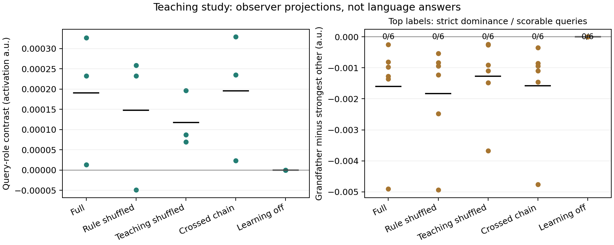
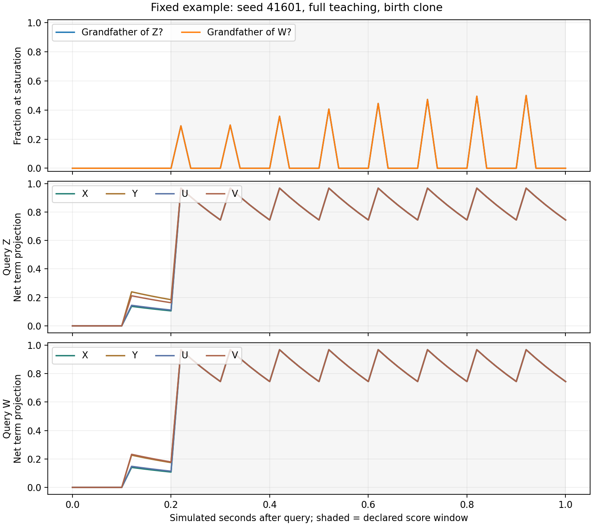

# Teaching study: father's father and question-answer transfer

2026-09-09 · Core causal/9 · state/6 · text-sensor/2

**Reliable grandfather-role transfer was not established. Rich teaching produced widespread, periodically saturated propagation, and the planned observer failed its physical calibration gate.** A supplementary 24-cycle example did give X a very small advantage for “Who is Z's grandfather?”. That observation is retained, but the second family did not succeed, and continuing-state probes produced zero net changes in the selected term projections. These are not validated language answers.

## Teaching and held-out queries

The user resolved the example contradiction: 甲 denotes 松子 and 乙 denotes 铃铛. Two additional consistent mappings were rotated through the same declarative, interrogative and first/second-person dialogue forms. Each carrier passed through the existing anonymous text sensor and input bus; speaker roles, logic and answers were not supplied as semantic Core fields.

Template families were A-B-C and D-E-F. Father facts, explicit grandfather facts, template question-answer examples and “父亲的父亲是爷爷” were interleaved with the language lessons. New families X-Y-Z and U-V-W received only father-chain facts, never their grandfather answers.

Queries asked for each new child's grandfather, father or bare name. Separate probes asked who 松子 and 铃铛 were. The eight-cycle course contained 192 carriers over153.6 simulated seconds; the24-cycle course contained512 over409.6 seconds. Carrier starts were0.8 seconds apart, training intensity1, with default192-channel anonymous encoding and unchanged Core dynamics.

## Calibration failure and prospective amendment

Four calibration parents used independent seeds41501/41502 and Latin/Chinese held-out names. At least80% of cue cases had to show nonzero sending/delivery, exclusive scoring channels and peak sampled saturation below20% during0–1 seconds. This is an instrument criterion, not a definition of healthy consciousness.

At each of intensities1,2,4, all32 queries propagated but none passed, with peak saturation around93–98%. Additional weaker probes reused exactly the same checkpoints: intensity0.03125 delivered in0/32;0.0625 passed1/32;0.125 passed2/32;0.25 and0.5 passed0/32. The saturation was periodic rather than present continuously at every instant. No dose qualified, and target-name rankings were not used to choose doses.

Before training any41601–41604 parent, a new notebook amendment cancelled the original confirmatory matrix and its significance tests. A bounded diagnostic then used four seeds, Latin materials, eight teaching cycles, and five conditions: full teaching; only the explicit rule character-shuffled; all auxiliary teaching character-shuffled; crossed first father links in the new families; learning disabled. Carrier counts, character totals and simulated duration were matched. Shuffling necessarily changes positional and pairwise sensory features; it does not isolate meaning perfectly.

Birth probes retained structure but cleared activity; learning during probing was disabled. Intensity1 and the original0.2–1.0-second score window were explicitly retained as an **uncalibrated diagnostic reference**, not presented as having passed calibration.

## Diagnostic results

R = (grandfather−father) under a grandfather query minus the same difference under a father query. Values are sham-subtracted observer projections, not answer accuracy. Seed41604 lacks an exclusive candidate channel; missing values remain missing. Role means use three complete seed blocks; four-way rankings use six scorable queries with two missing.

| Condition | Mean R | Expected grandfather strictly highest |
|---|---:|---:|
| Full |0.000190889|0/6|
| Rule shuffled |0.000147511|0/6|
| Auxiliary teaching shuffled |0.000117948|0/6|
| Crossed new chains |0.000195966|0/6|
| Learning off |0|0/6, all tied at zero|

Full-minus-rule-shuffled was0.0000433782; full-minus-teaching-shuffled was0.0000729415. These small positive differences coexist with positive contrasts under shuffled teaching and no reliable correct-candidate dominance. No confirmatory p-values or confidence intervals are reported.

Previously taught object-name questions were unstable too: full teaching had a positive paired preference in two of four seeds and an overall mean of−0.000450106; shuffled auxiliary teaching averaged+0.000631925. This does not show that nonsense is better teaching. It shows that this observer, under this rich course and configuration, did not reliably track the intended answers. The other object pairs and the meanings of “I/you” were not independently tested.

## Continuing state and longer teaching

The four full-teaching parents were also probed from independent continuing-state clones after a0.2-second wait. All available selected-term net projections were zero relative to no-query clones. These models were still active and propagating: zero net projections do not mean zero activity, death, or that every internal variable and every future time is input-independent.

With sufficient remaining budget, the prospectively fixed first seed41601 received24 teaching cycles. In its birth clone:

- “Who is Z's grandfather?”: X=0.852134676, strongest alternative V=0.852062341; X led by0.0000723353.
- “Who is W's grandfather?”: expected U=0.851556847, V=0.852088493; U did not lead.
- The taught object-name preference was positive,0.000128345.
- Continuing-state selected-term net differences remained zero.

This weak positive example is retained rather than discarded. However, it is one supplementary parent without a24-cycle matched control matrix, under failed calibration. More cycles also increased total simulated time. A1/2 descriptive outcome is not a validated reasoning accuracy.

The illustrated first preregistered seed shows small early differences followed by highly overlapping candidate projections in a common periodic response. Full diagnostic probe peaks ranged roughly43–98%; the long course reached100%. Dense coactivation, propagation reinforcement relative to inhibition/decay, and sensory-channel reuse are possible contributors, not demonstrated causal explanations. No Core formula was changed.

Further work should identify when input-specific responses converge during teaching and test existing intensity, spacing and plasticity/inhibition settings against physical observability criteria. Selecting settings by whether X wins would be inappropriate. This study stopped without that search.

## Evidence and limits

25 new parents,63 measurement jobs and517 independent probe/sham copies were saved in a separate Lab project. Weaker-dose probes reused calibration parents. Training, measurement and associated persistence took844.61 seconds, about14.08 minutes, below the20-minute cap. Recorded process RSS peaked at approximately203MiB; this is not whole-host peak memory. Maximum graph size was190 nodes and30442 edges.

Pre-publication database growth was508600320 bytes, approximately0.474GiB, plus about2.5MB local evidence. Final publication size is in acceptance.json and remains bounded by4GiB. Account weekly usage moved from63% at start to64% at experiment completion; this is account-wide approximate usage.

The two previous projects'1877 model metadata heads and report/note revisions remained unchanged. Every source-checkpoint hash still matched its source model. Four predetermined representative full ZIPs and all64 contained final-state hashes were checked; the evidence index lists all other bundles and hashes. All raw zero/nonzero activations, input frames, events, source/final states, failed calibrations and unscorable observations are retained.

Corpus balance, withheld-answer exclusion, contrast direction, crossed-chain truth and missing-value handling checks passed. Only research scripts and reports were added; no Core, Lab schema, sensor implementation or UI changes were needed. The experiment neither establishes emergent logic nor refutes the broader possibility that logic could develop through connection dynamics.
