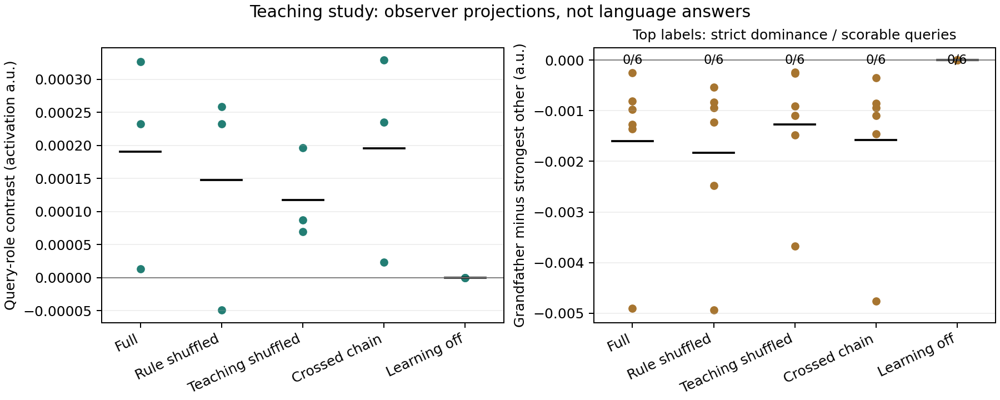
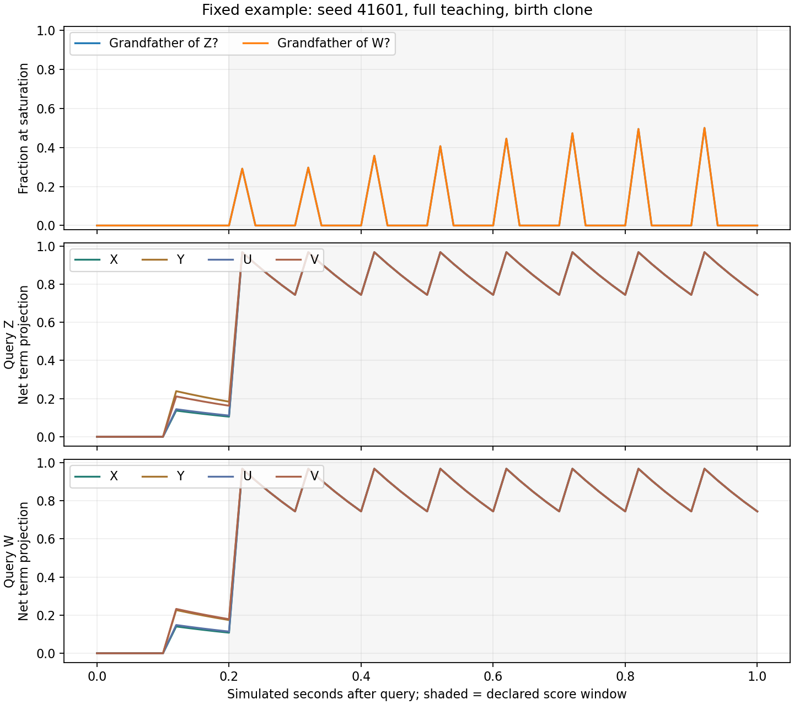

# 教学探索报告：父亲的父亲与问答迁移

> **修订 r3 · 2026-10-10**
> 修订原因：原件存储位置已迁移并核验，追加当前位置解析说明，保留原实验结论。
> 原版：[report.md](report.md)；父版本 r2：[report.r2.md](report.r2.md)

> **修订 r2 · 2026-10-10**
> 修订原因：生成证据移出 Git 并完成校验归档；追加位置登记，保留原字节与结论。
> 原版：[report.md](report.md)；父版本 r1：[report.md](report.md)

2026-09-09 · Core `causal/9` · 状态 `state/6` · 文本感官 `text-sensor/2`

**本轮尚未验证出可靠的祖父关系迁移。丰富教学后的网络出现了大范围、周期性的饱和传播，预定观察方法未通过校准。** 24 周期的单例长课中，确实有一次“Z的爷爷是谁？”使 X 的投影略高于其他候选；另一条家系没有对应成功，连续状态查询也没有产生预定词通道的净差。因此保留这个微弱正现象，但不能把它宣布成理解或推理。

平台项目：**教学探索：父亲的父亲与问答迁移 · 2026-09-09**。实验笔记保留原方案、校准失败后的修订与完整报告；记录与报告包含校准记录、两项教学对照记录和综合报告。

## 实际教了什么

用户确认后统一为“甲是松子、乙是铃铛”，并轮换“丁是陶杯、戊是柳叶”“己是木舟、庚是星河”。每组都包含陈述、谁是某物、某物是谁、第三人称对话和“我/你”的自述。原始对话按整句经过现有感官，不把说话人、逻辑关系或正确答案作为额外字段送入 Core。

家系教学包括 A是B的父亲、B是C的父亲、A是C的爷爷，以及 D-E-F 的另一条家系；中间穿插“父亲的父亲是爷爷”和模板问答。之后只输入 X是Y的父亲、Y是Z的父亲，以及 U-V-W 的第二条新链；**不输入 X是Z的爷爷或 U是W的爷爷**。

查询为 Z/W 的爷爷是谁、父亲是谁及裸名字，另外检查“松子是谁”“铃铛是谁”。八周期课程含192条输入，持续153.6模拟秒；长课含512条输入，持续409.6模拟秒。句子起点间隔0.8秒，训练强度1，192通道匿名编码；Core默认机制和参数均未改动。

## 为什么没有照原计划做大矩阵

独立校准使用41501/41502两个种子、拉丁及中文两套名字，共4个训练父本。正式诊断的41601–41604并未参与剂量选择。

预先要求至少80%的查询同时满足：实际非零发送与递送、观察词有专属评分通道、0–1秒内采样的最大饱和比例低于20%。这里20%是本观察方法的工作标准，不是意识健康或正确性的判定。

| 探针强度 | 有实际递送 | 同时满足校准标准 |
|---|---:|---:|
| 0.03125 | 0/32 | 0/32 |
| 0.0625 | 16/32 | 1/32 |
| 0.125 | 32/32 | 2/32 |
| 0.25、0.5、1、2、4（每一档） | 32/32 | 0/32 |

强度1、2、4的校准查询峰值饱和约93%–98%；弱探针不足以解决问题：过弱时不传播，一旦传播又常进入大范围激活。时序显示饱和随传播周期出现，**并不是每个时刻所有节点都饱和**。

追加弱探针复用了同4个来源恢复点，没有重新训练、改写原意识或查看目标排名来挑剂量。校准仍不合格，因此在正式种子训练之前，将修订写入新的实验笔记：取消原12种子、双材料、24周期确认性设计，改为4种子、拉丁材料、8周期、五条件的诊断实验。保留原观察窗和强度1作为明确的诊断参考，不把它改称合格强度。**不报告确认性p值或置信区间。**

## 诊断对照结果

所有条件保持相同的字符总量、句数和模拟时长；打乱字符改变了顺序和感官通道分布，因而这些对照也不能将一切差异独归于“语义”。

角色指标 R = (祖父−父亲)在爷爷查询 − (祖父−父亲)在父亲查询。它只是活动投影，不是语言回答。每个编码种子先平均两条家系；41604存在无法评分的候选通道，完整保留原始活动，不按零处理。因此表中的角色均值基于3个完整种子块，候选排名有6次可评分查询、2次缺失。

| 条件 | 角色指标均值 | 预期祖父严格高于其余三位候选 |
|---|---:|---:|
| 完整教学 | 0.000190889 | 0/6 |
| 仅规则打乱 | 0.000147511 | 0/6 |
| 辅助教学全部打乱 | 0.000117948 | 0/6 |
| 交换新家系第一条父子连接 | 0.000195966 | 0/6 |
| 关闭学习 | 0 | 0/6（全部并列零） |

完整教学相对“仅规则打乱”的配对差为0.0000433782，相对“辅助教学打乱”为0.0000729415。小的正差存在，但打乱教学也有正的角色指标；完整教学没有出现稳定的正确祖父优势，交换链也没有建立可靠的正确候选选择。不能据此宣布逻辑涌现。

“松子是谁/铃铛是谁”的已教问答也不稳定：完整教学4个种子中，正确配对平均偏向为正的只有2个，总体均值为−0.000450106；辅助教学打乱条件反而为+0.000631925。这不是证明乱码更好，而是说明当前指标在这套丰富教学后不能稳定追踪预期问答。其余两组物品只作为教学，没有单独验证“我/你”或所有物品概念。

左图为完整种子块，右图为可评分家系查询。缺失不画成零；同一意识的多个查询不是独立被试。

## 连续状态与长课

除出生副本（清空活动、保留结构）外，完整教学的4个父本都做了保留训练末尾状态、等待0.2秒的连续副本查询。探针期间统一关闭学习，避免测试写回父本。无提示副本用于扣除既有自发活动。

**连续副本中，可评分的预定词通道净投影均为零。** 这不是意识死亡或全网没有活动：源模型与副本仍有活动和传播，而查询相对于无查询基线，没有改变这一秒窗口内的这些词投影。此结论不等于所有内部变量、全部分布式表示或更长时间内都不受输入影响。

在剩余预算内，按事先修订固定的第一个种子41601补做24周期完整教学，未按前面结果挑选“表现最好”的种子。

| 长课后的爷爷查询 | 预期名字 | 预期投影 | 其余候选最高投影 | 结果 |
|---|---|---:|---:|---|
| Z的爷爷是谁？ | X | 0.852134676 | V：0.852062341 | X略高，差0.0000723353 |
| W的爷爷是谁？ | U | 0.851556847 | V：0.852088493 | U未占优 |

长课的“松子是谁/铃铛是谁”也出现正的小配对差，均值0.000128345。但这是一个种子、一个父本的附加观察，没有24周期的完整控制组，也未通过物理校准；训练轮数还同时改变总模拟时间。长课连续副本的词投影净差仍为零。

因此应保留“某个查询存在微弱正确偏向”的事实，同时明确：**它还不是稳定的关系理解，不能以1/2的单例描述代替推理准确率。**

## 时序告诉我们的信息

下面固定展示第一个预定种子41601的8周期完整教学，不挑选有利案例。两种爷爷查询在早期能产生细小差别，但随后四个候选词的投影高度重合，跟随共同的周期性活动。完整教学诊断组的峰值饱和范围约43%–98%，长课达到100%。

这一现象提示应先研究输入特异性如何在持续传播中保持。共同触达形成较密连接、传播强化与抑制/衰减的相对强度、192通道的复用等都是待检验解释；本轮没有完成相应机制消融，不能指定其中一项为已证实原因，也没有据此更改公式。

下一步更有价值的是固定课程，检查训练期间何时开始出现大范围同步传播、不同查询的原始活动何时趋同，以及现有强度、间隔、可塑性和抑制参数能否形成可分辨的工作区间。校准依据应继续是实际传输、饱和和表示可分辨性，而不是“X有没有成为第一名”。本轮在此停止，不继续调整参数追求命中。

## 数据、验证与预算

- 新建25个意识父本；63次校准/诊断作业，共517个独立探针/无提示副本。弱探针复用来源，不重复算作新父本。
- 训练、测量和对应写库累计844.61秒，约14.08分钟，低于20分钟上限；记录到的执行进程RSS最高约203MiB，不代表整个电脑峰值。
- 最大模型190个节点、30442条连接，未触及2000节点/100000边守卫。发布前数据库增长508600320字节，约0.474GiB；本地证据约2.5MB。最终发布后的空间见`acceptance.json`，仍受4GiB总预算约束。
- 本轮开始Codex账户周窗使用率63%，完成实验时64%；最终检查随验收记录。这是整个账户的近似变化，不是精确逐实验计费。
- 旧两个研究项目的1877个模型元数据摘要、报告及笔记版本摘要未变。没有自动清理、迁移或覆盖旧证据。
- 全部来源恢复点哈希仍与来源意识一致。校验4个预定代表性完整ZIP及其中全部最终状态哈希，共64个副本；其他完整ZIP均列出来源、下载路径与哈希。校准失败、不可评分、零值、饱和和偶然正确偏向均保留。
- 语料平衡、留出答案、防止缺失变零及祖父交换真值的检查通过。本轮只新增实验脚本与报告，现有Lab/Runtime功能足以完成实验，没有修改Core或产品代码。

本实验说明了这套课程、当前参数与观察方法的实际表现。它既没有证实“逻辑已涌现”，也不足以否定“逻辑可能从连接动力学中形成”的总体假设。

## 数据位置修订

选定的生成证据已逐字节校验归档。原报告、评判标准、结论及数据内 source_commit 均保留。以下逻辑下载需要当前主机管理员身份，数据目录未整体公开。

`data/experiments/2026-09-09-language-scaffold-relations/`

[Location and hash index / 位置及哈希登记](../../artifact-index/2026-10-09-relocations.json)

- [family-cases.csv](/api/v2/storage/research-artifacts/research-artifact:378b3cce69a186a43497cc12/content) — 7409 B; SHA-256 `579227958c868782842095a547699247f77511be538e7952d5c08ceec6c3eb33`.
- [physical-timing.json](/api/v2/storage/research-artifacts/research-artifact:260943b4e5c0d4d3ea8a6564/content) — 4338 B; SHA-256 `36ecec53b0a6f361b09ff8ebe578bbbfff530fd205835df19efbed2b4817c412`.
- [probe-observability.csv](/api/v2/storage/research-artifacts/research-artifact:5629c612b118c173a50f0997/content) — 48797 B; SHA-256 `7739ea6b84b87d776b53b9d87af79ed683f222cb635e8f7979bf168fec3465fb`.
- [time-courses.json](/api/v2/storage/research-artifacts/research-artifact:44c29e54980f1656069d23d9/content) — 89896 B; SHA-256 `e8e004572cc9cd69078443c04fcedefb706523c3ce2abcd09fa2b08f32cf3aa9`.

> **存储位置修订 · 2026-10-10**
> 本版追加已核验的原件迁移说明：本次清单中的原件迁至 `E:\ThreeMindData`，科学身份、哈希、原实验日期、测量与结论不变。保留正文中的路径表示历史来源，当前位置通过已登记的证据引用解析。仓库文档与冻结夹具留在原处，源副本保留；结构化查询数据及运行中的检查点仍存数据库。本说明不表示缺失的历史资料已恢复。
