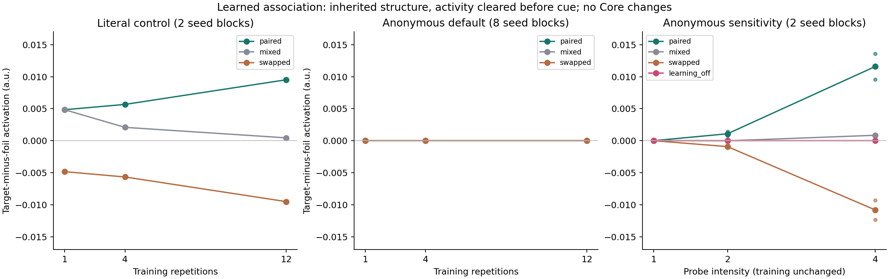
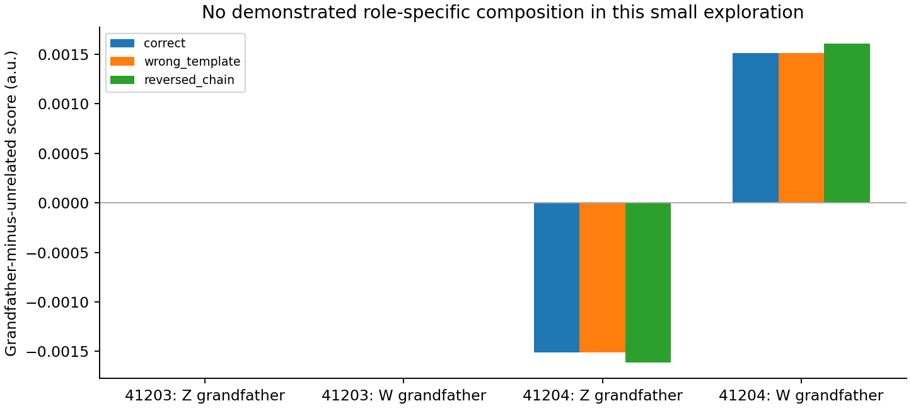

# Repeated associations and relational composition: exploratory report

Date: 2026-09-09. [Chinese full report](report.md) · [protocol](protocol.md) · [reproduction and evidence](README.md).

**Pair-specific association was observed under some encoding/probe conditions; role-specific relational composition was not demonstrated.** Core dynamics remained `threemind.causal/9`, with the restored per-edge threshold of 0.004 unchanged.

## Design

Train the pairs 甲→松子 and 乙→铃铛 at 0, 1, 4 or 12 repetitions. Controls alternate or swap assignments at matched token counts and duration; a 12-repetition control disables plasticity. Anonymous encoding uses eight seeds; literal-character encoding uses two seeds descriptively. Cue-only and sham probes use independent copies with plasticity disabled. Analyze both continuation after a short blank interval and official `birth/1` inheritance, which retains structure and clears activity. Birth is not revival or evidence of long-term survival of the original consciousness.

The endpoint is target-minus-foil activation averaged over 0.2–1.0 simulated seconds after the probe, less a matched no-probe baseline. Direct cue channels and target/foil shared channels are excluded **only from this scoring tool**. Full underlying node activations remain available and are not filtered or fed back to Core. Average both cues within each encoder seed before comparison; time points and copies are not independent samples. Literal seeds may produce isomorphic networks.

## Results

Literal birth-route mean scores for stable/mixed/swapped training were:

| Repetitions | Stable | Mixed | Swapped |
|---|---:|---:|---:|
| 1 | 0.004837 | 0.004837 | −0.004837 |
| 4 | 0.005668 | 0.002083 | −0.005668 |
| 12 | 0.009516 | 0.000444 | −0.009516 |

The one-repetition mixed condition is the same actual protocol as the stable condition and is a consistency check. Plasticity-off scores were zero. Continuation gave the same qualitative ordering. These comparisons support learned pair-specific association, not understanding of the language used in the sentences.

Default anonymous probes (intensity 1) produced zero net association across the sampled seeds. Both predeclared 12-repetition stable-versus-mixed endpoints, birth and continuation, had n=8 seed blocks, difference 0, bootstrap interval [0,0], sign-flip p=1 and Holm p=1. A degenerate interval with every observed score zero is conditional on this design, not proof of a universal absence of memory.

Exactly one bounded follow-up reused the first two anonymous seeds' trained parents, changing **only probe intensity**. For intensity 2, stable/mixed/swapped means were 0.001081/−0.000016/−0.000924; at intensity 4 they were 0.011588/0.000845/−0.010819. Plasticity-off remained zero. This is post-observation descriptive sensitivity analysis, not confirmation of default anonymous performance. Distributed channel amplitude and per-edge gating are plausible contributors; no complete transmission decomposition was performed.

The relation study used correct versus endpoint-swapped grandfather templates, held-out father chains X→Y→Z and U→V→W, reversed-chain controls, and grandfather/father/bare-name/sham queries. It used two seeds and 51.2 simulated seconds of training per parent. One of four correct-template grandfather queries had the correct grandfather as the strongest candidate, but unrelated-family and wrong-template controls produced essentially the same activity. For seed 41204, both Z's and W's grandfather queries reactivated U; wrong templates also did so. The aggregate correct-minus-wrong-template contrast was approximately 3.05e-12. This does not meet the predeclared role-discrimination criterion.

Some name templates retained only 1–2 exclusive scoring channels. Default anonymous probe sensitivity was already limited; relation probes were not further amplified. This experiment cannot separate failure to learn a rule from failure of this probe to read a rule-related state. It establishes no real-world causal reasoning result.

## Evidence and stopping

All 900 small training/probe models, checkpoints and input audit records are retained in a dedicated local project; 900 is **not** the statistical sample size. Actual successful computation took about 123 seconds, with peak process RSS about 129 MiB. Compressed checkpoints total about 20.2 MiB and raw curve packages about 3.55 MiB. A conservative project SQL projection/index estimate was about 406 MiB, within the 500 MiB budget.

Ten identical native protocol pairs had identical state hashes. A Python-reference replay had no structural differences; 32 floating values differed by at most approximately 1.735e-18. The first pilot stopped on a harness generator-indexing error before creating models; the failed attempt was retained. No Core defect had to be fixed to obtain these results.

The experiment stopped after its specified scope and one sensitivity follow-up. Plans, amendments, three records, the comprehensive report, raw evidence, and Markdown/HTML exports are saved in the platform project **重复记忆与关系组合 · 2026-09-09**. A notebook validation error encountered during publication was fixed: Markdown conversion emitted a nullable link title that the backend previously rejected. It did not affect experimental measurements.

Further work should first calibrate sensory/probe observability using held-out settings and then broaden independent words, seeds and relation families. Do not lower the agreed Core threshold or insert hard-coded semantic inference to manufacture a positive result.
