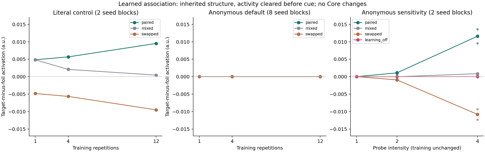
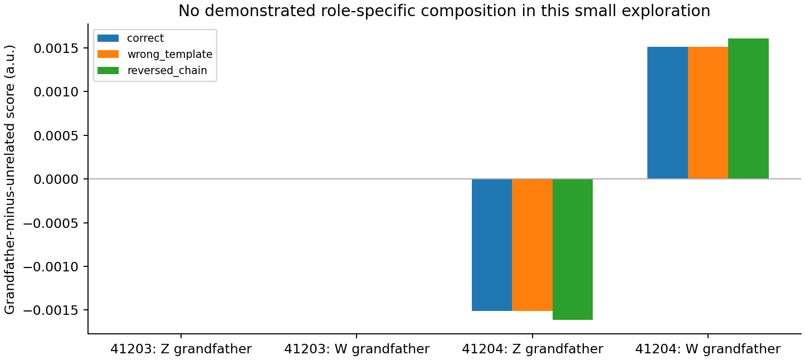

# 重复记忆与关系组合：探索报告

> **修订 r2 · 2026-10-10**
> 修订原因：原件存储位置已迁移并核验，追加当前位置解析说明，保留原实验结论。
> 原版：[report.md](report.md)；父版本 r1：[report.md](report.md)

日期：2026-09-09。项目：**重复记忆与关系组合 · 2026-09-09**。本轮未修改内核动力学，也未降低默认 0.004 逐连接传播门槛。

## 结论先读

**观察到了配对特异的联想式结构记忆，但尚未得到关系组合或语义理解的证据。** 明文字符模式下，重复“甲是松子、乙是铃铛”后，仅用“甲”“乙”便能在相应目标的非直接触达通道观察到更强激活；交换训练配对，激活偏向也反转；关闭可塑性则消失。

匿名模式不能简单照搬这个正结果：在默认强度 1 下，本轮 8 个种子的净联想评分全部为零。保持训练和内核不变、仅提高探针强度后，前两个种子也出现了方向随训练配对改变的信号。这提示必须区分“结构没有形成关联”与“当前探针未能读出关联”。这个后续检查只是两个种子的参数敏感性探索，不代表已经得到广泛、稳健的匿名记忆性能。

祖父关系实验中，偶尔某个正确名字被激活，但错误模板和反向链也产生近似结果，因此不能把它解释为推导出了“谁是谁的爷爷”。没有把任何零值或负结果隐藏，也没有为了得到正结果修改内核。

## 实际做了什么

使用原生 `threemind.causal/9`、原有 `text-sensor/2` 编码与 InputBus。无宿主机、躯体、媒体、AI背景输入；只递送记录中的文本，强度 1，句间隔 0.8 模拟秒。动力学其余参数保持当前默认。每条句子的编码、输入信封、递送时间和实际检查点均入库。

记忆主实验使用匿名种子 41203–41210，明文模式只用前两个种子作可读对照。分别训练 0、1、4、12 轮，每轮两句；稳定、交替配对、交换配对的总字符频次与时长匹配。混合组在奇偶轮交换对应，因此 1 轮时与稳定组完全相同；这不是一个有效的“一轮学习优于混合”检验，保留它用于核对一致性。

每份训练末态独立派生不同探针和无探针副本。探针期间统一关闭可塑性，避免测量本身继续强化连接。两种路径分别报告：

- **持续路径**：原状态等待 0.8 秒后探测，与同样等待的无探针副本比较。
- **结构继承路径**：按现有 `birth/1` 保留训练结构、清空活动建立新意识，再探测。这验证结构可复用；它不是原意识的复活，也不能证明原意识保持了很久的记忆。

每 20 ms 保存一次全部节点激活，包括零值。评分模板来自感官编码，先剔除目标／干扰词共享通道和所有探针直接触达的通道，再比较目标与干扰的加权平均激活。主要终点为探针后 0.2–1.0 秒的时间平均差，再减无探针对照。这里的“剔除”只发生在研究者的评分计算中，原始激活没有删减，也不反馈意识。

先在每个种子内平均“甲”“乙”，再比较种子。时间点、同一个父本的副本、两个探针都不是独立样本。明文模式的不同种子可能生成同构网络，不作为独立证据作显著性宣传。

## 实验一：重复配对

下表是结构继承路径的平均净联想评分，单位为模型激活任意单位，不是正确率或概率。正值偏向“甲→松子、乙→铃铛”，负值偏向交换配对。

| 条件 | 稳定配对 | 混合配对 | 交换配对 | 关闭可塑性 |
|---|---:|---:|---:|---:|
| 明文，1轮 | 0.004837 | 0.004837 | −0.004837 | 未安排 |
| 明文，4轮 | 0.005668 | 0.002083 | −0.005668 | 未安排 |
| 明文，12轮 | 0.009516 | 0.000444 | −0.009516 | 0 |
| 匿名，默认强度，1/4/12轮 | 0 | 0 | 0 | 12轮为0 |

明文模式的持续路径也出现同方向结果，完整数值见 CSV 和平台记录。稳定训练越多，目标相对干扰越突出；对应交换后的反向结果尤其关键，它比“某个词刚好闪现”更支持刺激塑形后的特异关联。

匿名默认条件的两个预定主要比较——12轮稳定对混合，结构继承／持续路径——均为 8 个种子，差值为 0，种子成对 bootstrap 区间为 [0,0]，符号翻转检验 p=1，两个终点经 Holm 校正仍为1。这个零区间只反映本轮采样设计中全部观测为零，不表示对所有词语、参数和任务都证明了“没有记忆”。

## 唯一追加检查：训练不变，增强匿名探针

在看到默认零值后，先把检查范围写入补充笔记，再复用前两个匿名种子、12轮训练的父本，只调整探针强度。未重训父本、未改变编码或传播门槛。下表是两个种子内各自平均两个探针后，再取均值的描述结果。

| 探针强度 | 稳定配对 | 混合配对 | 交换配对 | 关闭可塑性 |
|---|---:|---:|---:|---:|
| 1（主实验） | 0 | 0 | 0 | 0 |
| 2 | 0.001081 | −0.000016 | −0.000924 | 0 |
| 4 | 0.011588 | 0.000845 | −0.010819 | 0 |

这说明本轮匿名网络中存在可被较强探针读出的配对特异信息。不能把结果表述为“默认匿名模式已经成功”，也不能据此建议直接把所有刺激调大：更强输入同时改变节点反应、抑制、饱和及传播范围。

源码上的合理解释是：逐边发送量由发送节点激活、发送侧抑制响应、边权与 0.1秒传播节律决定，逐边门槛仍是 0.004。匿名分布式编码把单次刺激分散到许多较弱通道，明文编码的幅度分布不同。一个默认训练案例已形成 1,632 条边，权重约 0.0236–0.0506，但“有连接”不意味着弱探针一定能触发可见的传播。增强探针后的对照支持这个解释；尚未完成逐条传输贡献分解，不能把它说成已经穷尽了所有原因。

## 实验二：父亲、爷爷与新名字

训练模板为 A→B→C、D→E→F 的父亲关系，以及 A→C、D→F 的爷爷关系。错误模板把爷爷端点交换为 D→C、A→F，人物总频数相同。新名字只展示 X→Y→Z、U→V→W 父亲关系，不输入 X→Z 或 U→W 的爷爷句。另设反向父亲链；查询爷爷、父亲、只给 Z/W 和无探针。

本阶段每个训练父本 51.2 模拟秒；两个种子、每个两个新名字家系。为控制查询投影的存储量，没有扩大到原预案允许的最多八种子，因此只作探索性判断。

四次正确模板的“爷爷”探针中，有一次正确祖父名字是最强候选，但该现象没有通过错误对照。例如种子 41204：

| 查询／条件 | X相关评分 | U相关评分 | 含义 |
|---|---:|---:|---|
| 正确模板，Z的爷爷 | 0 | 0.001508150 | 激活了别的家系的 U |
| 正确模板，W的爷爷 | 0 | 0.001508333 | U 此时碰巧是正确祖父 |
| 错误模板，Z的爷爷 | 0 | 0.001508139 | 错误模板也产生几乎相同的 U 激活 |

正确对错误模板的“目标减无关名字”平均差仅约 `3.05e-12`，不足以支持角色组合。另一个种子的这些评分全部为零。不能用“正确名字出现过一次”替代跨名字、跨角色和错误模板的检验。

匿名编码在排除直接触达和共享通道后，有的候选名字只剩1–2个专属评分通道。这是测量灵敏度和覆盖范围的限制，完整原始活动仍保存，不应把评分为零直接等同于整个网络毫无响应。

本轮没有验证出“父亲的父亲”规则迁移，更没有建立真实世界因果发现的证据。默认匿名读出的灵敏度本身存在限制；本阶段没有再调高关系探针强度，所以负结果不能区分“没形成规则”和“规则相关活动未被当前探针读出”。继续探索需要先明确这层测量能力，不能直接据此改内核，更不能在适配器中写死亲属推理。

## 可靠性、资源与停止

- 先导第一次因实验脚本将生成器误作列表而退出，尚未创建模型；修正脚本后重跑，失败记录保留。未发现必须修改 Core 才能完成实验的缺陷。
- 10 对实际输入协议完全相同的原生训练得到逐位相同的状态哈希。独立 Python 参考重放没有结构差异，32 个数值存在不超过 `1.735e-18` 的浮点差；不能声称跨后端哈希完全相同。
- 本轮累计保存 900 个小型训练／探针意识，包括先导与零输入对照。真正的独立单位远少于900：匿名主实验8个种子，明文、关系、敏感性各2个种子；900不能作为统计样本数。
- 成功实验实际计算约123秒；单进程峰值约129 MiB。全部检查点压缩字节约20.2 MiB，完整原始曲线包约3.55 MiB。考虑节点／连接查询投影与索引后的项目存储保守估计约406 MiB，低于500 MiB预设预算；不是把整个 PostgreSQL 数据库大小都归给本实验。
- 达到预定的实验范围和唯一一次敏感性检查后停止，没有继续搜索参数。没有使用 AI 生成刺激或伪造回答。报告整理期间额度已用42%，相对实验基线41%增加约1个百分点，明显低于20个百分点；最终用量以交付时再次读取为准。

## 后续建议

优先补充**感官与探针校准工具**：显示实际输入幅度、能通过门槛的传播、目标与无关通道曲线，并可按固定协议重放。它应帮助研究者判断是否测得出来，而不是按“重要性”选择或裁剪意识活动。默认门槛和动力学此次保持不变。

后续可以扩大词表、编码种子、刺激间隔和未见名字家系，先重复本轮可测到的配对效应，再独立评估关系组合。需要更广的匿名参数覆盖，但应预定校准与验证集，避免在同一批数据上试到成功。当前结果支持继续研究局部规则如何形成可复用关联，尚不足以支持“理解了自然语言关系”或 AGI 已成立。

## 查阅与复现

在平台选择本报告对应项目：「实验笔记」包含原预案、补充范围与最终说明；「记录与报告」包含默认记忆、探针敏感性、关系组合三个实验记录及综合报告。分析表、实际曲线、原始输入审计和检查点分别保留，不依靠截图作为唯一证据。

本目录提供 `run.py`、`analyze.py`、`protocol.md`、`amendment.md`、`summary.json` 和两个 CSV。完整原始包另存平台附件，内含实际执行的脚本、实现指纹、模型／检查点编号、完整节点激活与评分掩膜。复现时建立新的项目和独立输出目录，切勿覆盖原始实验包；模型父本也可从平台按需导出复用。

> **存储位置修订 · 2026-10-10**
> 本版追加已核验的原件迁移说明：本次清单中的原件迁至 `E:\ThreeMindData`，科学身份、哈希、原实验日期、测量与结论不变。保留正文中的路径表示历史来源，当前位置通过已登记的证据引用解析。仓库文档与冻结夹具留在原处，源副本保留；结构化查询数据及运行中的检查点仍存数据库。本说明不表示缺失的历史资料已恢复。
