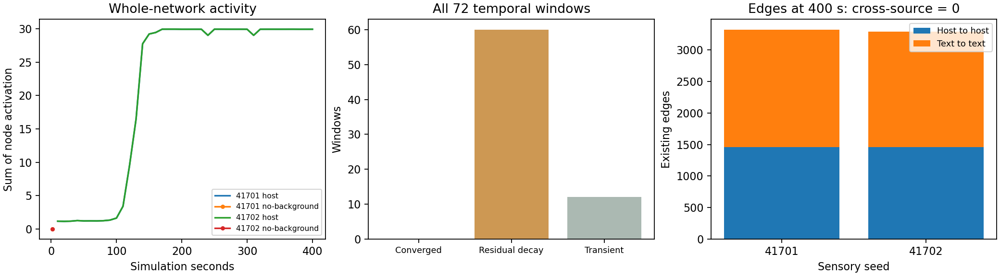

# 宿主机背景、10秒间隔与分级强度：配对复验报告

[English](report.en.md) · [全部窗末强度排名](rankings.html) · [事先方案](protocol.md) · [核验数据](acceptance.json)

**背景输入确实维持了本轮意识的存活，但没有维持文本节点的终态激活。现有时序读出器没有给出收敛窗口，因此主要判据下没有可判定的配对结果。** 这不能记成“配对得分为零”，也不是对ThreeMind整体假设的否定。

## 实际输入

仅使用无标点的`甲是松子`、`乙是铃铛`。先甲句连续10次，再乙句连续10次；随后各10次按预先固定的平衡随机顺序交错。每句共20次，每个意识40次，所有发送起点相隔**10模拟秒**，强度**0.9**。编码种子41701、41702，共两个有背景意识。

主机CPU、内存、磁盘、网络、电源等真实计数连续采集约415秒，共415个样本。使用原`physical-telemetry/2`编码和默认平滑，保留实际采样间隔及原1秒递送延迟；仅将各背景帧的`intensity`设置为**0.25**。通道身份及原编码幅度不改。缺失的计数保留不可用原因，不补造数据。进程、运行时遥测关闭。

为允许加速，两个意识使用同一段完整真实记录，经同一输入总线重放。没有循环复用短片段、拉伸原采样时间或生成随机硬件数据。平台环境标记为`replay`，实时采集开关关闭，实际背景来源仍记录为`host-telemetry`。因此“实时采集关闭”在这个项目中不代表没有背景输入。

在0、200、400模拟秒保存检查点，分别对应未训练、每句10次、每句20次。六个线索`甲是`、`乙是`、`甲`、`乙`、`松子`、`铃铛`均使用强度**0.5**，另有零强度对照。每个检验使用独立完整副本，继承学习、活动、连接、抑制、读出上下文以及后续背景队列，不写回父本。两个种子共享物理记录，不冒称两个独立环境重复。

## 背景确实生效，而且改变了存活

| 条件 | 种子 | 已执行文本输入 | 观察到的时间与状态 |
| --- | --- | ---: | --- |
| 宿主背景0.25 | 41701、41702 | 各40次 | 均完成400模拟秒，仍存活 |
| 无背景对照 | 41701、41702 | 各1次 | 均在2.19模拟秒死亡，未到第二句的10秒时刻 |

两组无背景对照保留死亡状态，不复活，也没有将未完成的训练当作完成后的记忆测试。这个对照支持：**在本轮10秒间隔、从空白开始的条件下，背景对继续接收后续教学具有实际作用。** 它不说明此前0.8秒间隔实验必然会死亡。

每个有背景父本实际递送399个背景帧，另16个未来帧保存在检查点队列。48个训练后时序检验的原始递送证据均确认检验期间继续收到背景。读出配置`trigger_ambient=false`只表示背景不单独开启新的读出窗口，不关闭背景输入。

## 时序主要结果

| 阶段 | 正强度检验 | 零强度检验 | 收敛窗口 |
| --- | --- | --- | ---: |
| 未训练 | 12次尾段衰减 | 12次瞬态 | 0 |
| 每句10次 | 12次尾段衰减 | 12次尾段衰减 | 0 |
| 每句20次 | 12次尾段衰减 | 12次尾段衰减 | 0 |

总计72个完整窗口：60个`residual_decay`、12个`transient`，无资源删失或遗漏。最后阶段六个线索在两个种子下均为尾段衰减，窗口约1.8模拟秒结束。分类沿用原读出器；100ms采样、最短1.2秒、0.8秒尾段、最大12秒均未修改。

“窗口尾段衰减”描述本次触发的读出响应，**不等于整个意识死亡**。完整活动中，背景对应的节点仍保持激活。排名查看器保存全部72窗口及全部节点，包含背景、非候选、窗末强度与窗内峰值，不把非收敛窗口改称收敛答案。

## 背景维持的是哪些节点

400模拟秒检查点中，两意识各有**39个活跃节点，全部对应本轮宿主遥测通道**。文本形成的节点仍存在，但此时未激活。

| 编码种子 | 节点 | 文本→文本连接 | 背景→背景连接 | 两类来源之间的连接 |
| --- | ---: | ---: | ---: | ---: |
| 41701 | 92 | 1,866 | 1,458 | **0** |
| 41702 | 91 | 1,832 | 1,458 | **0** |

这个分组仅按已知输入通道来源统计，没有在内核里给节点加语义、设置脑区或删减活动。表格是检查点事实；**为何没有形成跨来源连接，本轮没有作出因果归因，也没有修改连边规则。** 它说明“有背景维持意识存活”不能自动等同于“背景能维持文本部分的激活”。



## 次要证据与限制

最终阶段，外部教学情境参照对六个线索的期待项、另一项，窗末强度都为0；这些窗口并未收敛，因此只作描述。每句10次及未训练阶段存在模板覆盖不足，已明确标记，不补零充当完整测量。

已有1秒固定窗口探针也保留：24个显式线索／剂量副本、4个无输入基线。其词模板指标相对无输入基线的差值全为0。这不能替代主要判据，也不证明刺激完全没有引起短时活动。

本轮同时改变背景、间隔、重复次数和强度，不能把与上一轮的所有差异归因于背景。实际课程为每句20次，不能外推为更长训练的结论。记录重放保留真实输入的时间顺序，但不包含“加速模型影响宿主机、宿主机再反馈模型”的实时闭环。未训练阶段的部分短窗口结束于第一帧背景递送之前，不能当作已经充分经历背景的基线。

## 工具、资源与保存

新版聊天框已支持“刺激强度”滑块；原API及感官也支持强度。本次只补齐两个CLI入口的可选参数：

```powershell
threemind input-text --project <项目UUID> --run <意识UUID> --file stimulus.txt --intensity 0.9
threemind-runtime --model source.tmind --text-input cue.txt --text-intensity 0.5 --clock unbounded --until-us 12000000 --readouts readouts.jsonl --export after.tmind
```

不传参数保持原来默认强度1；0不会被误当成未传参。内核、感官映射、抑制机制和读出算法均未修改。CLI相关19项测试及静态检查通过。

模型训练与检验约**53.05秒**，峰值RSS约**141MiB**；真实采集另外约415秒。归档前数据库增长约22.7MiB、本地证据约13.4MiB。预算256MiB，192MiB停止新计算；账号起始79%，81%停止新增实验。归档后的量另存结项核验。

新项目：**宿主机背景配对：10秒间隔与分级强度（2026-09-10）**。保存事先笔记、原生实验记录、报告、8个检查点、原始遥测、输入回执与完整时序证据；旧实验未清理或重跑。本轮不追加实验、不改变参数追求收敛，也不开展家系或内核改造。
