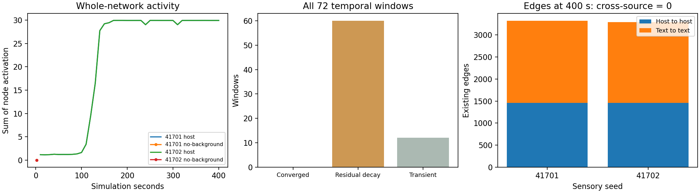

# Pairing with recorded host background, ten-second spacing and explicit intensities

> **Revision r2 · 2026-10-10**
> Revision reason: Relocate generated evidence out of Git; preserve original bytes and conclusions.
> Original: [report.en.md](report.en.md); parent r1: [report.en.md](report.en.md)

[中文](report.md) · [Complete endpoint rankings](/api/v2/storage/research-artifacts/research-artifact:66e2d2ee494e23ff369dec97/content) · [Audit](acceptance.json)

**Host background sustained both experimental consciousnesses for 400 simulated seconds. It did not sustain endpoint activation of the text nodes. No window met the unchanged temporal reader's convergence classification, so there is no eligible primary pairing result. This is not a zero accuracy score or a rejection of the overall hypothesis.**

Only the exact unpunctuated carriers `甲是松子` and `乙是铃铛` were used. Each was first repeated ten times consecutively, followed by ten more presentations each in a preregistered balanced random order. Input onsets were ten simulated seconds apart, training intensity 0.9. Sensory seeds were 41701 and 41702. Text encoding, NFKC, Core inhibition and all default scientific parameters were preserved.

The existing host probe recorded 415 real samples across approximately 415 seconds. Original counters, unavailable reasons, timestamps, normalization and smoothing were retained. Encoded frames retained their channel identities and amplitudes; only their explicit intensity was set to 0.25. The original one-second feedback delay was retained. Process and runtime telemetry were not collected. A single complete physical recording was replayed for both seeds without tiling or time stretching. The platform environment is therefore `replay`, with live collection disabled; actual bus input is still audited as `host-telemetry`. This is not a live accelerated feedback loop.

Checkpoints at 0, 200 and 400 simulated seconds correspond to untrained, ten presentations per sentence and twenty presentations per sentence. Each of the six cues `甲是`, `乙是`, `甲`, `乙`, `松子`, `铃铛` used intensity 0.5, with independent zero-intensity controls. Full activation, inhibition, learning, queued future background and reader context were inherited. Probe changes never returned to the training source.

| Condition | Actual training inputs per seed | Observed survival |
| --- | ---: | --- |
| Host background, intensity 0.25 | 40 | Active at 400 seconds, both seeds |
| No background | 1 | Dead at 2.19 seconds, both seeds; second input not reached |

Each trained parent delivered 399 host frames and retained another 16 future frames. All 48 post-training temporal probes demonstrably received background during measurement. The reader's `trigger_ambient=false` prevents background from opening its own windows; it does not disable input. Some untrained short windows ended before the first host frame arrived, and are not background-acclimated baselines.

There were 72 complete temporal windows: 60 residual decay and 12 transient, zero converged and zero censored. All 12 final positive probes were residual decay, ending at approximately 1.8 simulated seconds. All nodes are included in the endpoint-strength viewer, including background and noncandidates. A decaying cue-response window does not imply global death.

At 400 seconds both sources had 39 active nodes, all on recorded host channels. Text nodes still existed but were inactive. Seed 41701 had 92 nodes, 1,866 text-to-text edges and 1,458 host-to-host edges; seed 41702 had 91 nodes, 1,832 text-to-text and 1,458 host-to-host edges. **Neither had a cross-source edge.** This is an external classification by recorded receptor provenance, not an imposed brain region or semantic label. Why no cross-source edges formed was not causally established and no connectivity rule was changed.

Final external contextual-template endpoint values were zero for both alternatives. Because these windows were not converged, this remains descriptive. Earlier incomplete templates were marked unmeasurable instead of zero-filled. The secondary one-second tool ran 24 explicit cue/dose copies plus four built-in no-input baselines; all measured template differences from those baselines were zero. These statistics do not imply that input caused no transient activity.

Background, spacing, intensity and repetition count differ from the preceding experiment, so between-study differences cannot all be attributed to background. Twenty presentations per sentence do not establish outcomes for longer training. No additional search, threshold adjustment, kernel modification or family experiment was performed.

The UI already has a stimulus-intensity slider. This task added optional `--intensity` to `threemind input-text` and `--text-intensity` to the independent runtime. Omission preserves intensity 1; explicit zero remains zero. Nineteen affected tests and static checks passed. Core, sensor mapping and reader algorithms were unchanged.

Model execution took about 53.05 seconds, peak RSS about 141 MiB; physical recording separately took about 415 seconds. Before publication, database growth was about 22.7 MiB and local evidence about 13.4 MiB. Storage ceiling: 256 MiB, with new computation stopped at 192 MiB. Shared-account usage started at 79%; the new-experiment stop was 81%. Postpublication accounting is saved separately. The new project contains the design note, native records/report, eight checkpoints, raw physical measurements, actual input receipts and full temporal evidence. Earlier experiments remain untouched.

## Data location revision

Selected generated evidence has been archived and verified byte for byte. Original reports, criteria, conclusions and embedded source_commit values are preserved. The logical downloads below require the current host administrator. The data directory is not public.

`data/experiments/2026-09-10-host-background-pair/`

[Location and hash index / 位置及哈希登记](../../artifact-index/2026-10-09-relocations.json)

- [analysis.json](/api/v2/storage/research-artifacts/research-artifact:4994f4a50c0361646d06d4e8/content) — 1296381 B; SHA-256 `a94d9177318127c24f0221ba47ba6feb69ef02e05907843942b7365fa05a9cd6`.
- [rankings.html](/api/v2/storage/research-artifacts/research-artifact:66e2d2ee494e23ff369dec97/content) — 529619 B; SHA-256 `14b5532a5a5e94741cf58245d1c215afed463538b1f1348a00d688b915abed3d`.
