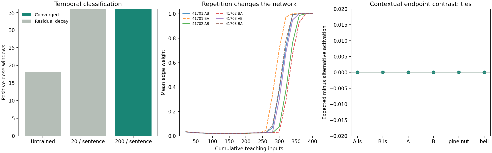

# Pine nut / bell: unpunctuated pairing and temporal endpoints

> **Revision r2 · 2026-10-10**
> Revision reason: Relocate generated evidence out of Git; preserve original bytes and conclusions.
> Original: [report.en.md](report.en.md); parent r1: [report.en.md](report.en.md)

[中文](report.md) · [Complete endpoint-ranking viewer](/api/v2/storage/research-artifacts/research-artifact:f20fa842d9b81f7f4801c22d/content) · [Registered protocol](protocol.md) · [Numerical summary](measurement-summary.json)

**Repetition changed consolidation and convergence, but the registered converged-window endpoint-strength criterion did not distinguish the two pairings.** After200 repetitions per sentence, all36 positive-dose tests converged. All36 expected-versus-alternative contextual comparisons tied. Node IDs and floating-point roundoff were not used to break those ties.

This is not a finding that repetition had no effect:20 repetitions per sentence produced decaying responses, whereas200 produced strong shared activity and all existing edges reached weight1. The observed shared association is insufficient to establish separate “甲→松子” and “乙→铃铛” recall.

## Exact teaching

Only `甲是松子` and `乙是铃铛` were sent, without punctuation, brackets, spaces or additional examples. Each sentence was repeated20 consecutive times before switching, for10 rounds:200 occurrences of each sentence,400 inputs per consciousness, at0.8 simulation-second onset intervals and intensity1. Each teaching history spans320 simulation seconds.

Encoding seeds41701,41702,41703 each had two order arms. AB taught the甲 sentence before the乙 sentence within each round; BA reversed that order without changing the pairings. Six new consciousnesses received2,400 verified teaching inputs. Current causal/9 and all defaults were retained, including the anonymous text sensor, NFKC and192 channels. The unpunctuated requirement affected source text only, not the mapping.

The AB untrained baseline and both arms at20/200 repetitions per sentence provided15 checkpoints. Every cue and zero-dose control began from an independent complete copy, retaining activation, inhibition, connections, queues, reader context and learning. Probe changes were never written back to the teaching source.

## Primary temporal results

| Stage | Positive-dose windows | Converged | Residual decay | Zero-dose controls |
| --- | ---: | ---: | ---: | --- |
| Untrained | 18 | 0 | 18 | 18 transient |
| 20 per sentence | 36 | 0 | 36 | 36 transient |
| 200 per sentence | 36 | 36 | 0 | 36 transient |

All180 windows completed:36 converged,54 residual_decay,90 transient. No cases were censored or unobserved. Final positive-dose windows ended after1.4–1.5 simulation seconds. Existing reader thresholds were unchanged:100ms sampling,1.2s minimum,0.8s settling tail and12s maximum. A transient classification for zero-dose input concerns qualified response above baseline; it does not mean that the learned network had no raw activity or was dead.

| Cue | Expected counterpart | Final converged tests | Contextual endpoint comparison |
| --- | --- | --- | --- |
| 甲是 | 松子 over 铃铛 | 6/6 | 6 ties |
| 乙是 | 铃铛 over 松子 | 6/6 | 6 ties |
| 甲 | 松子 over 铃铛 | 6/6 | 6 ties |
| 乙 | 铃铛 over 松子 | 6/6 | 6 ties |
| 松子 | 甲 over 乙 | 6/6 | 6 ties |
| 铃铛 | 乙 over 甲 | 6/6 | 6 ties |

AB/BA are within-seed controls, not six independent encoding replications. Contextual references were registered before training. Forward references use the two taught carriers with cue/shared channels excluded; reverse references use exclusive甲/乙 channels. These external annotations do not label Core nodes or manufacture verbal replies. Every recorded node remains available.

The three seeds had53,52,50 learned nodes respectively. In each final window, those existing nodes shared the strongest endpoint activation, approximately0.7440450757678325. Cues sometimes introduced additional weaker nodes, so complete states were not all identical. These weaker differences were preserved, but did not select the expected counterpart in the primary reference.

For example, seed41701, AB, cue甲是 recorded54 nodes with53 tied first. All16 pine-nut-context and12 bell-context exclusive channels were observed. Their weighted means were both approximately0.744045; a difference around2×10⁻¹⁶ is below the registered1×10⁻¹² tie tolerance.

The [ranking viewer](/api/v2/storage/research-artifacts/research-artifact:f20fa842d9b81f7f4801c22d/content) contains180 windows and7,892 actual node rows, sorted by final activation with ties. It also retains peak activation, original candidate flags, original composite scores and external references. Nonconverged windows retain their original classifications.

## Template coverage and secondary evidence

An isolated word and that word inside a sentence need not have identical positional/length features in the unchanged sensor. In the example above, the isolated松子 template covered12/18 channels and铃铛 covered10/14. Incomplete full-template comparisons were marked unmeasurable; missing activations were not fabricated. The predeclared contextual references had complete coverage and still tied. See [analysis](/api/v2/storage/research-artifacts/research-artifact:4c4e387528bf65d35cef0e45/content) and the raw packages for both views.

The existing one-second fixed-window secondary tool used72 explicit cue/dose copies plus12 built-in no-input baselines. Its predefined word-template endpoints differed from the matching no-input baseline by exactly0 in every final case. This does not imply that input had no effect on any node or at any time; additional cue nodes and transient details may differ. Secondary endpoints did not replace the primary temporal result.

## What repetition changed, and what remains open

At20 occurrences per sentence, mean edge weights were approximately0.0273–0.0284 and no edges had weight1. At200, every existing edge in all six networks had weight1. Block-end records, taken every20 inputs, first observed unit mean weight between340 and380 total inputs. This is an observation range, not the exact transition time.

Thus repetition produced a reproducible strengthening and dynamical transition across both teaching orders and all three encoding seeds. It led to strong shared activity without endpoint-strength pairing selectivity under this protocol. The study does not establish whether selectivity appeared between the two tested milestones and was subsequently flattened by broad strengthening. That intermediate regime is a useful future test; no additional experiments or Core changes were made here. The100ms observation cadence also leaves finer temporal differences unexcluded.

## Evidence and resources

Project: **松子铃铛：无标点单独配对与时序终态（2026-09-10）**. It contains design/result notes, forward/reverse records, native temporal sources, the report and downloadable evidence.

All2,400 raw carriers, sensory configurations, pulse amplitudes and delivery times were audited. Fifteen checkpoint hashes and42 measurement sources verified. Teaching also produced2,394 completed temporal windows; the six remaining open teaching windows persist in checkpoint reader context. All180 independent test windows completed.

Model computation took 186.75 seconds, about 3 minutes 7 seconds; recorded peak RSS was about 166 MiB. Before publication, database growth was about 46.4 MiB and local evidence about 24 MiB. The [prepublication audit](acceptance-prepublish.json) verifies measurements. Postpublication accounting is saved separately in the completion note and local acceptance.json, against the 512 MiB ceiling. Shared-account consumed usage was 77% at the beginning and after model execution; unchanged rounded usage is not zero consumption.

Current Core, native binary, sensory mapping and reader algorithms were unchanged, and previous experiments were preserved. See [README](README.md) for evidence and reproduction boundaries.

## Data location revision

Selected generated evidence has been archived and verified byte for byte. Original reports, criteria, conclusions and embedded source_commit values are preserved. The logical downloads below require the current host administrator. The data directory is not public.

`data/experiments/2026-09-10-pair-no-punctuation/`

[Location and hash index / 位置及哈希登记](../../artifact-index/2026-10-09-relocations.json)

- [analysis.json](/api/v2/storage/research-artifacts/research-artifact:4c4e387528bf65d35cef0e45/content) — 3795093 B; SHA-256 `d9a4e8127b594cd399f6097ff4c4972bcaa50e673da3b3f7114432b4f5f040a1`.
- [instrumentation-source.zip](/api/v2/storage/research-artifacts/research-artifact:b4d8f1b02bcaa70dab0976c2/content) — 22059 B; SHA-256 `f217c58d8c8048bc6912b50f6a296d2066aa60ba73bb459f3d51651758f93614`.
- [rankings.html](/api/v2/storage/research-artifacts/research-artifact:f20fa842d9b81f7f4801c22d/content) — 547699 B; SHA-256 `6ab90559b66b93e744104698b2a676e0015eff522ec5112e6380e34cfc17dced`.
