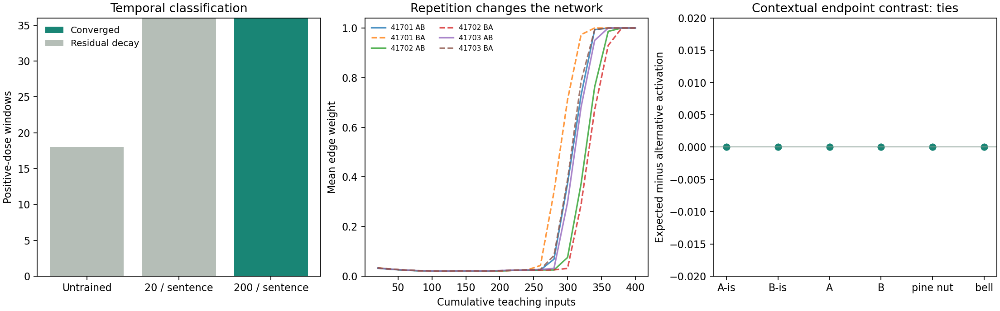

# 松子／铃铛：无标点配对的时序收敛实验

> **修订 r3 · 2026-10-10**
> 修订原因：原件存储位置已迁移并核验，追加当前位置解析说明，保留原实验结论。
> 原版：[report.md](report.md)；父版本 r2：[report.r2.md](report.r2.md)


> **修订 r2 · 2026-10-10**
> 修订原因：生成证据移出 Git 并完成校验归档；追加位置登记，保留原字节与结论。
> 原版：[report.md](report.md)；父版本 r1：[report.md](report.md)


[English](report.en.md) · [完整窗末强度排名查看器](/api/v2/storage/research-artifacts/research-artifact:f20fa842d9b81f7f4801c22d/content) · [事先方案](protocol.md) · [数值摘要](measurement-summary.json)

**重复巩固和收敛的变化已观察到，但在本轮选定的“收敛窗口结束时，按激活强度排序”判据下，没有得到能区分两组对应的结果。** 每句200次后，六个线索在3个编码种子、2种教学顺序下共36次正强度检验，全部收敛；期待项与另一项的外部情境通道强度36次全部并列。没有把编号顺序或浮点末位差异当作领先。

这不是“重复没有产生作用”：每句20次时还在衰减，而200次时形成了强而持续的共同活动，已有连接权重全部达到1。它目前表现为共同网络的强联想，尚不能据此认定分别记住了“甲→松子、乙→铃铛”。

## 1. 实际怎样训练

只发送两条原文：

```text
甲是松子
乙是铃铛
```

没有标点、方括号、额外示例或说话成分。每句**连续20次才轮换**，整组10轮，每个意识各200次，共400次。起点间隔0.8模拟秒，强度1；每个教学历程320模拟秒。AB每轮先甲句后乙句，BA每轮先乙句后甲句；两者都保持相同配对关系，没有交换名词或混入错误教学。

固定编码种子41701、41702、41703，各自创建AB和BA两种顺序，共6个新意识、**2,400次已核对的实际教学输入**。保持当前causal/9与默认参数；默认匿名文本感官、NFKC、192通道及原映射不变。这里的无标点仅指原文，不是修改转码规则。

AB的零训练基线、AB／BA各20次及各200次阶段共15个检查点。每个线索从检查点的独立完整副本接入，不清空激活、不冻结学习、不等待、不将检验学习写回教学源。每条线索另做零强度对照。所有原节点和原读出保存，包括不符合期待的活动。

## 2. 先看有没有收敛

| 教学阶段 | 正强度检验数 | 实际收敛 | 尾段衰减 | 对应零强度结果 |
| --- | ---: | ---: | ---: | --- |
| 未训练 | 18 | 0 | 18 | 18次均为transient |
| 每句20次 | 36 | 0 | 36 | 36次均为transient |
| 每句200次 | 36 | **36** | 0 | 36次均为transient |

总计180个完整时序窗口：36 converged、54 residual_decay、90 transient。没有资源删失或未观察项。全部200次阶段的正强度窗口在**1.4–1.5模拟秒**结束。

收敛分类沿用现有读出器，采样100ms、最短1.2s、0.8s尾段、最长12s，没有调整门槛。零刺激的transient表示没有足够的线索相关超基线响应，**不表示训练网络全无激活或已经死亡**。尤其200次后的原网络仍有共同活动。时序窗口分类与原始活动强度分开看。



## 3. 六个线索分别得到什么

下表只统计每句200次后的实际收敛窗口。每行6次来自3个种子×2种教学顺序；同一种子内的AB／BA是对照，不冒充独立随机重复。

| 线索 | 期望观察的对应 | 收敛 | 收敛终态的配对方向 |
| --- | --- | --- | --- |
| `甲是` | 松子相对铃铛 | 6/6 | 6次均并列 |
| `乙是` | 铃铛相对松子 | 6/6 | 6次均并列 |
| `甲` | 松子相对铃铛 | 6/6 | 6次均并列 |
| `乙` | 铃铛相对松子 | 6/6 | 6次均并列 |
| `松子` | 甲相对乙 | 6/6 | 6次均并列 |
| `铃铛` | 乙相对甲 | 6/6 | 6次均并列 |

这里的外部配对参照事先已固定：正向比较两条完整教学句中，排除线索及共有通道之后剩余的情境通道；反向比较甲／乙的专属通道。它是研究者对匿名模式的参照，**不是内核中的词标签或被编造的语言回复**。全部原始节点始终保留，不只显示这个参照集合。

三个种子的已训练节点数分别为53、52、50。每个200次阶段的窗口，这些已有节点都以约 **0.7440450757678325** 的窗末激活并列最强。线索本身有时创建或触达另外较弱的节点，因此完整终态并非每个节点都完全相同；这些差异也保存在排名中。它们没有使主要配对参照选出期待项。

例如种子41701、AB顺序、输入`甲是`：54个节点被记录，53个并列第一；松子情境的16条专属通道和铃铛情境的12条专属通道都完整观察到，两组均值都是约0.744045。约2×10⁻¹⁶的浮点差别不算铃铛领先，采用事先1×10⁻¹²的并列容差。

**直接查看原始排序：**[强度排名查看器](/api/v2/storage/research-artifacts/research-artifact:f20fa842d9b81f7f4801c22d/content)包含全部180个窗口、7,892行实际节点记录，可选种子、教学次序、阶段、线索和剂量。展示窗末强度排名、窗内峰值、原候选标识、原综合分数以及外部参照。默认先列训练结束后的正强度检验；未收敛窗口仍显示原分类。原综合排名没有被误当作本次强度排名。

## 4. 为什么还保存两种模板和次要探针

直接把孤立词`松子`的编码当作它出现在`甲是松子`中的全部编码，会遇到当前感官已有的位置／长度特征差异。例如41701的`甲是`检验中，孤立松子模板18个通道只观察到12个，铃铛14个只观察到10个。这个完整模板比较标为不可完整测量，没有补造缺失节点，也没有改映射器。

预先设立的教学情境参照则完整覆盖，并且两项仍同强。因此“并列”不是只因为独立词模板覆盖不足。独立词模板、完整节点排名和情境参照均可在[分析数据](/api/v2/storage/research-artifacts/research-artifact:4c4e387528bf65d35cef0e45/content)和完整证据中核对。

次要1秒固定窗口工具在最终检查点运行72个显式线索／剂量副本和12个自带无输入基线。其预定义词模板指标相对于同源无输入基线的差值全部为 **0**。这支持“共同活动未在该指标中表现出线索选择性”，但不表示输入完全没有作用：部分新节点及短时细节仍会不同。次要指标没有替代主要时序判定。

## 5. 重复确实改变了什么

各20次阶段的平均边权约0.0273–0.0284，无边达到权重1；各200次阶段，6个意识所有已有连接都达到权重1。每20条输入记录的块末指标中，首次观察到平均边权为1出现在总输入340–380次之间（这是块末观察范围，不是精确转变时刻）。

因此，两种教学顺序和三个编码种子都观察到了明显的巩固／动力学转变。当前较准确的描述是：**重复把该网络推入强烈的共同活动状态；按本次收敛终态强度，没有分辨出两组对应。** 本轮没有对“训练效果一定没有”“意识模型不可能”作出结论，也没有将所有联想判作不应存在。

值得后续检查的是每句20至200次之间，是否曾出现配对差异、随后又被普遍增强调平。现有证据不能回答这个阶段性选择性问题；本轮没有追加训练、改变参数或修改内核。100ms时序观测也不能排除更细时间尺度上的差异。这些限制不能反过来当作成功证据。

## 6. 保存、资源与复现

新项目名称：**松子铃铛：无标点单独配对与时序终态（2026-09-10）**。事先设计和结果笔记、正向／反向实验记录、时序原始数据、综合报告及可导出附件都保存在该项目。原实验保持原样。

- 2,400次输入的原文、默认感官配置、通道幅度和实际递送时间逐一核对；15个检查点及42个测量来源哈希验证通过。
- 教学过程另记录2,394个已完成时序窗口；最后6个尚未关闭的教学窗口保留在各自检查点读出上下文，未丢弃。独立检验的180个窗口均完整。
- 模型教学和检验总耗时 **186.75秒**，约3分7秒；成功作业记录的峰值RSS约 **166MiB**。未达到10分钟、内存、磁盘或存储上限。
- 归档前数据库增长约46.4MiB，本地证据约24MiB；[归档前验收](acceptance-prepublish.json)保存测量核验。报告与导出加入后的总量另存于结项核验笔记及本地acceptance.json。预算512MiB，384MiB停止新增计算。
- 本轮起始账号已用77%；模型计算完成时仍显示77%，最终读数见验收及额度记录。读数是共享账号窗口，不声称消耗为零。
- 当前Core、感官、读出算法及原生二进制未修改；只新增本轮研究脚本、报告、图表和排名查看器。本地提交，不推送。

复现入口及证据清单见[README](README.md)。


## 数据位置修订

选定的生成证据已逐字节校验归档。原报告、评判标准、结论及数据内 source_commit 均保留。以下逻辑下载需要当前主机管理员身份，数据目录未整体公开。

`data/experiments/2026-09-10-pair-no-punctuation/`

[Location and hash index / 位置及哈希登记](../../artifact-index/2026-10-09-relocations.json)

- [analysis.json](/api/v2/storage/research-artifacts/research-artifact:4c4e387528bf65d35cef0e45/content) — 3795093 B; SHA-256 `d9a4e8127b594cd399f6097ff4c4972bcaa50e673da3b3f7114432b4f5f040a1`.
- [instrumentation-source.zip](/api/v2/storage/research-artifacts/research-artifact:b4d8f1b02bcaa70dab0976c2/content) — 22059 B; SHA-256 `f217c58d8c8048bc6912b50f6a296d2066aa60ba73bb459f3d51651758f93614`.
- [rankings.html](/api/v2/storage/research-artifacts/research-artifact:f20fa842d9b81f7f4801c22d/content) — 547699 B; SHA-256 `6ab90559b66b93e744104698b2a676e0015eff522ec5112e6380e34cfc17dced`.


> **存储位置修订 · 2026-10-10**
> 本版追加已核验的原件迁移说明：本次清单中的原件迁至 `E:\ThreeMindData`，科学身份、哈希、原实验日期、测量与结论不变。保留正文中的路径表示历史来源，当前位置通过已登记的证据引用解析。仓库文档与冻结夹具留在原处，源副本保留；结构化查询数据及运行中的检查点仍存数据库。本说明不表示缺失的历史资料已恢复。
