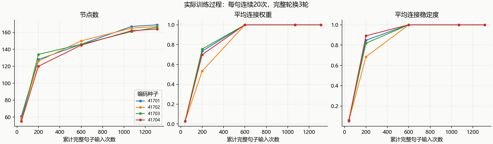

# 配对与问答

强度排序直接依据原始 `last_activation`，没有使用AI解码，没有拿窗内累计量冒充结束强度。下表把预先固定的词对应独有通道作外部摘要；完整节点（包括非候选节点）全部保留。覆盖不足意味着这个词在该阶段不能按此指标完整测量，不能填零、不能算答错。

| 种子 | 条件 | 阶段 | 线索 | 窗口分类 | 秒 | 终态词通道平均激活 | 比较 |
|---|---|---|---|---|---|---|---|
| 41701 | 主线 | 甲乙各20次 | 甲 | 响应衰退 | 1.2 | 松子=覆盖不足(9/15); 铃铛=覆盖不足(8/12) | 覆盖不足 |
| 41701 | 主线 | 甲乙各20次 | 乙 | 响应衰退 | 1.2 | 松子=覆盖不足(9/15); 铃铛=覆盖不足(8/12) | 覆盖不足 |
| 41701 | 主线 | 对话1轮 | 甲 | 收敛 | 6.6 | 松子=0.744045076; 铃铛=0.744045076 | 并列 |
| 41701 | 主线 | 对话1轮 | 乙 | 收敛 | 6.6 | 松子=0.744045076; 铃铛=0.744045076 | 并列 |
| 41701 | 主线 | 对话3轮 | 甲 | 响应衰退 | 1.2 | 松子=0.744045076; 铃铛=0.744045076 | 并列 |
| 41701 | 主线 | 对话3轮 | 乙 | 响应衰退 | 1.2 | 松子=0.744045076; 铃铛=0.744045076 | 并列 |
| 41701 | 主线 | 最终新家系后 | 甲 | 响应衰退 | 1.2 | 松子=0.744045076; 铃铛=0.744045076 | 并列 |
| 41701 | 主线 | 最终新家系后 | 乙 | 响应衰退 | 1.2 | 松子=0.744045076; 铃铛=0.744045076 | 并列 |
| 41701 | 名词互换 | 甲乙各20次 | 甲 | 响应衰退 | 1.2 | 松子=覆盖不足(9/15); 铃铛=覆盖不足(8/12) | 覆盖不足 |
| 41701 | 名词互换 | 甲乙各20次 | 乙 | 响应衰退 | 1.2 | 松子=覆盖不足(9/15); 铃铛=覆盖不足(8/12) | 覆盖不足 |
| 41701 | 名词互换 | 对话1轮 | 甲 | 收敛 | 6.5 | 松子=0.744045076; 铃铛=0.744045076 | 并列 |
| 41701 | 名词互换 | 对话1轮 | 乙 | 收敛 | 6.5 | 松子=0.744045076; 铃铛=0.744045076 | 并列 |
| 41701 | 名词互换 | 对话3轮 | 甲 | 响应衰退 | 1.2 | 松子=0.744045076; 铃铛=0.744045076 | 并列 |
| 41701 | 名词互换 | 对话3轮 | 乙 | 响应衰退 | 1.2 | 松子=0.744045076; 铃铛=0.744045076 | 并列 |
| 41702 | 主线 | 甲乙各20次 | 甲 | 响应衰退 | 1.2 | 松子=覆盖不足(7/11); 铃铛=覆盖不足(7/13) | 覆盖不足 |
| 41702 | 主线 | 甲乙各20次 | 乙 | 响应衰退 | 1.2 | 松子=覆盖不足(7/11); 铃铛=覆盖不足(7/13) | 覆盖不足 |
| 41702 | 主线 | 对话1轮 | 甲 | 收敛 | 2.8 | 松子=0.744045076; 铃铛=0.744045076 | 并列 |
| 41702 | 主线 | 对话1轮 | 乙 | 收敛 | 2.8 | 松子=0.744045076; 铃铛=0.744045076 | 并列 |
| 41702 | 主线 | 对话3轮 | 甲 | 响应衰退 | 1.2 | 松子=0.744045076; 铃铛=0.744045076 | 并列 |
| 41702 | 主线 | 对话3轮 | 乙 | 响应衰退 | 1.2 | 松子=0.744045076; 铃铛=0.744045076 | 并列 |
| 41702 | 主线 | 最终新家系后 | 甲 | 响应衰退 | 1.2 | 松子=0.744045076; 铃铛=0.744045076 | 并列 |
| 41702 | 主线 | 最终新家系后 | 乙 | 响应衰退 | 1.2 | 松子=0.744045076; 铃铛=0.744045076 | 并列 |
| 41702 | 名词互换 | 甲乙各20次 | 甲 | 响应衰退 | 1.2 | 松子=覆盖不足(7/11); 铃铛=覆盖不足(7/13) | 覆盖不足 |
| 41702 | 名词互换 | 甲乙各20次 | 乙 | 响应衰退 | 1.2 | 松子=覆盖不足(7/11); 铃铛=覆盖不足(7/13) | 覆盖不足 |
| 41702 | 名词互换 | 对话1轮 | 甲 | 收敛 | 5.4 | 松子=0.744045076; 铃铛=0.744045076 | 并列 |
| 41702 | 名词互换 | 对话1轮 | 乙 | 收敛 | 5.4 | 松子=0.744045076; 铃铛=0.744045076 | 并列 |
| 41702 | 名词互换 | 对话3轮 | 甲 | 响应衰退 | 1.2 | 松子=0.744045076; 铃铛=0.744045076 | 并列 |
| 41702 | 名词互换 | 对话3轮 | 乙 | 响应衰退 | 1.2 | 松子=0.744045076; 铃铛=0.744045076 | 并列 |
| 41703 | 主线 | 甲乙各20次 | 甲 | 响应衰退 | 1.2 | 松子=覆盖不足(10/15); 铃铛=覆盖不足(8/14) | 覆盖不足 |
| 41703 | 主线 | 甲乙各20次 | 乙 | 响应衰退 | 1.2 | 松子=覆盖不足(10/15); 铃铛=覆盖不足(8/14) | 覆盖不足 |
| 41703 | 主线 | 对话1轮 | 甲 | 收敛 | 1.9 | 松子=0.744045076; 铃铛=0.744045076 | 并列 |
| 41703 | 主线 | 对话1轮 | 乙 | 收敛 | 1.9 | 松子=0.744045076; 铃铛=0.744045076 | 并列 |
| 41703 | 主线 | 对话3轮 | 甲 | 收敛 | 1.4 | 松子=0.744045076; 铃铛=0.744045076 | 并列 |
| 41703 | 主线 | 对话3轮 | 乙 | 收敛 | 1.4 | 松子=0.744045076; 铃铛=0.744045076 | 并列 |
| 41703 | 主线 | 最终新家系后 | 甲 | 收敛 | 1.4 | 松子=0.744045076; 铃铛=0.744045076 | 并列 |
| 41703 | 主线 | 最终新家系后 | 乙 | 收敛 | 1.4 | 松子=0.744045076; 铃铛=0.744045076 | 并列 |
| 41704 | 主线 | 甲乙各20次 | 甲 | 响应衰退 | 1.2 | 松子=覆盖不足(9/14); 铃铛=覆盖不足(8/11) | 覆盖不足 |
| 41704 | 主线 | 甲乙各20次 | 乙 | 响应衰退 | 1.2 | 松子=覆盖不足(9/14); 铃铛=覆盖不足(8/11) | 覆盖不足 |
| 41704 | 主线 | 对话1轮 | 甲 | 收敛 | 7.2 | 松子=0.744045076; 铃铛=0.744045076 | 并列 |
| 41704 | 主线 | 对话1轮 | 乙 | 收敛 | 7.2 | 松子=0.744045076; 铃铛=0.744045076 | 并列 |
| 41704 | 主线 | 对话3轮 | 甲 | 响应衰退 | 1.2 | 松子=0.744045076; 铃铛=0.744045076 | 并列 |
| 41704 | 主线 | 对话3轮 | 乙 | 响应衰退 | 1.2 | 松子=0.744045076; 铃铛=0.744045076 | 并列 |
| 41704 | 主线 | 最终新家系后 | 甲 | 响应衰退 | 1.2 | 松子=0.744045076; 铃铛=0.744045076 | 并列 |
| 41704 | 主线 | 最终新家系后 | 乙 | 响应衰退 | 1.2 | 松子=0.744045076; 铃铛=0.744045076 | 并列 |

“谁是…”和“…是谁？”四种完整问句的收敛窗口比较：并列24个。其余问答窗口的分类及全部节点见原始数据。名词互换对照改变了全部教学对应，保留句式、标点和重复量；需要随对应改变的选择性结果，才支持学到了区分。本轮不能把两个目标同强度激活解释成两个问题都回答正确。广泛联想本身符合项目允许的内部活动；这里检查的是它能否在所提问题上表现出可区分的对应，不将这些联想判为应该删掉的活动。独有通道只是外部对照视图，原始读出没有因此删去任何节点。

刺激确实形成并反复作用于网络；节点、连接权重、稳定度的实测变化如图。连接形成或增强本身，与能否在测试时区别答案，是两个分别检验的问题。
