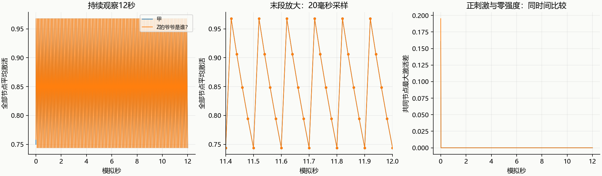

# 如何解释读出及其限制

本轮有两个需要明确区分的对象：**全部内部活动**，以及**相对既有基线的新响应**。当前时序读出器使用后者的稳定性和衰退情况分类，保留的完整节点数据则包含前者。源码中 `series.total` 是达到读出门槛的超基线响应之和，`series.active_node_count` 也是这类响应节点的数量；不能把它们标为全部激活及全部活跃节点。全部节点的结束活动使用 `nodes[].last_activation` 核对。因此 `residual_decay` 不是“意识消失”，`transient` 也不是“没有内部活动”。

例如种子41701最终检查点，输入“Z的爷爷是谁？”：

- 原窗口分类：响应衰退；长度1.2秒。
- 窗口末有169/169个节点活动；最小与最大激活分别为0.744045075768、0.744045075768。
- 原始节点按结束强度排序，以下保留并列名次；只是完整数据的前12行展示。

| 并列名次 | 节点 | 通道 | 结束激活 | 读出候选 |
|---|---|---|---|---|
| 1 | 1 | 108133812 | 0.744045075768 | True |
| 1 | 3 | 293522425 | 0.744045075768 | True |
| 1 | 4 | 341333626 | 0.744045075768 | False |
| 1 | 6 | 591315444 | 0.744045075768 | False |
| 1 | 7 | 647517647 | 0.744045075768 | True |
| 1 | 8 | 703719850 | 0.744045075768 | False |
| 1 | 9 | 712110852 | 0.744045075768 | True |
| 1 | 10 | 785095059 | 0.744045075768 | False |
| 1 | 11 | 832906260 | 0.744045075768 | False |
| 1 | 12 | 953701668 | 0.744045075768 | True |
| 1 | 13 | 1026685875 | 0.744045075768 | False |
| 1 | 14 | 1074497076 | 0.744045075768 | False |

“综合排名”是原读出器将持续时间、尾段活动和超基线强度等合成的分数；它不等同于结束激活强度，原始数据中另列，不曾替换本轮主排序。小于1e-12的数值差异按并列处理，防止浮点误差制造一个赢家。

## 窗口结束后继续观察

补充设计在运行前另存实验笔记。固定41701最终检查点、两条线索及零强度对照，共4个副本，持续观察12秒，每20毫秒保存全部节点。它是额外的连续观察，不改原窗口分类。

| 线索 | 原窗口秒数 | 样本数 | 末1秒平均活动范围 | 12秒节点强度跨度 | 12秒正刺激/零强度最大差 |
|---|---|---|---|---|---|
| 甲 | 1.2 | 601 | 0.744045076～0.967683308 | 0 | 0 |
| Z的爷爷是谁？ | 1.2 | 601 | 0.744045076～0.967683308 | 0 | 0 |

原读出器100毫秒采样与默认100毫秒传播周期相同，可能只看到周期的同一个位置。上图将20毫秒实测样本单独展示：周期内部波动和节点之间的差异是两个维度，应分别判断。“窗口收敛”不能扩展解释成连续时间里每个节点完全不再变化。
