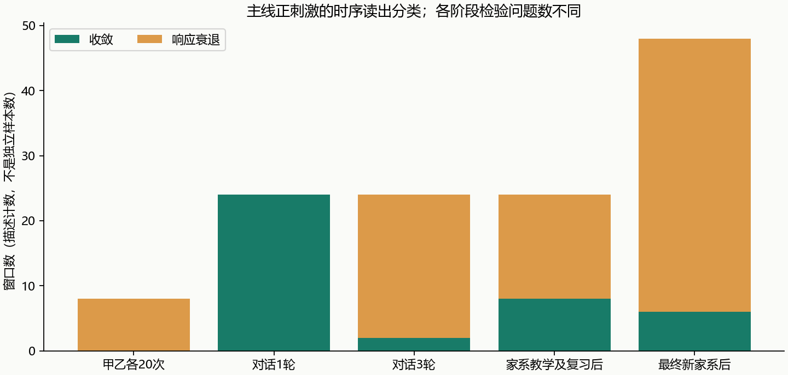

# 时序收敛复验报告

本轮按原句式进行了足量重复，并把**时序窗口及其结束时的完整节点激活排序**置于主要位置。共完成4个编码种子、10个训练或对照意识，实际递送7,400个完整短句；每个新句子首次连续20次，整组3轮。原文标点、说话人和默认感官映射全部逐帧核对通过。

时序检验共360个独立状态副本，其中正刺激180个、零强度对照180个；另有40个旧固定窗口次要检验副本。多副本和多问题不是独立种子。

主要结果：正刺激中有56个窗口被既有读出器判为收敛。排除不要求答案的裸名字对照后，56个收敛窗口的预设独有通道比较为：并列52个、覆盖不足4个。本轮未取得能把目标答案与对照可靠区分的收敛结果；这不等于把覆盖不足或未收敛的情况算成答错。下面同时展示其余窗口，不能把未收敛当作答错，也不能把节点编号顺序当作激活领先。

完整设计见[protocol.md](protocol.md)，原始排序见[node-rankings.jsonl](node-rankings.jsonl)，每个检验对应的数据库来源和ZIP下载见[evidence-index.json](evidence-index.json)。所有结论限定于本轮参数、材料、4个编码种子和记录方式。
