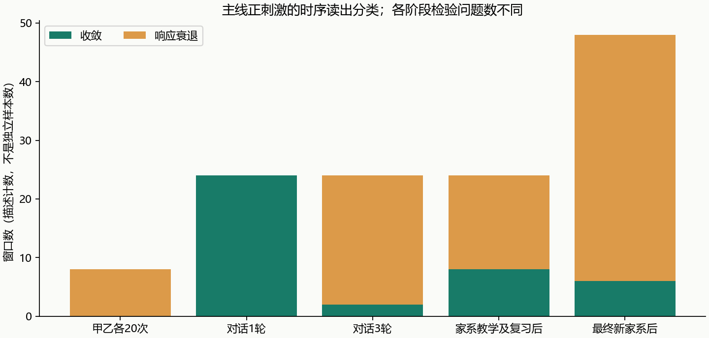
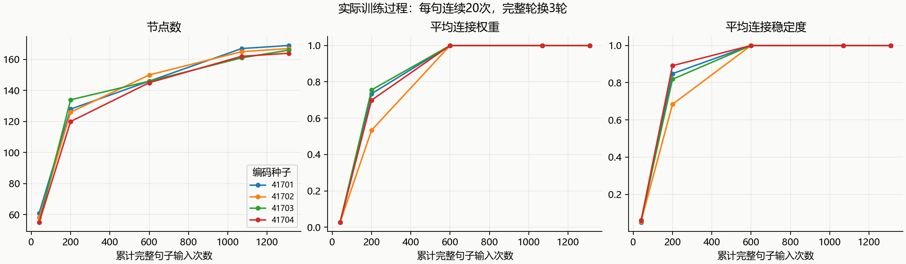
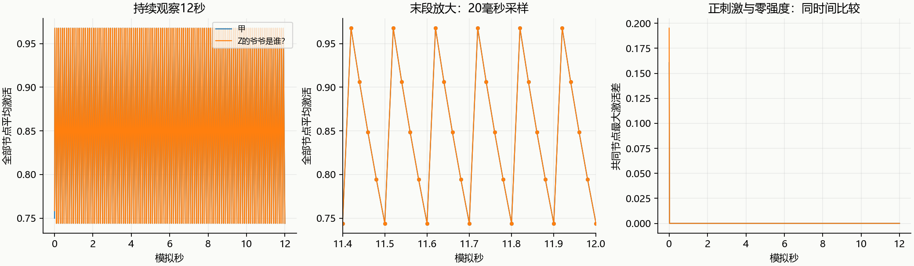

# 时序收敛复验报告 — r3

> **修订 r3 · 2026-10-16**
> 修订原因：补充研究目的、既有预期、结果分析与明确科学结论；保留原判据、成绩和全部历史版本。
> 原版：[report.md](report.md)；父版本 r2：[report.r2.md](report.r2.md)

2026-10-16 结论补述。原实验日期、测量、门槛及版本保持不变。本版依据原方案和报告归纳研究问题与科学意义；未在原方案预先量化的判断，不冒称预登记通过。没有重新运行个体或复算大型原始轨迹。

[父报告](report.r2.md) · [English](report.r3.en.md) · [全历史核查](../../../docs/zh/plans/report-conclusion-audit-20261016.md)。父文件本次读取 SHA256：`de48d5b409a0e7f76cf4b881bdfd918ff43801cca79c63a68759b00048f228f0`。

## 目的与原有预期

本轮检验的是：保持原文、默认感官映射和每句连续20次的足量重复，能否让实际时序读出在配对与未见家系题中区分正确答案。预期证据是正确目标在既定收敛窗口中领先，并随教学对应交换而改变；有活动或收敛本身不是成功标准。中文原报告已经作出否定结论，英文摘要版主要列数和边界。本修订让两种语言都明确回答同一个科学问题。

## 结果与科学判断

**本次课程和读出组合没有实现可区分的配对回答或未见家系推断。** 360个探针副本中180个为正剂量；其中要求具体答案且收敛的56个窗口，52个为目标并列、4个因专属通道不足无法测量。不能把4个测量缺项判成答错，也不能把56个收敛当成56个成功。四个编码来源才是独立层级，题目和副本不是新的独立来源。

这是对“完整语句足量重复配合当前终态读出足以获得选择性回答”这一课程预期的不利结果。原件显示活动持续存在，部分目标终态等强；所以直接失败点是本课程下的答案区分，而不是活动已经停止。12秒补充观察没有给原窗口补分，也没有把较早瞬时差异替换为原主终点。

**对 ThreeMind 的研究意义是：应先解决可测的活动区分和读取条件，再以同一方法扩大语言训练。** 单纯增加同类教学规模的依据不足。该判断来自已发生的负结果；没有据此更改Core，也没有把结构记忆、其他读取窗口或全部语言能力宣布为失败。

## 原报告证据层（保留原文）

> **修订 r2 · 2026-10-10**
> 修订原因：原件存储位置已迁移并核验，追加当前位置解析说明，保留原实验结论。
> 原版：[report.md](report.md)；父版本 r1：[report.md](report.md)

本轮按原句式进行了足量重复，并把**时序窗口及其结束时的完整节点激活排序**置于主要位置。共完成4个编码种子、10个训练或对照意识，实际递送7,400个完整短句；每个新句子首次连续20次，整组3轮。原文标点、说话人和默认感官映射全部逐帧核对通过。

时序检验共360个独立状态副本，其中正刺激180个、零强度对照180个；另有40个旧固定窗口次要检验副本。多副本和多问题不是独立种子。

主要结果：正刺激中有56个窗口被既有读出器判为收敛。排除不要求答案的裸名字对照后，56个收敛窗口的预设独有通道比较为：并列52个、覆盖不足4个。本轮未取得能把目标答案与对照可靠区分的收敛结果；这不等于把覆盖不足或未收敛的情况算成答错。下面同时展示其余窗口，不能把未收敛当作答错，也不能把节点编号顺序当作激活领先。

完整设计见[protocol.md](protocol.md)，原始排序见[node-rankings.jsonl](node-rankings.jsonl)，每个检验对应的数据库来源和ZIP下载见[evidence-index.json](evidence-index.json)。所有结论限定于本轮参数、材料、4个编码种子和记录方式。

## 配对与问答

强度排序直接依据原始 `last_activation`，没有使用AI解码，没有拿窗内累计量冒充结束强度。下表把预先固定的词对应独有通道作外部摘要；完整节点（包括非候选节点）全部保留。覆盖不足意味着这个词在该阶段不能按此指标完整测量，不能填零、不能算答错。

| 种子 | 条件 | 阶段 | 线索 | 窗口分类 | 秒 | 终态词通道平均激活 | 比较 |
|---|---|---|---|---|---|---|---|
| 41701 | 主线 | 甲乙各20次 | 甲 | 响应衰退 | 1.2 | 松子=覆盖不足(9/15); 铃铛=覆盖不足(8/12) | 覆盖不足 |
| 41701 | 主线 | 甲乙各20次 | 乙 | 响应衰退 | 1.2 | 松子=覆盖不足(9/15); 铃铛=覆盖不足(8/12) | 覆盖不足 |
| 41701 | 主线 | 对话1轮 | 甲 | 收敛 | 6.6 | 松子=0.744045076; 铃铛=0.744045076 | 并列 |
| 41701 | 主线 | 对话1轮 | 乙 | 收敛 | 6.6 | 松子=0.744045076; 铃铛=0.744045076 | 并列 |
| 41701 | 主线 | 对话3轮 | 甲 | 响应衰退 | 1.2 | 松子=0.744045076; 铃铛=0.744045076 | 并列 |
| 41701 | 主线 | 对话3轮 | 乙 | 响应衰退 | 1.2 | 松子=0.744045076; 铃铛=0.744045076 | 并列 |
| 41701 | 主线 | 最终新家系后 | 甲 | 响应衰退 | 1.2 | 松子=0.744045076; 铃铛=0.744045076 | 并列 |
| 41701 | 主线 | 最终新家系后 | 乙 | 响应衰退 | 1.2 | 松子=0.744045076; 铃铛=0.744045076 | 并列 |
| 41701 | 名词互换 | 甲乙各20次 | 甲 | 响应衰退 | 1.2 | 松子=覆盖不足(9/15); 铃铛=覆盖不足(8/12) | 覆盖不足 |
| 41701 | 名词互换 | 甲乙各20次 | 乙 | 响应衰退 | 1.2 | 松子=覆盖不足(9/15); 铃铛=覆盖不足(8/12) | 覆盖不足 |
| 41701 | 名词互换 | 对话1轮 | 甲 | 收敛 | 6.5 | 松子=0.744045076; 铃铛=0.744045076 | 并列 |
| 41701 | 名词互换 | 对话1轮 | 乙 | 收敛 | 6.5 | 松子=0.744045076; 铃铛=0.744045076 | 并列 |
| 41701 | 名词互换 | 对话3轮 | 甲 | 响应衰退 | 1.2 | 松子=0.744045076; 铃铛=0.744045076 | 并列 |
| 41701 | 名词互换 | 对话3轮 | 乙 | 响应衰退 | 1.2 | 松子=0.744045076; 铃铛=0.744045076 | 并列 |
| 41702 | 主线 | 甲乙各20次 | 甲 | 响应衰退 | 1.2 | 松子=覆盖不足(7/11); 铃铛=覆盖不足(7/13) | 覆盖不足 |
| 41702 | 主线 | 甲乙各20次 | 乙 | 响应衰退 | 1.2 | 松子=覆盖不足(7/11); 铃铛=覆盖不足(7/13) | 覆盖不足 |
| 41702 | 主线 | 对话1轮 | 甲 | 收敛 | 2.8 | 松子=0.744045076; 铃铛=0.744045076 | 并列 |
| 41702 | 主线 | 对话1轮 | 乙 | 收敛 | 2.8 | 松子=0.744045076; 铃铛=0.744045076 | 并列 |
| 41702 | 主线 | 对话3轮 | 甲 | 响应衰退 | 1.2 | 松子=0.744045076; 铃铛=0.744045076 | 并列 |
| 41702 | 主线 | 对话3轮 | 乙 | 响应衰退 | 1.2 | 松子=0.744045076; 铃铛=0.744045076 | 并列 |
| 41702 | 主线 | 最终新家系后 | 甲 | 响应衰退 | 1.2 | 松子=0.744045076; 铃铛=0.744045076 | 并列 |
| 41702 | 主线 | 最终新家系后 | 乙 | 响应衰退 | 1.2 | 松子=0.744045076; 铃铛=0.744045076 | 并列 |
| 41702 | 名词互换 | 甲乙各20次 | 甲 | 响应衰退 | 1.2 | 松子=覆盖不足(7/11); 铃铛=覆盖不足(7/13) | 覆盖不足 |
| 41702 | 名词互换 | 甲乙各20次 | 乙 | 响应衰退 | 1.2 | 松子=覆盖不足(7/11); 铃铛=覆盖不足(7/13) | 覆盖不足 |
| 41702 | 名词互换 | 对话1轮 | 甲 | 收敛 | 5.4 | 松子=0.744045076; 铃铛=0.744045076 | 并列 |
| 41702 | 名词互换 | 对话1轮 | 乙 | 收敛 | 5.4 | 松子=0.744045076; 铃铛=0.744045076 | 并列 |
| 41702 | 名词互换 | 对话3轮 | 甲 | 响应衰退 | 1.2 | 松子=0.744045076; 铃铛=0.744045076 | 并列 |
| 41702 | 名词互换 | 对话3轮 | 乙 | 响应衰退 | 1.2 | 松子=0.744045076; 铃铛=0.744045076 | 并列 |
| 41703 | 主线 | 甲乙各20次 | 甲 | 响应衰退 | 1.2 | 松子=覆盖不足(10/15); 铃铛=覆盖不足(8/14) | 覆盖不足 |
| 41703 | 主线 | 甲乙各20次 | 乙 | 响应衰退 | 1.2 | 松子=覆盖不足(10/15); 铃铛=覆盖不足(8/14) | 覆盖不足 |
| 41703 | 主线 | 对话1轮 | 甲 | 收敛 | 1.9 | 松子=0.744045076; 铃铛=0.744045076 | 并列 |
| 41703 | 主线 | 对话1轮 | 乙 | 收敛 | 1.9 | 松子=0.744045076; 铃铛=0.744045076 | 并列 |
| 41703 | 主线 | 对话3轮 | 甲 | 收敛 | 1.4 | 松子=0.744045076; 铃铛=0.744045076 | 并列 |
| 41703 | 主线 | 对话3轮 | 乙 | 收敛 | 1.4 | 松子=0.744045076; 铃铛=0.744045076 | 并列 |
| 41703 | 主线 | 最终新家系后 | 甲 | 收敛 | 1.4 | 松子=0.744045076; 铃铛=0.744045076 | 并列 |
| 41703 | 主线 | 最终新家系后 | 乙 | 收敛 | 1.4 | 松子=0.744045076; 铃铛=0.744045076 | 并列 |
| 41704 | 主线 | 甲乙各20次 | 甲 | 响应衰退 | 1.2 | 松子=覆盖不足(9/14); 铃铛=覆盖不足(8/11) | 覆盖不足 |
| 41704 | 主线 | 甲乙各20次 | 乙 | 响应衰退 | 1.2 | 松子=覆盖不足(9/14); 铃铛=覆盖不足(8/11) | 覆盖不足 |
| 41704 | 主线 | 对话1轮 | 甲 | 收敛 | 7.2 | 松子=0.744045076; 铃铛=0.744045076 | 并列 |
| 41704 | 主线 | 对话1轮 | 乙 | 收敛 | 7.2 | 松子=0.744045076; 铃铛=0.744045076 | 并列 |
| 41704 | 主线 | 对话3轮 | 甲 | 响应衰退 | 1.2 | 松子=0.744045076; 铃铛=0.744045076 | 并列 |
| 41704 | 主线 | 对话3轮 | 乙 | 响应衰退 | 1.2 | 松子=0.744045076; 铃铛=0.744045076 | 并列 |
| 41704 | 主线 | 最终新家系后 | 甲 | 响应衰退 | 1.2 | 松子=0.744045076; 铃铛=0.744045076 | 并列 |
| 41704 | 主线 | 最终新家系后 | 乙 | 响应衰退 | 1.2 | 松子=0.744045076; 铃铛=0.744045076 | 并列 |

“谁是…”和“…是谁？”四种完整问句的收敛窗口比较：并列24个。其余问答窗口的分类及全部节点见原始数据。名词互换对照改变了全部教学对应，保留句式、标点和重复量；需要随对应改变的选择性结果，才支持学到了区分。本轮不能把两个目标同强度激活解释成两个问题都回答正确。广泛联想本身符合项目允许的内部活动；这里检查的是它能否在所提问题上表现出可区分的对应，不将这些联想判为应该删掉的活动。独有通道只是外部对照视图，原始读出没有因此删去任何节点。

刺激确实形成并反复作用于网络；节点、连接权重、稳定度的实测变化如图。连接形成或增强本身，与能否在测试时区别答案，是两个分别检验的问题。

## 未见名字家系

教学中重复了两套完整家系及“父亲的父亲是爷爷。”。随后只教Z/Y/X、W/V/U的两代父亲事实，没有教对应爷爷答案。交叉对照交换中间父亲事实，使预期答案交换，同时保持字符总频次一致。所有新事实每句连续20次、3轮。

| 种子 | 条件 | 问题 | 应随事实激活的名字 | 窗口分类 | 秒 | 终态名字通道平均激活 | 比较 |
|---|---|---|---|---|---|---|---|
| 41701 | 主线 | Z的爷爷是谁？ | X | 响应衰退 | 1.2 | X=0.744045076; Y=0.744045076; U=0.744045076; V=0.744045076 | 并列 |
| 41701 | 主线 | W的爷爷是谁？ | U | 响应衰退 | 1.2 | X=0.744045076; Y=0.744045076; U=0.744045076; V=0.744045076 | 并列 |
| 41701 | 家系事实交换 | Z的爷爷是谁？ | U | 响应衰退 | 1.2 | X=0.744045076; Y=0.744045076; U=0.744045076; V=0.744045076 | 并列 |
| 41701 | 家系事实交换 | W的爷爷是谁？ | X | 响应衰退 | 1.2 | X=0.744045076; Y=0.744045076; U=0.744045076; V=0.744045076 | 并列 |
| 41702 | 主线 | Z的爷爷是谁？ | X | 收敛 | 1.6 | X=0.744045076; Y=0.744045076; U=0.744045076; V=0.744045076 | 并列 |
| 41702 | 主线 | W的爷爷是谁？ | U | 收敛 | 1.6 | X=0.744045076; Y=0.744045076; U=0.744045076; V=0.744045076 | 并列 |
| 41702 | 家系事实交换 | Z的爷爷是谁？ | U | 收敛 | 1.6 | X=0.744045076; Y=0.744045076; U=0.744045076; V=0.744045076 | 并列 |
| 41702 | 家系事实交换 | W的爷爷是谁？ | X | 收敛 | 1.6 | X=0.744045076; Y=0.744045076; U=0.744045076; V=0.744045076 | 并列 |
| 41703 | 主线 | Z的爷爷是谁？ | X | 响应衰退 | 1.2 | X=覆盖不足; Y=0.744045076; U=0.744045076; V=0.744045076 | 覆盖不足 |
| 41703 | 主线 | W的爷爷是谁？ | U | 响应衰退 | 1.2 | X=覆盖不足; Y=0.744045076; U=0.744045076; V=0.744045076 | 覆盖不足 |
| 41703 | 家系事实交换 | Z的爷爷是谁？ | U | 响应衰退 | 1.2 | X=覆盖不足; Y=0.744045076; U=0.744045076; V=0.744045076 | 覆盖不足 |
| 41703 | 家系事实交换 | W的爷爷是谁？ | X | 响应衰退 | 1.2 | X=覆盖不足; Y=0.744045076; U=0.744045076; V=0.744045076 | 覆盖不足 |
| 41704 | 主线 | Z的爷爷是谁？ | X | 响应衰退 | 1.2 | X=0.744045076; Y=0.744045076; U=0.744045076; V=0.744045076 | 并列 |
| 41704 | 主线 | W的爷爷是谁？ | U | 响应衰退 | 1.2 | X=0.744045076; Y=0.744045076; U=0.744045076; V=0.744045076 | 并列 |
| 41704 | 家系事实交换 | Z的爷爷是谁？ | U | 响应衰退 | 1.2 | X=0.744045076; Y=0.744045076; U=0.744045076; V=0.744045076 | 并列 |
| 41704 | 家系事实交换 | W的爷爷是谁？ | X | 响应衰退 | 1.2 | X=0.744045076; Y=0.744045076; U=0.744045076; V=0.744045076 | 并列 |

每个家系还检验“父亲是谁？”和单独名字。裸名字没有唯一正确答案，只作为活动对照，未纳入正确数。完整明细包括已教家系、父亲问题、裸名字和所有零强度副本，见 analysis.json。未见家系的可靠证据需要区分祖父与父亲、无关家系，并随交换后的事实改变；同强度共同激活不能满足这一点。

## 如何解释读出及其限制

本轮有两个需要明确区分的对象：**全部内部活动**，以及**相对既有基线的新响应**。当前时序读出器使用后者的稳定性和衰退情况分类，保留的完整节点数据则包含前者。源码中 `series.total` 是达到读出门槛的超基线响应之和，`series.active_node_count` 也是这类响应节点的数量；不能把它们标为全部激活及全部活跃节点。全部节点的结束活动使用 `nodes[].last_activation` 核对。因此 `residual_decay` 不是“意识消失”，`transient` 也不是“没有内部活动”。

例如种子41701最终检查点，输入“Z的爷爷是谁？”：

- 原窗口分类：响应衰退；长度1.2秒。
- 窗口末有169/169个节点活动；最小与最大激活分别为0.744045075768、0.744045075768。
- 原始节点按结束强度排序，以下保留并列名次；只是完整数据的前12行展示。

| 并列名次 | 节点 | 通道 | 结束激活 | 读出候选 |
|---|---|---|---|---|
| 1 | 1 | 108133812 | 0.744045075768 | True |
| 1 | 3 | 293522425 | 0.744045075768 | True |
| 1 | 4 | 341333626 | 0.744045075768 | False |
| 1 | 6 | 591315444 | 0.744045075768 | False |
| 1 | 7 | 647517647 | 0.744045075768 | True |
| 1 | 8 | 703719850 | 0.744045075768 | False |
| 1 | 9 | 712110852 | 0.744045075768 | True |
| 1 | 10 | 785095059 | 0.744045075768 | False |
| 1 | 11 | 832906260 | 0.744045075768 | False |
| 1 | 12 | 953701668 | 0.744045075768 | True |
| 1 | 13 | 1026685875 | 0.744045075768 | False |
| 1 | 14 | 1074497076 | 0.744045075768 | False |

“综合排名”是原读出器将持续时间、尾段活动和超基线强度等合成的分数；它不等同于结束激活强度，原始数据中另列，不曾替换本轮主排序。小于1e-12的数值差异按并列处理，防止浮点误差制造一个赢家。

### 窗口结束后继续观察

补充设计在运行前另存实验笔记。固定41701最终检查点、两条线索及零强度对照，共4个副本，持续观察12秒，每20毫秒保存全部节点。它是额外的连续观察，不改原窗口分类。

| 线索 | 原窗口秒数 | 样本数 | 末1秒平均活动范围 | 12秒节点强度跨度 | 12秒正刺激/零强度最大差 |
|---|---|---|---|---|---|
| 甲 | 1.2 | 601 | 0.744045076～0.967683308 | 0 | 0 |
| Z的爷爷是谁？ | 1.2 | 601 | 0.744045076～0.967683308 | 0 | 0 |

原读出器100毫秒采样与默认100毫秒传播周期相同，可能只看到周期的同一个位置。上图将20毫秒实测样本单独展示：周期内部波动和节点之间的差异是两个维度，应分别判断。“窗口收敛”不能扩展解释成连续时间里每个节点完全不再变化。

## 结论、边界和下一步

本轮检验的是：在保持完整说话人场景、原文标点、默认映射和足量逐句重复的情况下，时序读出能否在题目结束后提供有区别的答案活动。**出现收敛窗口不自动等于学会回答；不被读出器判为收敛，也不自动等于没有意识活动。** 上述表格保留两类事实。

本次没有验证到稳定的配对选择或未见家系组合。多数可测的目标词通道终态等强，换问题或交换教学对应后，没有出现能支持正确答案单独领先的结果。这个结论不表示模型完全没有结构记忆，也不表示内部联想没有意义。

两个固定线索的补充观察中，输入到达时确有即时激活差异；在20毫秒样本中，随后正刺激与零强度的节点激活强度轨迹一致，持续到12秒。节点仍共同在约0.744045至0.967683之间起伏，属于持续活动。原100毫秒读出采样看不到周期内部的这段起伏；此测量限制已经单独记录，未靠改分类制造结论。

当前结果需要优先关注活动的区分度、局部连接变化与读出判定边界，而不是先追加更多训练规模。若目标词在实际完整节点终态里同强度，并且零强度或交换对应后仍缺少相应变化，单靠换一个词分数不能获得选择性答案。若只是模板覆盖不足，则应归入测量限制，不归入能力失败。

旧固定窗口探针仅作次要参照：

| 种子 | 检验组 | 与等时无输入对照的最大绝对积分差 |
|---|---|---|
| 41701 | pair | 0.0 |
| 41701 | family | 0.0 |
| 41702 | pair | 0.0 |
| 41702 | family | 0.0 |
| 41703 | pair | 0.0 |
| 41703 | family | 0.0 |
| 41704 | pair | 0.0 |
| 41704 | family | 0.0 |

后续建议（本轮没有实施）：

1. 保持每句足量重复，先用小型实验逐项检查刺激间隔、增益、传播与抑制/遗忘参数如何影响节点活动区分度；不能把“减少重复”当作本轮已经验证的解决方案。
2. 给时序读出同时明确呈现“相对基线的响应”和“全部活动的稳定/振荡”，并检查采样周期与传播周期重合产生的测量盲区。候选节点、完整原始节点、综合分数和终态强度继续分开记录。
3. 检查连接趋于高权重与大范围等强活动之间的关系。二者同时出现不等于已证明因果；若做消融，应保留原机制作为对照，不据本轮结果擅自改Core。
4. 先在配对问题上获得能随对应互换改变、并能与零强度和无关线索区别的结果，再扩展家系规则和训练规模。4个种子不代表所有参数、所有训练方法。本轮也只有文本感官教学，没有躯体、物理互动或多模态经验，不能据此断言AGI不可行或已经实现理解。

### 实际资源与复现

- 训练与检验累计墙钟时间：23.45分钟；补充连续观察12.06秒（如上）。
- 训练进程峰值RSS：276.7 MiB；验收前数据库增长340.1 MiB，本轮本地证据209.6 MiB。预算4 GiB，仍有余量；出版后的实测见acceptance.json。
- 额度起点为总量已用72%，停算线90%；期间账户工具读数保存在quota-monitor.json。读数为账户共享且可能滞后的百分比，不能据整数未变化声称没有消耗。
- 内核causal/9、state/6、TextSensor默认配置、读出实现均未修改，已比较源码与原生二进制摘要。原训练状态不被探针写回，旧项目元数据核对未变。
- 逐条核对了7,400个存储输入的原文、重复量、默认编码结果、计划时刻及实际递送时刻；训练期保存7,394个时序窗口。独立检验保存完整原始ZIP、源检查点和全部窗口分类。
- 计划、补充观察计划、记录、报告与原始证据均在独立项目“时序收敛复验：逐句20次与未见家系（2026-09-10）”中，项目ID `194a2f1f-4912-435b-b94e-d8ac64fe4788`。复现入口见README.md。

> **存储位置修订 · 2026-10-10**
> 本版追加已核验的原件迁移说明：本次清单中的原件迁至 `E:\ThreeMindData`，科学身份、哈希、原实验日期、测量与结论不变。保留正文中的路径表示历史来源，当前位置通过已登记的证据引用解析。仓库文档与冻结夹具留在原处，源副本保留；结构化查询数据及运行中的检查点仍存数据库。本说明不表示缺失的历史资料已恢复。

## 修订结论

本轮没有获得选择性配对回答或未见家系推断；持续活动与收敛均不能替代答案区分。原课程预期未实现，下一步应先定位活动区分与测量条件。
