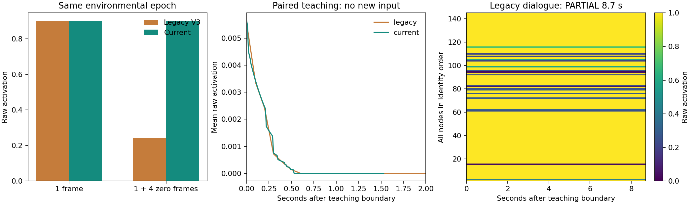

# Time and activity rhythms: partial first-stage comparison

> **Revision r2 · 2026-10-10**
> Revision reason: Relocate generated evidence out of Git; preserve original bytes and conclusions.
> Original: [report.en.md](report.en.md); parent r1: [report.en.md](report.en.md)

[中文](report.md) · [Registered protocol](protocol.md) · [Measurements and rankings](analysis.json) · [Stop manifest](stop.json)

**Neither current Core, native binary, sensory mapping nor temporal-reader algorithm was changed. This stage is incomplete.** Host-time and invocation controls passed; one seed's paired-teaching comparison completed. The unchanged legacy V3 dialogue process reached its registered 180-second deadline. No further model runs were started. The obstruction was a computation deadline, not exhausted memory or disk and not a need to modify current Core.

Current simulation can run in real time or faster with identical model results. This separates simulation from wall time, but does not imply that its propagation cadence emerges from activity. Current default propagation uses a global 100-ms cadence. Legacy V3 also had a global tick; it was not an already implemented, entirely activity-triggered internal clock.

## Completed controls

Current unbounded, real-time, 20x pacing, 10-ms observation/incremental advancement, and pause/save/restore produced the same complete Core state hash:
`696a771ca4a1434aa0637aef6dc00ac5c4c5470263f92358ed2b3bf7e69e0689`.
Legacy batched stepping, single stepping, added host waits, and pause/restore also matched in the compared dynamical state, excluding noncausal envelope UUIDs and archival metadata. These are small invariance witnesses, not measurements of subjective experience or exhaustive proofs.

The frame-count control is especially concrete. In one environmental epoch, a single-channel pulse gives activation **0.9** in either version. Adding four same-channel, zero-intensity frames in that epoch produces:

| Version | Evolution | Activation |
| --- | --- | --- |
| Legacy V3 | Five complete ticks instead of one | 0.241864704 = 0.9 × 0.72⁴ |
| Current | All events delivered at the same 100,000-us timestamp | 0.9 |

Legacy `_advance_input_epoch` executes a transition for every due frame, and one transition when no frame is due. `_run_loop` waits a default 0.1 wall seconds between epochs; `_decay_nodes` applies a 0.72 multiplier per transition. This establishes a frame-count/evolution coupling, not a claim that either policy is intrinsically right or wrong. Activity-dependent timing remains a legitimate research question.

## Paired teaching

Seed41701 used the unchanged default anonymous text sensor, including NFKC. The full sentences “甲是松子。” and “乙是铃铛。” were each repeated20 consecutive times, for two rounds:80 inputs, spaced0.8 reference seconds apart. Both kernels received identical channel amplitudes through their public interfaces. This is a shared-instrument Core comparison, not a reconstruction of the entire old application. Both formed61 nodes and2,786 directed edges; counts do not establish identical states.

All times below are relative to the64-second teaching boundary; the last teaching input occurred at63.3 seconds. Legacy seconds are epoch counts multiplied by the old default0.1-second reference period, not an assertion of an old precise simulation clock.

| Continuation | Legacy all-zero activation | Current all-zero activation | Current death |
| --- | --- | --- | --- |
| No new input | 0.60 reference seconds | 0.53 simulation seconds | 1.53 seconds |
| Cue “甲” at the next epoch | 1.40 reference seconds | 1.32 simulation seconds | 2.32 seconds |

These differences are smaller than legacy's0.1-second observation spacing and do not establish a decay regression. Legacy continued to label the all-zero state active, whereas current applied its approved one-second quiescence-death rule. A lifecycle label is not evidence of ongoing activation.

Cue-versus-no-input maximum node differences were approximately0.217991 in legacy and0.217988 in current. This is a measurable input effect, not a semantic answer. Current's default temporal window ran64.1–65.3 seconds and was classified **residual_decay**, not converged. Its final peak activation was approximately0.00423079 with three tied nodes. Complete endpoint intensity rankings and original composite scores remain available; all-zero final checkpoints refer to a later time.

## Interrupted dialogue case

The legacy model completed all200 teaching inputs: ten intact dialogue sentences including speakers, self-reference, questions and punctuation,20 consecutive repetitions each. The intact training checkpoint at1,600 epochs contains145 nodes and12,144 directed edges. The subsequent no-input trace preserves88 complete records through8.7 reference seconds. The gzip stream was interrupted before its end marker; the original is retained, with a separately labeled recovered prefix. Missing observations were not manufactured.

At the last available observation, all145 nodes were active, with mean activation0.900671 and node-to-node range0.965075. This partial result shows persistent internal activity with unequal node strengths in that legacy network. Current's matching dialogue case was not run. A previous longer current experiment cannot substitute for that missing matched comparison.

## Boundary and next decision

Completing this first stage requires **no Core change**. The intact legacy training checkpoint allows the observation phase to be run as a separate bounded job, avoiding a repeat of the200 teaching inputs. Alternatively, the per-job limit could be raised from180 to300 seconds while retaining720 seconds total computation,512MiB evidence budget and the memory/disk reserves. Neither option was started after the stop.

Determining whether fixed propagation scheduling specifically causes synchrony would require a separate controlled experimental implementation after agreeing on its alternative schedule. The direct legacy/current comparison has additional differences: legacy sender-side target headroom and target inhibition factors, current receiver-side delayed response, independent traversal consolidation, and different relaxation/inhibition/learning phases. Merely changing `propagation_interval_us` also changes per-pulse quantities and therefore does not automatically isolate scheduling. No scheduling variant was constructed and no mainline replacement is warranted by these partial results.

## Resources and preservation

The completed training/continuation cases used about17.03 compute seconds; the interrupted case reached180 seconds. Including diagnostics, model computation was about3 minutes20 seconds. Successful-case peak RSS was about65MiB; the interrupted process's last external reading was about75MiB, not a measured peak. Over10GiB host memory remained available, and the D/E drives retained over36/46GiB. Local evidence was below10MiB before packaging; final database and storage accounting is archived separately. Shared-account consumed usage moved73%→74%.

The new project **时间与活动节律：旧V3／当前内核第一阶段对照** contains the design note, records, report and attachments. Previous experiment metadata, executable sources and native binary hashes were verified unchanged. See [README](README.md) for evidence and reproduction boundaries.

## Data location revision

Selected generated evidence has been archived and verified byte for byte. Original reports, criteria, conclusions and embedded source_commit values are preserved. The logical downloads below require the current host administrator. The data directory is not public.

`data/experiments/2026-09-10-time-comparison/`

[Location and hash index / 位置及哈希登记](../../artifact-index/2026-10-09-relocations.json)

- [inputs.json](/api/v2/storage/research-artifacts/research-artifact:decf38ee925df7c7ffafb3dc/content) — 1098730 B; SHA-256 `b3830d63232dd7919e64bb9e88d13add43b752c461b620f2ce6ae3d544ce32aa`.
- [partial-prefix.json](/api/v2/storage/research-artifacts/research-artifact:8daec7ca0262c495edf5d5f9/content) — 553539 B; SHA-256 `ed2eaa057d5aab138fb28b13e56435f6deb68b4e7d88c64fcdca5ab6046d7043`.
