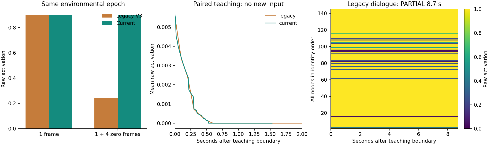

# 时间与活动节律：第一阶段对照及中止记录

> **修订 r2 · 2026-10-10**
> 修订原因：生成证据移出 Git 并完成校验归档；追加位置登记，保留原字节与结论。
> 原版：[report.md](report.md)；父版本 r1：[report.md](report.md)

[English](report.en.md) · [预先方案](protocol.md) · [数值与完整排名](analysis.json) · [中止清单](stop.json)

**当前内核、原生二进制、感官映射和时序读出算法均未修改。第一阶段只部分完成：宿主时间／调用方式检查通过，完成了一个种子的配对组；旧 V3 对话组达到单进程180秒时限后停止，没有继续其他组。** 这次中止是计算时限，不是内存或磁盘不足，也不是发现必须修改当前内核。

最关键的结果：当前内核并未被绑成“必须等待现实时间才会思考”。同一段模拟过程既可实时，也可加速，结果相同。但**模拟时间与墙钟解耦**不等于**传播节律由活动自发决定**。当前传播仍有默认100毫秒全局节律；旧版也有统一tick，并非已有一个完全由活动触发的独立内部时钟。

## 1. 哪些已经实测

| 问题 | 本次证据 | 能作出的判断 |
| --- | --- | --- |
| 当前计算快慢会改变同一模型过程吗？ | 同一输入分别用无界、实时、20倍速、细分推进及暂停保存恢复，最终完整Core状态哈希相同 | 这个样例中，墙钟快慢没有改变模型过程；不是主观时间测量 |
| 观察得更密会改变当前内核吗？ | 一次推进至1.6秒，与每10毫秒推进并读取节点，最终哈希相同 | 这个样例中，观察没有另加动力学步 |
| 旧版也能脱离现实等待运行吗？ | `step(ticks=16)`、逐步推进、插入宿主等待、暂停及存档恢复，所比较的动力学状态完全相同 | 旧版手动推进也不依赖必须等满墙钟时间 |
| 旧内部tick等于环境周期吗？ | 同一环境周期，1个有效脉冲与“1个有效＋4个零强度帧”对照 | 不等于；旧版分别执行1和5个完整tick |
| 配对短句之后能否自行活动？ | 每句连续20次、两句两轮，共80次；随后无新输入／另给一次`甲`，两侧均继续演化 | 两侧都出现余留活动，随后全零；本组没有持续自持活动 |
| 旧版包含对话的网络能否持续活动？ | 200次完整句子教学完成，之后无输入记录到8.7参考秒，145节点仍全部有激活且强度不相同 | 这个旧网络有持续内部活动，但观察被中止，不能宣称完整12秒检验完成 |

当前五个控制的完整状态哈希均为 `696a771ca4a1434aa0637aef6dc00ac5c4c5470263f92358ed2b3bf7e69e0689`。旧版四个控制比较节点、连接、历史动力学状态、tick和环境周期等，排除信封UUID、存档时间等观察元数据；并非声称旧存档字节全部相同。见[诊断数据](diagnostics.json)。

## 2. 已确认的时间差异，用一个数字说明

在同一环境周期输入单通道强度1的脉冲，两版首先都得到激活 **0.9**。再在该周期放四个相同通道、强度0的帧：

- 旧 V3 每帧执行完整 `_advance`，因此共5个tick，激活变成 **0.241864704**，即 `0.9 × 0.72⁴`。抑制也被额外演化。
- 当前五帧在同一个100,000微秒时刻递送，激活仍为 **0.9**。事件数量增加，但没有因此经过额外模拟时间。

这是传输帧数和演化次数的实际耦合差异。它既不能直接叫“旧版有主观时间”，也不能直接叫“无价值的旧缺陷”：如果研究设想恰好需要刺激密度影响内部节奏，这个差异值得明确研究。当前输入仍能通过激活、抑制和连接改变活动轨迹，只是不再通过“每帧额外走一个完整tick”实现。

旧源码证据：`core/threemind/runtime.py@97d8592` 的 `_run_loop`（默认墙钟等待0.1秒）、`_advance_input_epoch`（有几帧就执行几次 `_advance`，无帧仍执行一次）、`_decay_nodes`（每次乘0.72）。原始字节及SHA保存在[实现清单](implementation.json)和证据包中。当前对应 `src/threemind_runtime/host.py::Runtime`、`src/threemind_core/engine.py::advance_to`、`crates/threemind-core/src/lib.rs::advance`。

## 3. 配对组：实际活动、死亡、时序读出分开报告

唯一完成的编码种子是41701。两套内核使用同一默认感官产生的匿名通道、幅度和强度，间隔0.8参考秒。训练均得到61节点、2,786条有向连接；结构数量相同不代表权重或全部状态相同。教学结束边界为64参考秒，最后输入在63.3秒。

| 训练后条件 | 旧V3全部激活归零 | 当前全部激活归零 | 当前死亡 |
| --- | --- | --- | --- |
| 不再输入 | 0.60参考秒 | 0.53模拟秒 | 1.53模拟秒 |
| 下一周期输入一次`甲` | 1.40参考秒 | 1.32模拟秒 | 2.32模拟秒 |

以上均相对于教学结束边界。旧版只能看到每个完整tick后的状态，所以0.07／0.08秒的差别小于旧版0.1秒观测间隔，不能据此判定当前衰减有实质退化。旧版全零后仍标记active；当前全零持续1秒后死亡，这是已确认的生命周期规则差异，不能把标签active当作持续意识活动的证据。

`甲`线索与不再输入的副本相比，最大节点激活差：旧版约 **0.217991**，当前约 **0.217988**。这说明输入有可测的作用，不等于模型已给出“松子”答案。

当前默认时序窗口从64.1秒到65.3秒，分类 **residual_decay**（尾段幅度下降），不是converged。窗末最高强度约 **0.00423079**，三节点并列；全部窗末强度排序、原综合分数和原始窗口均保留。没有把非收敛结果称为收敛答案，也没有因原始活动不符合人类预期而删除它。末态全零排名与读出窗口的较早结束排名是不同时间的量，不能混用。

## 4. 对话组中止在何处

旧V3已完成十句完整对话各20次，共200次输入、1,600个环境周期。完整训练检查点可读，包含145节点、12,144条有向连接。接下来的无输入观察写到 **8.7参考秒**；尾段文件缺少gzip结束标记，原文件原样保留，另保存88条完整可解析记录的[恢复前缀](/api/v2/storage/research-artifacts/research-artifact:8daec7ca0262c495edf5d5f9/content)。这不是补造后面的数据，也不是可继续运行的末态。

在最后可读时刻，145节点全部有激活，均值约 **0.900671**，节点间最大强度差约 **0.965075**。图右侧展示全部节点，包含很强与很弱的活动。这个部分观察说明旧版也能在没有新输入时保留内部活动及节点差异。它尚未与同条件的当前对话组配对；不能拿前轮更长课程的当前结果与它拼成调度的因果结论。

单进程180秒到期后没有重跑。当前对话组、第二种子、旧对话线索副本均未启动或未完成，完整状态见[stop.json](stop.json)。没有修改本次注册的重复次数或句子来赶进度。

## 5. 下一步如何解决，需要不需要改内核

**完成第一阶段不需要修改当前内核，也不需要改变旧内核。** 当前阻碍可以通过把训练与观察拆成两个各自受限的作业解决：已有旧对话训练检查点可直接用于后续观察，无需再训练200次。另一选择是把这类旧Python对照作业的单次时限从180秒提高到300秒，仍保持总计算720秒、512MiB证据及内存／磁盘储备；它不是无限放开资源。本轮已按约定停止，未自行提高限额或重新开始。

如果下一阶段要回答更强的问题——**“是否正是固定传播调度造成了同步或退化？”**——仅比较旧V3与当前还不够。旧传播还乘目标剩余激活空间与目标抑制响应，当前由接收端在到达时处理；两者的独立传播巩固、离散／连续衰减、抑制与学习执行相位也不同。这些都是潜在解释，不能排除后再归因给时钟。

届时需要先明确替代调度规则，再建立隔离的实验版本，使局部公式、输入映射、初始状态和记账保持一致，只改变经批准的调度部分，并验证没有附带改变传播幅度或遗忘量。**本轮未建立该版本。** 单纯调整 `propagation_interval_us` 不是自动成立的“只改调度”实验，因为当前每次发射量和部分离散变化也使用该间隔。

当前证据不支持直接把主线改回旧帧机制，也不证明固定节律不会影响涌现；应保留这个待检问题。

## 6. 资源与证据

完成配对两版训练及各两个延续副本，共约17.03秒计算；旧对话作业在180秒中止。加上小型诊断，本轮模型计算约3分20秒，没有用满12分钟总上限。成功作业记录的峰值RSS约65MiB；中止作业最后一次外部检查约75MiB，这个值不是整个作业峰值。整理时可用内存约10.3GiB，D/E盘分别约36.5/46.0GiB空闲；本地证据不到10MiB，归档后的最终数据库增长与总量见验证清单。账号已用额度从73%到74%（共享账号窗口，不能精确归属每一步）。

实验设计已写入新项目 **时间与活动节律：旧V3／当前内核第一阶段对照** 的实验笔记。记录、报告和附件保存在同一项目；旧实验的小型元数据摘要前后相同。源码、感官和原生二进制哈希前后相同。完整证据与复现边界见[README](README.md)。

## 数据位置修订

选定的生成证据已逐字节校验归档。原报告、评判标准、结论及数据内 source_commit 均保留。以下逻辑下载需要当前主机管理员身份，数据目录未整体公开。

`data/experiments/2026-09-10-time-comparison/`

[Location and hash index / 位置及哈希登记](../../artifact-index/2026-10-09-relocations.json)

- [inputs.json](/api/v2/storage/research-artifacts/research-artifact:decf38ee925df7c7ffafb3dc/content) — 1098730 B; SHA-256 `b3830d63232dd7919e64bb9e88d13add43b752c461b620f2ce6ae3d544ce32aa`.
- [partial-prefix.json](/api/v2/storage/research-artifacts/research-artifact:8daec7ca0262c495edf5d5f9/content) — 553539 B; SHA-256 `ed2eaa057d5aab138fb28b13e56435f6deb68b4e7d88c64fcdca5ab6046d7043`.
