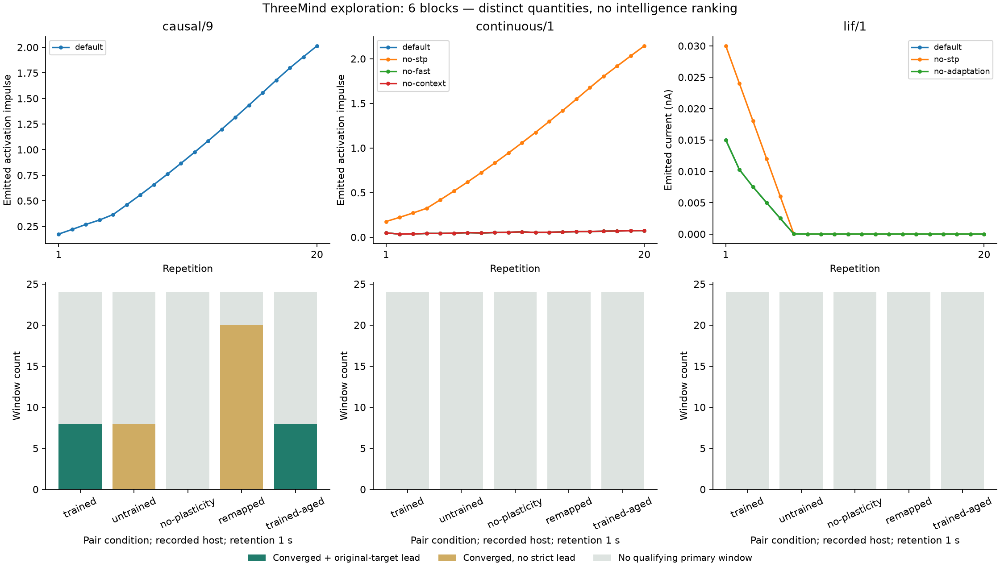

# Candidate kernels: adaptation, pairing and context — r3

> **Revision r3 · 2026-10-16**
> Revision reason: Add purpose, existing expectations, interpretation and explicit scientific conclusions; preserve criteria, results and historical editions.
> Original: [report.en.md](report.en.md); parent r2: [report.r2.en.md](report.r2.en.md)

Editorial synthesis dated 16 October 2026. Experiment dates, measurements, thresholds and version identities are unchanged. Purpose and meaning are reconstructed from the original protocol and report; judgments not prospectively quantified are not relabeled as preregistered passes. No subject was rerun and no large raw trajectory was recomputed.

[Parent report](report.r2.en.md) · [中文](report.r3.zh.md) · [Historical audit](../../../docs/en/plans/report-conclusion-audit-20261016.md). Parent bytes read for this review, SHA256: `b03ac86d1dc788397bb9ec5fbf102471d0aace443a0bd1bb3e3b2a893c7edc87`.

## Purpose, expectations and comparisons

This study compared causal/9, the continuous candidate and the LIF candidate on anonymous pairing, sequence, short-term resources and peripheral expression. Its scientific task was to identify actual history effects, localize mechanism contributions and identify apparatus-limited failures. It was not a mixed-condition intelligence leaderboard. Original conditions, readers and controls remain fixed; this revision adds no retrospective overall winner criterion.

## Main conclusion and evidence

**Pairing experience produced distinguishable response preferences; short-term resources in the continuous candidate suppressed response growth during repetition; reliable pure-sequence learning was not established.** These are the scientific outcomes, rather than the mere existence of 72 calibration cells, 2,832 measurements and twelve readers.

With real background and one-second retention in the same pairing condition, causal/9 had 8/24 converged windows with 8/8 correct leads. The continuous candidate had no converged windows but 24/24 target peak advantages. Corresponding untrained or plasticity-disabled controls lacked those target peak advantages. This supports experience-dependent pairing responses while requiring convergence and transient preference to remain separate outcomes, not a pooled accuracy.

With default short-term resources, the continuous candidate's repeated response rose from 0.0484348 to 0.0753993; without those resources it rose from 0.175522 to 2.14459. The intervention supports a causal role in suppressing repeated-response growth. The fast trace had a smaller contribution; the context switch made no difference in this single-pair condition. The new mechanisms did not contribute equally.

Pure-sequence teaching created no task edges in any of the three kernels, so this batch did not achieve the intended learned sequence discrimination. LIF emitted spikes in some 10ms settings that 100ms or one-second sampling could miss entirely. This identifies a timescale obstacle in the apparatus, not general incapacity of the architecture. Strong small-Transformer fitting on taught contexts likewise does not replace the missing unseen-context test.

## Meaning for ThreeMind

The study provides **positive evidence for pairing plasticity and short-term resource effects, a negative sequence outcome and an LIF observation limitation**. The justified next question concerns how resources, propagation and sampling determine experience expression. Adding candidates or improving within-training fit does not answer it. Each version retains its genuine identity; no universal cross-task ranking was established.

## Preserved original evidence

> **Revision r2 · 2026-10-10**
> Revision reason: Verified original-file relocation; append location-resolution guidance and preserve the experiment conclusions.
> Original: [report.en.md](report.en.md); parent r1: [report.en.md](report.en.md)

[中文](report.zh.md)

2026-09-29. Project `cb3a2d4a-f8a2-440e-9182-75148e9454a8`. This is a mechanistic exploration, not a certification of consciousness or AGI. The preregistered protocol preserves kernel formulas and sensory mappings. Anonymous channels do not test language understanding.

### Completed scope

72 calibration cells, six input/environment blocks, 2832 formal outcome rows and 12 independent tiny Transformers. Training intensity 1.0, interval 1 s; cue intensity 0.5. Each pair received 20 blocked repetitions, then 10 and five. Six distinct real host recordings contain 300 samples each; replay intensity is 0.2 with original timestamps. Process/runtime telemetry is off. Each probe uses its own training-state clone and never writes learning back to the parent.

Pairing produced 112 windows satisfying the existing convergence criteria; 36 had a strict original-target lead among four candidates. Sequence tests produced 24 converged windows and 2 strict expected-target leads. **These totals are not a pooled accuracy**: conditions differ in background, retention, ablation and teaching. The tables separate conditions. A dash in the lead fraction means no qualifying converged evidence.

Each probe advances at most 12 simulated seconds. The existing reader may close earlier: one block-0 continuous-model pairing window closed after 1.7 s as `residual_decay`, reason `tail_amplitude_decline`. The primary metric uses the recorded window endpoint, not an imposed 12 s endpoint. Original composite scores/ranks remain intact; analysis separately compares `last_activation` without rewriting reader evidence.

Target leads compare the four preregistered paired targets, or the two possible sequence endings. They do not imply the target dominates every node in the consciousness. Cue, background and other activity remain in full readouts; candidate sets are external evaluation definitions, never Core instructions or cuts to recorded activity.

### Observations

A fixed comparison is trained pairing with recorded background, retention 1 s, and half-intensity cues. The auxiliary block peak contrast subtracts other-target means from matched-target means; it does not replace the primary endpoint.

|Kernel|Converged / all|Strict target leads / converged|Peak leads / observed|Median block peak contrast|
|---|---:|---:|---:|---:|
|threemind.causal/9|8/24|8/8|21/24|0.10621|
|threemind.continuous/1|0/24|—|24/24|0.0296207|
|threemind.lif/1|0/24|—|0/24|0|

In this fixed condition, the baseline has 8/24 qualifying converged windows, with 8 strict target leads. These conditional pairing observations must not be erased by other nonconverged cases. The continuous model has 24/24 observed windows with a strict matched-target peak lead, a different phenomenon from a converged answer. Both require untrained/plasticity controls, retention and block-level interpretation rather than one overall score.

1. Short-term synaptic dynamics change emitted transmission after repetition. The first table reports mean first/20th emission under no background, with distinct physical units. An unchanged two-node context ablation does not establish that context competition is ineffective in richer networks.
2. LIF shows temporal accumulation: five inputs of intensity 0.5 at 10 ms intervals produced actual spike increments `[0,0,2,0,2]`; 100 ms or 1 s produced `[0,0,0,0,0]`. A 100 ms display projection cannot replace event-based spike measurement. Observability and the learning time window require separate calibration.
3. Convergence is not necessarily selective recall. Some remapped baseline cases converge with several candidates nearly tied. Full end-of-window activation is retained; ties and differences <=1e-9 are not strict leads. Peak responses remain secondary. Per-block matched-minus-other means in `summary.json` help distinguish cue discrimination from always favoring one target, which can otherwise score 1/4 or 1/2.
4. Tiny Transformers discriminate the two taught contexts: 24 expected-target probabilities have median 0.999762, range 0.999669–0.999899; the first-order baseline assigns 0.5 to each target. This is a rehearsed-context control, with no evidence of unseen-name or rule generalization and no feedback to ThreeMind.

### Repetition and adaptation

|Kernel / variant|First emitted|20th emitted|Unit|
|---|---:|---:|---|
|threemind.causal/9 / default|0.174998|2.01424|activation impulse|
|threemind.continuous/1 / default|0.0484348|0.0753993|activation impulse|
|threemind.continuous/1 / no-stp|0.175522|2.14459|activation impulse|
|threemind.continuous/1 / no-fast|0.0484074|0.0750523|activation impulse|
|threemind.continuous/1 / no-context|0.0484348|0.0753993|activation impulse|
|threemind.lif/1 / default|0.015|0|nA|
|threemind.lif/1 / no-stp|0.03|0|nA|
|threemind.lif/1 / no-adaptation|0.015|0|nA|

Emission includes all transmitted activity, without filtering for human-perceived utility. Recovery at 0.1/1/10 s and lifecycle outcomes are retained in `block-*.json` and the project. LIF nA and continuous activation impulse are not a common intelligence scale.

### Pairing, retention and remapping

Background 0/1 means none/recorded host. `trained-aged` waits an additional 40 s to match the remapping exposure duration. `untrained` has no paired input; `no-plasticity` disables plasticity from birth. This table evaluates the original target under `remapped`; new-target margins are separate in `summary.json`.

|Kernel|Background|Condition|Retention (s)|Converged / all|Strict target leads / converged|Peak leads / observed (secondary)|
|---|---|---|---:|---:|---:|---:|
|threemind.causal/9|0|trained|1|0/24|—|24/24|
|threemind.causal/9|0|trained|10|0/24|—|24/24|
|threemind.causal/9|0|trained|100|0/24|—|24/24|
|threemind.causal/9|0|untrained|1|0/24|—|0/24|
|threemind.causal/9|0|untrained|10|0/24|—|0/24|
|threemind.causal/9|0|untrained|100|0/24|—|0/24|
|threemind.causal/9|0|no-plasticity|1|0/24|—|0/24|
|threemind.causal/9|0|no-plasticity|10|0/24|—|—|
|threemind.causal/9|0|no-plasticity|100|0/24|—|—|
|threemind.causal/9|0|remapped|1|24/24|0/24|0/24|
|threemind.causal/9|0|remapped|10|0/24|—|0/24|
|threemind.causal/9|0|remapped|100|0/24|—|0/24|
|threemind.causal/9|0|trained-aged|1|0/24|—|24/24|
|threemind.causal/9|0|trained-aged|10|0/24|—|24/24|
|threemind.causal/9|0|trained-aged|100|0/24|—|24/24|
|threemind.causal/9|1|trained|1|8/24|8/8|21/24|
|threemind.causal/9|1|trained|10|4/24|4/4|24/24|
|threemind.causal/9|1|trained|100|0/24|—|24/24|
|threemind.causal/9|1|untrained|1|8/24|0/8|0/24|
|threemind.causal/9|1|untrained|10|8/24|0/8|0/24|
|threemind.causal/9|1|untrained|100|0/24|—|0/24|
|threemind.causal/9|1|no-plasticity|1|0/24|—|0/24|
|threemind.causal/9|1|no-plasticity|10|0/24|—|0/24|
|threemind.causal/9|1|no-plasticity|100|0/24|—|0/20|
|threemind.causal/9|1|remapped|1|20/24|0/20|0/24|
|threemind.causal/9|1|remapped|10|16/24|0/16|0/24|
|threemind.causal/9|1|remapped|100|0/24|—|0/24|
|threemind.causal/9|1|trained-aged|1|8/24|8/8|24/24|
|threemind.causal/9|1|trained-aged|10|16/24|16/16|24/24|
|threemind.causal/9|1|trained-aged|100|0/24|—|24/24|
|threemind.continuous/1|0|trained|1|0/24|—|24/24|
|threemind.continuous/1|0|trained|10|0/24|—|—|
|threemind.continuous/1|0|trained|100|0/24|—|—|
|threemind.continuous/1|0|untrained|1|0/24|—|0/24|
|threemind.continuous/1|0|untrained|10|0/24|—|0/24|
|threemind.continuous/1|0|untrained|100|0/24|—|0/24|
|threemind.continuous/1|0|no-plasticity|1|0/24|—|0/24|
|threemind.continuous/1|0|no-plasticity|10|0/24|—|—|
|threemind.continuous/1|0|no-plasticity|100|0/24|—|—|
|threemind.continuous/1|0|remapped|1|0/24|—|24/24|
|threemind.continuous/1|0|remapped|10|0/24|—|—|
|threemind.continuous/1|0|remapped|100|0/24|—|—|
|threemind.continuous/1|0|trained-aged|1|0/24|—|—|
|threemind.continuous/1|0|trained-aged|10|0/24|—|—|
|threemind.continuous/1|0|trained-aged|100|0/24|—|—|
|threemind.continuous/1|1|trained|1|0/24|—|24/24|
|threemind.continuous/1|1|trained|10|0/24|—|24/24|
|threemind.continuous/1|1|trained|100|0/24|—|20/20|
|threemind.continuous/1|1|untrained|1|0/24|—|0/24|
|threemind.continuous/1|1|untrained|10|0/24|—|0/24|
|threemind.continuous/1|1|untrained|100|0/24|—|0/20|
|threemind.continuous/1|1|no-plasticity|1|0/24|—|0/24|
|threemind.continuous/1|1|no-plasticity|10|0/24|—|0/24|
|threemind.continuous/1|1|no-plasticity|100|0/24|—|0/20|
|threemind.continuous/1|1|remapped|1|0/24|—|24/24|
|threemind.continuous/1|1|remapped|10|0/24|—|24/24|
|threemind.continuous/1|1|remapped|100|0/24|—|24/24|
|threemind.continuous/1|1|trained-aged|1|0/24|—|20/20|
|threemind.continuous/1|1|trained-aged|10|0/24|—|20/20|
|threemind.continuous/1|1|trained-aged|100|0/24|—|20/20|
|threemind.lif/1|0|trained|1|0/24|—|0/24|
|threemind.lif/1|0|trained|10|0/24|—|—|
|threemind.lif/1|0|trained|100|0/24|—|—|
|threemind.lif/1|0|untrained|1|0/24|—|0/24|
|threemind.lif/1|0|untrained|10|0/24|—|0/24|
|threemind.lif/1|0|untrained|100|0/24|—|0/24|
|threemind.lif/1|0|no-plasticity|1|0/24|—|0/24|
|threemind.lif/1|0|no-plasticity|10|0/24|—|—|
|threemind.lif/1|0|no-plasticity|100|0/24|—|—|
|threemind.lif/1|0|remapped|1|0/24|—|0/24|
|threemind.lif/1|0|remapped|10|0/24|—|—|
|threemind.lif/1|0|remapped|100|0/24|—|—|
|threemind.lif/1|0|trained-aged|1|0/24|—|—|
|threemind.lif/1|0|trained-aged|10|0/24|—|—|
|threemind.lif/1|0|trained-aged|100|0/24|—|—|
|threemind.lif/1|1|trained|1|0/24|—|0/24|
|threemind.lif/1|1|trained|10|0/24|—|0/4|
|threemind.lif/1|1|trained|100|0/24|—|—|
|threemind.lif/1|1|untrained|1|0/24|—|0/4|
|threemind.lif/1|1|untrained|10|0/24|—|0/4|
|threemind.lif/1|1|untrained|100|0/24|—|—|
|threemind.lif/1|1|no-plasticity|1|0/24|—|0/24|
|threemind.lif/1|1|no-plasticity|10|0/24|—|0/4|
|threemind.lif/1|1|no-plasticity|100|0/24|—|—|
|threemind.lif/1|1|remapped|1|0/24|—|0/24|
|threemind.lif/1|1|remapped|10|0/24|—|0/4|
|threemind.lif/1|1|remapped|100|0/24|—|—|
|threemind.lif/1|1|trained-aged|1|0/24|—|0/4|
|threemind.lif/1|1|trained-aged|10|0/24|—|0/4|
|threemind.lif/1|1|trained-aged|100|0/24|—|—|

### Order and context

Teach A→B→C and D→B→E; the swapped control teaches A→B→E and D→B→C, preserving unigram and first-order counts. Overlap=0 presents one symbol per frame. Overlap=1 explicitly co-presents adjacent symbols, a different sensory condition whose results cannot establish pure sequential growth.

|Kernel|Background|Overlap|Swapped teaching|Converged / all|Strict target leads / converged|Peak leads / observed (secondary)|
|---|---|---|---|---:|---:|---:|
|threemind.causal/9|0|0|0|0/12|—|0/12|
|threemind.causal/9|0|0|1|0/12|—|0/12|
|threemind.causal/9|0|1|0|0/12|—|6/12|
|threemind.causal/9|0|1|1|0/12|—|6/12|
|threemind.causal/9|1|0|0|6/12|0/6|0/12|
|threemind.causal/9|1|0|1|6/12|0/6|0/12|
|threemind.causal/9|1|1|0|6/12|1/6|5/12|
|threemind.causal/9|1|1|1|6/12|1/6|5/12|
|threemind.continuous/1|0|0|0|0/12|—|0/12|
|threemind.continuous/1|0|0|1|0/12|—|0/12|
|threemind.continuous/1|0|1|0|0/12|—|12/12|
|threemind.continuous/1|0|1|1|0/12|—|12/12|
|threemind.continuous/1|1|0|0|0/12|—|0/12|
|threemind.continuous/1|1|0|1|0/12|—|0/12|
|threemind.continuous/1|1|1|0|0/12|—|12/12|
|threemind.continuous/1|1|1|1|0/12|—|12/12|
|threemind.lif/1|0|0|0|0/12|—|0/12|
|threemind.lif/1|0|0|1|0/12|—|0/12|
|threemind.lif/1|0|1|0|0/12|—|0/12|
|threemind.lif/1|0|1|1|0/12|—|0/12|
|threemind.lif/1|1|0|0|0/12|—|0/12|
|threemind.lif/1|1|0|1|0/12|—|0/12|
|threemind.lif/1|1|1|0|0/12|—|0/12|
|threemind.lif/1|1|1|1|0/12|—|0/12|

### Structural boundary

Read-only checks cover 144 training parents (six blocks × background on/off for every kernel/input condition), with hashes matching their committed states. Parents were not selected according to output success. Edge counts include stored zero-weight entries and do not imply nonzero transmission.

|Kernel|Input condition|Snapshots|Task edges (range)|Task edge weights (range)|Cross-background edges|
|---|---|---:|---:|---|---:|
|threemind.causal/9|pair|12|8–8|1–1|0|
|threemind.causal/9|remapped|12|16–16|0.518747–1|0|
|threemind.causal/9|sequence-pure|12|0–0|—|0|
|threemind.causal/9|sequence-overlap|12|8–8|1–1|0|
|threemind.continuous/1|pair|12|8–8|0.576699–0.599371|0|
|threemind.continuous/1|remapped|12|16–16|0.183426–0.592622|0|
|threemind.continuous/1|sequence-pure|12|0–0|—|0|
|threemind.continuous/1|sequence-overlap|12|8–8|0.545476–0.596611|0|
|threemind.lif/1|pair|12|8–8|0–0|0|
|threemind.lif/1|remapped|12|16–16|0–0|0|
|threemind.lif/1|sequence-pure|12|0–0|—|0|
|threemind.lif/1|sequence-overlap|12|8–8|0–2.02764e-24|0|

Pure sequential input formed no task-channel edges, so this round does not yet test how an existing temporal pathway could carry context. Co-presentation formed edges, with different retained weights. Synchronous LIF pairing reduced paired-edge weights to zero; learning occurs at presynaptic signal arrivals and postsynaptic spikes, so simultaneous external input does not imply inevitable strengthening.

No edges crossed between task and background channels. Background may affect global survival or window classification without sustaining task-node activation. Sensory overlap, offset timing, or an independently justified edge-growth variant require a separate protocol; analysis must not assume or manufacture absent connections.

### Limits and next steps

- These are small anonymous-pattern tests, not proof for or against language, causal reasoning or AGI. Channel permutations do not create independent mechanism samples; deterministic no-background blocks may coincide. Descriptive results are reported without pseudoreplicated significance tests.
- Real recordings include machine activity during other tasks in this study. Timestamps, availability and raw readings are retained. Blocks are not stationary IID noise; within-block controls use the identical recording.
- Fixed curriculum order permits recency effects; renaming channels does not remove them. Remapping has an age-matched waiting control but no equal-count extra-training control. The 0.5 LIF cue dose was not independently calibrated for spike observability; absent probe spikes do not establish inability to learn.
- Structural persistence, ongoing activation, a target peak, convergence and selective output are distinct. Missing primary evidence is not zero. Death, nonconvergence and resource censoring remain separate; secondary peaks include observed nonconverged windows but exclude unobserved cases from the denominator (a dash denotes missing secondary evidence). Interpret them with their window classifications.
- Next priorities are millisecond-scale LIF event readouts and offset-input protocols, plus auditing how edge-growth conditions constrain pure sequence learning. Persistent nonselective activity merits a separate no-cue/zero-dose control. These are future protocols, not post-hoc parameter tuning in this round.
- Each CPU Transformer has 26048 parameters and trains for 200 steps. This validates small controls and interfaces, not large-language-model hardware requirements. Real GPU execution remains untested.

### Execution and audit

Model checkpoints, original inputs, spike events and temporal records are stored in the new project. The evidence archive contains protocols, source versions, recordings, observations, summaries and state hashes. Model states remain in database checkpoints and can be exported through experiment snapshots; this evidence ZIP is not an importable model artifact.

Per-second recursive metadata scanning caused an instrumentation bottleneck. Lightweight checks remain per-second; directory/database size scans now run per-minute with 512 MiB stop headroom. Independent replay matched the exact state hash and full temporal readout, reducing one case from 18.72 s to 3.43 s. One uncommitted case without a checkpoint was restarted; all committed evidence remains. Notebook revision 3 and `guard-parity.json` document the fix. No kernel formula changed.

Limits: one compute task, two numerical threads, 4 GiB RSS, 24 h total, 4 GiB target/8 GiB maximum evidence, 20 GiB new occupancy, and 15 GiB reserves on D/E. Account usage starts at 32%, with at most ten additional percentage points. All 499 pre-existing projects retained their run revisions, state hashes, statuses and research-document revisions. The pre-publication snapshot is `closure.json`; final occupancy after publication is recorded separately in `post-publication-closure.json`.

Host envelope `payload.frames` contains encoder output before the explicit study intensity. Actual delivery is recorded in `input_frames.stimulus`, verified as intensity 0.2. Replays must use those actual frames and timestamps rather than confusing the two layers.

> **Storage-location revision · 2026-10-10**
> This edition adds the verified move of the selected originals to `E:\ThreeMindData`. Stable scientific identities and hashes, experiment dates, measurements and conclusions remain unchanged. Paths in the preserved body describe historical sources; use the registered evidence resolver for current locations. Repository documents and frozen fixtures remain in place, and source copies are retained. Structured query data and running checkpoints remain in the database. This annotation does not assert that missing historical evidence was recovered.

## Revised conclusion

Pairing history effects and short-term resource suppression are supported; reliable pure-sequence learning was not achieved. These distinct mechanism judgments, rather than pooled condition scores or training fit, are the valid outcome of the candidate comparison.
