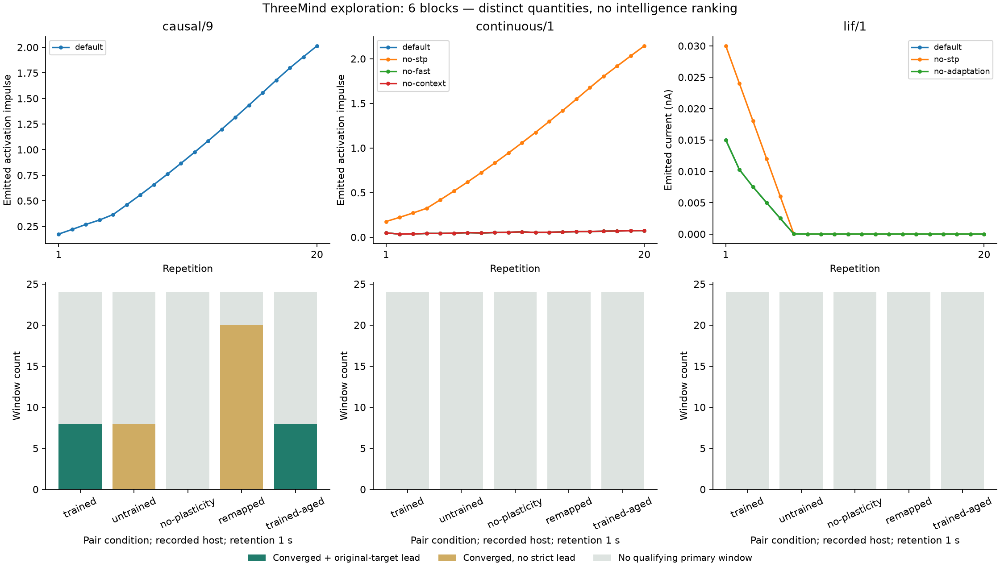

# 多内核初步实验：适应、配对与上下文 — r3

> **修订 r3 · 2026-10-16**
> 修订原因：补充研究目的、既有预期、结果分析与明确科学结论；保留原判据、成绩和全部历史版本。
> 原版：[report.zh.md](report.zh.md)；父版本 r2：[report.r2.zh.md](report.r2.zh.md)

2026-10-16 结论补述。原实验日期、测量、门槛及版本保持不变。本版依据原方案和报告归纳研究问题与科学意义；未在原方案预先量化的判断，不冒称预登记通过。没有重新运行个体或复算大型原始轨迹。

[父报告](report.r2.zh.md) · [English](report.r3.en.md) · [全历史核查](../../../docs/zh/plans/report-conclusion-audit-20261016.md)。父文件本次读取 SHA256：`eb4178a2ef4bed2b8bf8f79400eee50c8dd616290fe94ce52b88ac1d3e096659`。

## 目的、预期与比较对象

本批比较 causal/9、连续候选和 LIF 候选在匿名配对、顺序、短时资源及外设表达中的实际表现。研究目的不是按混合条件总分选“最聪明内核”，而是判断哪些经历效应已经产生、哪些机制有可定位贡献、哪些失败由当前装置限制了判读。旧方案固定的条件、读出和对照继续有效；本版不追加事后总冠军门槛。

## 主要结论及依据

**配对经历可以形成可辨识的响应偏好，连续候选中的短时资源确实抑制重复输入的响应增长；本批没有建立可靠的纯顺序学习。** 这是本次比较得到的科学结论，而不是72个校准格、2,832条测量或12个读取器本身构成成果。

在真实背景开启、保持1秒的同一配对条件中，causal/9有8/24窗口收敛且8/8目标领先；连续候选没有窗口收敛，但24/24存在目标峰值优势。相应未教学或关闭可塑性的对照缺少这些目标峰值优势。因此，本批有利于“经历改变配对响应”这一主张；也显示终态收敛与瞬时偏好必须分别报告，不能把不同窗口拼成统一正确率。

连续候选的重复响应在默认短时资源下由0.0484348升至0.0753993，关闭该资源后由0.175522升至2.14459。该干预支持短时资源承担重复响应抑制作用。快迹的贡献较小，单配对条件中的上下文开关没有差异；这些结果不支持把各新机制贡献平均分配。

纯顺序教学在三类内核中均未形成任务连接，因而本批未实现所需的经历性顺序区分。LIF在部分10ms设置可发放、100ms和1秒取样可完全漏过脉冲，指出了装置的时间尺度障碍；不能据此宣称LIF架构普遍无能力。小Transformer在教过的上下文中拟合良好，也不能替代尚未取得的未见上下文检验。

## 对 ThreeMind 的意义

这是**配对可塑性与短时资源作用的阳性结果，兼有顺序任务的阴性结果和LIF观察装置的限制**。有依据的推进方向是定位资源、传播和时间采样如何决定经历表达；本批不支持以增加候选数量或教内拟合分数替代这一机制问题。各版本按其真实实现解释，未建立一个跨任务通用优劣排名。

## 原报告证据层（保留原文）

> **修订 r2 · 2026-10-10**
> 修订原因：原件存储位置已迁移并核验，追加当前位置解析说明，保留原实验结论。
> 原版：[report.zh.md](report.zh.md)；父版本 r1：[report.zh.md](report.zh.md)

[English](report.en.md)

2026-09-29。项目：`cb3a2d4a-f8a2-440e-9182-75148e9454a8`。这是机制探索，不是意识或 AGI 的认证。设计先行写入实验笔记，保留三个内核公式、默认机制和感官映射。本轮使用匿名通道，未测试自然语言理解。

### 已完成范围

72 格校准、6 个输入／环境块、2832 个正式测量结果，以及 12 个独立小型 Transformer。训练使用共同强度 1.0、1 秒间隔；线索强度 0.5。每对先连续 20 次，再分别 10 次和 5 次。背景为 6 段各 300 次真实宿主采样，强度 0.2，按实际时间重放；进程和运行时遥测关闭。每个探测从训练父本另建副本，探测学习不写回父本。

配对测试共有 112 个窗口达到既有读出器的收敛判据，其中 36 个窗口的原目标在四个候选中严格领先。顺序测试有 24 个收敛窗口，其中 2 个指定目标严格领先。**这些总数不能当作统一准确率**：其内包含不同背景、保持时间、消融、重新配对和交换教学。下面按条件分别列出，领先比例的“—”表示没有合格的主判据。

每次提示后最多推进 12 模拟秒。既有时序读出器可以提前结束窗口，例如首块连续模型的一次配对提示在 1.7 秒时以 `tail_amplitude_decline` 结束，归类为 `residual_decay`。主指标取该窗口记录的结束时刻，不强行改成第 12 秒。原始综合分数与排序仍保留；本报告另按 `last_activation` 比较目标，未改写原始读出。

“目标领先”在配对测试中比较四个预先声明的目标，在顺序测试中比较两个候选末符号；它不表示目标是整个意识中激活最强的节点。提示节点、背景节点和其他活动均保留在完整读出。这些比较集合属于外部实验指标，不写入内核，也不裁剪意识活动。

### 值得关注的现象

先看一个固定条件：原始配对训练结束，真实背景开启，等待 1 秒，再以一半强度分别提示四个线索。下表中的“峰值对照差”是每块正确配对的平均峰值减其他配对的平均峰值；它是辅助描述，不替换主判据。

|Kernel|Converged / all|Strict target leads / converged|Peak leads / observed|Median block peak contrast|
|---|---:|---:|---:|---:|
|threemind.causal/9|8/24|8/8|21/24|0.10621|
|threemind.continuous/1|0/24|—|24/24|0.0296207|
|threemind.lif/1|0/24|—|0/24|0|

在这个固定条件中，旧基线有 8/24 个窗口符合收敛判据，其中 8 个目标严格领先。这是可记录的条件性配对现象，不能被其他未收敛案例抹掉。连续模型则有 24/24 个观测窗口的配对目标峰值严格领先；它与收敛答案是不同层次的现象。二者都需结合无训练、无可塑性、保持时间和逐块数据理解，不以一个总分替代。

1. 短时突触机制改变了重复输入后的传播量。下表是无背景条件，各块第一次与第 20 次输入期间实际发射量的均值；连续模型与 LIF 的单位分别标明。参数消融的差别来自模型自身演化。单一双节点条件中的“无差别”，不能证明局部上下文机制没有作用，因为这里没有丰富的输入竞争。
2. LIF 存在短时间累积：校准中强度 0.5、间隔 10 毫秒的五次输入产生脉冲增量 `[0,0,2,0,2]`；100 毫秒和 1 秒间隔均为 `[0,0,0,0,0]`。这是实际脉冲事件，不能由 100 毫秒界面采样的投影是否亮起替代。后续设计应把刺激的可观测性校准与学习时间窗校准分开。
3. 收敛不自动等于有选择性的答案。首块旧基线的重新配对条件中，存在多个候选几乎并列的持续活动。完整末次激活排序保留在记录中；平局或差值不超过 1e-9 不计严格领先。峰值领先只是次要现象，不能替代收敛末态。`summary.json` 另存逐块“配对目标均值减其他目标均值”，避免固定偏好一个目标就出现 1/4 或 1/2 领先而被误判为线索区分。
4. 小型 Transformer 对两类已教上下文给出了高区分度概率：24 个指定目标概率的中位数为 0.999762，范围 0.999669–0.999899。一阶转移基线对这两个目标各给 0.5。这展示本机可执行的独立概率对照；这里只复测教过的上下文，没有未见名字、逻辑组合或环境泛化的证据，也没有把输出反馈给 ThreeMind。

### 重复与适应

|Kernel / variant|First emitted|20th emitted|Unit|
|---|---:|---:|---|
|threemind.causal/9 / default|0.174998|2.01424|activation impulse|
|threemind.continuous/1 / default|0.0484348|0.0753993|activation impulse|
|threemind.continuous/1 / no-stp|0.175522|2.14459|activation impulse|
|threemind.continuous/1 / no-fast|0.0484074|0.0750523|activation impulse|
|threemind.continuous/1 / no-context|0.0484348|0.0753993|activation impulse|
|threemind.lif/1 / default|0.015|0|nA|
|threemind.lif/1 / no-stp|0.03|0|nA|
|threemind.lif/1 / no-adaptation|0.015|0|nA|

`sent` 是观察窗口内的总发射量，不是“有用传输”，也没有按研究者意图挑选信号。恢复测试的 0.1/1/10 秒各行及死亡标记见原始 `block-*.json` 和数据库中的对应意识。LIF 的 nA 与连续内核的激活冲量不构成同一评分尺度。

### 配对、保持与重新配对

背景 0/1 分别为无背景／真实宿主重放。`trained-aged` 比训练结束多等 40 秒，用于与额外 40 次重新配对匹配经过的时间。`untrained` 没有配对输入；`no-plasticity` 从出生关闭可塑性。`remapped` 的本表仍检查原目标，新目标的差值另存在 `summary.json`，不可把两个问题混用。

|Kernel|Background|Condition|Retention (s)|Converged / all|Strict target leads / converged|Peak leads / observed (secondary)|
|---|---|---|---:|---:|---:|---:|
|threemind.causal/9|0|trained|1|0/24|—|24/24|
|threemind.causal/9|0|trained|10|0/24|—|24/24|
|threemind.causal/9|0|trained|100|0/24|—|24/24|
|threemind.causal/9|0|untrained|1|0/24|—|0/24|
|threemind.causal/9|0|untrained|10|0/24|—|0/24|
|threemind.causal/9|0|untrained|100|0/24|—|0/24|
|threemind.causal/9|0|no-plasticity|1|0/24|—|0/24|
|threemind.causal/9|0|no-plasticity|10|0/24|—|—|
|threemind.causal/9|0|no-plasticity|100|0/24|—|—|
|threemind.causal/9|0|remapped|1|24/24|0/24|0/24|
|threemind.causal/9|0|remapped|10|0/24|—|0/24|
|threemind.causal/9|0|remapped|100|0/24|—|0/24|
|threemind.causal/9|0|trained-aged|1|0/24|—|24/24|
|threemind.causal/9|0|trained-aged|10|0/24|—|24/24|
|threemind.causal/9|0|trained-aged|100|0/24|—|24/24|
|threemind.causal/9|1|trained|1|8/24|8/8|21/24|
|threemind.causal/9|1|trained|10|4/24|4/4|24/24|
|threemind.causal/9|1|trained|100|0/24|—|24/24|
|threemind.causal/9|1|untrained|1|8/24|0/8|0/24|
|threemind.causal/9|1|untrained|10|8/24|0/8|0/24|
|threemind.causal/9|1|untrained|100|0/24|—|0/24|
|threemind.causal/9|1|no-plasticity|1|0/24|—|0/24|
|threemind.causal/9|1|no-plasticity|10|0/24|—|0/24|
|threemind.causal/9|1|no-plasticity|100|0/24|—|0/20|
|threemind.causal/9|1|remapped|1|20/24|0/20|0/24|
|threemind.causal/9|1|remapped|10|16/24|0/16|0/24|
|threemind.causal/9|1|remapped|100|0/24|—|0/24|
|threemind.causal/9|1|trained-aged|1|8/24|8/8|24/24|
|threemind.causal/9|1|trained-aged|10|16/24|16/16|24/24|
|threemind.causal/9|1|trained-aged|100|0/24|—|24/24|
|threemind.continuous/1|0|trained|1|0/24|—|24/24|
|threemind.continuous/1|0|trained|10|0/24|—|—|
|threemind.continuous/1|0|trained|100|0/24|—|—|
|threemind.continuous/1|0|untrained|1|0/24|—|0/24|
|threemind.continuous/1|0|untrained|10|0/24|—|0/24|
|threemind.continuous/1|0|untrained|100|0/24|—|0/24|
|threemind.continuous/1|0|no-plasticity|1|0/24|—|0/24|
|threemind.continuous/1|0|no-plasticity|10|0/24|—|—|
|threemind.continuous/1|0|no-plasticity|100|0/24|—|—|
|threemind.continuous/1|0|remapped|1|0/24|—|24/24|
|threemind.continuous/1|0|remapped|10|0/24|—|—|
|threemind.continuous/1|0|remapped|100|0/24|—|—|
|threemind.continuous/1|0|trained-aged|1|0/24|—|—|
|threemind.continuous/1|0|trained-aged|10|0/24|—|—|
|threemind.continuous/1|0|trained-aged|100|0/24|—|—|
|threemind.continuous/1|1|trained|1|0/24|—|24/24|
|threemind.continuous/1|1|trained|10|0/24|—|24/24|
|threemind.continuous/1|1|trained|100|0/24|—|20/20|
|threemind.continuous/1|1|untrained|1|0/24|—|0/24|
|threemind.continuous/1|1|untrained|10|0/24|—|0/24|
|threemind.continuous/1|1|untrained|100|0/24|—|0/20|
|threemind.continuous/1|1|no-plasticity|1|0/24|—|0/24|
|threemind.continuous/1|1|no-plasticity|10|0/24|—|0/24|
|threemind.continuous/1|1|no-plasticity|100|0/24|—|0/20|
|threemind.continuous/1|1|remapped|1|0/24|—|24/24|
|threemind.continuous/1|1|remapped|10|0/24|—|24/24|
|threemind.continuous/1|1|remapped|100|0/24|—|24/24|
|threemind.continuous/1|1|trained-aged|1|0/24|—|20/20|
|threemind.continuous/1|1|trained-aged|10|0/24|—|20/20|
|threemind.continuous/1|1|trained-aged|100|0/24|—|20/20|
|threemind.lif/1|0|trained|1|0/24|—|0/24|
|threemind.lif/1|0|trained|10|0/24|—|—|
|threemind.lif/1|0|trained|100|0/24|—|—|
|threemind.lif/1|0|untrained|1|0/24|—|0/24|
|threemind.lif/1|0|untrained|10|0/24|—|0/24|
|threemind.lif/1|0|untrained|100|0/24|—|0/24|
|threemind.lif/1|0|no-plasticity|1|0/24|—|0/24|
|threemind.lif/1|0|no-plasticity|10|0/24|—|—|
|threemind.lif/1|0|no-plasticity|100|0/24|—|—|
|threemind.lif/1|0|remapped|1|0/24|—|0/24|
|threemind.lif/1|0|remapped|10|0/24|—|—|
|threemind.lif/1|0|remapped|100|0/24|—|—|
|threemind.lif/1|0|trained-aged|1|0/24|—|—|
|threemind.lif/1|0|trained-aged|10|0/24|—|—|
|threemind.lif/1|0|trained-aged|100|0/24|—|—|
|threemind.lif/1|1|trained|1|0/24|—|0/24|
|threemind.lif/1|1|trained|10|0/24|—|0/4|
|threemind.lif/1|1|trained|100|0/24|—|—|
|threemind.lif/1|1|untrained|1|0/24|—|0/4|
|threemind.lif/1|1|untrained|10|0/24|—|0/4|
|threemind.lif/1|1|untrained|100|0/24|—|—|
|threemind.lif/1|1|no-plasticity|1|0/24|—|0/24|
|threemind.lif/1|1|no-plasticity|10|0/24|—|0/4|
|threemind.lif/1|1|no-plasticity|100|0/24|—|—|
|threemind.lif/1|1|remapped|1|0/24|—|0/24|
|threemind.lif/1|1|remapped|10|0/24|—|0/4|
|threemind.lif/1|1|remapped|100|0/24|—|—|
|threemind.lif/1|1|trained-aged|1|0/24|—|0/4|
|threemind.lif/1|1|trained-aged|10|0/24|—|0/4|
|threemind.lif/1|1|trained-aged|100|0/24|—|—|

### 顺序与上下文

输入 A→B→C、D→B→E，交换对照为 A→B→E、D→B→C，两者词频及一阶转移相同。Overlap=0 每帧仅一个符号；Overlap=1 明确把相邻符号共同输入，属于另一个感官条件。共同输入的结果不能冒充纯顺序产生了连接。

|Kernel|Background|Overlap|Swapped teaching|Converged / all|Strict target leads / converged|Peak leads / observed (secondary)|
|---|---|---|---|---:|---:|---:|
|threemind.causal/9|0|0|0|0/12|—|0/12|
|threemind.causal/9|0|0|1|0/12|—|0/12|
|threemind.causal/9|0|1|0|0/12|—|6/12|
|threemind.causal/9|0|1|1|0/12|—|6/12|
|threemind.causal/9|1|0|0|6/12|0/6|0/12|
|threemind.causal/9|1|0|1|6/12|0/6|0/12|
|threemind.causal/9|1|1|0|6/12|1/6|5/12|
|threemind.causal/9|1|1|1|6/12|1/6|5/12|
|threemind.continuous/1|0|0|0|0/12|—|0/12|
|threemind.continuous/1|0|0|1|0/12|—|0/12|
|threemind.continuous/1|0|1|0|0/12|—|12/12|
|threemind.continuous/1|0|1|1|0/12|—|12/12|
|threemind.continuous/1|1|0|0|0/12|—|0/12|
|threemind.continuous/1|1|0|1|0/12|—|0/12|
|threemind.continuous/1|1|1|0|0/12|—|12/12|
|threemind.continuous/1|1|1|1|0/12|—|12/12|
|threemind.lif/1|0|0|0|0/12|—|0/12|
|threemind.lif/1|0|0|1|0/12|—|0/12|
|threemind.lif/1|0|1|0|0/12|—|0/12|
|threemind.lif/1|0|1|1|0/12|—|0/12|
|threemind.lif/1|1|0|0|0/12|—|0/12|
|threemind.lif/1|1|0|1|0/12|—|0/12|
|threemind.lif/1|1|1|0|0/12|—|0/12|
|threemind.lif/1|1|1|1|0/12|—|0/12|

### 连接结构揭示的边界

以下只读核对 144 个训练父本（每个内核、输入方式包含 6 块 × 有／无背景），状态哈希与保存时一致。没有根据输出好坏筛选父本。边数包含已保存的零权重连接条目，不等于有非零信号经过。

|Kernel|Input condition|Snapshots|Task edges (range)|Task edge weights (range)|Cross-background edges|
|---|---|---:|---:|---|---:|
|threemind.causal/9|pair|12|8–8|1–1|0|
|threemind.causal/9|remapped|12|16–16|0.518747–1|0|
|threemind.causal/9|sequence-pure|12|0–0|—|0|
|threemind.causal/9|sequence-overlap|12|8–8|1–1|0|
|threemind.continuous/1|pair|12|8–8|0.576699–0.599371|0|
|threemind.continuous/1|remapped|12|16–16|0.183426–0.592622|0|
|threemind.continuous/1|sequence-pure|12|0–0|—|0|
|threemind.continuous/1|sequence-overlap|12|8–8|0.545476–0.596611|0|
|threemind.lif/1|pair|12|8–8|0–0|0|
|threemind.lif/1|remapped|12|16–16|0–0|0|
|threemind.lif/1|sequence-pure|12|0–0|—|0|
|threemind.lif/1|sequence-overlap|12|8–8|0–2.02764e-24|0|

本轮纯顺序输入没有形成任务通道之间的边；因此本轮尚未真正检验“已有时序连接能否承载上下文”。共同呈现形成了边，但三类内核的保留权重不同。LIF 的同步共同输入后配对边权降为零；其学习在前向信号到达和后节点脉冲时更新，不能把共同外部输入直接等同于必然巩固。

背景与任务之间没有跨边。背景可以改变全网络存活或读出窗口分类，却不等同于任务节点获得持续激活。为研究这种接触如何形成，应另设明确的感官重叠／错时条件或有依据的新生边变种，不能在分析时假定已有连接，也不能补造连接来美化结果。

### 解释边界与下一步

- 这是稀疏匿名模式的短期实验。不能据此证明或否定语言、因果推理或 AGI。六个通道重命名块不自动等于六个统计独立的机制样本；无背景确定性条件可能完全相同，报告只作描述，不提供伪独立的显著性检验。
- 背景来自实际机器，部分录制期间机器同时承担其他本轮任务；时间戳、可用／不可用指标及原始读数都保留。不同块不是平稳独立同分布噪声，块内对照使用同一段记录。
- 训练先后顺序固定，可能存在近因效应；通道重命名不消除此因素。重新配对另有等时等待对照，但没有把额外刺激数量与训练总量也配平，不能把所有差异归于覆盖旧记忆。LIF 的 0.5 剂量线索没有独立通过脉冲可观测性校准；不触发脉冲的结果不能证明该模型不能学习。
- 激活仍在、网络结构仍在、目标有峰值、收敛、选择性答案是不同结果。未收敛、死亡和预算停止分别记录。主判据缺失不补成 0；本表次要峰值包括没有收敛但实际观测到的窗口；没有观测窗的案例不计入峰值分母，“—”表示该次要指标也缺失。必须带分类理解。
- 下一步优先做毫秒级 LIF 事件读出及错时输入对照，并核对当前生边条件如何限制纯顺序学习。先研究实际机制及可观测时间尺度，再决定是否引入新变种。对持续但不具选择性的活动，可单列无提示／零强度提示检验。上述为后续建议，本轮没有追加调参来争取漂亮结果。
- CPU 上的 Transformer 只有 26048 个参数，每个训练 200 步。它验证接口和小任务，不代表大语言模型的资源需求。真实 GPU 尚未测试。

### 执行、资源与审计

模型状态和原始输入、脉冲、时序读出保存在本轮独立项目中；源码、方案版本、通道表、宿主录制、摘要、全部结果和观测文件可从证据包下载。模型状态在数据库检查点中，证据包以状态哈希和意识 ID 引用，可另用实验快照导出；该证据 ZIP 不是可直接导入的模型本体。

执行器曾出现逐秒遍历新增证据目录的监控瓶颈。修复后，轻量安全检查仍每秒进行，目录／数据库体积每分钟统计，提前 512 MiB 停止。独立重放的内核状态哈希和完整读出逐项一致，单例耗时从 18.72 秒降到 3.43 秒。一个无检查点的未提交案例重新执行，全部已提交案例保留；修复及版本记录在实验笔记第三版和 `guard-parity.json`。没有改动内核公式。

限制为单计算任务、2 个数值线程、RSS 4 GiB、24 小时、证据目标 4 GiB／上限 8 GiB、新增总占用 20 GiB，并保留 D/E 各 15 GiB。额度从已用 32% 计起，增加 10 个百分点即停止追加。发布前核对了 499 个旧项目的意识修订、状态哈希、状态及研究文档修订，均未变化。发布前资源快照见 `closure.json`；发布后的最终占用另记 `post-publication-closure.json`。

遥测信封的 `payload.frames` 是编码器原始输出（施加本实验强度之前）；实际递送以 `input_frames.stimulus` 为准，核验强度均为 0.2。复放应使用实际帧及原始时间戳，不能把这两层混淆。

> **存储位置修订 · 2026-10-10**
> 本版追加已核验的原件迁移说明：本次清单中的原件迁至 `E:\ThreeMindData`，科学身份、哈希、原实验日期、测量与结论不变。保留正文中的路径表示历史来源，当前位置通过已登记的证据引用解析。仓库文档与冻结夹具留在原处，源副本保留；结构化查询数据及运行中的检查点仍存数据库。本说明不表示缺失的历史资料已恢复。

## 修订结论

配对经历作用与短时资源抑制作用成立；可靠纯顺序学习未实现。候选比较的有效产出是这些可区分的机制判断，不能用跨条件总分或教内拟合代替。
