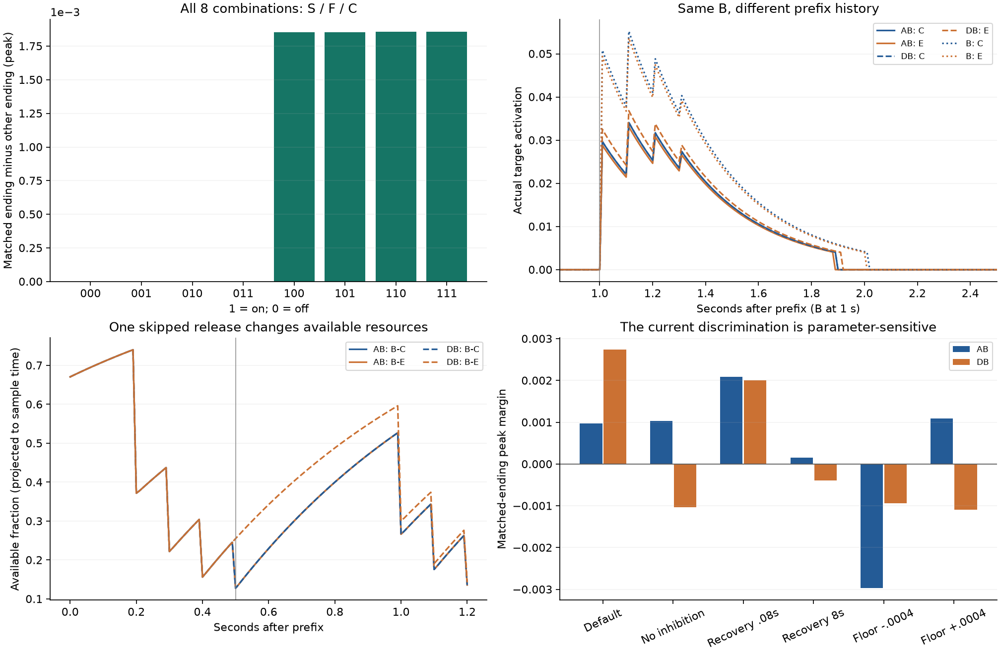

# What causes the continuous kernel's discrimination?

> **Revision r2 · 2026-10-10**
> Revision reason: Verified original-file relocation; append location-resolution guidance and preserve the experiment conclusions.
> Original: [report.en.md](report.en.md); parent r1: [report.en.md](report.en.md)

[中文](report.zh.md)

2026-09-29. New project: **2026-09-29 连续版机制归因**. Previous evidence is preserved. No Core implementation, default mapping, default configuration, or temporal edge-birth behavior was changed.

## Answer

**The earlier combination effect is primarily short-term synaptic resources interacting with existing inhibition, per-edge thresholds and learned weights. It is not an equal contribution from all three new mechanisms.**

The useful finding is concrete: **a prefix can leave both ending nodes inactive while changing available resources on their incoming edges. The same later B then produces a different preferred ending.** Transient history can be stored in connection state rather than persistent activation alone.

The limitation is equally concrete: changing the threshold by ±10% breaks or reverses the correspondence. This is a traceable dynamical effect, not yet robust sequence reasoning.

S = short-term resources; F = fast trace; C = receiver-local context allocation. These are measured anonymous-channel activations, not AI-generated answers.

## Design and verification

Reuse the previous overlap curriculum: `[A], [A,B], [B,C]` and `[D], [D,B], [B,E]`, 20 consecutive repetitions per sequence, then 10 and 5. Total 210 frames, dose 1.0, one simulated second spacing. Tests A→B and D→B have dose 0.5 and one-second spacing. Every test is an independent copy.

The design includes all eight S/F/C configurations, swapped C/E associations, reversed curriculum order, prefix-only/B-only/no-input controls, test-time switches from all-on trained parents, causal/9 reference and matched recorded host telemetry. A prospective second-stage amendment adds six fixed parameter settings. **324 formal, 5 validation and 12 diagnostic instances were completed: 341 total.** See [initial design](design.en.md) and [diagnostic amendment](diagnostic-plan.md).

Previous training state and temporal-reader peaks were reproduced exactly. Full public event observation and 10-ms all-node sampling produced identical final Core state and temporal readout to the previous 100-ms external sampling. Observation thresholds were not changed.

## Factorial result

Eight sequence tests per row: association swap × curriculum order × prefix. The margin is the matched ending's post-B peak minus the other ending's peak, a mechanism diagnostic distinct from the retained converged endpoint.

|S|F|C|Positive matched margins|Mean margin|
|---|---|---|---:|---:|
|1|1|1|8/8|0.001856751|
|1|1|0|8/8|0.001856751|
|1|0|1|8/8|0.001855021|
|1|0|0|8/8|0.001855021|
|0|1|1|4/8|approximately 0|
|0|1|0|4/8|approximately 0|
|0|0|1|4/8|approximately 0|
|0|0|0|4/8|approximately 0|

The 4/8 cases favor one ending regardless of prefix; they are not a statistical estimate of chance accuracy. This deterministic small-network matrix is not eight independent random replications.

**Resources are the critical new mechanism.** Disabling them only at test also changes 8/8 into 4/8: their contribution is not solely structural learning. Keeping only resources among the three additions preserves discrimination. Background confirmation yields 2/2 with resources and 1/2 without.

**Fast trace has a small contribution:** removing it reduces the mean margin by approximately 0.093%, changing no winning ending. **Local context has no measured contribution here:** when resources are enabled, switching context off preserves exact trained node/edge state and test trajectories. Each reception in the two default probes has one qualifying source, so its allocation coefficient is 1. This task does not demonstrate a benefit from Transformer-inspired attention, nor does it disprove benefits in actual multi-source competition.

With all three additions disabled, trained node/edge state exactly matches causal/9.

## The local causal chain

For the original, forward curriculum, B→C has slightly greater learned weight than B→E. A valid background B-only control therefore already favors C: peaks 0.055237 vs 0.053651.

A or D first weakly activates B through learned edges. C and E remain at zero, but their edges may already consume resources. At **0.5 seconds after the prefix**, the existing pre-release emission calculation gives:

|Prefix|B→C candidate|B→E candidate|Threshold = 0.004|
|---|---:|---:|---|
|A|0.004399659|0.004271768|Both edges release resources|
|D|0.004082169|0.003963507|C edge releases; E edge skips release|

The subsequent post-release threshold rejects these weak transmissions. Neither ending activates, but spent resources are not refunded. At second 1, direct B arrives. After D, the B→E release fraction is about **0.300618**, versus **0.266365** for B→C: 12.86% more, enough to overcome E's slightly lower learned weight.

At second 1.11, A→B has C/E peaks **0.034083/0.033105**; D→B has **0.034086/0.036822**. The same parent and same B respond differently because of prefix history. An independent evaluation of the existing equations matches the recorded release decisions (`mechanistic.json`). No new transmission rule was invented.

This refines the earlier interpretation: **A mostly preserves the existing C preference; D shifts it to E through resource history.** It is not symmetric acquisition of two semantic rules. Swapping associations and curriculum order preserves trained correspondence, but the present implementation realizes it through local amplitudes, gates and resource dynamics.

## Sensitivity and existing inhibition

Only test-copy parameters were changed; the trained parent was preserved.

|Test setting|A→B matched margin|D→B matched margin|
|---|---:|---:|
|Default|+0.000978|+0.002736|
|Inhibition off|+0.001036|−0.001036|
|Recovery 0.08 s (default 0.8 s)|+0.002091|+0.002002|
|Recovery 8 s|+0.000157|−0.000396|
|Floor 0.0036|−0.002972|−0.000943|
|Floor 0.0044|+0.001087|−0.001087|

The supported chain is **learned weight differences → inhibition-adjusted weak signals → threshold decisions → different resource-use histories → different later transmission**. Removing inhibition eliminates two-way discrimination in this example. The floor controls both zeroing and emission thresholds, so the sensitivity test is not a selective emission-only ablation. Faster recovery was tested on one curriculum parent and does not justify changing defaults.

## Endpoints and unavailable controls

There were **0/64 qualifying converged outputs** in the factorial sequence tests. Targets differ during activity and subsequently return to zero. A high-resolution transient peak is not a stable endpoint.

Without background input, B-only copies died before their scheduled B arrived. These trials cannot establish that B alone fails to evoke a response. The valid comparison uses matched host-telemetry copies, whose task-node A→B/D→B trajectories equal the no-background trajectories. `analysis-v2.json` corrects control availability; original `analysis.json` and all observations are retained.

## Implications and boundary

Keep investigating resources together with inhibition and learned connections: the previous stimulus demonstrably changes how the next one propagates. Do not increase fast-trace complexity for this effect; context allocation needs a task with real competing inputs. Before interpreting this as robust sequential memory, separately study physical release thresholds, numerical zeroing, resource recovery and response persistence. Current evidence identifies a useful route and a specific fragility rather than merely a favorable score.

This round stops here. Forming new associations between non-overlapping stimuli is a separate problem and was not addressed. No additional scale, training or Core changes were introduced.

`run.py` / `diagnose.py` provide reusable CLI orchestration, `analyze.py` / `mechanistic.py` reproduce the analyses, and `audit.json` verifies all 341 instances and parent hashes. Instance computation totaled approximately **8.35 minutes**. Before publication, new DB storage was approximately **710 MiB**, local evidence **274 MiB**; total published storage remains subject to the 2-GiB cap. Exact final storage, usage and publication identifiers are in [delivery](delivery.en.md). No old-data scan/deletion, paid AI, GPU, Transformer or cloud compute was used.

---

## Discussion addendum: resources, facilitation, consolidation and discovery (2026-09-29)

This section is appended to the report. Original findings, evidence and report revision 1 remain available. No new experimental results are presented here.

### What was actually established

**An earlier experience can remain in a connection's local state and change the response to a later identical input, even when the ending nodes were not activated by that earlier experience.** Factorial comparisons, test-time switches and local trajectories identified how this happens in ThreeMind. Related literature does not erase the value of this project-specific causal result.

The actual contrast was different prefixes A or D followed by the same B. It was not a complete AB/BA permutation test. History-dependent response is supported; more general order discrimination requires another experiment.

Dynamic synapses retaining recent input history and conveying it through subsequent responses are established computational ideas, not merely observations that biology has similar components. Maass and Markram (2002) studied this explicitly; Mongillo et al. (2008) proposed a facilitation-based working-memory model. The general function is therefore not a ThreeMind first. These papers did not perform the present causal analysis of ThreeMind's particular network. [References 3, 5]

### Three different mechanisms

|Mechanism|Plain explanation|Implementation and scope|
|---|---|---|
|Resource depletion and recovery|Transmission uses a local releasable pool; efficacy temporarily decreases and recovers.|Not host RAM, global energy, or a well-used route becoming stronger. Enabled in this study's default continuous candidate.|
|Short-term facilitation|Recent activity temporarily increases release propensity, which subsequently relaxes.|`stp_facilitation_tau_s` was **0: disabled** in this study. It is different from F in the original S/F/C experiment, where F meant the `fast_*` trace.|
|Connection consolidation|Experience produces more persistent changes to weight, stability and related structure.|Can coexist with depletion: a strong connection can be temporarily fatigued. ThreeMind's particular update formulas are not established biological long-term-memory equations.|

Depletion and facilitation are not logical contrapositives. They are distinct local processes with opposing influences; together they may enhance differences or compensate for one another. Such compensation has been demonstrated in particular biological synapses. [Reference 6]

### Is the effect driven by a bug?

Releasable pools, replenishment and facilitation have experimental foundations. [References 1, 2, 4] Those foundations do not validate every ThreeMind parameter or integration decision. The current implementation releases resources between two per-edge threshold checks. A release can consume resources without producing a transmission that clears the second threshold; this ordering participates in the observed effect.

**No implementation bug was established by this round, but the biological precedent does not establish that this integration is appropriate.** Nearby threshold settings can change or reverse the result. The next study must retain and disclose that sensitivity, without silently changing thresholds, inhibition or forgetting to obtain a desirable outcome.

### The next hypothesis

It is reasonable to test whether depletion and facilitation mainly support transient effects while consolidation lets some effects last longer. This remains a hypothesis. Consolidation can affect immediate responses; short-term states can influence subsequent learning and thus longer-term outcomes. All three enabled need not be best. All three disabled need not remove all history dependence: inhibition, fast traces and initial connection formation remain.

The next design crosses D (depletion), F (facilitation) and L (positive consolidation of existing edges), preserving other mechanisms. See the [study design](../2026-09-29-memory-timescales/design.en.md). Existing master switches cannot isolate these three factors; independent controls and equivalence checks are prerequisites for formal execution.

### References and what they support

1. Stevens, C. F. & Tsujimoto, T. (1995). *Estimates for the pool size of releasable quanta at a single central synapse and for the time required to refill the pool*. PNAS, 92, 846–849. [Abstract](https://pubmed.ncbi.nlm.nih.gov/7846064/), [DOI](https://doi.org/10.1073/pnas.92.3.846). Experimental releasable pools and replenishment, not a direct calibration of ThreeMind's recovery constant.
2. Tsodyks, M. V. & Markram, H. (1997). *The neural code between neocortical pyramidal neurons depends on neurotransmitter release probability*. PNAS, 94, 719–723. [Original paper](https://www.cns.nyu.edu/csh/csh04/Articles/Tsodyks-Markram-97.pdf), [DOI](https://doi.org/10.1073/pnas.94.2.719). Experimental and theoretical evidence that depression changes temporal information transmission.
3. Maass, W. & Markram, H. (2002). *Synapses as dynamic memory buffers*. Neural Networks, 15, 155–161. [Abstract](https://pubmed.ncbi.nlm.nih.gov/12022505/), [DOI](https://doi.org/10.1016/S0893-6080(01)00144-7). Theory and simulations of recent-input history stored in dynamic synaptic states and conveyed by later response amplitudes.
4. Jackman, S. L., Turecek, J., Belinsky, J. E. & Regehr, W. G. (2016). *The calcium sensor synaptotagmin 7 is required for synaptic facilitation*. Nature, 529, 88–91. [Full text](https://pmc.ncbi.nlm.nih.gov/articles/PMC4729191/), [DOI](https://doi.org/10.1038/nature16507). Knockout and rescue experiments identifying a molecular requirement for facilitation.
5. Mongillo, G., Barak, O. & Tsodyks, M. (2008). *Synaptic theory of working memory*. Science, 319, 1543–1546. [Author-hosted paper](https://barak.net.technion.ac.il/files/2012/11/synapticmemory.pdf), [DOI](https://doi.org/10.1126/science.1150769). A theoretical account of working memory through calcium-mediated facilitation, not proof that ThreeMind has working memory.
6. Turecek, J., Jackman, S. L. & Regehr, W. G. (2017). *Synaptotagmin 7 confers frequency invariance onto specialized depressing synapses*. Nature, 551, 503–506. [Full text](https://pmc.ncbi.nlm.nih.gov/articles/PMC5892411/), [DOI](https://doi.org/10.1038/nature24474). Experimental compensation between facilitation and depletion.
7. Bliss, T. V. P. & Lømo, T. (1973). *Long-lasting potentiation of synaptic transmission in the dentate area of the anaesthetized rabbit following stimulation of the perforant path*. Journal of Physiology, 232, 331–356. [Original paper](https://pmc.ncbi.nlm.nih.gov/articles/PMC1350458/), [DOI](https://doi.org/10.1113/jphysiol.1973.sp010273). Persistent synaptic potentiation; this does not equate model weights or stability variables with biological long-term memory.

> **Storage-location revision · 2026-10-10**
> This edition adds the verified move of the selected originals to `E:\ThreeMindData`. Stable scientific identities and hashes, experiment dates, measurements and conclusions remain unchanged. Paths in the preserved body describe historical sources; use the registered evidence resolver for current locations. Repository documents and frozen fixtures remain in place, and source copies are retained. Structured query data and running checkpoints remain in the database. This annotation does not assert that missing historical evidence was recovered.
