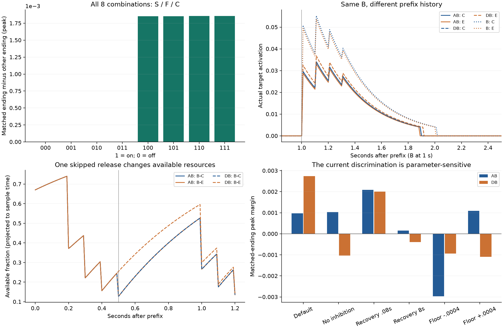

# 连续版的区别来自哪里：机制归因实验

> **修订 r2 · 2026-10-10**
> 修订原因：原件存储位置已迁移并核验，追加当前位置解析说明，保留原实验结论。
> 原版：[report.zh.md](report.zh.md)；父版本 r1：[report.zh.md](report.zh.md)

[English](report.en.md)

2026-09-29。项目：**2026-09-29 连续版机制归因**。原实验与本轮全部证据独立保留。本轮没有修改任何内核实现或主线默认参数，也没有开展跨时间生边改进。

## 已经查明的答案

**上一轮所谓的“机制组合效果”，主要来自短时突触资源与原有抑制、逐边门槛、训练形成的权重共同作用。不是三个新增机制都在发挥重要作用。**

最有价值的观察是：**前一个刺激尚未点亮结尾节点，却已经改变了某些连接的可用资源；后面的同一个 B 到来时，因此产生不同的结尾偏向。** 这说明临时记忆可以保存在连接的状态中，不只保存在持续激活或长期权重中。

同时查明了它的局限：这个例子对门槛敏感，门槛上下调整 10% 就会失效或反转。它是可以逐步解释的真实动力学现象，但还不是稳健的顺序推理能力。

图左上为八种机制组合；右上为两个结尾的真实激活；左下显示 D 前缀使一条边少释放一次资源；右下展示固定六组参数对照。S 为短时资源，F 为快痕迹，C 为局部上下文。数值是匿名通道的实际激活，没有用 AI 生成答案。

## 实验怎样排除了其他解释

沿用上一轮匿名符号和材料：教学 `A、A+B、B+C` 与 `D、D+B、B+E`，先分别连续重复 20 次，再各 10 次、各 5 次，共 210 帧；每帧强度 1.0、间隔一模拟秒。测试为 A→B 或 D→B，强度 0.5，间隔一秒。所有测试从父本独立复制。

- 三机制完整八种开关组合；同时交换 C/E 的教学对应，并倒置两组教学的先后。
- 增加只给前缀、只给 B、无提示对照；从全开训练父本复制，在测试时单独切换机制，分清学习和响应阶段。
- 使用真实宿主遥测的同一段录制重放复核。增加六组小型参数诊断，方案在执行前另行登记。
- 完成 324 个正式实例、5 个测量校验实例、12 个补充诊断实例，共 **341 个**。完整设计见[初始方案](design.md)与[补充方案](diagnostic-plan.md)。

上一轮的训练状态、时序读出峰值均精确复现。10 毫秒全节点采样和完整事件观察，与原来 100 毫秒外部采样得到相同的内核最终状态和时序读出。全节点采样不改变读出候选门槛。

## 哪个机制起作用

下表每格有 8 条提示：两种教学对应 × 两种教学顺序 × 两个前缀。“领先”比较匹配结尾与另一个结尾在 B 到达后的峰值。它是本轮机制诊断量，不能冒充收敛末态。

|短时资源 S|快痕迹 F|局部上下文 C|匹配结尾领先|平均峰值差|
|---|---|---|---:|---:|
|开|开|开|8/8|0.001856751|
|开|开|关|8/8|0.001856751|
|开|关|开|8/8|0.001855021|
|开|关|关|8/8|0.001855021|
|关|开|开|4/8|约 0|
|关|开|关|4/8|约 0|
|关|关|开|4/8|约 0|
|关|关|关|4/8|约 0|

4/8 的含义是偏向同一个结尾，碰巧匹配其中一个前缀；不是在陌生样本上估计出了“50% 准确率”。这些是确定性的小网络对照，不能将对称条件当独立统计样本。

**短时资源是关键新增机制。** 在另两项关闭时仍为 8/8；反过来，保留另两项、关闭它，则不能区分两个前缀。只在测试时关闭它也会从 8/8 变成 4/8，说明作用不只是训练时改变了结构，响应时的资源状态本身也参与了结果。

**快痕迹只是轻微调节。** 去掉它，平均差值仅减少约 0.093%，没有改变任何一条提示的领先结尾。它在这项任务中不是主要原因；这不等于它在其他节奏或任务中必然无用。

**局部上下文没有为本现象作出可测贡献。** 短时资源开启时，无论快痕迹是否开启，关闭上下文后的训练节点与连接状态完全相同，测试轨迹也相同。默认两条提示的实际接收事件都只有一个合格来源，分配系数就是 1，没有发生多路竞争。因此不能把这次结果归功于借鉴 Transformer 的局部注意力。

三机制全关时，训练结构与保留的 causal/9 基线完全一致。真实背景复核中，每种开启短时资源的组合都是 2/2，其余都是 1/2，结论保持不变。

## 具体哪一步造成了区别

以原教学正序、全开参数为例：

1. 训练后 B→C 的长期权重比 B→E 略大。只给 B，在有背景的有效对照中，C 的峰值为 0.055237，E 为 0.053651，原本就略偏 C。
2. 先给 A 或 D，会通过已经存在的边弱激活 B。此时 C/E 的激活仍都为零，但部分连接已经进行了资源释放。
3. 在前缀后的 **0.5 秒**，出现关键分岔。现有发送公式算出的“释放资源之前的候选发送量”如下：

|前缀|B→C 候选量|B→E 候选量|门槛 0.004 下发生什么|
|---|---:|---:|---|
|A|0.004399659|0.004271768|两条边都释放资源|
|D|0.004082169|0.003963507|B→C 释放，B→E 未达到门槛，跳过此次释放|

4. 释放后还有一次门槛检查。在这个时刻，释放后的量太小，没有实际到达 C/E；但已经释放的资源不会退回。所以，“结尾没有被激活”不等于“通路没有留下短时变化”。
5. 第 1 秒 B 直接到来。在 D→B 条件下，B→E 因为少消耗过一次资源，此次释放比例为约 **0.300618**，B→C 为 **0.266365**；E 通路能释放约多 12.86% 的比例，足以反过来超过原来略强的 C 通路。
6. 到第 1.11 秒，A→B 的 C/E 峰值分别为 **0.034083/0.033105**；D→B 则为 **0.034086/0.036822**。同一父本、同一个 B，只因前缀不同，领先结尾就不同。

这里对 0.5 秒的量做了现有公式的独立复算，并核对了记录中实际发生的逐边释放，见 `mechanistic.json`。没有加入新的发送规则或目标偏好。

**解释应比上一轮更精确：A 在这个例子里主要保留了原本偏 C 的结果；D 改变了临时资源分配，使结果转向 E。** 两条提示不是对称地各增加一种“语义理解”。交换教学和倒置教学顺序后，对应仍随训练改变，但目前的实现是通过局部幅度、门槛和资源历史产生区别。

## 原有抑制与门槛不是无关背景

在同一个训练父本的测试副本上，仅调整下列配置。正差表示匹配教学，负差表示另一个结尾领先。

|测试时配置|A→B 匹配差值|D→B 匹配差值|现象|
|---|---:|---:|---|
|默认|+0.000978|+0.002736|两条均对应|
|关闭抑制|+0.001036|−0.001036|两条都偏 C，区分消失|
|资源恢复 0.08 秒，原为 0.8 秒|+0.002091|+0.002002|两条仍对应，幅度更均衡|
|资源恢复 8 秒|+0.000157|−0.000396|只剩一条对应|
|门槛 0.0036|−0.002972|−0.000943|两条都与教学对应相反|
|门槛 0.0044|+0.001087|−0.001087|只剩一条对应|

这确认了：**当前结果依赖“学习后的权重差 → 抑制调节后的弱信号 → 是否越过逐边门槛 → 不同的资源消耗历史 → 后续信号强度”的作用链。** 门槛附近的差异会被资源状态保存，而不是简单在当时丢失。

门槛参数同时控制激活归零与发送预检，所以 ±10% 是整体敏感性检查，不是只改变一处门槛的纯消融。快速恢复只检查了一种教学父本，不能据此修改全局默认或宣布它全面更好。本轮没有做任何这样的修改。

## 最终输出与一个必须说明的对照问题

64 条全组合序列提示中，合格的时序收敛输出为 **0/64**。目标在过程中有区别，随后归零；原来的主要判定依据仍没有通过。高频采样看到了更接近真实到达时刻的峰值，不能把它替换为稳定末态。

无背景的“只给 B”副本，在 B 预定到达之前就满足静息死亡条件，因此该项属于**B 未能递送的对照**，不能拿零激活声称“B 单独不能引发响应”。有效的 B-only 比较来自有真实遥测背景的同龄副本；它的 A→B、D→B 任务节点轨迹与无背景条件一致。分析文件 `analysis-v2.json` 修正了这处对照可用性的标注，原 `analysis.json` 留存；没有重写任何实验观测。

## 对下一步的具体判断

- **值得保留并继续研究：短时资源、抑制和训练形成的连接。** 已经找到上一条输入如何在局部状态中留下影响，再改变下一条输入的明确例子。这比笼统说“出现了机制组合效果”前进了一步。
- **暂不为这项现象增加快痕迹复杂度。** 它的作用很小；应先解决已确认的资源与门槛敏感性。局部上下文应留待确实存在多路合格输入竞争的任务验证。
- **暂不能宣称已经获得稳健顺序记忆或关系组合。** 这里的好结果依赖当前门槛和状态轨迹。后续若要改善，应分别检查物理释放门槛与数值归零门槛、资源恢复尺度及响应保持，不直接调参追求漂亮答案。
- **本轮到此停止。** “先后到达、没有同时出现的刺激怎样形成新关联”仍是单独议题，本轮未触碰。没有继续堆训练规模，也没有修改内核。

## 证据和资源

三机制组合、测试时切换、背景对照、完整逐节点轨迹和局部状态均可追溯。`run.py`、`diagnose.py` 是可复用命令行编排；`analyze.py` 和 `mechanistic.py` 从原始证据计算结果。`audit.json` 核对全部 341 个实例及父本哈希。

全部实例的计算耗时合计约 **8.35 分钟**。发布前数据库增长约 **710 MiB**、本地证据约 **274 MiB**；连同发布后的证据包和数据库副本仍受 2 GiB 总新增上限约束。精确最终体积、账户用量和发布 ID 另见[交付记录](delivery.zh.md)。

没有扫描、清理或重写旧实验；没有调用付费 AI、GPU、Transformer 或外部云算力。所有参数干预都只在登记的独立副本中发生。

---

## 讨论补记：短时资源、易化、巩固与发现的意义（2026-09-29）

本节在原报告之后追加；前文结果、原始数据和第 1 版报告保留。本节没有新增实验结果。

### 这里实际发现了什么

**在 ThreeMind 中，前一次经历可以留在连接的局部状态里；即使结尾节点当时没有激活，这个状态仍会改变下一次相同输入的传播。** 本轮通过组合对照、测试时切换和局部轨迹，查明了这一现象的具体来源。这是项目内有价值的机制确认，不应因为存在相关文献而被抹掉。

需要把发现的范围说准：这里比较的是“不同前缀 A、D 之后，同一个 B 的响应”，没有完成相同元素的 AB／BA 全排列验证。因此，“不同经历影响后续响应”已经有证据；更广义的“识别先后顺序”仍需另外实验。

动态突触保存近期输入历史、并改变后续响应的计算作用，已有明确的理论与模拟研究，不只是“生物里也有类似现象”。Maass 与 Markram（2002）直接研究了这种信息保存与读出；Mongillo 等（2008）提出了利用突触易化维持工作记忆的模型。因此不能把一般机制宣称为 ThreeMind 首次发现。已有文献也没有替 ThreeMind 完成当前网络中的作用链验证。[文献 3、5]

### 三个容易混淆的机制

|机制|通俗含义|本次实现与讨论边界|
|---|---|---|
|资源耗竭与恢复|连接传输会消耗局部可释放资源，暂时变弱，随后恢复。|不是主机内存、全局能量或“越走越顺”。本轮默认连续候选启用了它。|
|短时易化|近期活动会暂时提高再次释放的倾向，随后回落。|现有参数为 `stp_facilitation_tau_s`；本轮为 **0，未启用**。它不等于前文 S/F/C 中的 F；前文 F 指 `fast_*` 快痕迹。|
|连接巩固|经历使连接的权重、稳定度等发生较持久改变。|可与短时耗竭并存：一条长期较强的连接，刚使用后仍可能暂时疲劳。ThreeMind 的具体巩固公式不等同于已验证的生物长期记忆机制。|

耗竭与易化不是逻辑上的“逆否命题”。它们是方向不同、可以同时存在的局部过程；组合后可能放大差异，也可能互相抵消。真实突触中存在易化补偿耗竭的实验例子。[文献 6]

### 是否在靠 BUG 工作

可释放资源耗竭、补充，以及易化都有实验依据。[文献 1、2、4] 但生物依据支持的是机制方向，不是给 ThreeMind 每个参数、阈值和接入方式背书。当前连续候选把资源释放接在两次逐边门槛检查之间；一次释放可能消耗资源，却没能产生达到后一门槛的传输。这个次序确实参与了本轮现象。

**本轮没有确认它是实现 BUG，也不能因为存在生物模型就认定这套接法已经合理。** 默认值附近的门槛变化会改变甚至反转结果，这是下一轮需要保留并说明的敏感性。不能为得到漂亮结果，悄悄改变门槛、抑制或遗忘。

### 下一轮研究问题

检验“耗竭和易化主要影响短时记忆，巩固让部分影响保留更久”是合理方向，但这还是待检验的假说。巩固也可能影响短时响应；短时状态也可能改变后续学习，从而影响较长时段。三者全开未必最好，三者全关也未必失去一切历史影响，因为抑制、快痕迹、初始生边等仍存在。

下一轮采用 D（耗竭）、F（易化）、L（既有连接正向巩固）的八组组合；保持其他机制。详见[实验方案](../2026-09-29-memory-timescales/design.zh.md)。现有总开关不能完成干净的三因素隔离，方案将独立控制与等价性验证列为正式实验的前置条件。

### 文献及各自支持的内容

1. Stevens, C. F. & Tsujimoto, T. (1995). *Estimates for the pool size of releasable quanta at a single central synapse and for the time required to refill the pool*. PNAS, 92, 846–849. [论文／摘要](https://pubmed.ncbi.nlm.nih.gov/7846064/)，[DOI](https://doi.org/10.1073/pnas.92.3.846)。可释放资源池和补充的实验依据；不是 ThreeMind 恢复常数的直接标定。
2. Tsodyks, M. V. & Markram, H. (1997). *The neural code between neocortical pyramidal neurons depends on neurotransmitter release probability*. PNAS, 94, 719–723. [原论文](https://www.cns.nyu.edu/csh/csh04/Articles/Tsodyks-Markram-97.pdf)，[DOI](https://doi.org/10.1073/pnas.94.2.719)。实验与模型共同说明突触抑郁会改变时间信息的传递。
3. Maass, W. & Markram, H. (2002). *Synapses as dynamic memory buffers*. Neural Networks, 15, 155–161. [论文／摘要](https://pubmed.ncbi.nlm.nih.gov/12022505/)，[DOI](https://doi.org/10.1016/S0893-6080(01)00144-7)。动态突触状态保存近期输入历史，并通过后续响应幅度传出信息的理论与模拟研究。
4. Jackman, S. L., Turecek, J., Belinsky, J. E. & Regehr, W. G. (2016). *The calcium sensor synaptotagmin 7 is required for synaptic facilitation*. Nature, 529, 88–91. [全文](https://pmc.ncbi.nlm.nih.gov/articles/PMC4729191/)，[DOI](https://doi.org/10.1038/nature16507)。通过敲除与恢复实验识别易化所需的分子机制。
5. Mongillo, G., Barak, O. & Tsodyks, M. (2008). *Synaptic theory of working memory*. Science, 319, 1543–1546. [作者所在机构保存的原论文](https://barak.net.technion.ac.il/files/2012/11/synapticmemory.pdf)，[DOI](https://doi.org/10.1126/science.1150769)。用钙介导易化解释工作记忆的理论模型；不是 ThreeMind 已获得工作记忆的证明。
6. Turecek, J., Jackman, S. L. & Regehr, W. G. (2017). *Synaptotagmin 7 confers frequency invariance onto specialized depressing synapses*. Nature, 551, 503–506. [全文](https://pmc.ncbi.nlm.nih.gov/articles/PMC5892411/)，[DOI](https://doi.org/10.1038/nature24474)。易化和耗竭可共同作用并相互补偿的实验依据。
7. Bliss, T. V. P. & Lømo, T. (1973). *Long-lasting potentiation of synaptic transmission in the dentate area of the anaesthetized rabbit following stimulation of the perforant path*. Journal of Physiology, 232, 331–356. [原论文](https://pmc.ncbi.nlm.nih.gov/articles/PMC1350458/)，[DOI](https://doi.org/10.1113/jphysiol.1973.sp010273)。持续突触增强的经典实验；不据此把模型的权重、稳定度变量与真实长期记忆一一等同。

> **存储位置修订 · 2026-10-10**
> 本版追加已核验的原件迁移说明：本次清单中的原件迁至 `E:\ThreeMindData`，科学身份、哈希、原实验日期、测量与结论不变。保留正文中的路径表示历史来源，当前位置通过已登记的证据引用解析。仓库文档与冻结夹具留在原处，源副本保留；结构化查询数据及运行中的检查点仍存数据库。本说明不表示缺失的历史资料已恢复。
