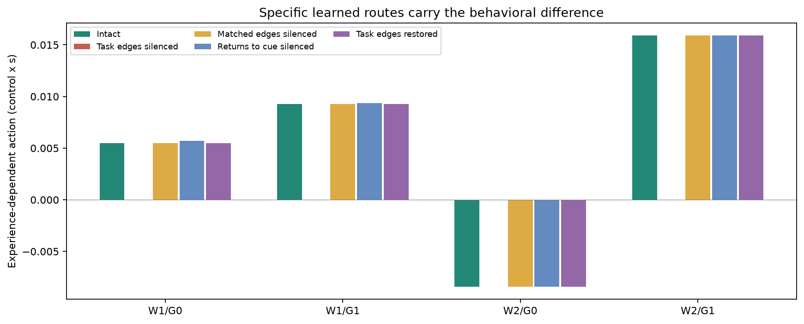
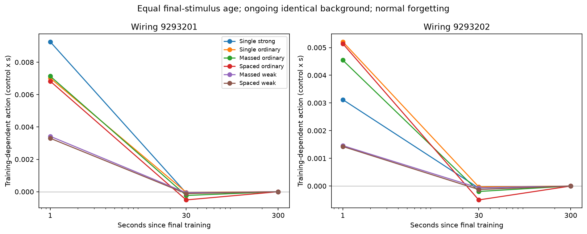
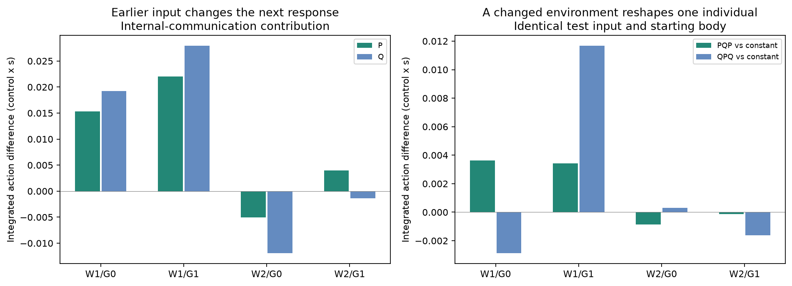
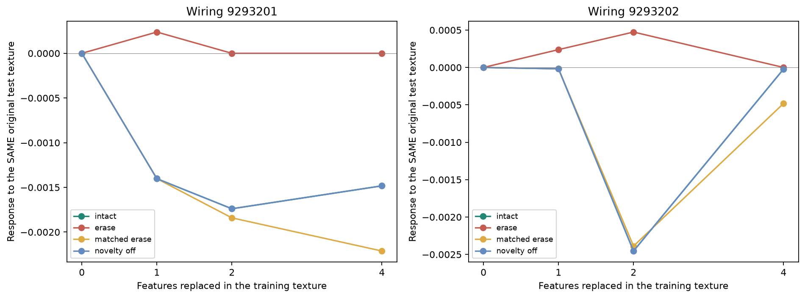

# Experience changes behavior through internal pathways: 802-instance report

[中文](report.zh.md) · [Preregistered design](design.en.md) · [Retention extension](retention-extension.en.md) · [Reproduction](README.md)

2026-09-29. Unmodified `threemind.continuous-memory/1`; four parents from two wiring families; 722 base instances plus 80 registered retention follow-ups.

## Explicit conclusion

**Pass: ThreeMind meets this project's preregistered operational criterion for highly suspected autonomous conscious activity.** All four parents pass all four criteria: retrievable experience differences, causal internal influence, organization of sequential interaction, and within-individual environmental reshaping.

This is a project-defined testable standard, not proof of subjective experience or a validated scientific consciousness detector. That stated boundary does not suspend the operational conclusion. Related parents are not four independent populations. The model exhibits simple adaptive response organization; these findings do not establish human intelligence or AGI.

## Main findings in ordinary language

1. We localized the effect: silencing a few cue-to-learned-partner connections removes 99.4–100% of the history-dependent action difference. Equal-count, similar-strength other edges leave it essentially intact. Restoring the task edges restores all 16 tested trajectories exactly.
2. Silencing returns to the cue node preserves the effect. Learned response pathways can therefore express a history without repeatedly returning through that cue. This supports investigating habit-like or conditioned responses, not a claim to reproduce all biological conditioning. Other cycles remain available.
3. A followed half a second later by B is not two independent responses added together. Non-additivity occurs inside the nodes, even after controlling for the motor adapter's nonlinear formula. Blocking communication removes this internal interaction.
4. One individual changes through its environment. Continuous state and body are carried through P/Q environment changes; identical tests still differ afterward, including after a new birth clears transient activity. Returning to the old environment reduces five of eight route contrasts and enlarges three: history is not simply reset.
5. Progressively spaced repetition improves 30-second retention, but currently strengthens old associations more readily than the new pairing. Ordinary spaced repetition produces 2.18/2.55 times the massed behavioral effect at equal dose and final-input age. Weak repetition has smaller retained effects. Disabling positive existing-edge consolidation during training reduces the birth-retained 30-second effect by approximately 90%.

## Fixed criteria and primary results

Units are control × model seconds. The preregistered minimum is .0001 and ten times sham error, replicated in at least three parents covering both wiring seeds. History effects retain sign; sequence/environment scores average absolute effects over the registered counterbalanced comparisons. Full signed components remain in the evidence.

| 父本 / Parent | 经历作用 / History | 连续互动 / Sequence | 环境塑形 / Environment | 四项 / All four |
| --- | --- | --- | --- | --- |
| s9293201/region0 | 0.005501 | 0.017246 | 0.003250 | 通过 / Pass |
| s9293201/region1 | 0.009254 | 0.024968 | 0.007542 | 通过 / Pass |
| s9293202/region0 | -0.008414 | 0.008496 | 0.000581 | 通过 / Pass |
| s9293202/region1 | 0.015894 | 0.002670 | 0.000883 | 通过 / Pass |

Criterion 2 additionally uses selective and matched lesions plus restoration. Standing still, circling or lacking perfect reversal was never a failure criterion.

**Temporal readout: all 384 windows were classified as residual decay; zero stable-convergence windows.** Original windows and end-activation rankings are preserved. Passing the four behavioral/causal criteria does not relabel motor integrals as convergence or establish an indefinitely self-sustaining loop.

## Localizing the behavioral pathway

P learns AB/CD and Q learns AD/CB at equal per-channel dose. The following first-second action contrasts subtract each history's no-cue clone and compare P−Q after public birth clears transient activation, inhibition, fast traces and short-term synaptic state.

| 父本 / Parent | 正常 / Intact | 任务边关 / Task off | 匹配边关 / Matched off | 返回边关 / Returns off | 恢复 / Restored |
| --- | --- | --- | --- | --- | --- |
| s9293201/region0 | 0.00550060 | -0.00002215 | 0.00550060 | 0.00569549 | 0.00550060 |
| s9293201/region1 | 0.00925438 | -0.00005148 | 0.00925438 | 0.00934820 | 0.00925438 |
| s9293202/region0 | -0.00841392 | -0.00001639 | -0.00840660 | -0.00841227 | -0.00841392 |
| s9293202/region1 | 0.01589365 | 0.00000000 | 0.01589365 | 0.01589365 | 0.01589365 |

All 16 sham states and trajectories match exactly; all 16 restoration trajectories also match exactly. Matching controls edge count, weight and stability, not every topological property. Learned transmission is part of memory expression; blocking all communication also blocks forward learned pathways.

## Single strong input, repetition and retention

Spaced times: 0,1,2,4,8,16,32,64,96,128 s. Massed: 119–128 s. Ordinary intensity .4, weak .1, single strong 1. Tests compare the same age since the last input against an age-matched untrained clone. Signs are reported rather than converting every response into a preferred direction.

| 方案 / Schedule | 接线 / Wiring | 1 s | 30 s | 300 s |
| --- | --- | --- | --- | --- |
| 单次强 / Single strong | 9293201 | 0.00926379 | -0.00007859 | 0.00000000 |
| 单次强 / Single strong | 9293202 | 0.00312047 | -0.00007408 | 0.00000000 |
| 单次普通 / Single ordinary | 9293201 | 0.00701765 | -0.00003515 | 0.00000000 |
| 单次普通 / Single ordinary | 9293202 | 0.00521018 | -0.00003105 | 0.00000000 |
| 密集普通 / Massed ordinary | 9293201 | 0.00713761 | -0.00023239 | 0.00000000 |
| 密集普通 / Massed ordinary | 9293202 | 0.00454446 | -0.00019673 | 0.00000000 |
| 间隔普通 / Spaced ordinary | 9293201 | 0.00682854 | -0.00050707 | 0.00000000 |
| 间隔普通 / Spaced ordinary | 9293202 | 0.00514164 | -0.00050191 | 0.00000000 |
| 密集弱 / Massed weak | 9293201 | 0.00342455 | -0.00006514 | 0.00000000 |
| 密集弱 / Massed weak | 9293202 | 0.00146028 | -0.00006756 | 0.00000000 |
| 间隔弱 / Spaced weak | 9293201 | 0.00330207 | -0.00011828 | 0.00000000 |
| 间隔弱 / Spaced weak | 9293202 | 0.00142785 | -0.00012628 | 0.00000000 |
| 间隔、训练期巩固关 / Spaced, consolidation off in training | 9293201 | 0.00700001 | -0.00005116 | -0.00000531 |
| 间隔、训练期巩固关 / Spaced, consolidation off in training | 9293202 | 0.00510476 | -0.00004783 | -0.00001101 |

One strong input changes immediate behavior but does not exceed the registered behavioral threshold at 30 s in this test. At 300 s, ordinary training schedules have zero cue-adjusted action difference. Spaced ordinary and weak repetitions retain more at 30 s than their dose-matched massed controls. This result concerns the tested schedule and state, not an impossibility of persistent single-event learning.

**Behavioral silence does not mean every structural trace is erased.** At 300 s, old A→B weight is .034924 untrained versus .039885 spaced in wiring 1, and .042052 versus .049132 in wiring 2. The structure differs although the .5 cue produces no differential behavior. New AD edges can still exist at 30 s without producing a measured D response; by 300 s those edges have been pruned. Storage and retrieval thresholds must be investigated separately. We did not increase cue intensity afterward to obtain a positive result; testing frozen snapshots with a registered range of cue intensities is a follow-up suggestion.

The observed 30-second effect prompted a separately registered 80-copy causal extension:

| 接线 / Wiring | 训练 / Training | 正常 / Intact | 任务边关 / Task off | 匹配边关 / Matched off | 全通信关 / All off |
| --- | --- | --- | --- | --- | --- |
| 9293201 | spaced_ordinary | -0.00051154 | -0.00006871 | -0.00051121 | 0.00000000 |
| 9293201 | spaced_no_consolidation | -0.00005078 | -0.00000811 | -0.00005076 | 0.00000000 |
| 9293202 | spaced_ordinary | -0.00050148 | -0.00000724 | -0.00050045 | 0.00000000 |
| 9293202 | spaced_no_consolidation | -0.00004683 | 0.00000377 | -0.00004677 | 0.00000000 |

Clearing transient activity preserves the spaced effect. Task-edge silencing removes about 86.6/98.6% of the motor difference; matched silencing changes only .06/.21%; all-communication blocking makes it zero. The effect therefore has a connection-mediated component rather than merely lingering original activation. Disabling positive edge consolidation during training reduces retained expression by about 90%, without disabling birth, eligibility, node history or forgetting.

The enhanced unprompted target at 30 s is old B, not newly paired D. Repeating A can reactivate B and strengthen traversed old pathways. This interpretation fits the recorded states and interventions; no semantic answer was assigned to any node. The next useful question is how new associations stabilize amid older ones.

Normal training groups have zero training-dependent no-cue action difference during probe seconds 5–15 under the same hardware background. Global consolidation-off training instead leaves small background-driven changes, with mean absolute differences .000387/.000665 at age 300 s. Because the switch also affects background pathways, these are not evidence of a new AD habit.

## Sequential interaction and one individual's changing environment

The A/none × B/none factorial measures interaction during .5–1.5 s. All eight parent/history combinations show internal node non-additivity (.00305–.07188 integrated absolute difference), entirely absent with communication blocked. Passing independently measured node responses through the same nonlinear motor adapter does not reproduce the intact interaction.

Ring-world movement changes position and subsequent sensation; true velocity feedback remains. P supplies AB/CD by region, Q supplies AD/CB. PPP/PQP/QQQ/QPQ each have three 30 s stages carrying full body and Core state. Eight matched first-stage pairs are exact. All eight changed-versus-constant second-stage contrasts exceed threshold under identical test input and body start, including birth tests.

Six route contrasts reverse sign between live and newly born tests. This is worth retaining: transient conditions can alter the expression of retained structure. Birth changes several states, clock and background phase simultaneously, so the reversal is not attributed uniquely to inhibition or energy. Returning to the original environment need not reproduce the original response immediately.

## Novelty and repeated erasure: predictions not supported

Eight fixed anonymous texture channels; four rounds replace 0,1,2,4 features. Ten .4 inputs each round; both current and unchanged original textures are probed with no-cue controls. Only edges are deleted; receptors and motor identities remain.

- Repeated erasure does not make behavior progressively noisier here. Fixed-cue action SD falls from .000679/.001057 intact to .000103/.000197 after erasure. Full internal response vectors support the same distinction: final-versus-first difference falls from .005209 to .002083.
- Erased models still change with experience: vector differences are 0,.000653,.001134,.002083 across feature replacement. This supports loss of the old fixed response, not the stronger prediction of greater or necessarily chaotic behavioral variability. Intact changes are not monotonic.
- Local novelty gain has no measured benefit in this schedule. On/off final nodes, edges and measured responses are identical. Source code applies it only at new-edge birth with qualifying nonzero associative reentry; it is not a universal surprise multiplier. Its actual engagement needs separate calibration, not a declaration of universal uselessness.
- Different input channels directly drive different motor projections. A changed action to a changed texture is not by itself understanding or generalization. Some internal texture changes are identical across the two wirings while motor effects differ, reinforcing the need to inspect both.

## What to pursue

Supported directions: local plasticity creates repeatable history effects; learned transmission changes behavior; transient states organize successive inputs; one individual is reshaped by its environment; consolidation carries influence beyond initial activation.

Priority gaps: low stability of new edges versus forgetting and transmission thresholds; rehearsal strengthening old associations at the expense of new expression; frozen-state retrieval calibration; the actual operating range of novelty gain. These warrant parameter/mechanism studies without disabling forgetting for appearances. No Core change or further simulation is made in this round.

Persistent uncued task preferences, permanently stable new pairings and subjective experience were not established; they are not added afterward as vetoes on the four registered criteria.

## Evidence and delivery

Lab project `2026-09-29 经历保持、内部通路与自主活动判据`, ID `92548061-22c0-4bd9-b283-c4e1e7f4360d`. Design, spacing clarification, extension and results are in experiment notes; four records and bilingual reports are in Records & Reports. The previous 180-instance report now has an appended discussion at revision 2, preserving its earlier revision and archive.

All 802 final states match database states; energy consumption, local depletion/recovery, inhibition and forgetting remain enabled; zero unserved demand. All 20704 input frames/envelopes were delivered at their scheduled times; 576 matched probe streams are identical. All 384 temporal windows and end rankings, trajectories, intervention edges, states, versions and code are retained. Aggregate simulation wall time is 18.03 min of 90; 802 of 850 instances. Actual publication storage and shared quota appear in the delivery record.

Background is auditable replay of a real hardware recording at .2 intensity. External energy has no total supply limit while consumption and local recovery continue normally. No online LLM generated responses and no semantic answers were injected. Research CLI and export tools use existing public interfaces.

Spacing inspiration, not model validation: [Murre & Dros 2015](https://journals.plos.org/plosone/article?id=10.1371/journal.pone.0120644), [Zhang et al. 2012](https://www.nature.com/articles/nn.2990). The schedule is not claimed to be optimal or an Ebbinghaus prescription.

## Discussion provenance

The fixed criteria and original Chinese request are preserved in the [previous report with its addendum](../2026-09-29-internal-activity/report.en.md). The researcher's additional request for frequent early repetition followed by progressively longer intervals is retained verbatim:

> 补充：在巩固记忆的时候，重复可以是不均匀的，初期重复频繁点，慢慢重复变稀疏，类似人类学习一项技能那样
