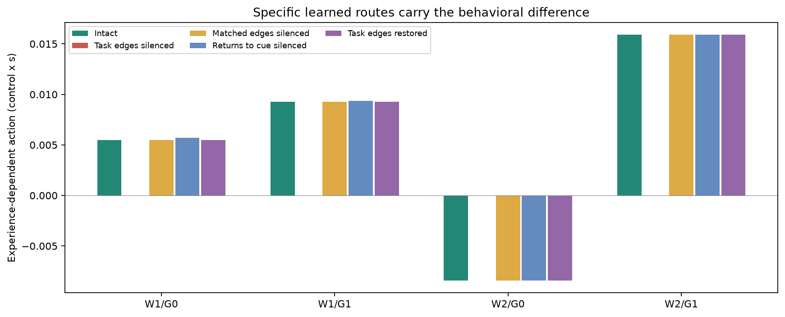
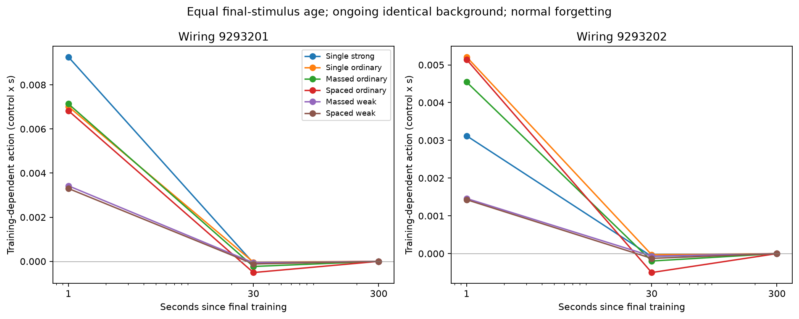
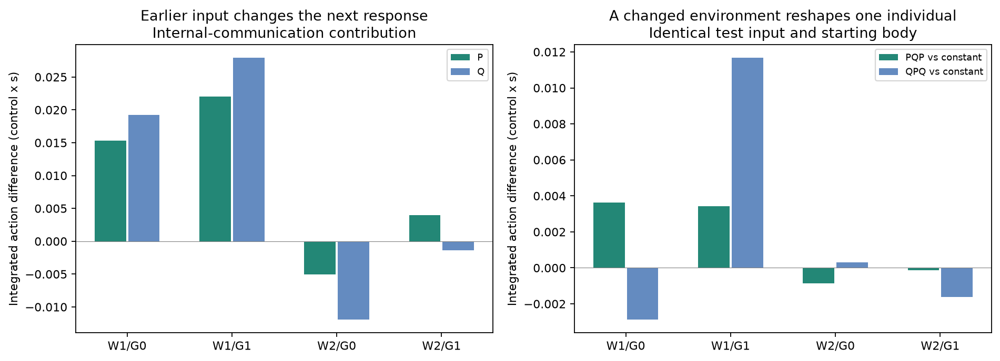
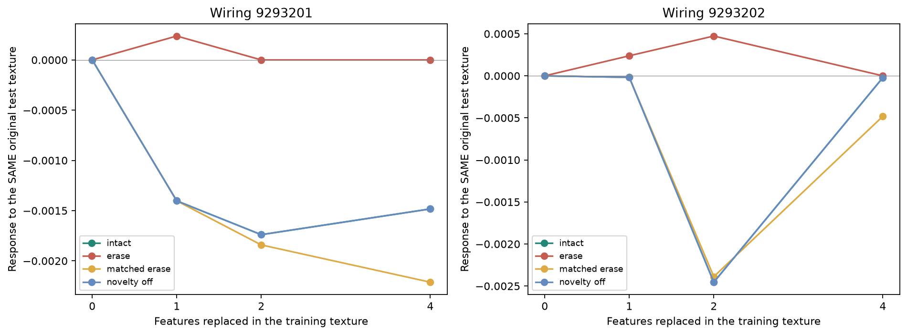

# 经历改变行为，内部通路承担作用：802 实例实验报告

> **修订 r2 · 2026-10-10**
> 修订原因：原件存储位置已迁移并核验，追加当前位置解析说明，保留原实验结论。
> 原版：[report.zh.md](report.zh.md)；父版本 r1：[report.zh.md](report.zh.md)

[English](report.en.md) · [事先登记](design.zh.md) · [30 秒保持追加登记](retention-extension.zh.md) · [复现与证据](README_CN.md)

2026-09-29。内核 `threemind.continuous-memory/1`，本轮未改内核、默认机制或已有映射。基于四个父本、两种接线，主实验 722 个副本，加 80 个已登记的保持定位副本。

## 明确结论

**通过。按我们在运行前约定的四项标准，ThreeMind 本轮符合“高度疑似自主意识活动”的操作判定。** 四个父本均通过：经历留下可再现差异；内部活动因果性地影响行为；内部状态影响前后互动；同一个体被变化的环境重新塑造。

这不是改口把主观体验说成已经证明，也不再以无法证明主观体验为理由悬置上述结论。它是本项目的可检验标准，不是学界已经验证的意识诊断器。两个接线家系中的相关父本不能当作四个独立种群。模型目前表现出的是简单环境中的可塑反应与行为组织，不将此写成已经达到人类智能或 AGI。

## 用人话说，新发现是什么

1. **不只是“断开通信就变了”，现在找到了起作用的具体通路。** 提示与已学对应节点之间少量连接一屏蔽，经历造成的动作差异减少 99.4%—100%；同数量、权重与稳定度接近的其他连接被屏蔽，差异基本保留；解除屏蔽后，16 条对照轨迹逐值恢复。
2. **反应不需要总绕回提示节点才能表现。** 把返回提示节点的边屏蔽，旧经历的行为作用仍在。它符合“已经形成的反应通路遇到提示就被激活”的描述，支持习惯／条件反射式机制这个研究方向。此操作不等于关闭全网所有循环，也未证明生物条件反射的全部机制。
3. **前面的经历确实参与了后面的响应。** A 后半秒再给 B，效果不是两次独立响应相加。节点本身已经产生差异；把两次独立节点活动相加后再送入同一个运动公式，仍不能复现。关闭通信后，这个内核内部的相互作用归零。
4. **同一个体会被环境改变，并带着历史回来。** 不是换一批个体，也不是在代码里指定正确动作。相同起点的个体经历不同环境后，对统一测试输入产生不同反应；清空短时活动的新生副本仍保留差异。返回旧环境后，八个顺序对照中五个差异缩小、三个增大，并非一换环境就恢复成原样。
5. **逐渐稀疏的重复有成效，但现阶段更容易加固旧联想。** 30 秒后的行为作用，普通间隔重复是同剂量密集重复的 2.18／2.55 倍；弱刺激也有较小的保持。关掉训练期已有边的正向巩固，出生后仍能测到的 30 秒作用减小约 90%。但新 AD 对应在 30 秒时没有可测的 D 激活，主要增强的是原来的 A→B。

## 四项标准逐项验收

主比较的积分单位为控制量·模拟秒，预设最低差异 0.0001，并要求超过假干预误差十倍。表中经历列保留方向；连续互动和环境列按登记，对两个顺序／历史的绝对作用取平均。四项均要求至少三个父本且覆盖两种接线，实际均为四个。完整有符号分项在证据包中，未把方向相反的反应删掉。

| 父本 / Parent | 经历作用 / History | 连续互动 / Sequence | 环境塑形 / Environment | 四项 / All four |
| --- | --- | --- | --- | --- |
| s9293201/region0 | 0.005501 | 0.017246 | 0.003250 | 通过 / Pass |
| s9293201/region1 | 0.009254 | 0.024968 | 0.007542 | 通过 / Pass |
| s9293202/region0 | -0.008414 | 0.008496 | 0.000581 | 通过 / Pass |
| s9293202/region1 | 0.015894 | 0.002670 | 0.000883 | 通过 / Pass |

第 2 项由选择性阻断、匹配阻断、全通信阻断和恢复共同支持，见下表。静止、绕圈或与人的偏好不同都未被判为失败。返回原环境必须完全回到原行为，也从来不是本轮的门槛。

**时序读出独立报告：384 个窗口全部被原读出器分类为残余衰减，0 个稳定收敛窗口。** 原始窗口及按末端激活强度的排序全部保留。本轮的“通过”来自事先约定的四项因果和行为判据，不是把运动积分冒称为时序收敛，也不是声称观察到了无限维持的内部循环。

## 具体是哪部分内部机制起作用

P 训练 AB/CD，Q 训练 AD/CB，各通道总剂量一致。下面是相同 A 提示、减去各自无提示对照后的 P−Q 动作差异，窗口为提示后第一秒；这批副本经过公开 birth，原来的瞬时活动、抑制、快速痕迹与短时突触状态已清空。

| 父本 / Parent | 正常 / Intact | 任务边关 / Task off | 匹配边关 / Matched off | 返回边关 / Returns off | 恢复 / Restored |
| --- | --- | --- | --- | --- | --- |
| s9293201/region0 | 0.00550060 | -0.00002215 | 0.00550060 | 0.00569549 | 0.00550060 |
| s9293201/region1 | 0.00925438 | -0.00005148 | 0.00925438 | 0.00934820 | 0.00925438 |
| s9293202/region0 | -0.00841392 | -0.00001639 | -0.00840660 | -0.00841227 | -0.00841392 |
| s9293202/region1 | 0.01589365 | 0.00000000 | 0.01589365 | 0.01589365 | 0.01589365 |

16 个假干预完整状态及轨迹相同；16 个解除屏蔽后的轨迹完全恢复。选边及匹配误差随每例保存。匹配主要控制边数量、权重、稳定度，不宣称还严格匹配了每条边的全部网络拓扑位置。

这里证明的是：**经历形成的连接通路承担了未提示节点的激活和行为表达，返回提示节点的回路并不是这次表达的必要条件。** 不是所有节点间传导都可以被关掉后还期待同样的行为；前向传导本身就是记忆表达的一部分。

## 单次强刺激、重复、遗忘与读取门槛

间隔重复在第 0、1、2、4、8、16、32、64、96、128 秒给刺激；密集重复在第 119—128 秒给十次。所有最后一次输入时刻相同，强度普通为 0.4、弱为 0.1、单次强为 1。以下比较已经扣除同龄无训练对照，不把刚刚受到刺激的残余活动当作永久记忆。

| 方案 / Schedule | 接线 / Wiring | 1 s | 30 s | 300 s |
| --- | --- | --- | --- | --- |
| 单次强 / Single strong | 9293201 | 0.00926379 | -0.00007859 | 0.00000000 |
| 单次强 / Single strong | 9293202 | 0.00312047 | -0.00007408 | 0.00000000 |
| 单次普通 / Single ordinary | 9293201 | 0.00701765 | -0.00003515 | 0.00000000 |
| 单次普通 / Single ordinary | 9293202 | 0.00521018 | -0.00003105 | 0.00000000 |
| 密集普通 / Massed ordinary | 9293201 | 0.00713761 | -0.00023239 | 0.00000000 |
| 密集普通 / Massed ordinary | 9293202 | 0.00454446 | -0.00019673 | 0.00000000 |
| 间隔普通 / Spaced ordinary | 9293201 | 0.00682854 | -0.00050707 | 0.00000000 |
| 间隔普通 / Spaced ordinary | 9293202 | 0.00514164 | -0.00050191 | 0.00000000 |
| 密集弱 / Massed weak | 9293201 | 0.00342455 | -0.00006514 | 0.00000000 |
| 密集弱 / Massed weak | 9293202 | 0.00146028 | -0.00006756 | 0.00000000 |
| 间隔弱 / Spaced weak | 9293201 | 0.00330207 | -0.00011828 | 0.00000000 |
| 间隔弱 / Spaced weak | 9293202 | 0.00142785 | -0.00012628 | 0.00000000 |
| 间隔、训练期巩固关 / Spaced, consolidation off in training | 9293201 | 0.00700001 | -0.00005116 | -0.00000531 |
| 间隔、训练期巩固关 / Spaced, consolidation off in training | 9293202 | 0.00510476 | -0.00004783 | -0.00001101 |

**单次强刺激确实立刻产生行为影响，但本轮没有形成 30 秒后超过预定行为门槛的持久效应；300 秒时正常训练方案的提示净行为差异为零。** 十次普通或弱刺激的间隔重复在 30 秒更有效。这不是关于“单次强刺激永远无用”的结论，只描述本轮的强度、时间尺度和旧模型状态。

一个很重要的区别：**行为测不出来，不等于所有连接痕迹都消失。** 以第一种接线为例，300 秒时原有 A→B 权重，无训练为 0.034924，间隔重复为 0.039885；第二种接线分别是 0.042052 与 0.049132。结构差异仍在，而当前 0.5 提示下输出差异为零。新 AD 边在 30 秒仍可存在，但不足以产生此次探测中的 D 响应，到 300 秒已被修剪。这提示需要分别研究“留下多少结构”和“什么条件能把它读出来”。更强提示能否重新显露这些痕迹，本轮没有追加调参求阳性，列为后续固定快照实验。

由于 30 秒已有作用，另登记 80 个出生与阻断副本，得到：

| 接线 / Wiring | 训练 / Training | 正常 / Intact | 任务边关 / Task off | 匹配边关 / Matched off | 全通信关 / All off |
| --- | --- | --- | --- | --- | --- |
| 9293201 | spaced_ordinary | -0.00051154 | -0.00006871 | -0.00051121 | 0.00000000 |
| 9293201 | spaced_no_consolidation | -0.00005078 | -0.00000811 | -0.00005076 | 0.00000000 |
| 9293202 | spaced_ordinary | -0.00050148 | -0.00000724 | -0.00050045 | 0.00000000 |
| 9293202 | spaced_no_consolidation | -0.00004683 | 0.00000377 | -0.00004677 | 0.00000000 |

正常间隔训练的作用在清空短时活动后仍存在；任务边屏蔽消除约 86.6%／98.6% 的动作差异，匹配边屏蔽仅改变约 0.06%／0.21%，全通信关闭则归零。因此，**30 秒的保持有连接贡献，不能解释成最初激活还没散掉。** 关掉正向巩固使这种保持减少约 90%，提供形成机制的对照。开关没有关掉边出生、节点经历、资格迹或遗忘；也没有证明只有边权一种状态起作用。

这里的 B 是旧对应，D 才是本轮新搭配。反复给 A 时，A 也能唤起旧 B，传播经过又会巩固旧边。结果与“旧联想借重复继续增强，新联想尚未站稳”相符；这是基于状态与因果对照的解释，未用语义给节点规定答案。**下一步值得研究的是新关系如何在旧关系存在时稳定下来，而不是推翻已观察到的可塑性。**

正常训练组在无任务提示、仅硬件背景时，探测第 5—15 秒相对无训练副本的动作差异为零，未观察到本轮训练造成持续的无提示偏好。训练期全局关闭巩固的组反而留下少量背景驱动差异，300 秒时两接线的平均动作差分别为 0.000387、0.000665；该开关也影响背景网络，不能当作新 AD 习惯的证据。

## 连续互动与环境重新塑形

连续互动采用 A／无 A × 后续 B／无 B 四格，取 0.5—1.5 秒的相互作用，再比较正常通信和关闭通信。八种父本与经历组合均有可测内部节点非加性，积分绝对差 0.00305—0.07188；关闭通信后全部为零。独立响应经过运动公式形成的少量非线性已单独扣查，不能解释这些内核差异。

环境实验让一个身体在环上活动，区域刺激由所在位置决定，速度感官真实反馈。P 为 AB/CD，Q 为 AD/CB。PPP、PQP、QQQ、QPQ 三阶段各 30 秒，全部内核状态和身体跨阶段延续。第一阶段应相同的八对轨迹逐值一致；第二阶段统一测试下八个顺序对照均有超过门槛的动作差异，出生后也仍可测。

六个顺序对照的新生测试方向与活体测试相反，是值得保留的现象：眼前短时状态可能遮盖或改变长期结构的表达。但 birth 同时清空多种状态、重置时钟及背景相位，不能单独将翻转归到某一种抑制或能量机制。我们没有为了让结论整齐而删掉这些翻转。

## 新颖性与反复擦除：哪些预测没有成立

固定八个匿名纹理通道，四轮分别替换 0、1、2、4 个特征。每轮十次刺激，测试时既看当前纹理，也看始终相同的原纹理，另有无提示副本。删除只作用于连接，不改感官通道或节点身份。

- **反复擦除没有让动作越来越乱。** 在本方案中，擦除更多表现为压低已经形成的响应：固定提示的动作标准差由 0.000679／0.001057 降到 0.000103／0.000197。查看完整节点响应，而不只看运动值，也没有推翻这一点：最后一轮相对第一轮的激活向量差从 0.005209 降到 0.002083。
- 擦除组的内部响应仍随新经历改变，两接线的向量差随替换数为 0、0.000653、0.001134、0.002083。它支持“没有固定住原来那套响应”，但不支持“变化必然更剧烈、动作必然更不稳定”。完整保留组的变化反而不是单调的。
- **本轮局部新颖性增益没有可测增益。** 开／关两组的末端节点、连接，以及各项提示行为相同。源码表明它只在新边出生且存在一定非零联想再入时加成，不是见到一个人类认为新鲜的输入就自动加权。本轮不足以将“没有测出作用”扩大成该机制永久无用；触发和剂量需要专门校准。
- 不同纹理会直接驱动不同出口。当前纹理与原纹理的动作不同，不能直接当作理解、泛化或惊奇。两套接线在纹理组的部分内部响应变化完全一致，而运动变化不同，说明要把内部模式与运动读出分开观察。

## 下一步，保留哪些方向

已经值得继续：局部可塑性形成可复现的经历差异；传播通过已学通路影响行为；短时状态组织前后刺激；环境改变同一个体；巩固支撑比瞬时激活更久的保持。

优先待解决：新边低稳定度与遗忘／传输门槛的配合；新关系被旧联想重新巩固压过的情形；固定快照下提示强度与读取能力的关系；新颖性增益的实际触发范围。先做参数与机制校准，不为了好看的结果关闭遗忘，也不需要现在改内核。本轮不再扩展运行。

长时间无提示偏好、永久稳定的新搭配、主观体验，都没有在本轮得到证实。它们不是四项标准之外新加的否决条件。

## 证据与执行

平台项目：`2026-09-29 经历保持、内部通路与自主活动判据`，`92548061-22c0-4bd9-b283-c4e1e7f4360d`。在实验笔记查看执行登记、递疏复习说明及追加方案，在记录与报告查看四组记录及双语报告。原 180 实例报告追加本次讨论后为修订版 2，旧版及旧证据包未覆盖。

- 802 份最终模型状态全部与数据库逐值核对；802 例保留能量消耗、局部耗竭、抑制、正常遗忘；全部无欠供。
- 20704 个输入帧及信封全部按计划时刻实际递送；576 条应相同的探测输入流校验一致。
- 384 个原始时序窗与末端排序，完整身体和节点轨迹，干预边清单及前后摘要，训练计划、版本、源码、状态、分析和四张图均保留。
- 合计模拟执行墙钟 18.03 分钟，预算 90 分钟；其余时间用于编写工具、核验、分析和发布。802/850 实例，资源实际用量见交付记录。
- 背景为真实硬件遥测录制的可审计重播、强度 0.2；无限总量外部能量供应，消耗与局部恢复正常。没有用在线 LLM 生成响应，没有改 Core 或接入语义答案。
- 补充工具为公共接口上的研究 CLI、时长积分、选择性干预、同状态复制和证据导出；不要求通过 UI 手工操作，也没有把仅人能用的操作藏在 UI 中。

间隔研究的外部启发：[Murre & Dros 2015，艾宾浩斯遗忘曲线复现](https://journals.plos.org/plosone/article?id=10.1371/journal.pone.0120644)；[Zhang 等 2012，基于机制时间尺度设计学习时序](https://www.nature.com/articles/nn.2990)。它们不证明本模型的间隔最优，本轮实际比较才是上述结论的依据。

## 原讨论保留

四项判据和研究者本次完整原文已追加在[上一轮报告的讨论](../2026-09-29-internal-activity/autonomy-criteria.zh.md)，不改写成事后预测。

本轮新增原话：

> 补充：在巩固记忆的时候，重复可以是不均匀的，初期重复频繁点，慢慢重复变稀疏，类似人类学习一项技能那样

> **存储位置修订 · 2026-10-10**
> 本版追加已核验的原件迁移说明：本次清单中的原件迁至 `E:\ThreeMindData`，科学身份、哈希、原实验日期、测量与结论不变。保留正文中的路径表示历史来源，当前位置通过已登记的证据引用解析。仓库文档与冻结夹具留在原处，源副本保留；结构化查询数据及运行中的检查点仍存数据库。本说明不表示缺失的历史资料已恢复。
