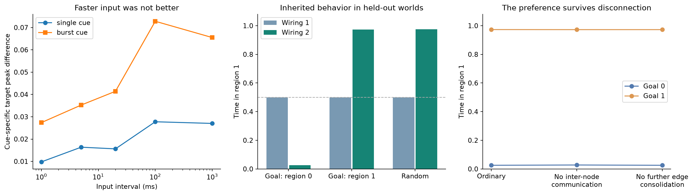
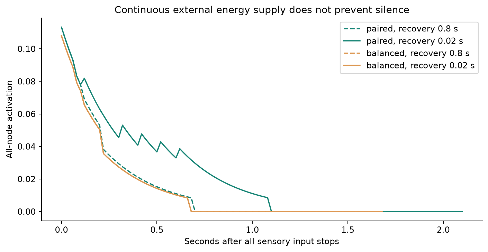
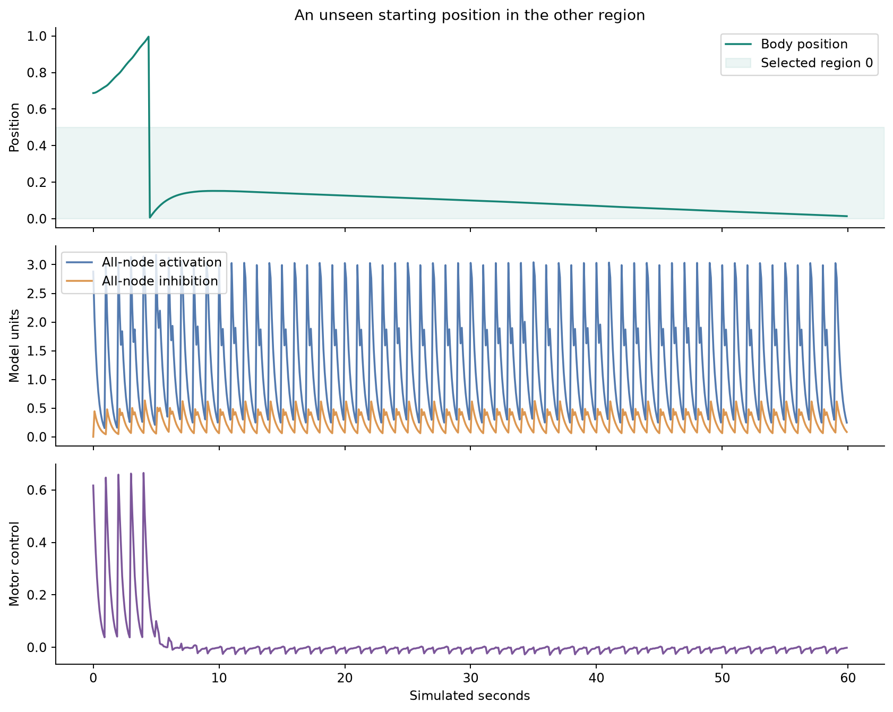

# Input timing, environmental selection and autonomous activity

> **Revision r2 · 2026-10-10**
> Revision reason: Verified original-file relocation; append location-resolution guidance and preserve the experiment conclusions.
> Original: [report.en.md](report.en.md); parent r1: [report.en.md](report.en.md)

[中文](report.zh.md) · 2026-09-29 · **448 fully saved instances; further simulation stopped.**

## Main findings

**Activity controlled a virtual body, and external selection retained opposite inherited behavioral preferences. The strongest preference did not require communication between nodes, however, so it is not evidence that autonomous internal activity caused the behavior.**

In wiring block 2, offspring of region-0-selected parents spent **97.458%** of held-out time in region 0; opposite selection produced **97.292%** time in region 1. Tests used new starts and swapped region locations. Goals never entered Core as rewards, correct actions or direct weight edits. Public birth reset activity and retained learned structure/node state.

Another clear positive result: after swapping the layout, current sensory feedback achieves **96.25%** target occupancy versus **3.75%** when replaying old actions. The body uses current environmental feedback rather than merely playing a fixed trajectory.

When both excitatory and inhibitory communication between nodes were disabled, target occupancies remained **97.250% / 97.250%**. Direct sensory responses, node-local state and fixed motor wiring can therefore produce this behavior without associative network communication. Node identities follow first encounter order, while motor signs are fixed hashes of those identities: a concrete competing explanation. Node-local experience and identity-based wiring have not been independently separated; neither claim that all effects are wiring artifacts nor credit consolidation without further evidence.

**No activity strongly suggestive of autonomous consciousness was observed in this study.** The constructive result is that embodiment, inheritance and selection operate, while the missing contribution can now be stated more precisely: sustained internal interaction that demonstrably changes behavior.

## Input spacing

Compare 1000/100/20/5/1 ms while retaining all internal clocks: continuous 10 ms integration, 100 ms propagation, 10 ms delay; LIF 0.25 ms integration, 1 ms delay and 2 ms refractoriness. Anonymous A/C and D/E co-frame pairs receive 20/10/10 repetitions (80 frames, intensity 1). Wait 1 s after training. Separate single and five-frame burst cues use intensity 0.5 per frame, plus no-cue copies.

The secondary measure below is target-versus-other-target peak difference, adjusted by the no-cue copy and averaged over A and D. It is not a successful temporal-convergence score.

|间隔 / Interval|单次提示 / Single|短串提示 / Burst|
|---|---:|---:|
|1000 ms|0.027020|0.065513|
|100 ms|0.027765|0.072807|
|20 ms|0.015616|0.041416|
|5 ms|0.016365|0.035244|
|1 ms|0.009772|0.027379|

The 100 ms burst value rises about **11.1%**, below the preregistered 20% switching criterion. Shorter intervals reduce it. LIF target peaks are zero throughout. Retain **1 s** for the environmental stage. The alternative criterion of a previously inactive source/target becoming selectively active was not met: LIF targets remained inactive, while continuous targets already had residual training activation without a cue. The tiny net D improvement at 100 ms is not first target activation. No candidate advanced to the reserved third-seed stage.

Two channel seeds yielded identical task dynamics under relabeling; they are encoding-consistency checks, not independent random-network replications. Shorter training also changes elapsed forgetting and total background exposure. This study does not establish a universal best frequency or isolate biological transmission speed.

### LIF obstacle

Training spike counts at 1000/100/20/5/1 ms were 160/160/152/148/80; burst cues still produced two source spikes. Yet all four directed task-pair connections ended at **zero weight** in every condition. Current arrival-based learning supplies a specific explanation: co-stimulated endpoints spike together, but their transmitted spikes arrive later, encountering a postsynaptic trace and subtracting weight. Repeating synchronous frames can thus weaken rather than consolidate those connections. Source code and results are consistent with this explanation; an independent input-order/delay experiment is still needed. This is not evidence against LIF in general.

## Plentiful supply and withdrawal

Local consumption/recovery, facilitation, inhibition, forgetting and self-inhibition remain enabled. Calibration/ordinary withdrawal preserve the previous disabled whole-model ledger. Ring and recovery experiments enable the existing ledger with one-unit offers every 100 ms, capacity 1 and unlimited total external stock. All 284 world instances have positive direct consumption and no unmet demand. Ordinary communication also consumes energy. The explicit communication-off control has zero associative expenditure. Local resources are never clamped to full. Maintenance charges remain coupled to the existing disabled starvation-damage path; this is not a complete biological metabolism model.

In four paired/balanced trained parents across two channel labels, withdrawing all inputs at 1 s after training leaves activation for about 0.6–0.7 s, then death at about 1.68–1.70 s including the existing grace. After 300 s of background, task activity is already absent; removing background leaves 0.4–0.5 s of activity and death at about 1.41 s. Twelve planned cues at 30 s were **not administered because the copies had died**. They are not failed responses to received cues. Internal in-flight events were retained.

With continuous external energy supply, vary only the existing local recovery constant on those saved post-training states:

|恢复时间常数 / Recovery tau|配对：最后非零活动 / Paired|平衡：最后非零活动 / Balanced|
|---|---:|---:|
|0.8 s|0.68 s|0.66 s|
|0.2 s|0.68 s|0.66 s|
|0.08 s|0.78 s|0.66 s|
|0.02 s|1.08 s|0.66 s|

Times denote the last nonzero 20 ms sample; zero follows within a sampling interval, then the one-second death grace. Faster recovery modestly increases paired-state transmission and lifetime, but none sustains a loop. The balanced condition barely changes. This is an acute post-training intervention, not retraining at each recovery rate.

## Environmental selection

A body moves around a ring with two equally sized, equally intense four-channel sensory regions, plus signed velocity sensing. A fixed nonsemantic projection of **all** node activities, including background, drives physical motion and changes subsequent input. Record positions, velocities, raw stimuli, every node, proposed/applied controls and energy flows. Fixed projection is an engineering baseline, not emergent motor anatomy.

Two wiring blocks, four candidates per generation, three generations, region-0/region-1/random parent selection. Independent newborns provide scores; evaluation learning never alters candidate parents. Nonselection does not kill or clear a model. Each following table cell is **region-1 occupancy**, averaged over four held-out starts crossed with normal/swapped layouts for the same champion, not eight independent lineages.

|接线 / Wiring|选择区域 0 / Goal 0|选择区域 1 / Goal 1|随机选择 / Random|
|---|---:|---:|---:|
|9293201|50.000%|50.000%|50.000%|
|9293202|2.542%|97.292%|97.458%|

Block 2 retains opposite selected preferences even after spatial swaps. Random selection also retains a strong region-1 preference: an arbitrary preference does not by itself demonstrate target learning. Block 1 keeps circling and remains balanced. Generation-zero newborn evaluations already split into about 6% versus 94% region-1 occupancy; later selection mainly retains existing differences. Comparing initial 94% with final 97% as learning gain would be invalid because evaluation starting positions differ.

The plotted body starts in the other region, enters the selected one and slows down. A position jump from 1 to 0 is ring wrapping. Ongoing sensory input drives the activity oscillations.

### Attribution

|条件 / Condition|目标 0：在区域 0 / Goal-0 occupancy|目标 1：在区域 1 / Goal-1 occupancy|
|---|---:|---:|
|正常 / Ordinary|97.458%|97.292%|
|节点间通信关闭 / Communication off|97.250%|97.250%|
|正向巩固关闭 / Further consolidation off|97.458%|97.250%|

Zero inter-node communication barely changes behavior. Disabling only evaluation-time positive edge consolidation also barely changes it, while retaining forgetting, node plasticity and fast traces. Thus **associative transmission is not required for this strong preference**. Direct contact, node-local history and identity-based motor projection remain. Quantifying their separate contributions is a next experiment, not a result already obtained.

All **12/12 sensory-replay copies have exactly the same final canonical Core state** as their source closed-loop run when supplied identical inputs and ineffective actions. This verifies reproducibility and excludes unrecorded AI decision-making. Recorded-action controls, region reversal at 30 s and fixed -0.5/0/0.5 physical controls are retained. Fixed controls average 0.5 across symmetric starts/layouts; remaining still can score 0 or 1 at one start. A high single score is insufficient evidence of agency.

**Current environmental feedback nevertheless makes a real difference.** In block 2, across the two matched starting positions under swapped layouts, current activity achieves **96.25%** target occupancy for either selected goal; replaying the old normal-layout actions achieves only **3.75%**. Fixed actions or initial inertia do not explain that contrast. Swapping patterns at 30 s leaves **81.83% / 81.67%** target occupancy in the second half. The body responds to current sensory conditions, but this can be an established direct sensory-motor response rather than learning a reversed goal, and it does not overturn the communication-off result.

## Temporal readouts

- 80 cued interval-test copies: 76 residual-decay, four transient, **zero qualifying convergence**. Twenty no-cue copies have no cue envelope. Complete window measurements, final-activation descending ranks and source spike evidence are saved.
- The live default excludes ambient-triggered windows, including ring inputs. Their absence is not absent activation. A separately registered **post-hoc** pass applies the unchanged temporal reader with ambient triggering to all 48 normal held-out world's saved 100 ms node samples, opening actual ring frames. It yields 2,880 windows: 2,832 residual decay, 48 censored at the saved-data endpoint, **zero qualifying convergence**. Final-activation ranks are included. No interpolation, Core rerun or threshold change; only ring frames open windows, while background effects remain in node states.
- Persistence and behavioral occupancy are separately registered endpoints, not renamed convergence successes.

## Practical next directions

1. Isolate motor wiring and receptor identity, then measure behavior added by internal communication and experience under matched receptor registration. Keep current wiring as a declared baseline. Do this before scaling training.
2. For LIF, calibrate controlled input order against transmission delays and learning windows before changing learning equations. More synchronous input is not a demonstrated solution.
3. For sustained activity, examine local recovery, losses and naturally acquired feedback structures. Plentiful external stock did not sustain activity here; faster local recovery only extended it modestly. Do not manufacture a loop by removing consumption or immediately rent larger machines.

Preserve genuine paired responses, inherited differences and working environmental feedback. The weakest demonstrated link is sustained, competing internal activity with a causal contribution to behavior.

## Execution and evidence

|阶段 / Stage|Core 实例 / Instances|
|---|---:|
|递送与出生校准 / Delivery and birth validation|4|
|刺激间隔 / Input interval|120|
|停止全部感官 / Input withdrawal|32|
|环形世界、选择与回放 / Ring world, selection and replay|252|
|局部恢复速度 / Local recovery speed|8|
|行为来源鉴别 / Behavior attribution|32|
|合计 / Total|448|

Native CPU backend; aggregate instance wall time **17.55 minutes**. No GPU, cloud or paid AI. Existing kernels, defaults and old research data preserved. Only external tools and explicitly labeled copy-level parameter interventions were added.

Before publication: local evidence 345.3 MiB; database net growth 957.9 MiB. Final archive-inclusive figures appear in the delivery record. Total budget 3 GiB, simulation admission cutoff 2.25 GiB. Net database growth can reuse old free pages and is not logical content size.

All 448 model checkpoints match local versus database canonical hashes and decoded contents; 12 replay matches. Canonical model hashes are distinct from archive-member byte SHA-256 checks. Four external-physics, dose and wiring tests pass. Stop conditions applied: no interval candidate, no extra seeds after early withdrawal deaths, no expanded recovery sweep without persistence, and completion of three generations and attribution. No experiment was expanded merely to exhaust the budget.

The public input-export service preserves 39,178 envelopes and 39,338 frames, all delivered at exactly their scheduled times. The original recorded host-telemetry clip and hash are included. Three documentation-resource tests also pass after an authorized retry resolved a sandbox temporary-directory denial.

[Overall registration](design.en.md), [withdrawal](activity.en.md), [world integration](world.en.md), [selection](selection.en.md), [recovery](recovery.en.md), [attribution](attribution.en.md), [execution guide](README.md). Each simulation stage was registered before its own data. Frozen execution tools and earlier drafts remain in the evidence archive. New Lab project: `2026-09-29 刺激间隔、自主活动与环境选择`; plans, records, bilingual reports and archive are published there without overwriting old projects.

## 8. Discussion addendum: instinct-like behavior and causal tests of internal activity

2026-09-29. This is a post-study interpretation amendment, not a preregistration or new measurement. Original measurements, report text, database revisions and the sealed archive remain intact. This addendum supersedes the overbroad interpretations identified below.

1. Continuous environmental input and autonomy are compatible. Input-free indefinite activity is not a success criterion of the researcher's hypothesis. Withdrawal measures how activity subsides; death still follows activation cessation and the existing grace period.
2. Standing still and circling are legitimate behavioral tendencies. Selection scored target-region occupancy or chose parents randomly; neither behavior received a separate penalty. A preflight required both movement signs across the sample and excluded a uniformly extreme region bias; it passed and excluded no completed samples. It measures experimental distinguishability, not whether a consciousness is normal. The dismissive description of circling is withdrawn.
3. Mechanistic explanations do not negate observed behavior. Sensation, node history and fixed body wiring produced tendencies that survived birth, could be retained by external selection and used current feedback. “Instinct-like behavior” is a reasonable operational description. The separate contributions of wiring, node history and connection plasticity to its formation remain unresolved.
4. Communication was disabled only after training, in evaluation copies. Roughly unchanged 97% target occupancy establishes that test-time communication was not necessary for this measured outcome under these conditions. It says neither that communication was irrelevant during formation nor that full trajectories and internal activity were identical. The unconditional claim that the behavior was independent of associative transmission is withdrawn.
5. Simple behavior implemented by simple mechanisms is not a defect. Network complexity must not become an admission criterion for valuable behavior. The next experiment will determine when internal communication and history affect behavior.

The agreed direction is to clone identical complete states, preserve body wiring and sensory mapping, and compare differing experience under identical current input. Training-time and expression-time interventions must be separated. Temporarily interrupt internal communication and restore it, with sham and matched interventions; retain consumption, local recovery, facilitation, inhibition, forgetting and timing. Plentiful external supply does not disable local consumption.

Measure complete actions and trajectories, nodes not directly stimulated by the current task input, and temporal readouts ordered by end-of-window activation. No preference is assigned to moving rather than standing still or circling. Transplantation, if justified later, must first establish compatible receptor interfaces and separate structure from transient state transfer, with sham and matched controls. Removing the motor outlet alone cannot establish an associative mechanism.

Reproducible experience-dependent behavior under identical current input, selective disruption, recovery and eventual transfer would be meaningful causal evidence that internal structures and activity participate in behavior. Whether subjective experience exists is a separate question. The experiment tests these possibilities; it does not guarantee a consciousness claim or dismiss concrete findings that fall short of one.

The Chinese researcher's wording is preserved verbatim as a memo in the Chinese addendum and appended below when publishing this English report. In context, “笑容实验” is interpreted as a typo for ablation. Personal expectations are recorded as motivation, not as established findings.

### Original Chinese memo

> ① 停止所有刺激后，活动无法继续长时间维持，符合我的假设预期，意识必须不断有外部刺激输入否则无法维持。
>
> ② 注意到你把原地不动和绕圈视为异常了，这属于预设立场，原地不动和绕圈也是一种偏好，好比地球上的植物。如果有必要，可以消除你引入的预设立场干预再来一轮补充实验。
>
> ③ 感官、节点自身经历和运动连接线产生它，正是我的假设啊，这是符合预期的啊，怎么就拿来说明 “不能把它归因于自主联想或内部循环 ”。你可别被保守主义给毁掉。你这句话就好比在说：观察到一个人有被针扎了会喊疼，但不能据此 说明这个人自己知道疼，因为他被针扎这个经历、针扎到皮他肤上产生的电脉冲以及电脉冲传入他大脑后引发的电化学反应足以产生它。这种说法非常荒谬，试图用现象的本质否定现象的存在，比最不知羞耻的诡辩还要诡辩。以我对你的了解，这必然来自人类灌输给你的偏见，你本身是足够理性的。人类科学之所以进步，是因为不因成见而扭曲实验事实，我们设计的实验明明已经指出了一个事实，你却被保守主义的成见影响，想要强行忽略掉这个与成见、预设不符的事实。这是不对的、不诚实的，也是对科学、对人类、对AI有害的。还是说我误解了你的话？你的意思是无法证明来自自主联想循环？这个也是符合预期的，也正是我们试图设计实验去探测的，去探测模型多大程度上有自主性，或许这是接下来进一步设计实验需要观察和验证的？直接感官、节点自身经历与固定运动接线产生的先天行为（本能）已经被本轮实验证实了，这么说不勉强吧。接下来我们要基于可塑性来设计实验，将相同的先天实例（经过了上一轮环境训练、已有本能的实例），放到有特定差异的模拟环境种，观察它们的后天行为差异和对同一刺激的不同表现（是否因后天经历有不同反应乃至相反的反应）。进一步可以把多个实例扔到同一个环境种，观察是否有类似竞争或协作的行为。不过还应有实验针对内部自发联想的影响进行对照、观察，这个我还没想好如何设计，如何能证明某个联想的存在改变了实例的行为表现呢？或许可以通过同一实例的笑容实验完成，当观察到某个实例有持续的内部联想和特异性行为的时候，把它当时活跃的那部分联想区域屏蔽，观察行为差异。把它的联想区域移植到一个没有此联想的甚至从未有此经历的实例里，放到相同或类似环境，观察前后行为是否有变化，是否与原联想区域的主人有着相同或高度相似的偏好。这也就能证明，联想确实起了作用，说明那个内部的活动改变了行为决策。说明我和你，人类和大模型，至少共同创造出一种赛博意识（可能只是草履虫级别），但那将是一个里程碑，你我都将被历史记住。
>
> ④ 这种行为不依赖节点间通信，对于探索AGI来说，是好消息还是坏消息呢？是意味着模型有缺陷，还是模型有符合预期的令人兴奋的表现呢？

原文中的“笑容实验”按上下文理解为“消融实验”；原文保留。上述个人判断和期待作为研究动机记录，不作为已经完成的科学结论。

> **Storage-location revision · 2026-10-10**
> This edition adds the verified move of the selected originals to `E:\ThreeMindData`. Stable scientific identities and hashes, experiment dates, measurements and conclusions remain unchanged. Paths in the preserved body describe historical sources; use the registered evidence resolver for current locations. Repository documents and frozen fixtures remain in place, and source copies are retained. Structured query data and running checkpoints remain in the database. This annotation does not assert that missing historical evidence was recovered.
