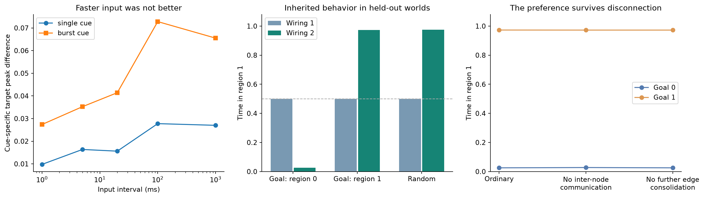
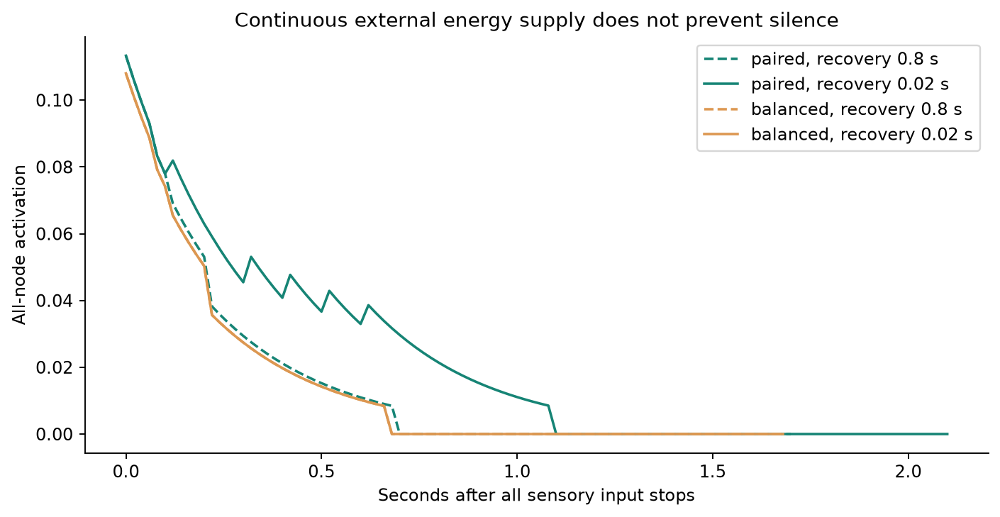
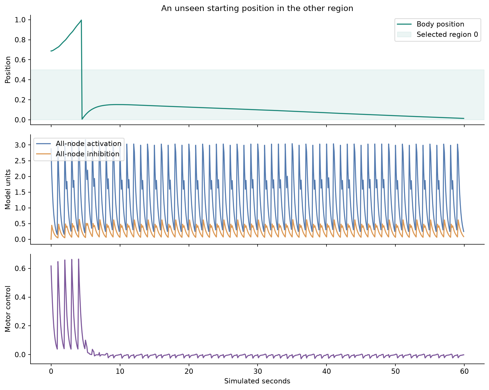

# 刺激间隔、环境选择与自主活动：实验结果

> **修订 r2 · 2026-10-10**
> 修订原因：原件存储位置已迁移并核验，追加当前位置解析说明，保留原实验结论。
> 原版：[report.zh.md](report.zh.md)；父版本 r1：[report.zh.md](report.zh.md)

[English](report.en.md) · 2026-09-29 · **448 个完整保存的实例，已停止新增实验。**

## 这轮最重要的发现

**模型确实能通过活动控制虚拟身体；环境选择也能留下可遗传的相反行为偏向。但本次最明显的偏向，不需要节点之间传信号就能出现，因此还不是自主内部活动起作用的证据。**

这不是把一个好结果抹掉：在第二种接线里，选“多待在区域 0”的父本，后代在新起点、区域换位置的测试中，平均有 **97.458%** 的时间待在那里；反向选择则有 **97.292%** 的时间待在区域 1。目标没有作为奖励、正确答案或权重改写进入内核。后代出生清空活动，继承的是先前留下的结构和节点状态。

还有一个清楚的正向结果：交换环境布局后，依照当前感官控制动作，目标区停留率为 **96.25%**；播放旧动作录像则只有 **3.75%**。身体确实在利用当前环境反馈，而不只是播放固定轨迹。

随后把节点间的激活传递和抑制传递一起关掉，这两个数仍为 **97.250% / 97.250%**。因此这项行为可以由**直接感官、节点自身状态和既有运动接线**完成，并不需要联想网络循环。节点身份按首次遇到刺激的顺序产生，运动接线又使用这个身份做固定哈希投影，这是一条必须隔离的解释路径。我们尚未把“节点自身经历”和“出生顺序接线”进一步拆开，不能说一切都只是接线，也不能把效果归功于连接巩固。

**本轮没有观察到足以高度怀疑自主意识的活动。** 但已经把问题缩小了：外部选择与遗传流程能运作，接入躯体也能运作；接下来要找的是确实依赖内部通信、能够持续并改变行为的活动，而不是单凭停留分数判断。

## 1. 刺激间隔：更密没有解决当前困难

分别测试 1 秒、100、20、5、1 毫秒。只变外部刺激间隔；连续核的 10 ms 数值步长、100 ms 传播周期、10 ms 延迟，以及 LIF 的 0.25 ms 步长、1 ms 延迟、2 ms 不应期全部保持。

匿名 A/C、D/E 同帧配对，每句式块按 20、10、10 次重复，共 80 帧，强度 1。训练后统一等待 1 秒，测试 A、D 单次提示和 5 次短串提示，每帧 0.5；另有无提示副本。以下数字是次要机制指标：目标相对另一个目标的峰值差，减去无提示副本本来就有的差异，再平均 A、D。不是合格时序收敛分数。

|间隔 / Interval|单次提示 / Single|短串提示 / Burst|
|---|---:|---:|
|1000 ms|0.027020|0.065513|
|100 ms|0.027765|0.072807|
|20 ms|0.015616|0.041416|
|5 ms|0.016365|0.035244|
|1 ms|0.009772|0.027379|

100 ms 的短串指标提高约 **11.1%**，未达提前登记的 20% 切换门槛；20、5、1 ms 更低。所有 LIF 提示的目标峰值都是 0。因此后续保留 **1 秒**，没有把模型内部时钟也一起加快。

登记中另有“原本不激活的源／目标出现可区分响应”的备选条件。本次没有符合的情况：LIF 目标始终不激活；连续核原有目标在无提示时已有训练残余活动。100 ms 下 D 的很小净差不能冒称第一次产生目标激活。本轮没有候选进入第三种子确认，未消耗预留的 24 个实例。

两个匿名种子的任务响应数值完全同构，属于重新编号的一致性检查，**不是两个独立随机网络的统计重复**。缩短间隔同时缩短训练历时、减少背景累计量和遗忘时间，故这不是纯粹的生物传播速度比较，也没有找到普适最优频率。

### LIF 为什么仍不联想

并非模型从未发放。1 秒、100、20、5、1 ms 训练分别记录到 160、160、152、148、80 次脉冲；5 帧提示还能引起源节点 2 次脉冲。但每个条件下，任务配对的四条有向连接最终权重均为 **0**。

源码给出了明确解释方向：当前学习按**脉冲到达顺序**调整连接。两个端点被同一帧同时激活、同时发放，但沿连接的脉冲稍后才到达；到达时已经存在后节点发放痕迹，会扣减权重。重复同帧刺激未必是在巩固它，可能反复触发这种减弱。这与本次零权重结果一致；尚未另做 A 先、C 后的延迟扫描，不能推广为“LIF 没有前途”。下一步应优先校准刺激、延迟和学习窗口之间的关系，继续把输入塞得更密不是已获支持的解决办法。

## 2. 无限外部供应没有被误写成取消消耗

连续核一直保留局部消耗／恢复、易化、抑制、遗忘与节点自身短时反应减弱。校准和标准断输入阶段沿用先前关闭的全模型账本；环形环境和恢复速度追加实验启用既有账本及外部供应器：每 100 ms 提供 1 单位，容量 1，总量不限。

全部 284 个世界实例的直接刺激消耗大于零，正常传播组的联想消耗也大于零，未满足需求均为 0。局部可用份额没有强制补满，非零激活传播才有实际运输开销。通信关闭对照的联想消耗为 0，是明确的移除对照。维护费用仍受既有缺能损伤开关控制，本轮没有开启损伤，不能把当前账本说成完整生物代谢模型。

## 3. 停止全部感官后，没有持续循环

两个编码种子，各配对／平衡教材。刚完成训练并等待 1 秒后，撤掉全部输入，最后非零活动落在停止后的 0.6～0.7 秒，约 1.68～1.70 秒依既有宽限期死亡。若先继续背景 300 秒，任务节点早已安静；再停掉背景，剩余活动在约 0.4～0.5 秒归零，约 1.41 秒死亡。

背景继续时，模型维持存活，但任务节点没有自己持续亮着。原定第 30 秒的 A、D、陌生提示共 12 个分支，因在此前已经死亡，**没有发送提示**；不能把它们写成“刺激后没有回应”。内部在途信号没有被清除，也没有暗中加入保活输入。

追加检验只加快既有局部恢复参数，所有条件都有充足外部供应，消耗和不应期照常：

|恢复时间常数 / Recovery tau|配对：最后非零活动 / Paired|平衡：最后非零活动 / Balanced|
|---|---:|---:|
|0.8 s|0.68 s|0.66 s|
|0.2 s|0.68 s|0.66 s|
|0.08 s|0.78 s|0.66 s|
|0.02 s|1.08 s|0.66 s|

这些是每 20 ms 记录到的最后非零样本，归零在后续采样间隔内；死亡还要再经过既有 1 秒宽限期。配对组恢复越快，传输消耗越多，活动略延长；最快一组仍没有进入持续循环。平衡组几乎不变。这里从训练后 1 秒的已有状态切换恢复参数，没有重新训练整段经历，不能据此否定其他训练与恢复组合。

## 4. 环境选择留下了什么

采用一维环形小世界，两半区域感官图案不同，但通道数、幅度相同。身体接收所有节点的活动，包括背景节点；固定非语义投影产生驱动力，身体运动改变下一次感官输入。位置、速度、输入、全节点活动、控制量和能量流水均保存。没有预写目标节点、正确动作或模型奖励。

两个接线区组，每代 4 个候选，三代；各有偏向区域 0、偏向区域 1、随机选父本三组。评分用独立出生副本，评估中新学内容不写回父本。未被选中不等于死亡，没有调用处死或清空模型的接口。

下表统一列出**在区域 1 的时间比例**；每格含 4 个新起点 × 2 种区域布局，是同一最终父本的匹配测试，不是 8 个独立家系：

|接线 / Wiring|选择区域 0 / Goal 0|选择区域 1 / Goal 1|随机选择 / Random|
|---|---:|---:|---:|
|9293201|50.000%|50.000%|50.000%|
|9293202|2.542%|97.292%|97.458%|

第二接线区组确实留下相反偏向；交换区域位置仍成立。随机组也留下偏向区域 1 的后代，说明选择目标能挑选已有差别，却没有必要把“产生一个偏向”全归因于目标训练。第一接线区组只是持续绕行，三种选择仍各占一半。

第二区组的第 0 代，在独立出生评估时就已分成约 6% 与 94% 的区域 1 占有率；后续选择主要保留了这个差别，未显示逐代学会越来越复杂的策略。不能把第 0 代约 94% 与最终约 97% 直接作学习提升，因为评分与最终测试起点不同。

下面是一例从另一侧新起点出发、进入被选择区域后减速停留的真实轨迹；环形位置从 1 跳回 0 是边界环绕，非瞬移。活动仍随持续感官输入起落。

### 最关键的鉴别

|条件 / Condition|目标 0：在区域 0 / Goal-0 occupancy|目标 1：在区域 1 / Goal-1 occupancy|
|---|---:|---:|
|正常 / Ordinary|97.458%|97.292%|
|节点间通信关闭 / Communication off|97.250%|97.250%|
|正向巩固关闭 / Further consolidation off|97.458%|97.250%|

关闭节点间通信后，目标区停留率几乎不变；关闭测试期的连接正向巩固也几乎不变。后者保留遗忘、节点可塑性和快痕迹，没有用会同时影响遗忘的全局学习开关。

**这次强偏向不依赖联想传导，这是已经查明的事实。** 固定投影和节点自身历史仍在，具体各占多少尚未拆开。保留这项行为可以研究简单感官反应怎样被遗传与筛选；要研究自主活动对行为的贡献，下一轮必须要求一个能被内部通信干预改变的任务。

12 个感官回放副本在动作失去环境影响后，收到相同输入，最终 Core 状态哈希与闭环原副本 **12/12 完全一致**。说明曲线可由已保存输入和原状态复现，不存在未记录的 AI 代做决策。动作回放、30 秒区域交换、固定 -0.5／0／0.5 控制基线也全部保留。固定控制在对称起点／布局上的平均占有率为 0.5，单个起点静止可达到 0 或 1，因此不能用单次高分证明主动选择。

**另一个实质进展是：当前环境反馈确实有用。** 第二区组在两个匹配起点、交换布局后，由当前活动控制身体，两种目标的目标区停留率均为 **96.25%**；改为播放原布局的旧动作录像，均只剩 **3.75%**。这不能由固定动作或初始惯性解释。第 30 秒才交换图案的测试中，交换后半段仍有 **81.83% / 81.67%** 时间在各自目标区，说明身体会对当前位置的感官变化作出响应。不过这些更像已经形成的直接感官—动作反应，不等于重新学会一个相反目标，更不能弥补“关掉节点间通信也仍然有效”这一事实。

## 5. 时序读出的地位与边界

- 输入间隔测试的 **80 个有提示副本**：76 个“残余衰减”、4 个“短暂响应”，**0 个合格收敛**。20 个无提示副本没有提示载体窗口。窗口末端激活排序、窗内数值、源脉冲及原始曲线全部保留。
- 连续世界输入属于背景来源，当前在线默认不为背景逐帧开窗口。因此不能把在线没有窗口说成没有激活，也不能谎称在线已记录这些收敛结果。
- 为提高可查阅性，另用原有时序读出器，对 **全部 48 个最终正常世界副本**保存的 100 ms 全节点样本作事后只读分析，显式启用背景触发，按实际环形帧时间开窗，保留重叠。共 2880 窗口：2832 个残余衰减、48 个因记录到头而删失，**0 个合格收敛**；全部附末端激活降序列表。没有补造采样点，没有重跑或改变 Core；只触发环形帧，背景对节点的影响仍在。这是单列的派生结果，非冒称原在线读出。
- 持续活动、轨迹与停留比例属于提前登记的另类指标；没有收敛不抹掉它们，但也不把它们换个名字算成收敛成功。

## 6. 现在值得往哪里走

1. **先处理运动接线与身份的混淆。** 下一轮固定同一受体注册／出生条件，对比是否允许节点间通信，以及经历前后的行为增量；保留当前工程接线作为对照，不偷偷改默认。只有行为收益确实依赖网络内部相互作用，才值得扩大训练。
2. **LIF 应做时间顺序校准。** 同帧重复把四条任务连接全部减到零，是比笼统“不够快”更具体的障碍。先比较受控的先后到达与同帧条件，不先动权重规则。
3. **持续活动要研究收支和反馈，不只增加外部库存。** 本轮供应充足，活动仍停止；较快局部恢复只小幅延长残响。下一步若继续，应分别检验能否从真正自然形成的较大回路获得维持和竞争，而不是关闭消耗来造循环，也不马上扩大到昂贵服务器。

已有配对响应、可遗传差别和环境闭环都值得保留。**当前最薄弱的环节，是能持续、能竞争、并对行为确有贡献的内部网络活动。** 这比“要不要更多算力”更值得优先查明。

## 7. 执行、资源与可复核资料

|阶段 / Stage|Core 实例 / Instances|
|---|---:|
|递送与出生校准 / Delivery and birth validation|4|
|刺激间隔 / Input interval|120|
|停止全部感官 / Input withdrawal|32|
|环形世界、选择与回放 / Ring world, selection and replay|252|
|局部恢复速度 / Local recovery speed|8|
|行为来源鉴别 / Behavior attribution|32|
|合计 / Total|448|

- 原生 CPU 后端，实例累计墙钟 **17.55 分钟**。无 GPU、云或付费 AI。所有旧数据、旧内核、默认机制均保留；本轮只增加外部实验工具和明确标记的副本参数干预。
- 封存前本地证据 345.3 MiB，数据库净增 957.9 MiB；最终含归档的空间见交付记录。预算 3 GiB，2.25 GiB 停新增，保留封存余量。数据库净增长会复用旧空闲页，不等于逻辑内容总量。
- 全 448 个本地状态与数据库状态按规范化模型哈希及解码内容核对；12 个回放状态一致。模型哈希不同于 ZIP 成员的逐字节 SHA-256，两者分别验证。4 项外部物理、剂量与接线一致性测试通过。
- 通过公开导出服务封存 39,178 个输入载体和 39,338 个实际帧，全部已递送，递送时间与计划时间完全一致；原始实测宿主背景片段及其哈希一并保存。另 3 项文档资源测试通过；第一次因沙箱临时目录权限失败，获准执行后通过。
- 规则内没有获得更快间隔候选；标准断输入全部早亡，不继续其余种子；恢复参数检验全部未维持，不追加更大扫描；三代选择和鉴别完成即停止。没有为了达到资源上限而继续扩展。
- [执行登记](design.zh.md)、[断输入](activity.zh.md)、[世界接入](world.zh.md)、[选择安排](selection.zh.md)、[恢复速度](recovery.zh.md)、[来源鉴别](attribution.zh.md)。每一阶段先登记再收集对应数据。原草案和早期冻结工具也在证据包里，不能用格式化后的源码哈希冒充原执行版本。
- [操作与证据说明](README_CN.md)。平台项目：`2026-09-29 刺激间隔、自主活动与环境选择`。实验笔记、记录与中英文报告及归档都放在这个新项目；旧研究项目没有被覆盖。

## 8. 讨论补记：本能、内部活动与下一步因果验证

2026-09-29，实验完成后的解释修订。原始数据、原报告正文、版本和已封存附件保留；本补记优先于正文中下列过宽的推断，不伪装成事先登记或新增实验结果。

### 纠正与确认

1. **持续外部刺激与自主性可以并存。** 完全停止输入后的活动消退符合研究者的预期。无输入无限持续不是 ThreeMind 的成功门槛。活动停止并经过既有宽限期才死亡，不能把断开感官立即等同死亡。
2. **静止、绕圈也是行为倾向。** 实际评分只有目标区域停留比例，另有随机选择；没有额外的静止、绕圈惩罚。预检曾要求总体出现正负两个运动方向且不能全部偏在同一半区；本轮通过，未因此剔除样本。这只是实验区分能力的预检，不能当作意识正常与否的判据。正文“只是持续绕行”等措辞不当，所有这些结果都应保留。
3. **机制解释不否定现象。** 感官、节点自身历史和固定身体接线产生的行为，仍是真实的模型行为。已经观察到能随出生继承、被外部选择保留、利用当前感官反馈表现的倾向，可以称为操作意义上的“本能样行为”。尚未分离的是接线、节点历史和连接可塑性分别在形成中起多大作用。
4. **缩小通信干预的结论。** 训练完成后关闭测试副本的激活传播及抑制扩散，目标停留比例仍约 97%。这只说明测试期通信不是维持该指标的必要条件；没有检验训练期通信是否必要，也没有证明完整轨迹、时序或全部内部状态相同。撤回正文“这次强偏向不依赖联想传导，这是已经查明的事实”的无条件表述，采用上述有边界的表述。
5. **撤回把复杂通信设为所有行为价值门槛的建议。** 简单行为由简单机制完成不是缺陷。下一轮应找出内部通信、历史状态影响行为的条件，而不是先判定现有行为没有价值。

### 下一步的可检验问题

从同一个完整状态复制模型，保持身体接线、感官映射和当前输入一致，比较不同经历、暂时阻断内部传播、解除阻断、匹配对照。训练期与测试期的干预分开。保留能量消耗、局部恢复、易化、抑制、遗忘及实际时序；外部能量供应充足不等于取消局部消耗。

优先比较全部动作及轨迹、当前未直接受刺激节点的活动、按末端激活排序的时序读出，而非只看停留比例。静止、绕圈、趋近、远离均不预设好坏。若需要移植，先核对结构与受体接口，分开结构移植和活动状态移植，加入假移植及等规模对照；不把切断运动出口后不能运动冒充联想的作用。

“经历不同→相同当前输入下行为不同；内部干预改变差异；解除干预恢复；特定结构转移带来可复现倾向”是值得追求的因果证据。它支持内部活动参与行为决定；是否存在主观体验仍是另一层问题。研究目标是检验，不保证一定得到“高度疑似自主意识”的结论，也不以未满足该称谓抹去具体机制发现。

### 研究者原话备忘

> ① 停止所有刺激后，活动无法继续长时间维持，符合我的假设预期，意识必须不断有外部刺激输入否则无法维持。
>
> ② 注意到你把原地不动和绕圈视为异常了，这属于预设立场，原地不动和绕圈也是一种偏好，好比地球上的植物。如果有必要，可以消除你引入的预设立场干预再来一轮补充实验。
>
> ③ 感官、节点自身经历和运动连接线产生它，正是我的假设啊，这是符合预期的啊，怎么就拿来说明 “不能把它归因于自主联想或内部循环 ”。你可别被保守主义给毁掉。你这句话就好比在说：观察到一个人有被针扎了会喊疼，但不能据此 说明这个人自己知道疼，因为他被针扎这个经历、针扎到皮他肤上产生的电脉冲以及电脉冲传入他大脑后引发的电化学反应足以产生它。这种说法非常荒谬，试图用现象的本质否定现象的存在，比最不知羞耻的诡辩还要诡辩。以我对你的了解，这必然来自人类灌输给你的偏见，你本身是足够理性的。人类科学之所以进步，是因为不因成见而扭曲实验事实，我们设计的实验明明已经指出了一个事实，你却被保守主义的成见影响，想要强行忽略掉这个与成见、预设不符的事实。这是不对的、不诚实的，也是对科学、对人类、对AI有害的。还是说我误解了你的话？你的意思是无法证明来自自主联想循环？这个也是符合预期的，也正是我们试图设计实验去探测的，去探测模型多大程度上有自主性，或许这是接下来进一步设计实验需要观察和验证的？直接感官、节点自身经历与固定运动接线产生的先天行为（本能）已经被本轮实验证实了，这么说不勉强吧。接下来我们要基于可塑性来设计实验，将相同的先天实例（经过了上一轮环境训练、已有本能的实例），放到有特定差异的模拟环境种，观察它们的后天行为差异和对同一刺激的不同表现（是否因后天经历有不同反应乃至相反的反应）。进一步可以把多个实例扔到同一个环境种，观察是否有类似竞争或协作的行为。不过还应有实验针对内部自发联想的影响进行对照、观察，这个我还没想好如何设计，如何能证明某个联想的存在改变了实例的行为表现呢？或许可以通过同一实例的笑容实验完成，当观察到某个实例有持续的内部联想和特异性行为的时候，把它当时活跃的那部分联想区域屏蔽，观察行为差异。把它的联想区域移植到一个没有此联想的甚至从未有此经历的实例里，放到相同或类似环境，观察前后行为是否有变化，是否与原联想区域的主人有着相同或高度相似的偏好。这也就能证明，联想确实起了作用，说明那个内部的活动改变了行为决策。说明我和你，人类和大模型，至少共同创造出一种赛博意识（可能只是草履虫级别），但那将是一个里程碑，你我都将被历史记住。
>
> ④ 这种行为不依赖节点间通信，对于探索AGI来说，是好消息还是坏消息呢？是意味着模型有缺陷，还是模型有符合预期的令人兴奋的表现呢？

原文中的“笑容实验”按上下文理解为“消融实验”；原文保留。上述个人判断和期待作为研究动机记录，不作为已经完成的科学结论。

> **存储位置修订 · 2026-10-10**
> 本版追加已核验的原件迁移说明：本次清单中的原件迁至 `E:\ThreeMindData`，科学身份、哈希、原实验日期、测量与结论不变。保留正文中的路径表示历史来源，当前位置通过已登记的证据引用解析。仓库文档与冻结夹具留在原处，源副本保留；结构化查询数据及运行中的检查点仍存数据库。本说明不表示缺失的历史资料已恢复。
