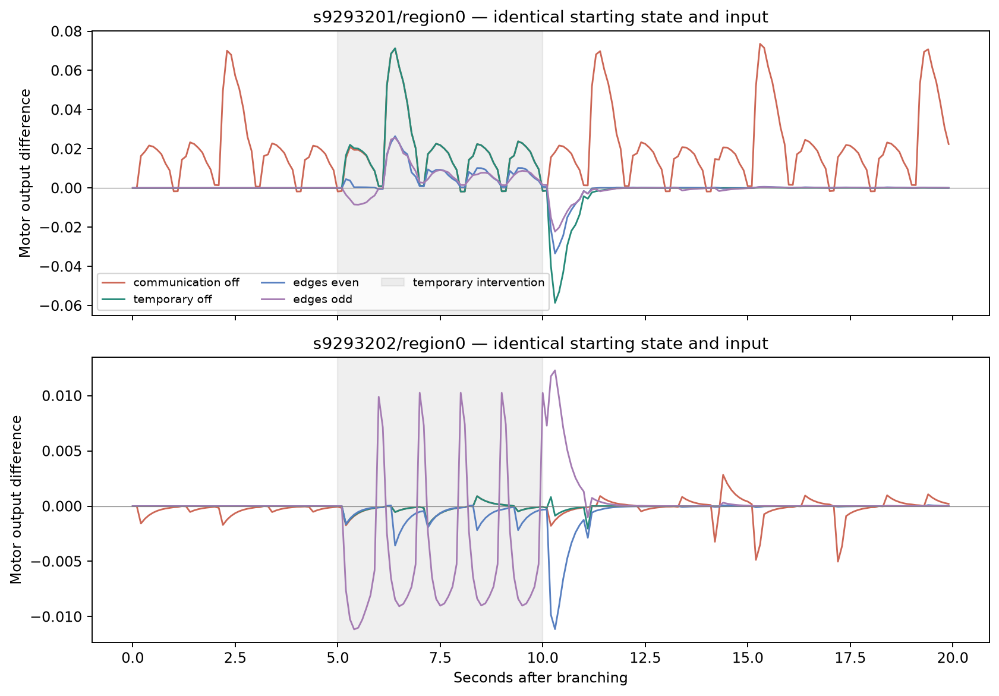
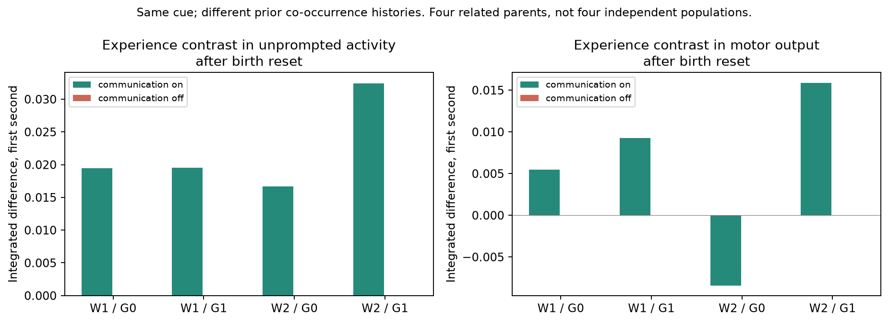
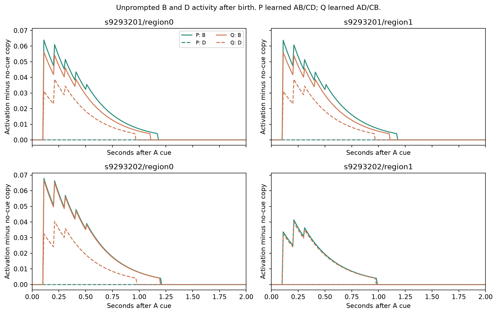

# Internal activity changes behavior: 180 matched causal tests

> **Revision r2 · 2026-10-10**
> Revision reason: Verified original-file relocation; append location-resolution guidance and preserve the experiment conclusions.
> Original: [report.en.md](report.en.md); parent r1: [report.en.md](report.en.md)

[中文](report.zh.md) · [Registered design](design.en.md) · [Birth extension](validation.en.md)

**Different co-occurrence histories in the same inherited model produced different unprompted-node responses and motor outputs to identical cues. The differences survived birth, which cleared current activity and short-term states. Blocking communication eliminated both measured birth-history contrasts.** Retained experience can therefore affect behavior through internal transmission in these conditions.

This is stronger than observing an activity image or comparing occupancy alone. Effects were brief and modest, not a demonstrated long-lived autonomous strategy or subjective consciousness. The concrete causal finding remains valuable.

## Interpretation corrections

The prior bilingual reports now have a versioned discussion addendum (database revision 2); original revision 1 and the sealed archive remain. Input-free indefinite persistence is not an autonomy requirement. Standing still and circling receive no separate penalty. Disabling test-time communication while preserving occupancy never established its irrelevance to formation or every aspect of behavior.

## Matched intervention and recovery

Four inherited parents from two wiring families and two selection goals were born, warmed for 20 s, then copied in complete live state. A normal 20 s closed loop provided the identical sensory replay for seven counterfactual branches. All 4 sham copies reproduced exact motor trajectories and final Core states; all 32 branches had identical external stimulus streams.

Compare full communication blockade, excitation-only and inhibition-only blockade, temporary blockade during 5–10 s, and temporary silencing of two complementary hash-defined edge groups. Sensory and motor nodes stayed available and in-flight signals were retained. Groups were defined before outcomes, not identified associative regions.

Circling models showed motor differences around 0.019 early and 0.025 late under full blockade. In the second wiring, full blockade had smaller effects; partial edge blockade could produce larger transient changes. Cancellation between pathways is a hypothesis, not yet isolated. Temporary blockade in wiring 1/goal 0 yielded four successive 5 s mean absolute control differences of 0.000000, 0.019263, 0.005974, 0.000048: effects appeared during blockade and declined after restoration. Restored communication resumed actual transmission but cannot erase accumulated history or body displacement.

The counterfactual bodies moved under their own outputs but received the normal copy's replayed input. These are causal action comparisons, not independently closed-loop adaptation scores.

## Different experience under equal exposure

P learned AB/CD; Q learned AD/CB. All channels already existed, keeping receptor identity and body wiring fixed. Each pair repeated 20, then 10, then 10 times: 80 frames 1 s apart, intensity 0.8, 40 exposures/channel. Cross histories with training communication on/off, yielding 16 trained states. After a 1 s wait, fork A/C/no-cue tests with expression communication on/off, yielding 96 copies, cue intensity 0.5 and continuing recorded host background 0.2.

All eight normal-training, normal-expression parent/cue contrasts showed experience-related changes in unprompted activity. In wiring 2/goal 1, cue A produced first-second no-cue-adjusted B/D integrals 0.016531/0 after P versus 0/0.016798 after Q. B and D were not directly prompted. Other Q copies retained mixtures of old B and newly associated D responses rather than cleanly reversing the leading node; all were kept.

Communication was unnecessary during training to form all such contrasts: restoring it during expression still revealed them. Current co-input learning can alter edges without transmitted activation. Some blocked-training contrasts were larger. Formation and expression should be studied separately; competition or interference during transmission is not yet an established explanation, and default communication remains unchanged.

## Retention after birth

After these observations, a disclosed extension included every normally trained P/Q parent. Public birth inherited structure and long-term node history, clearing current activation, inhibition, queued events and short-term operator states. A/no-cue by test communication on/off gave 32 new individuals, not revivals.

|父本 / Parent|未提示节点的经历差异 / Activity contrast|运动输出的经历差异 / Motor contrast|关闭通信后两项 / Both with communication off|
|---|---:|---:|---:|
|s9293201/region0|0.019482|0.005501|0 / 0|
|s9293201/region1|0.019515|0.009254|0 / 0|
|s9293202/region0|0.016673|-0.008414|0 / 0|
|s9293202/region1|0.032441|0.015894|0 / 0|

Numbers integrate the first second. Activity contrast is `[(B−D) under P] − [(B−D) under Q]`, with each response adjusted by its matched no-cue copy. Motor contrast is P's adjusted control minus Q's. Motor range is −1 to 1. Integration uses actual sample durations, not sample counts. Signs express direction, not quality.

**All four retained history contrasts survived birth and required test-time communication for these measured effects.** This excludes current residual activation and fixed wiring plus direct input as sufficient explanations of the entire difference. Birth preserves both structure and long-term node history, so it does not isolate one edge or memory variable.

Absolute first-second mean motor contrasts were about 0.0055–0.0159. Some small effects remained during 1–5 s; all measured cue-adjusted history contrasts were zero during 5–15 s. What persisted was the capacity for a later cue-dependent response, not a demonstrated continuously active 15 s internal loop.

## Temporal readouts and scope

All 80 cued copies retained existing temporal windows and end-activation rankings: 80 residual-decay classifications, no qualifying convergence. The 48 no-cue copies had no task-triggered window. Ambient world input was not relabeled to force task windows. Matched behavior/state interventions establish this round's causal finding; peaks and integrals are not called convergence.

Four parents from two related wiring families are not four independent populations, and time points are not independent replications. No region transplantation, shared ecology, long-term autonomous goal or subjective experience was demonstrated. The next question is whether history-driven internal effects alter subsequent sensing, selection and relearning in a genuine closed loop, with pathway-specific and matched controls.

## Delivery and checks

New Lab project: `2026-09-29 内部活动与行为的因果验证`. Bilingual registrations, reports, records and evidence are stored through Lab services. The 180 instances comprise 4 warmups, 32 expression branches, 16 training, 96 original-state probes and 32 birth probes. Native CPU aggregate case wall time: 3.84 min; no GPU/cloud/paid AI.

All 180 complete local/database states matched canonical hashes and decoded content. All 5928 envelopes/frames were delivered exactly on schedule. Identical-input checks covered 32 expression and 128 probe branches. Core, mapping and defaults were unchanged; no old data were deleted. Result `config` records creation settings; explicit later interventions are in events and the actual final configuration is in the full model. Consumption, recovery, facilitation, forgetting and inhibition remained; unmet energy demand was zero.

Three tool tests passed. An initial test incorrectly expected intervention sequence counters to remain unchanged; inspection found only the legitimate +2 operation count, so the expectation was corrected without changing dynamics. Sham final-state equality still passed.

New storage budget 2 GiB; STOP prevents new simulations. Final storage, shared usage and archive readback are in [delivery](delivery.en.md). Initial execution and extension code are separately frozen; later analysis sources are not misrepresented as initial preregistration.

## Added discussion: fixed criteria and lasting experience (2026-09-29)

This section is appended to the 180-instance report without replacing earlier versions or evidence. It records decisions, not new experimental findings.

### Four operational criteria

1. **Experience creates individual differences:** identical inherited states acquire repeatable internal and behavioral differences under identical present input, retrievable later.
2. **Internal activity causally influences behavior:** selective internal interventions change behavior while sensors and motor outlets remain available; sham, matched-damage and restoration controls distinguish this from general injury.
3. **Internal states organize sequential interactions:** a preceding interaction affects later perception and action, and intervening on internal mechanisms changes this influence. Continuing background input is allowed; indefinite activity without an environment is not required.
4. **The same individual can be reshaped by its environment:** feedback and changing experience form, update, compete with, replace or retrieve response tendencies without coding correct actions into the Core. Standing still and circling are legitimate behaviors.

If all four pass registered replication and controls, the study will explicitly conclude that the model meets this project's operational criterion for **highly suspected autonomous conscious activity**. Language, intelligence or indefinite persistence will not be added afterward. This is a project-defined, testable criterion, not a validated detector of subjective experience: an adaptive system without subjective experience could also satisfy it. That limitation is stated now and must not later rescind an operationally positive result.

Explaining a phenomenon's physical mechanisms does not negate the phenomenon. Further localization does not erase the previous causal evidence. Preservation across a new birth is not yet a measured long retention curve.

### Additional predictions

Compare single strong input with ordinary or weak massed/spaced repetitions. Measure subsequent behavior with connections intact, blocked, with routes returning to the cue receptor blocked, and after a public birth that clears short-lived activity while retaining structure. A new birth is a structural persistence test, not revival of the original individual.

Blocking all transmission also removes learned forward pathways, so it cannot isolate recurrence. Novelty, generalization and repeated erasure require matched dose, wiring and damage controls. Increasing intervals are not presented as an Ebbinghaus prescription; we measure this model's own retention curve. The researcher's duck-test analogy is implemented as advance registration, falsifiable comparisons and fixed conclusions rather than untestable assertions.

The researcher's original Chinese request is preserved below in the published report.

### Original Chinese memo

好的，将当前讨论追加到本轮报告末尾。并设计进一步的实验，将需要2中需要进一步定位的内部机制以及3和4中需要验证的内容，进行实验验证。此前你提到的经历及联想导致的行为差异的持续时间的问题，也可设计单独的实验进行验证，我预测在单次的高强度刺激（类似人遇到突发事件、精神打击，未必需要重复）以及重复（类似艾宾浩斯记忆曲线）刺激（未必很强，普通强度或者微弱强度），会使得巩固机制起作用留下长期的记忆和行为影响。可用同一实例的副本做对照实验，对单次高强度刺激和符合记忆曲线的重复进行分别验证，一旦观察到有此形成的行为差异，则进行消融和抑制实验，确认是长期连接产生的影响。并且我预测，这类长期影响形成的是类似习惯、条件反射的东西，也就是即使阻止内部联想，相同或类似的刺激到达时，也将引发激活和特定行为表现，或者实例在环境中始终保持某个未经提示的行为。此外，还有新鲜度的差异，某个新的刺激会留下更深的印象，并成为类似刺激的稳定的响应模式。如果总是在新刺激导致新模式后消除这种连接或联想模式，并对环境或刺激进行略微改变，再次刺激，那种稳定的响应行为不会复现，会出现新的有差异的行为，对环境和刺激改变越多，这种新的差异越大。如果不断重复刺激和消除，实例的响应模式也会一直跟着变化，无法形成一个稳定偏好。最后你说的，无法确定实例有主观体验，这个我同意，这在哲学上无法验证。我们只能通过观察来确信：高度怀疑有自主意识活动。并且妥协一个标准：一个动物它看起来像鸭子、叫起来像鸭子、走起路来像鸭子，那么我们就认为它是鸭子。以免陷入虚无主义和不可证伪。
当前有其他的项目（1个）在消耗额度，因此你设定的实验资源消耗中，额度消耗可以放宽。
其他你认为本轮有必要进行的实验，也可进行。
本轮实验结束后，按照我们商定的标准，对于ThreeMind有无高度怀疑的自主意识活动，应有明确的命题结论，不能再不知可否、闪烁其词。

> **Storage-location revision · 2026-10-10**
> This edition adds the verified move of the selected originals to `E:\ThreeMindData`. Stable scientific identities and hashes, experiment dates, measurements and conclusions remain unchanged. Paths in the preserved body describe historical sources; use the registered evidence resolver for current locations. Repository documents and frozen fixtures remain in place, and source copies are retained. Structured query data and running checkpoints remain in the database. This annotation does not assert that missing historical evidence was recovered.
