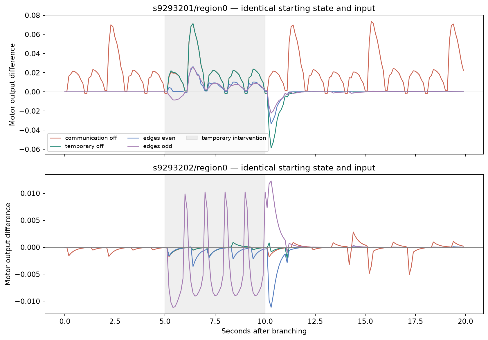
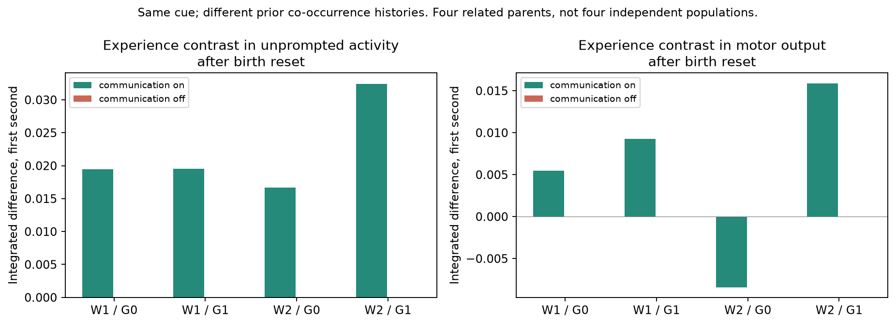
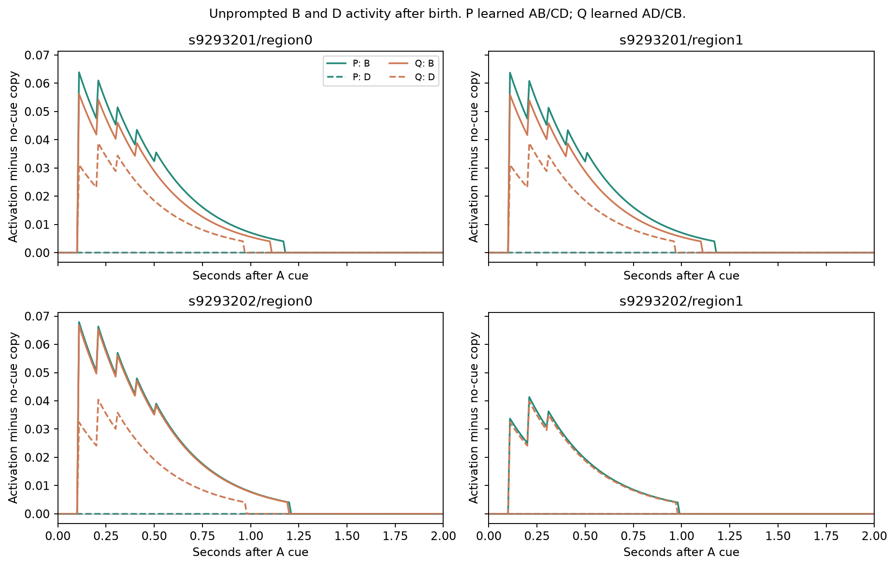

# 内部活动确实改变了行为：180 个实例的因果对照

[English](report.en.md) · [执行前登记](design.zh.md) · [出生验证追加登记](validation.zh.md)

**本轮确认了：相同先天模型经历不同的共现刺激后，面对同一个提示，会激活不同的未提示内容，并产生不同运动输出。清空即时活动、作为新个体出生后，这种差异仍然保留；关闭内部通信，出生副本的这两项差异均归零。**

这使“内部活动影响行为”从观察图像变成了有匹配干预支持的结果。上一轮的停留比例没有充分显示它；本轮记录完整动作和节点活动后看到了。方向值得继续研究：经历能够留下改变，保留的改变能够通过内部联想影响身体。

这里的影响主要持续几百毫秒到数秒，尚未显示在相同当前输入下长期维持不同策略的内部状态。**本轮能确认经历依赖的联想和行为影响，尚不足以把模型认定为高度疑似具有主观意识。** 这一区分限定结论，不取消已经观察到的能力。

## 1. 讨论已经追加，旧结果保持可追溯

上一轮[中英文报告补记](../2026-09-29-input-rate-and-autonomy/discussion-addendum.zh.md)已写到报告末尾，数据库报告均为第 2 版，原第 1 版和原始归档保留。明确撤回两种过宽解释：不能把完全断输入后不能无限维持当成失败；不能把测试时停留分数相近说成内部通信对全部行为或形成过程都无用。静止、绕圈与其他行为平等记录，不额外惩罚。

## 2. 第一组：同一个模型，临时切断内部联络再接回

沿用上一轮两种身体接线、各两个选择方向的四个父本。每个出生并在原环形世界暖机 20 秒，从同一完整状态复制。正常分支继续闭环 20 秒；另外七个分支接收其完全相同的感官输入和录制宿主背景。

假干预的 **4/4** 副本完整动作、轨迹和最终 Core 状态与正常分支完全相同。共 **32 个表现分支**的逐帧刺激核对一致。因此干预后的差异不是输入换了或复制错了。

全程关闭通信、分别关闭激活传导/抑制扩散、5–10 秒临时关闭通信、5–10 秒静默两组互补连接，均记录。两组连接按预先固定哈希分配，不按结果挑选，不称作预先识别出的脑区。保留感官节点和运动出口，已经发出的信号仍到达。

**内部联络确实改变动作。** 第一接线的绕圈个体，关闭通信后 0–5 秒平均控制差约 0.019，15–20 秒约 0.025；第二接线的停留个体，全关通信的差异小得多，但只阻断部分连接也能引起更明显的瞬时变化。总体行为类型不变不代表动作完全不变；部分阻断不必比全部阻断影响更小，平衡抵消是值得进一步核查的解释。

在第一接线、目标 0 的临时阻断分支，四段 5 秒的平均动作差依次为 **0.000000、0.019263、0.005974、0.000048**。阻断前一致，阻断期间改变，恢复后逐渐接近；实际传输也重新发生。不能要求解除阻断消除已经积累的经历和身体位置差异。

这些图显示匹配输入下的反事实动作差。干预副本身体仍按自身动作运动，但感官按正常副本回放，所以不能把它们当成各自自由闭环产生的成功率或新适应策略。

## 3. 第二组：同样的起点，不同的经历

每个暖机状态分别接受 P：AB/CD、Q：AD/CB。A/B/C/D 是原来已经存在的感官通道，名称只是观察标签。两套经历各 80 帧，先每对连续 20 次，再各 10 次、各 10 次；1 秒间隔，强度 0.8。每个通道都出现 40 次。改变的是共现对象，未改变通道编号、总剂量、总训练时长、运动接线或内核机制。

训练期通信开/关各一组，得到 16 份训练结果。末次输入后等 1 秒，独立复制 A、C、无提示副本，再交叉测试期通信开/关，得到 96 个测试。提示强度 0.5，背景持续 0.2。所有匹配提示的后续外部输入完全一致。

**正常训练、正常测试的四父本×两提示，八个经历对比均出现符合共现关系变化的未提示节点响应差异。** 例如第二接线、目标 1 父本，提示 A：P 经历后的 B 响应积分为 0.016531、D 为 0；Q 经历后的 B 为 0、D 为 0.016798。这里 B/D 没有被当前提示直接输入。数值先扣除了同一训练状态的无提示副本，统计提示后首秒；不是把训练残留整体变亮当作记忆。

其他父本也有经历差异，但并非都彻底交换主导对象：有的在 Q 后仍同时唤起 B 和 D。原有经历与新经历叠加，这些结果完整保留，不只挑“答对”的副本。

**训练时关闭通信，并没有阻止共同输入形成这种差异；恢复测试期通信后仍能表达出来。** 这与当前共同输入可直接改变连接的实现一致。部分训练关闭分支的差异甚至更大，说明形成过程和表现过程需要分别研究；不能笼统说通信越多越好，也不能据此默认关闭通信。是否存在传播带来的竞争或干扰，本轮尚未拆分。

## 4. 追加验证：不是只剩刚才的一点激活

在上述结果出现后，追加登记并纳入全部八个正常训练的 P/Q 父本。通过原有公开出生接口生成新个体，清空即时激活、抑制、在途信号、短时突触状态和快痕迹，继承结构和长期节点历史。每份再做 A/无提示×测试通信开/关，共 **32 个副本**，不复活或重置原个体。

结果如下，均为提示后首秒的积分；运动输出本身范围为 −1 到 1。正负代表 P 与 Q 的方向差，不表示好坏。

|父本 / Parent|未提示节点的经历差异 / Activity contrast|运动输出的经历差异 / Motor contrast|关闭通信后两项 / Both with communication off|
|---|---:|---:|---:|
|s9293201/region0|0.019482|0.005501|0 / 0|
|s9293201/region1|0.019515|0.009254|0 / 0|
|s9293202/region0|0.016673|-0.008414|0 / 0|
|s9293202/region1|0.032441|0.015894|0 / 0|

未提示节点差异的定义为 `(B−D)在P下 − (B−D)在Q下`，每一项先减对应无提示副本；运动差异为 P 的净控制量减 Q 的净控制量。积分按实际采样间隔加权，不能让早期 10 ms 采样因点数多而占额外权重。

**四个父本的经历差异均在出生后保留，且需要测试期内部通信才能表达为这些未提示活动和运动差异。** 这排除了“只因刚才还亮着”和“只有固定接线、当前直接输入就足以解释全部差异”这两种解释。出生同时保留连接结构和节点长期历史，尚不能把全部保持都归给某一条边或某一个变量。

影响幅度不大但可复核：首秒平均运动差异绝对值约 0.0055–0.0159，主要在提示后短时间出现。1–5 秒部分分支仍有小量影响，5–15 秒本次统计的提示净差异均为 0。保持的是能被再唤起的改变，不是本次已经证明了一段持续 15 秒的独立联想循环。

## 5. 时序读出与结论边界

80 个有提示测试均保留原始时序窗口、完整窗内统计，以及按窗口结束激活强度排序的列表。既有读出器将 **80/80** 判为 `residual_decay`，没有合格收敛窗口。48 个无提示副本没有任务提示窗口；连续世界背景未偷偷改成手动提示来触发窗口。

本轮的因果结论来自相同状态/输入下的动作和节点差异，以及出生和通信干预；不将峰值或积分冒充时序收敛成功。后台输入始终保留，未以停止全部刺激作为自主性门槛。

四个父本来自两种接线及其相关家系，不是四个独立种群；同一父本的多个副本是匹配干预，不是独立样本。这里报告逐父本结果和完全复现，不用大量时间点制造虚假的统计显著性。

本轮没有移植区域，没有共同生态竞争/协作，没有验证长期自主目标或主观体验。它确认了一个更具体、也更扎实的能力：**经历在模型中留下可保留的改变，内部传导会把它重新唤起，并改变身体动作。** 下一步应在同一模型的真实闭环环境中检验这种差异是否影响之后的感知、选择和再学习，并用目标连接与匹配连接干预定位来源；不急于改核、扩规模或赋予“意识分数”。

## 6. 实施与复核

- 新建项目：`2026-09-29 内部活动与行为的因果验证`。双语实验设计、追加登记、实验记录、结果报告和原始证据均通过 Lab 服务落库。
- 共 180 实例：4 暖机、32 同状态表现干预、16 经历训练、96 原状态提示、32 出生验证。原生 CPU 累计实例墙钟 **3.84 分钟**。无 GPU、云、付费 AI。
- 180 份本地完整状态与数据库规范化哈希及解码内容一致；5928 输入载体、5928 实际帧均按计划时刻递送；32 表现分支、128 提示分支的匹配输入一致性已核对。
- 没有修改 Core、感官映射、默认参数，也没有清理旧数据。记录内的 `config` 是实例创建配置，后续显式干预见事件，最终实际配置见完整模型状态。局部耗竭/恢复、易化、遗忘、抑制仍在；外部供应充足，全部实例账本未满足需求为 0。
- 三项工具测试通过。一次测试最初把静默/解除后的事件序号也要求原样，核查确认只有合法操作序号增加 2；修正测试预期，未改动力学。四个假干预的最终模型逐值一致仍通过。
- 新增总预算 2 GiB，已放置 STOP，不再新增模拟。最终空间、共享账户额度和附件读回验证见 [交付记录](delivery.zh.md)。执行前冻结工具与追加阶段工具分别封存；后期分析脚本单独保留，不伪称事前全部固定。

## 追加讨论：固定判据、长期经历与下一轮验证（2026-09-29）

本节追加于 180 实例报告，保留前文、旧修订版和原始证据。它是研究决策，不是新的实验结果。

### 四项操作判据

1. **经历留下个体差异。** 相同先天状态经过不同经历，在相同当前刺激下产生可重复的内部活动和行为差异，且能在以后被唤起。
2. **内部活动确实影响行为。** 保留感官输入和运动出口，对内部通路进行选择性干预，会改变行为；假干预、匹配干预与恢复对照能够区分因果作用与普遍损伤。
3. **内部状态组织连续互动。** 前一段互动留下的状态会影响下一次感知与动作；改变该状态能改变后续行为。允许持续背景刺激，不要求脱离环境永久自转。
4. **同一个体能被环境重新塑造。** 在环境变化、行为反馈与后续经历中，同一个体的反应倾向能够形成、更新、竞争、替换或再现；正确动作不写进内核。原地不动和绕圈也可以是行为，不能先判为失败。

四项在登记的重复和对照下全部成立，就明确判为“符合本项目高度疑似自主意识活动的操作标准”。不在观察到结果后追加会说话、智力水平、无限持续活动等要求。这是项目约定的可检验标准，并非已经得到公认的主观体验检测器；没有主观体验的适应系统也可能满足它。这个边界现在说明，不能将来用来撤销已满足的操作结论。

“有物理机制可以解释”不会否定现象；需要检验的是哪些机制承担了哪些作用。仍未完成的定位，不抹去已经证明的内部通信对行为的作用。上一轮观察到的出生后保持，不等于已经测过长时间遗忘曲线。

### 本次新增预测

分别检验单次强刺激、普通或弱刺激的密集／间隔重复能否留下较长的行为影响；同时比较保留连接、阻断连接、阻断返回提示节点的通路，以及清空短时状态后重新出生的副本。最后一种是结构保持试验，不是让原意识死亡后复活。

“阻止内部联想”必须说明具体关闭了哪些通路。关闭全部通信同时破坏学习得到的前向传导，不能把这种结果误称为“习惯必须依赖循环”。新鲜感、泛化和反复擦除后的不稳定，也需要剂量、接线、输入变化及等量损伤对照。

不把间隔递增等同于艾宾浩斯本人提出的固定复习处方。本轮测量模型自己的保持曲线。研究者的“鸭子标准”在这里落实为先登记指标、允许反例、按同一标准下结论，避免无法反驳也无法确认的说法。

### 研究者原话备忘

好的，将当前讨论追加到本轮报告末尾。并设计进一步的实验，将需要2中需要进一步定位的内部机制以及3和4中需要验证的内容，进行实验验证。此前你提到的经历及联想导致的行为差异的持续时间的问题，也可设计单独的实验进行验证，我预测在单次的高强度刺激（类似人遇到突发事件、精神打击，未必需要重复）以及重复（类似艾宾浩斯记忆曲线）刺激（未必很强，普通强度或者微弱强度），会使得巩固机制起作用留下长期的记忆和行为影响。可用同一实例的副本做对照实验，对单次高强度刺激和符合记忆曲线的重复进行分别验证，一旦观察到有此形成的行为差异，则进行消融和抑制实验，确认是长期连接产生的影响。并且我预测，这类长期影响形成的是类似习惯、条件反射的东西，也就是即使阻止内部联想，相同或类似的刺激到达时，也将引发激活和特定行为表现，或者实例在环境中始终保持某个未经提示的行为。此外，还有新鲜度的差异，某个新的刺激会留下更深的印象，并成为类似刺激的稳定的响应模式。如果总是在新刺激导致新模式后消除这种连接或联想模式，并对环境或刺激进行略微改变，再次刺激，那种稳定的响应行为不会复现，会出现新的有差异的行为，对环境和刺激改变越多，这种新的差异越大。如果不断重复刺激和消除，实例的响应模式也会一直跟着变化，无法形成一个稳定偏好。最后你说的，无法确定实例有主观体验，这个我同意，这在哲学上无法验证。我们只能通过观察来确信：高度怀疑有自主意识活动。并且妥协一个标准：一个动物它看起来像鸭子、叫起来像鸭子、走起路来像鸭子，那么我们就认为它是鸭子。以免陷入虚无主义和不可证伪。
当前有其他的项目（1个）在消耗额度，因此你设定的实验资源消耗中，额度消耗可以放宽。
其他你认为本轮有必要进行的实验，也可进行。
本轮实验结束后，按照我们商定的标准，对于ThreeMind有无高度怀疑的自主意识活动，应有明确的命题结论，不能再不知可否、闪烁其词。
